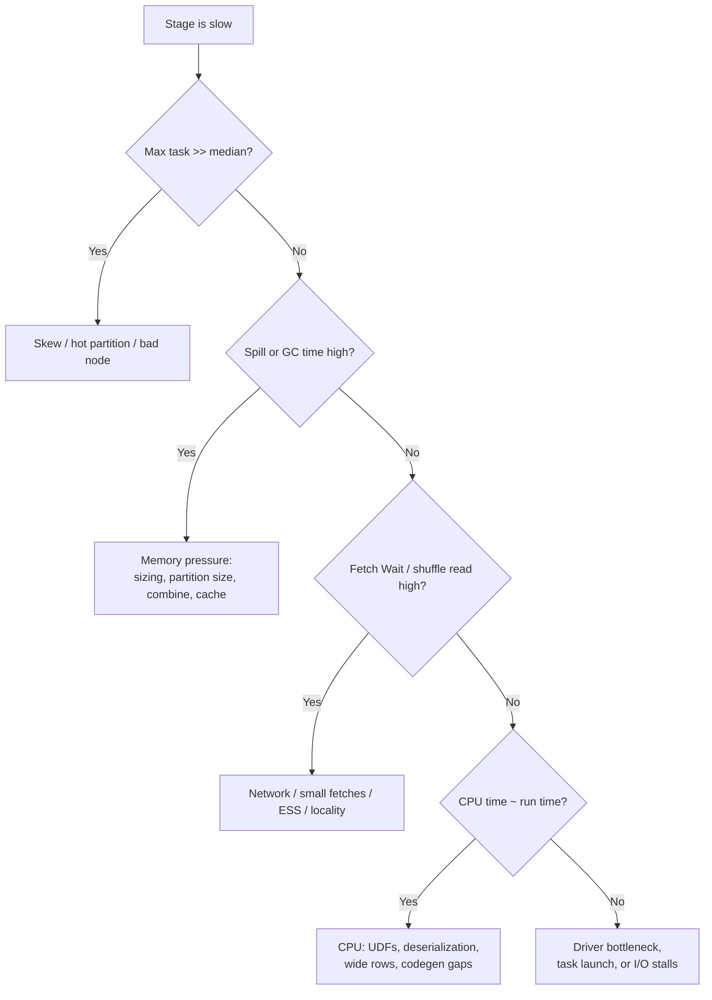

# 09 - JVM, GC & Performance Diagnostics

**Priority:** P1
**Versions:** Apache Spark **3.5.0**, Java **8/11/17**.
**Sources:** [SOURCES.md](SOURCES.md) - full list at the end of this chapter.
**See also:** [02 - Memory Management & Disk Spilling](02%20-%20Memory%20Management%20&%20Disk%20Spilling.md), [03 - Tungsten, Serialization & Data Representation](03%20-%20Tungsten,%20Serialization%20&%20Data%20Representation.md), [04 - Shuffle, Partitioning & Network Transfer](04%20-%20Shuffle,%20Partitioning%20&%20Network%20Transfer.md).

**TL;DR:** Spark runs in JVMs, so every performance problem eventually shows up in one of four places: **CPU** (deserialization, codegen, UDFs), **memory** (spill, GC, OOM), **I/O** (shuffle, files, disk), or **scheduling** (skew, waiting, driver bottleneck). The diagnostic skill is not "tune the JVM" - it is **reading the task metrics and stage distributions to identify which of the four it is**, then fixing the cause (layout, partitioning, serializer, memory sizing, or parallelism). Interview skill: walk a symptom ("tasks slow, GC time high") to a cause and a fix without guessing flags.

---

## 1. Why It Exists (The One Idea)

Spark's abstractions hide the JVM until something hurts. Then the JVM is exactly where the pain is:

- Objects -> allocation -> **GC pauses** (why Tungsten exists).
- Heap -> unified pool -> **spills/OOM** (chapters 02, 07).
- Deserialization -> CPU burn on cached/shuffled data.
- Threads -> one per core -> **contention** and task queueing.
- Class loading/codegen -> **metaspace** growth.

> Performance diagnosis = locate the bottleneck in the **task lifecycle**: deserialize -> read -> compute -> write -> serialize -> GC, and compare across tasks (distribution, not averages).

**Memory hook:** *"Average task time lies; the median tells you the workload, the max tells you the skew, and the gap tells you the cost."*

---

## 2. The Executor JVM: What Actually Takes Space

Before diagnosing anything, hold the mental map of where memory actually goes. Almost every "Spark memory" discussion conflates heap, pool, off-heap, and container overhead - and each of those regions has its own distinct failure mode.

| Region | Contents | Failure mode |
|--------|----------|--------------|
| Heap: young gen (Eden/Survivor) | Short-lived objects: rows, deserialized records, temporary buffers | High allocation rate -> frequent minor GCs; promotion -> old-gen pressure |
| Heap: old gen | Long-lived objects: cached deserialized data, broadcast structures, plans | Full GC pauses; `GC overhead limit exceeded` |
| Spark unified pool (inside heap) | Execution + storage (chapter 02) | Spill / eviction |
| Off-heap | `Unsafe` memory: Tungsten pages, off-heap cache (`spark.memory.offHeap`) | Native OOM; invisible to heap profilers |
| Metaspace | Class metadata: generated codegen classes, UDF/closure classes, libraries | Metaspace leak/OOM after many query shapes |
| Container overhead | JVM internals, threads stacks, direct buffers, Python workers | Container kill despite "free" heap (`memoryOverhead`) |

Modern JDKs matter:

- Spark 3.5 supports Java 8/11/17; **Spark 4.0 requires JDK 17+** and supports Scala 2.13 [RN 4.0].
- Spark 4.2 adds **Java 25** support [RN 4.2].
- G1 is the default collector on modern JDKs; Spark's tuning guide recommends G1 for large executor heaps (measure, don't cargo-cult flags).

---

## 3. Reading the Task Metrics (The Core Skill)

Spark records per-task metrics; the Stage page aggregates them. Learn the meaning of each:

| Metric | What it captures | High value means |
|--------|------------------|------------------|
| Executor Run Time | Actual task computation | CPU-bound work, codegen/UDF cost |
| Executor CPU Time | CPU consumed (vs wall clock) | CPU saturation; compare to run time for I/O waits |
| Executor Deserialize Time | Reading/serializing task & data | Java serialization, large closures, wide rows |
| Result Serialization Time | Serializing result to driver | Large `collect()`/driver-bound results |
| JVM GC Time | Per-task GC time | Heap pressure/object churn (chapter 02) |
| Peak Execution Memory | Max execution memory used | Aggregation/sort/join memory footprint |
| Memory/Disk Spill | Spill bytes | Execution memory pressure (chapter 02) |
| Shuffle Read/Write Size, Records | Bytes/records moved | Shuffle cost (chapter 04) |
| Fetch Wait Time | Time blocked fetching | Network/ESS/straggler hosts |
| Input Size / Records | Scan volume | Partitioning/column pruning effectiveness (chapter 07) |

Two comparison rules:

1. **Compare CPU time to run time.** CPU ≈ run time -> compute-bound. Run time >> CPU time -> waiting on I/O/fetch/GC.
2. **Compare median to max.** Similar -> uniform work. Max >> median -> skew or a bad executor/host.

**Concrete example: one stage, two diagnoses.** A 200-task stage has median 12 s, max 95 s, CPU time 11 s, GC time 1 s, and fetch wait 2 s. The max is ~8x the median, so start with skew or a bad host, not GC. If the median task instead shows run time 12 s, CPU 3 s, GC 8 s, and no fetch wait, the bottleneck is memory/GC: the task is mostly collecting, not computing. Same stage page, two different fixes.

---

## 4. The Four Bottlenecks And Their Signatures

Diagnosis is a sequence of comparisons, not a hunt for a magic flag. The decision tree below is the one to walk out loud in an interview; each branch is decided by a metric you can read in the UI, and only the leaves involve changing anything.

| Bottleneck | Primary evidence | Typical causes | Typical fixes |
|-----------|------------------|----------------|---------------|
| **CPU** | CPU time ≈ run time; no spill/fetch | Row-at-a-time Python UDFs, Java serialization, regex/string work, missing codegen | Built-ins instead of UDFs, Arrow/Pandas UDFs, Kryo/UnsafeRow, fewer/wider rows |
| **Memory** | GC time, spills, Peak Execution Memory | Too many concurrent sorters, wrong partitions, cached objects, huge broadcasts | More pool/fewer cores per executor, combine earlier, reduce partition size, unpersist |
| **I/O/Network** | Fetch Wait, remote reads, long shuffle write | Many small fetches, skew, no locality, ESS overload, small files | Contiguous fetch/push shuffle, coalescing, compaction, host-local reads |
| **Scheduling** | Gaps in timeline, launch latency, waiting tasks | Too many tasks, driver overload, FIFO starvation, locality wait | Fewer/larger partitions, FAIR pools, driver sizing, reduce task count |

---

## 5. GC In Practice: Symptoms, Causes, Levers

**Symptoms**

- "GC Time" high relative to run time; long stage tasks with low CPU.
- Logs: frequent full GCs, long pause warnings, `GC overhead limit exceeded`.
- Executors OOM-killed or lost during large shuffles/caches.

**Causes**

1. **Object-heavy paths**: RDD API with Java serialization, user objects in Datasets, `collect()`/`toPandas()` materialization, cached deserialized blocks.
2. **Too much live data in heap**: large caches, broadcasts, or execution structures.
3. **Too many small objects**: wide schemas, string parsing, per-row UDFs.
4. **Heap too large relative to pause requirements** (collector-dependent).

**Levers (in order of preference)**

1. **Use the binary path**: DataFrames/SQL, whole-stage codegen, `UnsafeRow` - less garbage per row (chapter 03).
2. **Fix memory pressure**: sizing, partition sizes, combine, cache policy (chapters 02/07).
3. **Choose the serializer**: Kryo + registration instead of Java serialization for RDDs.
4. **Batch Python work**: Arrow/Pandas UDFs instead of row-at-a-time.
5. **JVM/GC tuning**: only after locating the cause; G1 for large heaps; GC logging; avoid random flag collections.

**Do not** "fix" GC by just adding heap: bigger heap often means longer full-GC pauses and hides the allocation problem. Diagnose first.

---

## 6. Driver-Side And Boundary Costs

| Cost | Where it shows | Fix |
|------|----------------|-----|
| Large `collect()` | Driver OOM, result serialization time | Aggregate first; `spark.driver.maxResultSize`; write to storage |
| Big broadcasts | Driver memory, broadcast timeout, executor memory | Filter/aggregate the dimension; raise/lower threshold deliberately |
| Too many tasks | Driver planning/serialization/launch latency | Coalesce partitions; AQE; fewer stages |
| Giant logical plans | Driver CPU/GC during planning | Simplify queries, avoid deeply nested views/CTEs |
| Python worker memory | Container kills, Python OOM (not JVM GC) | `spark.python.worker.memory`, Arrow batching, fewer Python objects |
| Off-heap growth | Container kill with healthy heap | Size `spark.memory.offHeap.size` + `memoryOverhead` explicitly |

**Interview point:** the driver is a JVM too; "executor GC tuning" advice doesn't fix a driver overloaded with `collect()` or plan construction.

---

## 7. Tooling: From Spark UI To Flames

| Tool | Use |
|------|-----|
| Spark UI Jobs/Stages/Executors/SQL | First stop: where time went, task distribution, spill/GC/shuffle metrics |
| Event log + History Server | Post-mortem timeline, executor churn, retries |
| Spark REST API | Automate extraction of metrics/progress |
| Spark metrics sinks (JVM, executor, driver) | Export to Prometheus/Grafana/Graphite for trends |
| GC logs (`-Xlog:gc*` on JDK 9+) | Pause distribution, promotion failures, humongous allocations |
| JFR / async-profiler | CPU/alloc/lock flame graphs on executor/driver JVMs |
| `jstack`, `jmap`, heap dumps (`-XX:+HeapDumpOnOutOfMemoryError`) | Deadlocks, leaks, object histograms |
| Cluster manager UI (YARN RM / K8s) | Preemption, container kills, queue waits |

Practical flow: **Spark UI -> stage/task distribution -> metrics (CPU vs GC vs fetch) -> one JVM profile -> one fix -> re-measure.**

---

## 8. Failure Modes You Should Recognize Instantly

A handful of failure signatures are so common that recognizing them is practically a vocabulary. The table below is the shortlist; each row has exactly one first check, which is the part interviewers listen for.

| Signature | Likely cause | First check |
|-----------|--------------|-------------|
| `java.lang.OutOfMemoryError: Java heap space` | Pool + non-pool heap exhausted | Executor memory, caches, broadcast sizes, spills |
| Container killed / OOMKilled, heap healthy | Off-heap + overhead exceeded container | `memoryOverhead`, off-heap size, Python workers |
| `GC overhead limit exceeded` | JVM spends most time collecting with little reclaim | Live set size (cache/broadcast), allocation churn |
| `Metaspace` OOM | Too many generated classes/classloaders | Query shapes, UDF registration, repeated codegen |
| `Too many open files` | Shuffle/cache files, sockets | `ulimit`, file counts, partition counts |
| Tasks stuck in `Fetch waiting` | Network/ESS/straggler host | Fetch Wait metric, host distribution, ESS load |
| Driver "stuck" with all tasks finished | Driver processing results/building plans | Event loop thread dump, result sizes |
| One task runs for hours | Skew or poison record | Max vs median, key distribution, retries |

---

## 9. Version Notes

JVM and diagnostics guidance changed meaningfully with Spark 4.x because the JDK floor moved. Note where older tuning advice stops applying, and treat this table as a compatibility layer for advice you find in the wild.

| Version | Change | Diagnostic impact |
|---------|--------|-------------------|
| 1.6 | Unified memory + off-heap execution (experimental) [RN 1.6] | Heap vs off-heap split becomes a sizing decision |
| 2.0 | Tungsten runtime; less object churn | Many "GC problems" become data-shape problems |
| 3.x | AQE/skew join (3.0+), vectorized readers | Fewer skew/task-count symptoms to fix manually |
| 4.0 | JDK 17+ required; Scala 2.13 [RN 4.0] | GC defaults change; old JDK flags/recipes may not apply |
| 4.1 | Netty native IO by default [RN 4.1] | Network stack diagnostics shift (native transports) |
| 4.2 | Java 25 support [RN 4.2] | Newer collectors available; re-validate tuning |

---

## 10. The One-Page Recap (memorize this)

1. Four bottlenecks: CPU, memory, I/O/network, scheduling. Metrics tell you which.
2. CPU time ≈ run time = compute-bound; run time >> CPU time = waiting.
3. Max >> median = skew/bad host; similar tasks = systemic cost.
4. GC pain usually means object churn or live-set size - fix representation/sizing before flags.
5. Spill = execution memory pressure; container kills despite healthy heap = off-heap/overhead.
6. Driver is a JVM: collect/broadcast/plan costs surface there.
7. Diagnostic order: UI -> stage/task distribution -> metric (CPU/GC/fetch/spill) -> profile -> fix -> verify.

---

## 11. Drills (Cover The Answer Column)

| # | Question | Answer |
|---|----------|--------|
| 1 | Four bottleneck categories? | CPU, memory, I/O/network, scheduling |
| 2 | How do you detect compute-bound tasks? | CPU time close to executor run time; no dominant fetch/spill/GC |
| 3 | What does max >> median task time indicate? | Skew, hot key, or a bad executor/host |
| 4 | GC time high but no spills? | Non-pool heap churn/live set: caches, broadcasts, deserialized objects, object-heavy API |
| 5 | Executor killed but heap not full? | Container physical limit: off-heap + overhead (+ Python workers) |
| 6 | Why can adding heap make GC worse? | Longer full-GC pauses; it hides allocation pressure instead of removing it |
| 7 | First fix for row-at-a-time Python UDFs? | Rewrite as built-ins or Arrow/Pandas UDFs; batching removes per-row JVM<->Python overhead |
| 8 | What does Peak Execution Memory tell you? | Max execution memory held by a task (sort/aggregate/join structures) |
| 9 | What does Fetch Wait Time indicate? | Blocked time waiting for shuffle blocks - network/ESS/stragglers |
| 10 | Why is driver GC a thing? | Plans, broadcasts, collect results, task serialization all live in the driver JVM |
| 11 | Evidence of Java serialization being the bottleneck? | High deserialize/serialization time, low CPU efficiency, RDD API + default serializer |
| 12 | What tool gives CPU flame graphs on executors? | async-profiler or JFR (attached to executor JVMs) |
| 13 | What changed for JVM diagnostics in 4.0? | JDK 17+ requirement; modern GC defaults/logging (`-Xlog`) |
| 14 | When do you tune GC flags? | After confirming GC is the bottleneck and fixing allocation/live-set causes |
| 15 | What's the fastest way to find skew? | Compare max vs median task duration/read size on the stage page |

---

## 12. Key Source Classes (pin refs to a tag, e.g. `apache/spark@v3.5.0`)

| Class | Module | Role |
|-------|--------|------|
| `TaskMetrics`, `ExecutorMetrics` | `core/.../executor/` | Per-task/per-JVM metrics (GC, spill, shuffle, CPU) |
| `SparkEnv` | `core/.../` | Executor runtime container (memory manager, block manager, etc.) |
| `MemoryManager`, `TaskMemoryManager` | `core/.../memory/` | Pool allocation + spill calls (chapter 02) |
| `MetricsSystem`, `SparkUI`, `AppStatusStore` | `core/.../metrics/`, `core/.../ui/` | Observability plumbing |
| `Utils` (GC time helpers, size estimation) | `core/.../util/` | Metric collection utilities |
| `Executor` | `core/.../executor/` | Task threads, heartbeats, metrics reporting |
| `DAGSchedulerEventProcessLoop` | `core/.../scheduler/` | Driver-side event processing (driver bottleneck) |

---

## 13. Sources Used

- [S6](SOURCES.md) *The Internals of Apache Spark* - executor architecture, metrics, memory, task lifecycle
- [S7](SOURCES.md) *The Internals of Spark SQL* - planner/driver-side costs, operator memory
- [RN 1.6 / 2.0 / 4.0 / 4.1 / 4.2](SOURCES.md) - unified/off-heap memory, JDK requirements, Netty native IO, Java 25
- Official tuning and configuration documentation (apache.org) - task metrics definitions, G1 guidance for large heaps, memory overhead, `spark.python.worker.memory`
- [Appendix B](Appendix%20B%20-%20Optimization%20Evolution%20Map.md) - Campaign 3 (CPU/Tungsten) and Campaign 2 (memory) for narrative context
