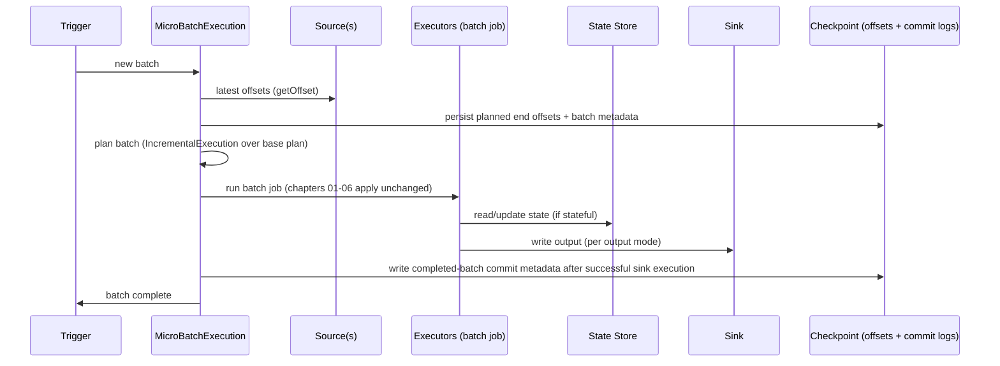

# 10 - Structured Streaming Internals

**Priority:** P1
**Versions:** Apache Spark **3.5.0**, micro-batch processing.
**Sources:** [SOURCES.md](SOURCES.md) - full list at the end of this chapter.
**See also:** [01 - Execution Architecture & Scheduling](01%20-%20Execution%20Architecture%20&%20Scheduling.md), [08 - Fault Tolerance, Resource Scheduling & Multi-Tenancy](08%20-%20Fault%20Tolerance,%20Resource%20Scheduling%20&%20Multi-Tenancy.md), [11 - Delta Lake & Connector Internals](11%20-%20Delta%20Lake%20&%20Connector%20Internals.md).

**TL;DR:** In Spark **3.5.0 micro-batch processing**, each trigger obtains source end offsets -> **persists planned offsets** -> executes the batch with state and sink writes -> **records completed-batch metadata**. Replayable inputs, recoverable state and sink replay deduplication enable exactly-once effects. The built-in Kafka sink is at-least-once.

---

## 1. Why It Exists (The One Idea)

Streaming is hard because state, time, and failure interleave. Structured Streaming's trick [S5 lineage]: **treat the stream as a table that grows**, and process it as a series of ordinary Spark SQL jobs:

> A stream is an incrementally planned query. Planned offsets, completed-batch logs and versioned state drive recovery; the sink handles replayed effects using its transaction/idempotency protocol.

Micro-batch triggers are loop iterations; properly configured operators use watermarks/time bounds for cleanup; durable checkpointing records progress.

**Memory hook:** *"Offsets say how far we got; state says what we remember; the sink must tolerate a replay."*

---

## 2. The Model: Unbounded Table, Output Modes, Triggers

The model is deliberately small: a table, a trigger, a mode, a watermark. Almost every streaming question can be answered by locating the case in this model first, before touching any mechanics.

| Concept | Meaning |
|---------|---------|
| Unbounded table | Input stream = table with rows appended over time |
| **Output mode** | `append` (only new rows), `update` (changed rows only), `complete` (whole result each batch) |
| **Trigger** | `default` (as fast as possible), `processingTime="10 seconds"`, `availableNow` (drain what's available, then stop), `once` (deprecated) |
| **Watermark** | Event-time threshold used by each operator's late-data and finalization rules |
| **Stateful operators** | Aggregations, dedup, stream-stream joins, arbitrary state (`mapGroupsWithState`/`flatMapGroupsWithState`), session windows |
| **Sources/sinks** | Kafka, files, rate, socket; file/HDFS, Kafka, `foreachBatch`, Delta/Iceberg table sinks |

Two rules that decide most designs:

1. **Output mode and retained state**: aggregations/joins/dedup can retain state in append mode; complete-mode aggregation keeps the whole result.
2. **State size depends on keys, rate, window/join ranges and effective retention**; configure cleanup for each operator.

---

## 3. Architecture: The Micro-Batch Loop

The loop below is the entire engine in one picture. If you can narrate it while pointing at the checkpoint directory, you have already answered most Structured Streaming internals questions.

Components:

| Component | Role |
|-----------|------|
| `StreamingQuery` / `StreamingQueryManager` | User-facing lifecycle (`start`, `awaitTermination`, `stop`) |
| `MicroBatchExecution` | The loop: offsets -> plan -> execute -> commit |
| `IncrementalExecution` | Plans each batch on top of the previously planned state/result |
| `OffsetSeqLog`, `CommitLog` | Durable offsets + completed-batch metadata in the checkpoint dir |
| `StateStore` (per operator) | Versioned state keyed by operator/partition/key, with operator-specific cleanup |
| `WatermarkTracker` | Global low watermark across operators |
| Sources/sinks | Replayable inputs, idempotent/transactional outputs |

**Checkpoint directory contents** (the interview favorite): metadata, offsets log, commits log, state store snapshots/deltas (per `state` operators), and source-specific metadata. Move it and the query restarts from scratch; corrupt it and recovery fails.

---

## 4. State Stores

State is the part of streaming that does not fit a batch mindset, so it gets its own storage engine. The implementations differ mainly in how they scale and how they checkpoint - the correctness contract stays the same.

| Implementation | Since | Notes |
|----------------|-------|-------|
| HDFS-backed state store | 2.0 | Default; versioned files in the checkpoint dir; snapshots + deltas |
| RocksDB state store | 3.2 [RN 3.2] | Local RocksDB + checkpoint to DFS; better for large state and more predictable latency |
| Changelog checkpointing | 3.5 [RN 3.5] | Uploads state changes continuously instead of snapshot bursts - shorter checkpoint pauses |

State store mechanics worth knowing:

- State is **partitioned** and versioned; each micro-batch reads version N, writes version N+1, and commits.
- **Watermark eviction** finalizes/removes eligible state according to the operator/output mode, such as a window's end time.
- **State schema is fixed** at query start; changing the state type/key typically means changing `checkpointLocation` and reprocessing from scratch (or a state-migration tool).
- State metrics (rows, bytes, used memory) appear in the Streaming UI's progress data - they're your state-growth alarm.

---

## 5. Time, Watermarks & Late Data

Event time is the data's clock; processing time is the engine's clock (also used for processing-time timeouts). `withWatermark(eventTimeCol, delay)` supplies an event-time threshold, but **the lateness guarantee is one-sided**: sufficiently recent data (within the configured delay) will not be dropped for lateness; older data **may or may not** be processed. Cleanup depends on the operator, window/time predicates, output mode and effective watermark advancement. Multiple inputs use a global policy (minimum by default); an idle input can stall advancement.

**Example.** Batch 42 records Kafka end offset 13 before executing offsets `[5,13)`; sink success is followed by batch completion. With maximum event time 10:25 and a 10-minute delay, the candidate watermark is 10:15; effective operator watermarks advance at batch boundaries. A 10:12 event can still update a live `[10:10,10:20)` window at watermark 10:15 because cleanup follows **window end**. Complete-mode aggregation retains the full result.

### State / retention / API matrix (Spark 3.5.0)

| Operator / API | Required or optional time conditions | Cleanup / output-mode contract | Unbounded-state risk |
|----------------|--------------------------------------|--------------------------------|----------------------|
| Window aggregation, append | Watermark on grouping event-time column before aggregation required to finalize output | Emit final windows and evict when effective watermark passes window end | Stalled watermark or unbounded keys within live windows |
| Window aggregation, update | Watermark optional; proper grouping/time placement needed for cleanup | Update live results; eligible window state can be removed | Without cleanup conditions, state accumulates |
| Aggregation, complete | Retains the complete result | Entire result retained/emitted | Full result grows with cardinality |
| `dropDuplicates` / `dropDuplicatesWithinWatermark` (3.5) | Without watermark, remember all keys; with watermark use API-specific event-time/dedup-key rules | Within-watermark API bounds remembered IDs by event-time delay; duplicates outside its guarantee may recur | Unbounded without effective retention; choose delay for duplicate timestamp spread |
| Inner stream-stream join | Watermarks/time-range predicates optional for validity; needed to bound both sides | Each side's cleanup derives from opposite watermark and join-time bounds; append output | No finite time constraints or stalled input => retained join state |
| Left/right/full outer stream-stream join | Appropriate watermark and time-range conditions required (both sides for full outer; see join support matrix) | Unmatched output waits until no future match is possible; batch progress required | Delayed/null output and state growth if watermarks stall |
| `mapGroupsWithState` / `flatMapGroupsWithState`, processing-time timeout | Timeout mode and per-key timeout duration set by application | Callback after timeout when triggers run; application must remove/update state | No trigger or no removal => retained state; not an event-time guarantee |
| Same APIs, event-time timeout | Watermark plus per-key timeout timestamp required | Timeout after effective watermark passes timestamp; application removes state | Stalled watermark or application retention |
| Native `session_window` (since 3.2) aggregation | Built-in SQL/DataFrame session grouping; watermark needed for bounded finalization | Sessions merge by event-time gaps; append/complete supported, **update not supported in 3.5** | No watermark, stalled progress or continually extended sessions |

The [pinned streaming guide](https://github.com/apache/spark/blob/v3.5.0/docs/structured-streaming-programming-guide.md) lists watermark placement and output-mode/join support for these APIs.

**Memory hook:** *"Watermarks protect recent data; operators decide finalization."*

---

## 6. Exactly-Once: The Contract

Exactly-once holds when **all three** are true:

1. **Replayable source**: the engine can re-read from recorded offsets (Kafka, files, Delta).
2. **Checkpointed state**: aggregation/join state can be reconstructed from the checkpoint at the last committed batch.
3. **Replay-safe sink protocol**: output already committed before Spark records completion must be deduplicated on batch replay; transactionality alone is insufficient.

| Sink | Guarantee |
|------|-----------|
| File sink (HDFS/cloud files) | Exactly-once via commit log + file commit protocol |
| Built-in Kafka sink | **At-least-once**; Spark batch replay can republish records as new producer sends |
| `foreachBatch` custom sink | At-least-once callback; use stable query/application identity + batch ID and atomic dedup/output (or genuinely idempotent MERGE semantics) |
| Delta / other transactional table sinks | Connector-specific replay protocol; Delta commits application/batch transaction identifiers with file actions (chapter 11) |

Failure/recovery flow: restart -> read checkpoint -> resume from last offset -> replay the uncommitted batch -> commit -> continue. With `foreachBatch`, batch re-execution is the reason idempotency is your job.

| Crash point | Spark recovery with intact checkpoint | Required sink behavior |
|-------------|---------------------------------------|------------------------|
| Planned offsets durable, before sink output | Re-execute same batch/ranges | Handle retries/partial task effects; no assumed external rollback |
| Sink commit succeeded, before Spark completion log | Replay same batch; Spark cannot infer external commit from offsets alone | File sink metadata / Delta txn dedup avoids duplicate effects; Kafka or naive callback may duplicate |
| Spark completion log durable | Continue with next batch | Earlier output already durable under that sink's contract; retention must preserve recovery data |

Source offsets identify input ranges; Kafka offsets are per topic/partition with exclusive end offsets. **Batch IDs identify query-local executions**. Stable application/query identity plus batch ID supplies a replay key. A new checkpoint resets batch numbering, so coordinate the application identity with the sink (see the Delta replay example).

---

## 7. Triggers, Throughput & Latency

Triggers are the control surface for latency, cost, and backlog. The table below is the menu; the latency formula after it is worth reciting verbatim, because it explains why every streaming system eventually trades one for another.

| Trigger | Behavior | Use |
|---------|----------|-----|
| Default micro-batch | Next batch immediately | Max throughput; latency = batch duration |
| `processingTime` | Fixed cadence | Predictable load; easier backlog control |
| `availableNow` | Process all available data, then stop | Scheduled/backfill jobs with stream semantics |
| Continuous (2.3, experimental) | Long-running tasks, epoch markers | Very low latency; restricted operators |
| Real-Time Mode (4.1) | Stateless sub-second pipelines; single-digit ms reported [RN 4.1] | Latency-sensitive stateless forwarding |

Backpressure/rate control: `maxOffsetsPerTrigger` (Kafka), `maxFilesPerTrigger` (files) bound how much a batch ingests - the practical answer to "how do I protect the cluster from a backlog burst?"

Latency math to say out loud: **end-to-end latency ≈ trigger interval + batch execution time + sink commit**, and batch execution time includes reading the *entire* backlog a trigger consumed - so throughput-limited clusters trade latency automatically.

---

## 8. Failure Behavior & Traps

Streaming failures almost always replay something, and replay is where exactly-once is won or lost. The table below is organized by "what gets replayed and what the sink must promise" - read it that way and the rows stop looking unrelated.

| Situation | Behavior | Notes |
|-----------|----------|-------|
| Executor loss mid-batch | Failed tasks retry; fetch failures may recover stages; query restart can replay batch | Sink transaction/idempotency protocol handles repeated effects |
| Driver restart | Resume from checkpoint at last committed batch | Replays uncommitted batch -> needs idempotent sink |
| Checkpoint lost/corrupt | Cannot resume; start new query (may reprocess or skip) | Treat checkpoint dir as critical data |
| State schema change | Query fails on restart | New checkpoint location or migration tooling |
| No effective state retention | State can grow unboundedly | Watermark/time conditions or application-controlled timeouts/removal; a declaration alone may not suffice |
| Kafka rebalance | New partitions assigned -> offsets from checkpoint | Spark manages offsets; Kafka consumer groups not the source of truth |
| Sink not idempotent + replay | Duplicates | Fix with dedup keys/MERGE/transactions |
| Late data beyond delay | May be processed or dropped depending on operator/window/mode | Measure dropped-row/state metrics; define required lateness policy |
| Small files from streaming | Many tiny output files | Compact periodically; table formats help |

---

## 9. Observability

Streaming observability is a small, well-defined set of signals. Learn the four thresholds that should page you and you can operate a pipeline without ever reading a thread dump.

| Signal | Where | Meaning |
|--------|-------|---------|
| Input rate / Process rate | Streaming tab | Can the query keep up? (process < input = backlog) |
| Batch duration vs trigger interval | Streaming tab | Falling behind schedule |
| Watermark | Progress JSON/UI | How late data can still arrive; state retention bound |
| State rows/bytes per operator | Streaming tab (progress) | State growth trend; eviction working? |
| Sources/sinks stats | Progress JSON (`StreamingQueryProgress`) | Offsets processed, sink timing |
| `lastProgress` / listener events | App/`StreamingQueryListener` | Programmatic monitoring + alerting |
| Checkpoint dir size | Filesystem | Snapshot/changelog growth |

Rule: alerts should fire on **processRate < inputRate sustained**, **batch duration > interval**, and **state growth with flat watermark**.

---

## 10. Version Notes

Experimental continuous processing uses at-least-once delivery; the micro-batch recovery protocol is described above.

| Version | Change | Impact |
|---------|--------|--------|
| 1.6 | `mapWithState` ~10x faster than `updateStateByKey` (DStream era) [S14] | Historical lineage: stateful streaming got practical before Structured Streaming |
| 2.0 | Structured Streaming GA: micro-batch, checkpointing, file/Kafka sources | The unbounded-table model ships |
| 2.3 | Continuous processing (experimental); stream-stream joins [RN 2.3] | Low-latency path + joinable streams |
| 3.2 | RocksDB state store [RN 3.2] | Large-state workloads get a predictable engine |
| 3.5 | Changelog checkpointing [RN 3.5] | Faster/reliable checkpoints for big state |
| 4.1 | Real-Time Mode (stateless, sub-second); declarative pipelines (SDP) [RN 4.1] | Latency tier below micro-batch; pipeline-level abstraction |

---

## 11. The One-Page Recap (memorize this)

1. Structured Streaming = unbounded table + repeated batch planning (`MicroBatchExecution` + `IncrementalExecution`).
2. Checkpoint = offsets + commits + state; it is the source of truth for progress.
3. Exactly-once effects need retained replayable source + recoverable state + sink replay dedup; transactionality alone is insufficient.
4. Output modes: append/update/complete; micro-batch triggers: default/processingTime/availableNow.
5. Watermarks give a one-sided lateness guarantee; cleanup depends on operator/mode/time bounds and progress. Native session_window exists since 3.2.
6. State stores: HDFS-backed (default), RocksDB (3.2), changelog checkpointing (3.5).
7. Built-in Kafka is at-least-once; foreachBatch uses application-owned replay deduplication; Delta uses txn identities.

---

## 12. Drills (Cover The Answer Column)

| # | Question | Answer |
|---|----------|--------|
| 1 | What is the core execution model? | Micro-batches of a normal SQL plan over an unbounded table |
| 2 | What's in the checkpoint directory? | Metadata, offsets log, commit log, state store data, source metadata |
| 3 | Three requirements for exactly-once effects? | Retained replayable source, recoverable checkpointed state, sink protocol deduplicating batch replay |
| 4 | Does producer idempotence make the built-in Kafka sink exactly-once? | No; it remains at-least-once across Spark batch replay |
| 5 | What does a watermark guarantee? | Recent data within delay is not dropped for lateness; older data may or may not be processed; operator/mode controls cleanup |
| 6 | Which joins need watermarks? | Inner joins allow none but need time bounds/watermarks for bounded state; outer joins require appropriate watermark/time conditions for unmatched output |
| 7 | Output mode differences? | Append: new rows only; update: changed rows; complete: full result per batch |
| 8 | When use `availableNow`? | Scheduled/backfill processing with stream semantics; drains then stops |
| 9 | What is checkpoint ordering? | Planned offsets before execution; successful state/sink work before completed-batch metadata; failures can replay external effects |
| 10 | What happens if checkpoint state schema changes? | Restart fails; new checkpoint or migration required |
| 11 | How do you control burst ingestion? | `maxOffsetsPerTrigger` (Kafka), `maxFilesPerTrigger` (files) |
| 12 | What's the latency formula? | Trigger interval + batch execution + sink commit |
| 13 | Why is `foreachBatch` dangerous with exactly-once? | Batch replay duplicates non-idempotent side effects unless you dedup/MERGE |
| 14 | 3.2 vs 3.5 state store changes? | RocksDB state store (3.2); changelog checkpointing (3.5) |
| 15 | What changes when a query starts with a new checkpoint? | Batch numbering resets; use a new sink application identity so earlier batch IDs remain distinct |
| 16 | What metrics alarm on backlog? | Process rate < input rate; batch duration > trigger interval |

---

## 13. Key Source Classes (pin refs to a tag, e.g. `apache/spark@v3.5.0`)

| Class | Module | Role |
|-------|--------|------|
| `StreamingQuery`, `StreamingQueryManager`, `StreamingQueryListener` | `sql/core/.../streaming/` | Lifecycle, events, progress |
| `MicroBatchExecution` | `sql/core/.../execution/streaming/` | The micro-batch loop |
| `IncrementalExecution` | `sql/core/.../execution/streaming/` | Per-batch planning |
| `OffsetSeqLog`, `CommitLog` | `sql/core/.../execution/streaming/` | Durable progress |
| `StateStore`, `HDFSBackedStateStoreProvider`, `RocksDBStateStoreProvider` | `sql/core/.../execution/streaming/state/` | State implementations |
| `WatermarkTracker` | `sql/core/.../execution/streaming/` | Global event-time tracking |
| `KafkaSource`, `FileStreamSource` | `connector/kafka-0-10-sql/`, `sql/core/.../sources/` | Sources |
| `FileStreamSink` | `sql/core/.../execution/streaming/` | Exactly-once file sink |

---

## 14. Sources Used

- [S5](SOURCES.md) Discretized Streams (HotCloud '12 / SOSP '13) - lineage of Spark's streaming model
- [S14](SOURCES.md) Announcing Apache Spark 1.6 (Databricks, 2016) - `mapWithState` ~10x (historical DStream state)
- [RN 2.3 / 3.2 / 3.5 / 4.1](SOURCES.md) - continuous processing and stream-stream joins, RocksDB state store, changelog checkpointing, Real-Time Mode/SDP
- Official Structured Streaming programming guide (apache.org) - output modes, triggers, watermarks, exactly-once semantics, state store configurations
- [Appendix B](Appendix%20B%20-%20Optimization%20Evolution%20Map.md) - Campaign 6 (streaming/platform) context
