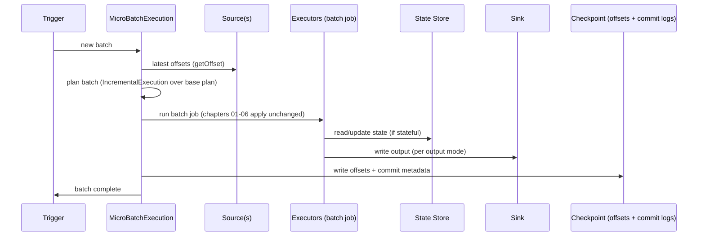

# 10 - Structured Streaming Internals

**Priority:** P1
**Versions:** 1.6 (mapWithState) / 2.0 (GA) -> 4.2
**Sources:** [SOURCES.md](SOURCES.md) - full list at the end of this chapter.
**See also:** [01 - Execution Architecture & Scheduling](01%20-%20Execution%20Architecture%20&%20Scheduling.md), [08 - Fault Tolerance, Resource Scheduling & Multi-Tenancy](08%20-%20Fault%20Tolerance,%20Resource%20Scheduling%20&%20Multi-Tenancy.md), [11 - Delta Lake & Connector Internals](11%20-%20Delta%20Lake%20&%20Connector%20Internals.md).

**TL;DR:** Structured Streaming runs an **unbounded table** as a sequence of incrementally planned batches over a normal Spark SQL plan. Each trigger: read new offsets -> plan the batch against the evolving result -> execute -> update state -> write to the sink -> **commit offsets to the checkpoint**. Exactly-once is a three-part contract: replayable source offsets + checkpointed state + idempotent or transactional sink. Interview skill: draw the micro-batch loop, explain what's in the checkpoint directory, and explain when exactly-once actually holds (and when it silently becomes at-least-once).

---

## 1. Why It Exists (The One Idea)

Streaming is hard because state, time, and failure interleave. Structured Streaming's trick [S5 lineage]: **treat the stream as a table that grows**, and process it as a series of ordinary Spark SQL jobs:

> A stream is an infinite, repeatedly planned batch query. Correctness comes from recording what was processed (offsets) and what state resulted (state store), so a restart can continue - not restart - no matter how it died.

Everything else follows from that: micro-batch triggers are just loop iterations; watermarks bound state by event time; checkpointing makes progress durable.

**Memory hook:** *"Offsets say how far we got; state says what we remember; the sink must tolerate a replay."*

---

## 2. The Model: Unbounded Table, Output Modes, Triggers

The model is deliberately small: a table, a trigger, a mode, a watermark. Almost every streaming question can be answered by locating the case in this model first, before touching any mechanics.

| Concept | Meaning |
|---------|---------|
| Unbounded table | Input stream = table with rows appended over time |
| **Output mode** | `append` (only new rows), `update` (changed rows only), `complete` (whole result each batch) |
| **Trigger** | `default` (as fast as possible), `processingTime="10 seconds"`, `availableNow` (drain what's available, then stop), `once` (deprecated) |
| **Watermark** | Event-time bound: state/results older than `max event time - delay` can be evicted/dropped |
| **Stateful operators** | Aggregations, dedup, stream-stream joins, arbitrary state (`mapGroupsWithState`/`flatMapGroupsWithState`), session windows |
| **Sources/sinks** | Kafka, files, rate, socket; file/HDFS, Kafka, `foreachBatch`, Delta/Iceberg table sinks |

Two rules that decide most designs:

1. **Only `append` can be truly stateless-ish**: update/complete modes require maintaining result state.
2. **State size is driven by key cardinality x watermark retention**, not by throughput.

---

## 3. Architecture: The Micro-Batch Loop

The loop below is the entire engine in one picture. If you can narrate it while pointing at the checkpoint directory, you have already answered most Structured Streaming internals questions.

Components:

| Component | Role |
|-----------|------|
| `StreamingQuery` / `StreamingQueryManager` | User-facing lifecycle (`start`, `awaitTermination`, `stop`) |
| `MicroBatchExecution` | The loop: offsets -> plan -> execute -> commit |
| `IncrementalExecution` | Plans each batch on top of the previously planned state/result |
| `OffsetSeqLog`, `CommitLog` | Durable offsets + completed-batch metadata in the checkpoint dir |
| `StateStore` (per operator) | Per-key state keyed by (operator, partition, key), evicted by watermark |
| `WatermarkTracker` | Global low watermark across operators |
| Sources/sinks | Replayable inputs, idempotent/transactional outputs |

**Checkpoint directory contents** (the interview favorite): metadata, offsets log, commits log, state store snapshots/deltas (per `state` operators), and source-specific metadata. Move it and the query restarts from scratch; corrupt it and recovery fails.

---

## 4. State Stores

State is the part of streaming that does not fit a batch mindset, so it gets its own storage engine. The implementations differ mainly in how they scale and how they checkpoint - the correctness contract stays the same.

| Implementation | Since | Notes |
|----------------|-------|-------|
| HDFS-backed state store | 2.0 | Default; versioned files in the checkpoint dir; snapshots + deltas |
| RocksDB state store | 3.2 [RN 3.2] | Local RocksDB + checkpoint to DFS; better for large state and more predictable latency |
| Changelog checkpointing | 3.5 [RN 3.5] | Uploads state changes continuously instead of snapshot bursts - shorter checkpoint pauses |

State store mechanics worth knowing:

- State is **partitioned** and versioned; each micro-batch reads version N, writes version N+1, and commits.
- **Watermark eviction** removes keys that can no longer be updated (late data beyond the watermark is dropped).
- **State schema is fixed** at query start; changing the state type/key typically means changing `checkpointLocation` and reprocessing from scratch (or a state-migration tool).
- State metrics (rows, bytes, used memory) appear in the Streaming UI's progress data - they're your state-growth alarm.

---

## 5. Time, Watermarks & Late Data

Time semantics are where streaming correctness lives, and two sentences carry most of the interview load. First: event time is the data's clock, processing time is only the trigger's cadence. Second: a watermark is an explicit statement of "how late is too late".

- `withWatermark(eventTimeCol, delay)` asserts: "events older than (max event time seen - delay) are late." Consequences:
  - Stateful aggregations can drop state for old keys -> bounded state.
  - Stream-stream joins require watermarks on both sides (+ a join-time condition) - otherwise state grows forever.
  - The low watermark gates when results can be emitted in `append` mode.
- **Event time vs processing time**: windows should always use event time; processing time is only the trigger cadence.
- **Late data policy is explicit**: with a watermark, late rows are dropped from state updates (they may still appear in stateless parts).
- Session windows: express via `flatMapGroupsWithState` with timeouts (or platform-specific window helpers).

**Concrete example: one batch and its watermark.** Batch 42 consumes Kafka records 5 through 12 and records those end offsets in the offset log before execution; after the sink commits, the commit log marks batch 42 done. If the maximum event time in the batch is 10:25 and the watermark delay is 10 minutes, the watermark becomes 10:15. An event with event time 10:12 arriving in the next batch is older than the watermark and is dropped from stateful aggregation; state for keys last seen before 10:15 can be evicted. A crash between the offset-log and commit-log writes replays records 5-12, which is why the sink must be idempotent or transactional.

**Memory hook:** *"No watermark, no bound; watermark = 'how late is too late'."*

---

## 6. Exactly-Once: The Contract

Exactly-once holds when **all three** are true:

1. **Replayable source**: the engine can re-read from recorded offsets (Kafka, files, Delta).
2. **Checkpointed state**: aggregation/join state can be reconstructed from the checkpoint at the last committed batch.
3. **Idempotent or transactional sink**: re-executing a committed batch's output must not duplicate effects.

| Sink | Guarantee |
|------|-----------|
| File sink (HDFS/cloud files) | Exactly-once via commit log + file commit protocol |
| Kafka sink | At-least-once by default; exactly-once with idempotent/transactional producer semantics |
| `foreachBatch` custom sink | Whatever you implement: dedup keys, MERGE, or transactional writes |
| Delta/Iceberg table sinks | Exactly-once via transactional table commits (chapter 11) |

Failure/recovery flow: restart -> read checkpoint -> resume from last offset -> replay the uncommitted batch -> commit -> continue. With `foreachBatch`, batch re-execution is the reason idempotency is your job.

---

## 7. Triggers, Throughput & Latency

Triggers are the control surface for latency, cost, and backlog. The table below is the menu; the latency formula after it is worth reciting verbatim, because it explains why every streaming system eventually trades one for another.

| Trigger | Behavior | Use |
|---------|----------|-----|
| Default micro-batch | Next batch immediately | Max throughput; latency = batch duration |
| `processingTime` | Fixed cadence | Predictable load; easier backlog control |
| `availableNow` | Process all available data, then stop | Scheduled/backfill jobs with stream semantics |
| Continuous (2.3, experimental) | Long-running tasks, epoch markers | Very low latency; restricted operators |
| Real-Time Mode (4.1) | Stateless sub-second pipelines; single-digit ms reported [RN 4.1] | Latency-sensitive stateless forwarding |

Backpressure/rate control: `maxOffsetsPerTrigger` (Kafka), `maxFilesPerTrigger` (files) bound how much a batch ingests - the practical answer to "how do I protect the cluster from a backlog burst?"

Latency math to say out loud: **end-to-end latency ≈ trigger interval + batch execution time + sink commit**, and batch execution time includes reading the *entire* backlog a trigger consumed - so throughput-limited clusters trade latency automatically.

---

## 8. Failure Behavior & Traps

Streaming failures almost always replay something, and replay is where exactly-once is won or lost. The table below is organized by "what gets replayed and what the sink must promise" - read it that way and the rows stop looking unrelated.

| Situation | Behavior | Notes |
|-----------|----------|-------|
| Executor loss mid-batch | Batch retries from offsets (tasks/stages retry as chapter 08) | No partial commit: commit log is the atomicity point |
| Driver restart | Resume from checkpoint at last committed batch | Replays uncommitted batch -> needs idempotent sink |
| Checkpoint lost/corrupt | Cannot resume; start new query (may reprocess or skip) | Treat checkpoint dir as critical data |
| State schema change | Query fails on restart | New checkpoint location or migration tooling |
| No watermark on stateful op | State grows unboundedly (OOM) | Add watermark or bounded retention |
| Kafka rebalance | New partitions assigned -> offsets from checkpoint | Spark manages offsets; Kafka consumer groups not the source of truth |
| Sink not idempotent + replay | Duplicates | Fix with dedup keys/MERGE/transactions |
| Late data spike beyond watermark | Dropped from stateful results | Increase delay or accept drops |
| Small files from streaming | Many tiny output files | Compact periodically; table formats help |

---

## 9. Observability

Streaming observability is a small, well-defined set of signals. Learn the four thresholds that should page you and you can operate a pipeline without ever reading a thread dump.

| Signal | Where | Meaning |
|--------|-------|---------|
| Input rate / Process rate | Streaming tab | Can the query keep up? (process < input = backlog) |
| Batch duration vs trigger interval | Streaming tab | Falling behind schedule |
| Watermark | Progress JSON/UI | How late data can still arrive; state retention bound |
| State rows/bytes per operator | Streaming tab (progress) | State growth trend; eviction working? |
| Sources/sinks stats | Progress JSON (`StreamingQueryProgress`) | Offsets processed, sink timing |
| `lastProgress` / listener events | App/`StreamingQueryListener` | Programmatic monitoring + alerting |
| Checkpoint dir size | Filesystem | Snapshot/changelog growth |

Rule: alerts should fire on **processRate < inputRate sustained**, **batch duration > interval**, and **state growth with flat watermark**.

---

## 10. Version Notes

The version history of streaming is a widening of the latency band: micro-batch first, then continuous experiments, then rock-solid state engines, then real-time mode. Read the table as a story about how low Spark could push latency without giving up exactly-once.

| Version | Change | Impact |
|---------|--------|--------|
| 1.6 | `mapWithState` ~10x faster than `updateStateByKey` (DStream era) [S14] | Historical lineage: stateful streaming got practical before Structured Streaming |
| 2.0 | Structured Streaming GA: micro-batch, checkpointing, file/Kafka sources | The unbounded-table model ships |
| 2.3 | Continuous processing (experimental); stream-stream joins [RN 2.3] | Low-latency path + joinable streams |
| 3.2 | RocksDB state store [RN 3.2] | Large-state workloads get a predictable engine |
| 3.5 | Changelog checkpointing [RN 3.5] | Faster/reliable checkpoints for big state |
| 4.1 | Real-Time Mode (stateless, sub-second); declarative pipelines (SDP) [RN 4.1] | Latency tier below micro-batch; pipeline-level abstraction |

---

## 11. The One-Page Recap (memorize this)

1. Structured Streaming = unbounded table + repeated batch planning (`MicroBatchExecution` + `IncrementalExecution`).
2. Checkpoint = offsets + commits + state; it is the source of truth for progress.
3. Exactly-once = replayable source + checkpointed state + idempotent/transactional sink.
4. Output modes: append/update/complete; triggers: default/processingTime/availableNow (+ Real-Time in 4.1).
5. Watermarks bound state and define late-ness; no watermark = unbounded growth for stateful ops.
6. State stores: HDFS-backed (default), RocksDB (3.2), changelog checkpointing (3.5).
7. `foreachBatch` means *you* own idempotency; Delta/file sinks buy it via commits.

---

## 12. Drills (Cover The Answer Column)

| # | Question | Answer |
|---|----------|--------|
| 1 | What is the core execution model? | Micro-batches of a normal SQL plan over an unbounded table |
| 2 | What's in the checkpoint directory? | Metadata, offsets log, commit log, state store data, source metadata |
| 3 | Three requirements for exactly-once? | Replayable source, checkpointed state, idempotent/transactional sink |
| 4 | When does Kafka sink give exactly-once? | Only with transactional/idempotent producer semantics; otherwise at-least-once |
| 5 | What does a watermark do? | Bounds state retention and defines which data is "too late" (dropped) |
| 6 | Why do stream-stream joins need watermarks on both sides? | Without them, join state grows forever |
| 7 | Output mode differences? | Append: new rows only; update: changed rows; complete: full result per batch |
| 8 | When use `availableNow`? | Scheduled/backfill processing with stream semantics; drains then stops |
| 9 | What retries after executor loss mid-batch? | The batch (from recorded offsets); commit is atomic |
| 10 | What happens if checkpoint state schema changes? | Restart fails; new checkpoint or migration required |
| 11 | How do you control burst ingestion? | `maxOffsetsPerTrigger` (Kafka), `maxFilesPerTrigger` (files) |
| 12 | What's the latency formula? | Trigger interval + batch execution + sink commit |
| 13 | Why is `foreachBatch` dangerous with exactly-once? | Batch replay duplicates non-idempotent side effects unless you dedup/MERGE |
| 14 | 3.2 vs 3.5 state store changes? | RocksDB state store (3.2); changelog checkpointing (3.5) |
| 15 | What did 4.1 add for latency? | Real-Time Mode for stateless sub-second pipelines (single-digit ms reported) |
| 16 | What metrics alarm on backlog? | Process rate < input rate; batch duration > trigger interval |

---

## 13. Key Source Classes (pin refs to a tag, e.g. `apache/spark@v3.5.0`)

| Class | Module | Role |
|-------|--------|------|
| `StreamingQuery`, `StreamingQueryManager`, `StreamingQueryListener` | `sql/core/.../streaming/` | Lifecycle, events, progress |
| `MicroBatchExecution` | `sql/core/.../execution/streaming/` | The micro-batch loop |
| `IncrementalExecution` | `sql/core/.../execution/streaming/` | Per-batch planning |
| `OffsetSeqLog`, `CommitLog` | `sql/core/.../execution/streaming/` | Durable progress |
| `StateStore`, `HDFSBackedStateStoreProvider`, `RocksDBStateStoreProvider` | `sql/core/.../execution/streaming/state/` | State implementations |
| `WatermarkTracker` | `sql/core/.../execution/streaming/` | Global event-time tracking |
| `KafkaSource`, `FileStreamSource` | `connector/kafka-0-10-sql/`, `sql/core/.../sources/` | Sources |
| `FileStreamSink` | `sql/core/.../execution/streaming/` | Exactly-once file sink |

---

## 14. Sources Used

- [S5](SOURCES.md) Discretized Streams (HotCloud '12 / SOSP '13) - lineage of Spark's streaming model
- [S14](SOURCES.md) Announcing Apache Spark 1.6 (Databricks, 2016) - `mapWithState` ~10x (historical DStream state)
- [RN 2.3 / 3.2 / 3.5 / 4.1](SOURCES.md) - continuous processing and stream-stream joins, RocksDB state store, changelog checkpointing, Real-Time Mode/SDP
- Official Structured Streaming programming guide (apache.org) - output modes, triggers, watermarks, exactly-once semantics, state store configurations
- [Appendix B](Appendix%20B%20-%20Optimization%20Evolution%20Map.md) - Campaign 6 (streaming/platform) context
