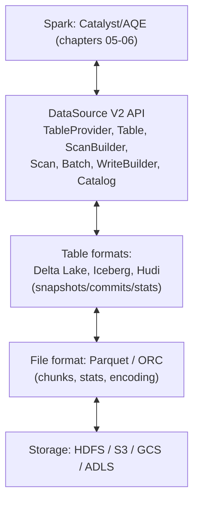
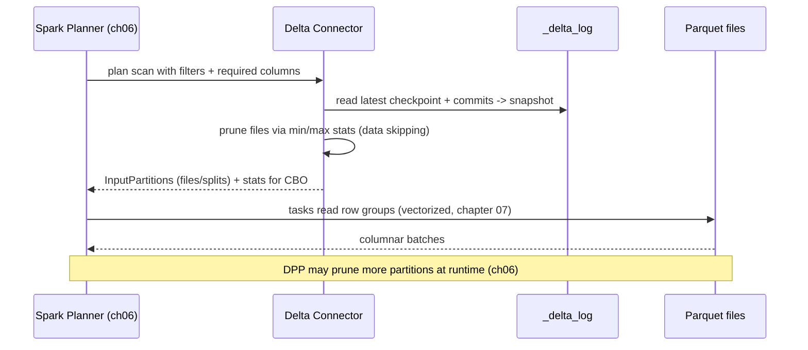

# 11 - Delta Lake & Connector Internals

**Priority:** P2
**Versions:** Apache Spark **3.5.0** / Delta protocol **3.0.0**.
**Sources:** [SOURCES.md](SOURCES.md) - full list at the end of this chapter.
**See also:** [06 - Query Planning (Catalyst & AQE)](06%20-%20Query%20Planning%20%28Catalyst%20&%20AQE%29.md), [07 - Storage, Caching & File Formats](07%20-%20Storage,%20Caching%20&%20File%20Formats.md), [10 - Structured Streaming Internals](10%20-%20Structured%20Streaming%20Internals.md).

**TL;DR:** Files don't know how to be a database; object stores don't know how to be filesystems. **Connectors** bridge Spark to storage (DataSource V2 is the interface: scan builders, pushdowns, catalogs, transactional writes), and **table formats** (Delta Lake, Iceberg, Hudi) bridge files to database semantics (snapshots, ACID commits, time travel, statistics-driven skipping). Delta does it with an **ordered transaction log** (`_delta_log`) and optimistic concurrency: writers create new Parquet files plus a log commit; readers replay the log to a snapshot. Interview skill: describe a Delta commit, explain why the log is the product (not the Parquet files), and place the DSv2 pushdowns that make it fast in Spark.

---

## 1. Why It Exists (The One Idea)

Plain Parquet-on-S3 gives you cheap storage and terrible database semantics: no atomic multi-file writes, no isolation between concurrent writers, no schema enforcement, no way to know "what tables exist" beyond listing directories. Delta's core idea [S22]:

> A table = **data files + an ordered, atomic transaction log**. Every commit is a new log entry that adds/removes files; a snapshot is the log replayed to a version. Readers see consistent snapshots; writers race optimistically and one wins.

Everything Delta offers - ACID, time travel, streaming/batch unification, data skipping - falls out of that one design.

**Memory hook:** *"The Parquet files are the payload; the transaction log is the truth."*

---

## 2. The Layering: Spark <-> Connector <-> Table Format <-> Files <-> Storage

It helps to see connectors as a contract negotiation between four different worlds, each with its own guarantees. The diagram places Spark, the connector API, the table format, and the storage layer in the order those guarantees flow.



Each layer has one job:

| Layer | Responsibility | Failure if missing |
|-------|----------------|--------------------|
| Spark | Planning/execution, pushdown requests | - |
| DSv2 | Stable contract for reads/writes/catalogs/pushdowns | Connectors become engine-specific hacks |
| Table format | ACID commits, snapshots, stats, schema | Concurrent writers corrupt each other's data |
| File format | Columnar layout, per-file/row-group stats | Scans read too much |
| Object store | Durability, cheap storage | - (but offers no atomic rename, no consistency guarantees beyond per-object) |

---

## 3. DataSource V2: The Connector Contract

The read path, in API order:

1. **Resolve the table**: `TableProvider` (e.g., Delta's provider) -> `Table` identified through a `CatalogPlugin`/`TableCatalog` (or path-based).
2. **Plan a scan**: Spark calls `ScanBuilder`; the connector implements interfaces it supports:
   - `SupportsPushDownFilters` - which filters can the source evaluate?
   - `SupportsPushDownRequiredColumns` - column pruning into the source.
   - `SupportsReportStatistics` - row counts/sizes/NDV for CBO (chapter 06).
   - `SupportsRuntimeFiltering` / partition-filter callbacks - **DPP** integration (chapter 06).
   - `SupportsPushDownLimit`/`TopN` - early stop.
3. **Scan**: Spark schedules `InputPartition`s (file splits / Kafka partitions); each task runs a `PartitionReader`/`Batch` producing rows or columnar batches (feeding the vectorized pipeline of chapter 07).

The write path:

- `WriteBuilder` -> `BatchWrite` for batch; `StreamingWrite`/`MicroBatchStream` for streaming (chapter 10): connectors own commit semantics, which is exactly where Delta buys exactly-once.
- Transactional table writers (Delta) implement atomic multi-file commits; plain file sinks rely on Spark's commit protocol (chapter 08).

**Catalogs**: the session catalog resolves `spark_catalog` by default; external catalogs are configured as `spark.sql.catalog.<name>` and expose namespaces/tables (the mechanism behind multi-engine lakehouse setups). Spark Connect (3.4+, GA 3.5) puts the connector boundary behind a client/server protocol - the server owns planning and catalog access.

Interview line: *"DSv2 didn't make scans fast by itself; it gave Spark a contract to ask the source for pruning, stats, and transactional writes - Delta filled in the answers."*

---

## 4. Delta Lake Internals

### A. The transaction log

- Location: `<table>/_delta_log/`, containing ordered JSON commits: `00000000000000000000.json`, `...01.json`, ... plus periodic **Parquet checkpoints** (`...10.checkpoint.parquet`; interval property default 10 commits [S24]).
- Each commit is a set of **actions**: `protocol`, `metaData`, `add` (file + stats + partition values), `remove`, `txn`, `commitInfo`, and newer actions (domain metadata, sidecars, deletion vectors) [S23].
- **Snapshot construction**: read the latest checkpoint, then apply subsequent JSON commits; version N = state after commit N. This is why old JSON commits can be cleaned up after checkpointing (`delta.logRetentionDuration`, default 30 days [S24]) without breaking current reads.

### B. ACID & optimistic concurrency

1. Writer reads the current snapshot (version N) and plans its changes (new `add`/`remove` files).
2. The configured storage/LogStore implementation publishes the next log version **atomically and exclusively**. Competing version claims trigger conflict checks/retries. Readers use **`_last_checkpoint`** to locate a checkpoint for snapshot reconstruction.
3. If another writer committed first, conflict detection runs (did both touch the same files/partitions?): the loser retries or fails with a conflict exception (`ConcurrentAppendException`, `ConcurrentDeleteReadException`, `ConcurrentDeleteDeleteException`, `MetadataChangedException`, `ProtocolChangedException` [S24]).

Readers never see partial writes: they read a snapshot version and its reachable files, while concurrent writers create *new* files - the classic **snapshot isolation for readers + optimistic writers** pattern [S22].

**Concrete example: two writers, one table.** Version 0 lists `A.parquet` and `B.parquet`. Writer 1 replaces `B.parquet` with `C.parquet` and commits version 1. Writer 2 started at version 0 and also tries to replace `B.parquet`; its commit fails the conflict check because it touched a file that changed. It re-reads version 1 and applies the same logical change to the new snapshot (`C.parquet` is now the file that replaced `B`, so it replaces `C` with `D`) and commits version 2. The commit contains separate actions:

```json
{"remove": {"path": "C.parquet"}}
{"add": {"path": "D.parquet", "size": 128000000}}
```

A reader at version 0 still sees A+B; a reader at version 2 sees A+D. Neither ever sees the half-written transition.

### C. Statistics & data skipping

- Each `add` action carries per-file stats: `numRecords`, min/max/nullCount per indexed column (default up to 32 columns [S24]).
- Query filters become **file-level pruning** before opening any Parquet: skip files whose min/max can't match - the log's stats are the first pruning layer, Parquet row-group stats are the second (chapter 07).
- `OPTIMIZE` compacts small files (and with `ZORDER BY` clusters data so min/max stats prune better); `VACUUM` physically removes files no longer referenced by any retained version [S24].

### D. Time travel, schema, and maintenance

| Feature | Mechanism | Limits |
|---------|-----------|--------|
| Time travel | Read snapshot at version/timestamp | Bounded by log retention (30 d default) and file retention (`VACUUM` default 7 d) [S24] |
| Schema enforcement | Commits must match table schema | - |
| Schema evolution | `mergeSchema` opt-in on writes | Some changes require protocol/metadata updates |
| Small-file control | `OPTIMIZE` (compaction), Z-order clustering | Rewrite cost; coordinate with readers |
| Deletes/updates | **Copy-on-write** replaces affected files with remove/add actions; deletion vectors can instead mask deleted row positions at read time, deferring rewrites [S23] | DV is a protocol/table feature; reads honor masks and later maintenance may rewrite files |
| Streaming integration | Stable application/batch transaction identifiers committed with file actions (chapter 10) | Retain application identity, checkpoint and transaction history through the replay window |

### F. Replay identity: `txn(appId, version)`

The Delta **3.0.0 protocol** records application transaction identifiers (`appId`, monotonically increasing `version`) in `txn` actions alongside `add`/`remove` actions. The sink skips an already-committed batch version, atomically coupling replay identity and table effects. Spark source offsets remain in the streaming checkpoint.

**Crash example:** app `orders-stream-A`, batch 42 publishes its files plus `txn(appId="orders-stream-A", version=42)`, then the driver dies before Spark's completion log. Restart replays batch 42; the Delta sink sees version 42 and skips another add. For `foreachBatch`, configure supported `txnAppId`/`txnVersion` options or implement equivalent atomic deduplication.

A new checkpoint resets batch IDs. Reusing an old app ID with reset versions may silently skip intended writes; changing app ID during replay may duplicate effects. Coordinate new identities with deliberate replay policy. Expiring transaction identifiers (e.g. configured transaction retention) before the replay horizon removes dedup protection; data/log/VACUUM retention is a separate concern.

### E. Table format landscape (one-line comparisons)

| Format | Commit mechanism | Mental model |
|--------|------------------|--------------|
| **Delta Lake** | Ordered JSON log + Parquet checkpoints | "Log is the database index over files" [S22] |
| Iceberg | Metadata files + manifests + snapshots | "Immutable manifest tree per snapshot" |
| Hudi | Timeline + file groups (copy-on-write/merge-on-read) | "Record-level updates via timeline" |

All three sit on Parquet + object stores; Spark reaches all of them through DSv2 connectors; the differences are commit protocols, metadata layout, and maintenance operations.

---

## 5. Execution Trace: A Filtered Query Over A Delta Table



Write side (copy-on-write `MERGE INTO` example): plan -> identify affected files (`remove`) -> write replacements (`add`) -> atomic log commit (including `txn` for replay-safe sink writes). DV-enabled paths may mask rows instead of immediately replacing entire files. A crash before publication leaves invisible orphans; a crash afterward is durable, but replay still needs identity-based dedup.

---

## 6. Failure Behavior & Traps

Delta's failure modes are the price of its optimistic design, and they are all recoverable. The table below is grouped by what went wrong - concurrency, maintenance, or protocol - so you can go straight to the right explanation.

| Situation | Behavior | Notes |
|-----------|----------|-------|
| Crash mid-write | Orphan files; table unchanged | Readers never see uncommitted files [S22] |
| Concurrent writes to same files | One commits; loser retries or throws conflict exception | Client retries configurable; conflict classes [S24] |
| `VACUUM` too aggressively | Breaks time travel / running readers | Retention defaults: 7 days files, 30 days log [S24] |
| Schema mismatch write | Fails unless evolution enabled | Enforcement is a feature, not a bug |
| Protocol upgrade | Old readers/writers may lose access | Protocol versions gate features [S23] |
| Small files + no OPTIMIZE | Slow scans; listing overhead | Compaction + Z-order [S24] |
| Metadata (log) growth | Slow snapshot construction | Checkpointing keeps it bounded [S23] |
| Sink commit before Spark completion | Same batch may replay | Retained Delta txn appId/version deduplicates replay; source offsets remain in the Spark checkpoint |
| Object store consistency | Rare listing/read anomalies | Modern stores are strong per-object; log design avoids multi-object atomicity anyway [S22] |

---

## 7. Observability

Delta exposes more of its own state than a typical datasource, which makes it unusually observable. Use these views to verify skipping, compaction, and conflict behavior directly instead of inferring them from timing.

| Signal | Where | Meaning |
|--------|-------|---------|
| `DESCRIBE HISTORY` / `DESCRIBE DETAIL` | Delta SQL | Commits, operation types, file counts, table size, partitioning |
| Spark SQL scan metrics | SQL tab | Files/partitions pruned; rows/bytes read; data skipping working? |
| `numFiles` / `sizeInBytes` trends | `DESCRIBE DETAIL`, monitoring | Small-file accumulation; compaction effectiveness |
| Commit conflicts in logs | Driver logs | Contention on hot tables; retry/failure rates |
| Checkpoint/JSON commit counts | `_delta_log` listing | Metadata growth and checkpoint interval health |
| `OPTIMIZE` output stats | Command output | Files compacted; Z-order benefit |
| Streaming progress | Streaming tab (chapter 10) | Delta sink commit cadence, exactly-once behavior |

---

## 8. Version Notes

Version notes in this chapter split between Spark's connector surface and Delta's protocol. Keep the two lineages separate when answering, and be explicit about which version owns the feature you are describing.

| Version | Change | Impact |
|---------|--------|--------|
| 3.4 | Spark Connect (Python) client [RN 3.4] | Connector/catalog boundary becomes client-server |
| 3.5 | Connect GA (Scala/Go) [RN 3.5] | Multi-language lakehouse access |
| 4.0 | `VARIANT` for semi-structured data [RN 4.0] | JSON-in-Parquet with binary layout (chapter 03) |
| 4.1 | VARIANT GA + shredding (8x vs non-shredded, 30x vs JSON strings reads; writes 20-50% slower, Databricks 2025) [S20, RN 4.1]; declarative pipelines (SDP) [RN 4.1] | Semi-structured analytics gets a vectorized path; pipeline-level abstraction |
| 4.2 | CDC support; whole-stage codegen for `MERGE` [RN 4.2] | Change feeds and faster upserts |
| Delta 2.x/3.x | Per-table features via protocol versions: deletion vectors, column mapping, checkpoints [S23] | Feature adoption is negotiated through the log [S23] |

---

## 9. The One-Page Recap (memorize this)

1. DSv2 is the contract: scan builder, pushdown interfaces, catalogs, batch/streaming writes.
2. Delta = Parquet files + ordered `_delta_log`; snapshot = checkpoint + JSON commits.
3. Optimistic concurrency: new files + one atomic log commit; readers see snapshots, conflicts retried/failed.
4. Stats live in the log: file-level pruning before Parquet row-group pruning.
5. Time travel bounded by log (30 d) and file (VACUUM 7 d) retention defaults.
6. Streaming + Delta replay safety = stable appId/version txn committed with file actions plus retained checkpoint/history.
7. Table formats differ in commit/metadata machinery, all ride Parquet + object stores.

---

## 10. Drills (Cover The Answer Column)

| # | Question | Answer |
|---|----------|--------|
| 1 | What makes Delta a database over files? | The ordered transaction log providing atomic commits and snapshots |
| 2 | How is a snapshot built? | Latest checkpoint + subsequent JSON commits replayed |
| 3 | How do concurrent writers work? | Optimistic concurrency: plan on a snapshot, commit once, conflict detection retries/fails |
| 4 | What do readers see during a write? | The previous complete snapshot; new files appear only after commit |
| 5 | Where do pruning statistics live? | Per-file stats in the log (`add` actions), plus Parquet row-group stats |
| 6 | What breaks time travel? | `VACUUM`/log cleanup removing the files/commits needed |
| 7 | Name the two retention defaults. | Files: 7 days (`VACUUM`); log: 30 days |
| 8 | What does DSv2's `SupportsPushDownFilters` do? | Lets Spark delegate filter evaluation into the source scan |
| 9 | How does DPP involve connectors? | Runtime filter/partition pruning interfaces (`SupportsRuntimeFiltering`) pass join-derived values into scans |
| 10 | Why replay-safe Delta sinks? | txn(appId, version) is committed with file actions; replayed batch versions are skipped; source offsets need not be in the Delta commit |
| 11 | What are orphans? | Files written but never committed (crash); invisible to readers, cleaned by VACUUM |
| 12 | What does `OPTIMIZE` fix? | Small files; `ZORDER BY` additionally clusters for better min/max skipping |
| 13 | Delta vs Iceberg in one line? | Log + checkpoints vs manifest-tree snapshots; both ACID-over-Parquet |
| 14 | What can a protocol upgrade do? | Enable/require features (e.g., deletion vectors); older clients may be excluded |
| 15 | Which Spark 4.x versions touched this area? | 4.0 VARIANT; 4.1 SDP/VARIANT shredding; 4.2 CDC + MERGE codegen |

---

## 11. Key Source Classes (pin refs to a tag, e.g. `apache/spark@v3.5.0`; Delta refs to delta-io/delta tags)

| Class | Module | Role |
|-------|--------|------|
| `TableProvider`, `Table`, `ScanBuilder`, `Scan`, `Batch`, `PartitionReader` | `sql/core/.../connector/` | DSv2 read contract |
| `SupportsPushDownFilters`, `SupportsPushDownRequiredColumns`, `SupportsReportStatistics`, `SupportsRuntimeFiltering` | `sql/core/.../connector/` | Pushdown/statistics interfaces |
| `WriteBuilder`, `BatchWrite`, `StreamingWrite`, `MicroBatchStream` | `sql/core/.../connector/` | Write + streaming contracts |
| `CatalogPlugin`, `TableCatalog`, `SupportsNamespaces` | `sql/core/.../connector/catalog/` | Catalog contract |
| `DataSourceV2Strategy`, `DataSourceV2ScanExecBase` | `sql/core/.../execution/datasources/v2/` | Spark-side planning/execution of V2 sources |
| `DeltaLog`, `Snapshot`, `OptimisticTransaction`, `DeltaScan` | delta-io/delta (`core`) | Log, snapshots, transactions, scans |
| `SparkConnectService` | `connector/connect/` | Server-side catalog/planning boundary (3.4+) |

---

## 12. Sources Used

- [S22](SOURCES.md) "Delta Lake: High-Performance ACID Table Storage over Cloud Object Stores" (VLDB 2020) - log design, ACID, optimistic concurrency, snapshots
- [S23](SOURCES.md) Delta Lake Protocol (PROTOCOL.md) - actions, snapshot construction, protocol versions, isolation
- [S24](SOURCES.md) Delta Lake Documentation - time travel, VACUUM/OPTIMIZE, retention defaults, conflict exceptions
- [S7](SOURCES.md) *The Internals of Spark SQL* - DataSource V2 classes and planning
- [RN 3.4 / 3.5 / 4.0 / 4.1 / 4.2](SOURCES.md), [S20](SOURCES.md) - Connect, VARIANT/VARIANT shredding numbers, SDP, CDC, MERGE codegen
- [Appendix B](Appendix%20B%20-%20Optimization%20Evolution%20Map.md) - Campaign 6 for the ecosystem narrative
