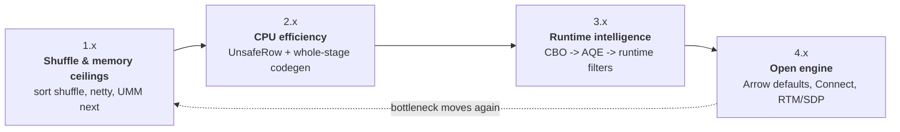

# Appendix B - The Story of Spark Performance (Spark 1.2 -> 4.2)

**Sources:** Databricks engineering blogs, apache.org release notes and docs, the papers and books listed in [SOURCES.md](SOURCES.md). Every number below is attributed to the source that measured it.

**See also:** [Appendix C - The Spark Acceleration Landscape](Appendix%20C%20-%20The%20Spark%20Acceleration%20Landscape.md) - what happens after the JVM-era optimizations: native engines and vendor runtimes.

**TL;DR:** Spark's bottleneck kept moving, and each era fixed the previous one's bottleneck. If you remember one sentence: **"Shuffle got cheaper (1.x), rows got cheaper (2.x), plans got smarter (3.x), and the engine got open (4.x)."**

| Era | Theme | The one thing it bought |
|-----|-------|-------------------------|
| 1.x | Make it scale | Sort shuffle + unified memory: jobs stopped dying on file handles, spills, and GC |
| 2.x | Make the CPU cheap | UnsafeRow + whole-stage codegen: per-row costs dropped 10-100x |
| 3.x | Make plans smart | CBO -> AQE: re-plan at every shuffle with measured data; partition tuning became obsolete |
| 4.x | Open the engine | ANSI by default, VARIANT, Arrow by default, Spark Connect, real-time streaming |

How to use this doc: read the story once, then revise from **Section 8 (Cheat Cards)**, **Section 9 (Say It In 30 Seconds)**, and **Section 10 (Drills)**. The same facts repeat in all three formats on purpose.

---

## 1. The Shape of the Story

Every Spark optimization answers: *"what is the bottleneck now?"* The answer changed six times:

1. **Disk & file handles (1.x):** hash shuffle created M x R files; jobs hit file-handle and memory limits. -> sort shuffle, tungsten shuffle.
2. **Memory & GC (1.6):** cache and execution fought over a fixed split, and JVM objects clogged the heap. -> unified memory, binary rows.
3. **CPU per row (2.0):** even with data in memory, iterator calls and boxing dominated. -> whole-stage codegen, vectorized readers.
4. **Bad plans from missing statistics (2.2 -> 3.0):** the optimizer guessed at compile time; guesses were often wrong. -> CBO, then AQE with measured sizes.
5. **Data movement (3.1 -> 3.3):** even good plans paid too much for fetching. -> host-local reads, push-based merged shuffle, Bloom-filtered shuffles.
6. **The ecosystem boundary (4.x):** Python conversion and process coupling. -> Arrow everywhere, Spark Connect, VARIANT/geospatial/CDC in-engine.

---

## 2. Timeline Cheat Sheet (the version map)

One memorable fact per version, with its number where one exists. Don't try to memorize the whole table at once: learn the number column first, then let the campaign sections below fill in how each version earned its entry.

| Version | Era | What changed | Number to remember |
|---------|-----|--------------|--------------------|
| 1.2 | Scale | Sort-based shuffle becomes default; Netty block transfer | "M x R files -> O(1) per map task" |
| 1.4 | Scale | Tungsten begins: serialized shuffle outputs, binary cache-aware sort | Sort **3x** faster than pointer sort (Databricks, 2015) |
| 1.5 | Scale | Tungsten on by default; cache-friendly agg/sort/join layouts; external-sort fallback; codegen on for DataFrame/SQL functions | "Join bounded by disk, not memory" (external sort-merge join preferred) |
| 1.6 | Scale | **Unified Memory Manager**; new Parquet reader; columnar cache fixes; off-heap execution | Parquet **+50%** throughput; complex-type cache **14x**; `mapWithState` **10x** (Databricks, 2016) |
| 2.0 | CPU | **Whole-stage codegen**; vectorized Parquet reader (ColumnarBatch) | Per-row: filter 15 -> **1.1 ns**, hash join 115 -> **4.0 ns**, sort 620 -> **5.3 ns** (Databricks, 2016) |
| 2.2 | Planner | **CBO**: cardinality estimation, join reordering, star-schema heuristics | "Plans chosen by cost, not just rules" |
| 2.3 | CPU | Vectorized ORC reader; CBO histograms; Zstd; spill-reader read-ahead | ORC scan **2-5x** |
| 3.0 | Runtime | **AQE** (coalesce partitions, switch joins, handle skew), **DPP**, local shuffle reader, contiguous block fetch | **~2x** vs 2.4 on TPC-DS; AQE up to **8x** per query; DPP **2-18x** on 60/102 queries (Databricks, 2020) |
| 3.1 | Runtime | Host-local shuffle reads without shuffle service; rules that delete unnecessary shuffles/sorts; char/varchar | "Fewer Exchanges in the plan" |
| 3.2 | Runtime | **Push-based shuffle** (merge at the shuffle service); **AQE on by default**; RocksDB state store; ANSI GA | "AQE default = tuning knob retired" |
| 3.3 | Runtime | Runtime **Bloom filter joins**; vectorized nested Parquet; full-outer join codegen; ANSI intervals | Bloom joins up to **10x**; struct scans **~15x** (Databricks, 2022) |
| 3.4 | Runtime | Spark Connect Python client; AQE caches partitioning/ordering and reuses stage stats | "Stats computed once, reused" |
| 3.5 | Open | Spark Connect GA (Scala/Go clients); Arrow Python UDFs | "Python UDFs without Pandas conversion" |
| 4.0 | Open | **ANSI mode default**; VARIANT; collation; SQL UDFs; `pyspark-client` **1.5 MB**; CRC32C shuffle checksum; JDK 17 + Scala 2.13 | "1.5 MB client vs ~350 MB full PySpark" |
| 4.1 | Open | **Real-Time Mode** streaming (sub-second; single-digit ms stateless); VARIANT GA + **shredding**; SDP; checksum-based shuffle stage retry | Shredding: **8x** vs non-shredded, **30x** vs JSON reads; writes **20-50%** slower (Databricks, 2025) |
| 4.2 | Open | GEOMETRY/GEOGRAPHY + `ST_*`; CDC `CHANGES`; NEAREST BY top-K join; **Arrow Python UDFs by default**; Java 25 | "Vector search becomes a SQL join" |

---

## 3. Campaign 1 - Shuffle: From File Explosion to Merged Fetches

**The pain.** Hash shuffle wrote one file per (map task x reduce partition) = M x R files per job, each with buffers. With hundreds of mappers and reducers, jobs died on file handles and memory long before CPU became the issue.

**The four generations (the #1 shuffle interview win):**

| Generation | Version | Trick | Mental model |
|-----------|---------|-------|--------------|
| 1. Sort shuffle | 1.2 (default) | Partition records by reduce id, sort, spill + merge; write one data file + one index file per map task | "Trade CPU sorting for bounded memory and O(1) files" |
| 2. Tungsten shuffle | 1.4-1.5 | Write serialized bytes; sort *pointers* by partition id (radix, no object dereference); spill binary runs; reuse serialized upstream data without round-tripping through objects | "Never deserialize just to sort" |
| 3. Local reads | 3.0-3.1 | Contiguous block fetches (one request per range, not per block); AQE local shuffle reader skips the network when data is already correctly partitioned; host-local disk reads without a shuffle service | "Don't move data you don't have to" |
| 4. Push-based merge | 3.2 | Mappers push outputs to the shuffle service, which merges blocks per partition; reducers fetch fewer, larger blocks | "Merge before fetch, not after" |

**Detail that earns points:** the tungsten writer is only chosen when the shuffle has **no map-side combine** (no aggregation), the serializer supports relocation, and partition counts are moderate; otherwise Spark falls back to the classic sort writer or the bypass writer. So "tungsten-sort" is a *path*, not a global mode.

**Integrity (4.x):** shuffle streams got CRC32C checksums (4.0), and 4.1 can rerun an entire map stage when checksums reveal corruption instead of failing the job or returning bad data.

**Memory hook:** *"Four S's: Sort (1.2), Serialized (1.4), Skip network if local (3.0/3.1), Shuffle-service merge (3.2)."*

---

## 4. Campaign 2 - Memory: From Static Split to Borrow-and-Evict

**The pain.** Before 1.6, executor memory was split into a fixed execution fraction (sorts, joins, aggregations) and a fixed storage fraction (cache). No caching -> execution starved. Heavy caching -> execution spilled constantly. There were no defaults that worked for everyone; you had to tune.

**The fix (Unified Memory Manager, 1.6):**
- One shared region; execution and storage **borrow from each other**.
- The asymmetry is the interview point: **execution can evict cached blocks (LRU), but storage can never evict execution.** Why? Spilled execution data *will* be read back from disk; cached data *may* never be touched again. The cost of being wrong is asymmetric.
- Memory is handed out in pages per task, with per-task fair shares so one giant task can't starve the pool.
- Off-heap: usable for execution from 1.6, for storage from 2.0.

**Memory hook:** *"Unified memory = one pool, borrowing both ways, eviction only one way - because spill always comes back, cache may never."*

---

## 5. Campaign 3 - CPU: From JVM Objects to Generated Code

**The pain.** JVM objects per row: headers, boxed primitives, pointer chasing, virtual calls per operator per row, GC pressure.

**Two compounding fixes:**

1. **Binary rows (UnsafeRow, 1.4; default 1.5).** A row is one contiguous byte region: null bitmap + fixed fields (8-byte aligned) + variable fields. Consequences:
   - Sorting/hashing/comparing happen on **bytes**, not objects - and the layout is designed to sort correctly as raw bytes.
   - Memory comes from managed pages and spills as binary blocks (no per-object overhead).
   - Aggregations use a binary hash map (`BytesToBytesMap`), avoiding boxed keys entirely.
2. **Code generation (1.5 -> 2.0).** Expressions compiled to Java (1.5, on by default), then **whole-stage codegen** (2.0): an entire pipeline - scan, filter, project, aggregate - is fused into **one generated function**. No iterator `next()` dispatch, no intermediate row objects between operators; rows stay in local variables.

**The numbers (Databricks, 2016):** per-row cost fell from 15 -> 1.1 ns (filter), 115 -> 4.0 ns (hash join), 620 -> 5.3 ns (low-entropy sort). Think of these as proof that iterator/boxing overhead was the enemy, not as current absolutes.

**The limit that sets up everything after:** codegen can't fuse **across a shuffle** - a shuffle is a hard boundary. So the next frontier was making the *plan* around those boundaries smarter, not the loops inside them.

**Memory hook:** *"Binary rows kill GC; whole-stage codegen kills virtual dispatch; together a pipeline becomes one tight loop over bytes."*

---

## 6. Campaign 4 - Planner: From Rules to Runtime Reality

**Three eras of deciding how to execute:**

| Era | Decides when | Inputs | Failure mode |
|-----|--------------|--------|--------------|
| Rules (1.3+) | Compile time | Query shape only | No statistics: bad join order, bad partition counts |
| CBO (2.2+) | Compile time | Table stats, histograms, cardinality estimates | Stale/missing stats; data arrives unpredictably (storage-compute separation) |
| AQE (3.0+; default 3.2) | **At every shuffle**, at runtime | **Measured** partition sizes from completed stages | Non-shuffle parts of the plan stay compile-time (and AQE overhead is ~1% typical) |

**What CBO added (2.2-2.3):** statistics collection, cardinality estimation for filters/joins/aggregates, dynamic-programming join reordering, star-schema heuristics (join dimensions first so broadcast works), histograms (2.3).

**What AQE added (3.0) - three moves:**
1. **Coalesce shuffle partitions:** start with many partitions, merge adjacent small ones at runtime (target ~64 MB). This retired the single most infamous tuning knob, `spark.sql.shuffle.partitions`.
2. **Switch join strategies:** sort-merge join -> broadcast hash join when the build side turns out small enough, measured not guessed.
3. **Skew join handling:** detect partitions that are much larger than the median, split them into sub-partitions, and mirror the matching side. (Docs defaults: skewed if > 5x median and > 256 MB.)

**What runtime filters added (3.3):** during a broadcast join, build a **Bloom filter** on the join key of the small side and push it into scans of the big side - row-level pruning *inside* the partitions that DPP could not eliminate. DPP prunes partitions/files; Bloom filters prune rows. Measured up to ~10x on TPC-DS, biggest gains when storage is untuned or stats are missing.

**What 3.4 polished:** AQE remembers output partitioning/ordering across re-plans and reuses statistics computed by finished stages - fewer re-optimizations, fewer redundant shuffles.

**The numbers (Databricks unless noted):** ~2x total vs 2.4 on TPC-DS at 3.0; AQE up to 8x on individual queries (later Databricks production numbers in a VLDB 2024 paper: up to 25x per query, 1.7x total); DPP 2-18x on 60/102 queries; Bloom joins up to 10x.

**Memory hook:** *"CBO bets on statistics at compile time; AQE stops betting - it re-plans at every shuffle with measured sizes. That's why 3.2 made it default."*

**Concrete plan:** the worked example in [06 - Query Planning (Catalyst & AQE)](06%20-%20Query%20Planning%20%28Catalyst%20&%20AQE%29.md) shows this on an actual `EXPLAIN` - 200 partitions coalesced toward 8, with a join strategy switch.

---

## 7. Campaign 5 - Readers and Caching: Read Columns, Not Rows

The pattern: every "vectorized" upgrade decodes a **batch of columnar bytes** in one shot and feeds codegen directly, skipping per-row objects.

| Version | Change | Number |
|---------|--------|--------|
| 1.4-1.6 | Columnar cache for DataFrames; fix for complex types | up to **14x** on complex types (1.6) |
| 1.6 | New Parquet reader bypasses record assembly for flat schemas | **+50%** scan throughput (2.9M -> 4.5M rows/s) |
| 2.0 | Vectorized Parquet reader: `ColumnarBatch` (~4096 rows), dictionary decoding | Pairs with whole-stage codegen |
| 2.3 | Vectorized ORC reader | **2-5x** scan |
| 3.3 | Vectorized reader for nested/complex Parquet; `_metadata` hidden file columns | structs **~15x**, arrays ~1.5x |
| 4.0 | Zstd becomes default ORC compression | Smaller files, same speed class |
| 4.1 | VARIANT shredded into typed Parquet fields; Parquet logical VARIANT type | **8x** faster than non-shredded, **30x** vs JSON strings; writes 20-50% slower |

Notice what ties these rows together: caching and reading are the same problem seen from two sides. A cache stores columnar batches so scans don't happen; a vectorized reader decodes batches so scans are cheap when they do. Both exist to feed the same consumer - the generated code from Campaign 3.

**Memory hook:** *"If it says 'vectorized', it means: one decode per batch, no per-row Java objects, straight into generated code."*

---

## 8. Campaign 6 - Opening the Engine (3.4 -> 4.2)

Not raw speed, but they change *where* execution happens - increasingly asked about in interviews:

- **Arrow everywhere Python meets JVM:** columnar exchange for Pandas UDFs (2.x) -> Arrow Python UDFs (3.5) -> Arrow-optimized UDFs **by default** (4.2) -> zero-copy `PyCapsule` handoff to Polars/DuckDB (4.2).
- **Spark Connect (3.4 -> GA 3.5):** client-server Spark; `pyspark-client` is 1.5 MB vs ~350 MB full PySpark; plans travel as protobuf; JDBC driver (4.1).
- **Real-Time Mode (4.1):** continuous Structured Streaming, sub-second latency (single-digit ms stateless) - the old micro-batch floor is gone for stateless workloads.
- **Declarative layers (4.1-4.2):** Spark Declarative Pipelines and Auto CDC for SCD Type 1; metric views (4.2).
- **Correctness as a default (4.0):** ANSI mode on by default - `CAST('a' AS INT)` now *fails* instead of returning NULL. This is the change most likely to break an old job on upgrade.

**Memory hook:** *"4.x optimizes the boundary: Arrow at Python, Connect at processes, ANSI at semantics."*

---

## 9. Cheat Cards (the revision section)

Revision works best in layers: first recall the decision, then the condition that triggers it, then the number. Cover the right columns here and you can rebuild an entire interview answer from a single card.

### Card A - Which shuffle path runs?

| Path | Chosen when | Essence |
|------|-------------|---------|
| Bypass merge-sort | Very few partitions | Write per-partition files, then concatenate |
| Classic sort writer | Aggregation/combine or incompatible serializer | Sort + combine + spill + merge |
| Tungsten (unsafe) writer | No combine, relocatable serializer, moderate partition counts | Sort serialized pointers by partition id, spill binary runs |

### Card B - Memory managers

| | Static (pre-1.6) | Unified (1.6+) |
|---|------------------|----------------|
| Split | Fixed execution/storage fractions | One pool, soft boundary |
| Borrowing | None | Both directions |
| Eviction | N/A (spills) | Execution can evict cached storage; never the reverse |
| Tuning | Required | Mostly unnecessary |

### Card C - Data representation

| Format | Layout | Used by | Weakness |
|--------|--------|---------|----------|
| JVM objects | Headers, boxing, pointers | RDD API paths | GC + pointer chasing |
| UnsafeRow | Contiguous bytes, null bitmap, sortable as-is | SQL engine (1.5+) | Manual memory, off-heap spills |
| Arrow | Columnar, dictionary-friendly | Python boundary, ecosystem | Conversion cost at boundary |

### Card D - Planner eras

| Era | Decision time | Inputs | Fails when |
|-----|---------------|--------|------------|
| Rules | Compile | Shape | No stats |
| CBO | Compile | Stats/histograms | Stale stats, unpredictable data |
| AQE | Each shuffle | Measured sizes | Non-shuffle ops (still compile-time) |

### Card E - Ear era summaries (say these in interviews)

- **1.x:** "Make it not fall over" - sort shuffle, spill-to-disk, unified memory.
- **2.x:** "Make rows and loops cheap" - binary format, whole-stage codegen, vectorized readers.
- **3.x:** "Make decisions with real data" - CBO, AQE, DPP, runtime Bloom filters.
- **4.x:** "Make the engine open and correct by default" - ANSI, VARIANT, Arrow defaults, Connect, real-time streaming.

---

## 10. Say It In 30 Seconds (interview openers)

**Q: Walk me through Spark's performance evolution.**
"Four eras. 1.x made the engine survive scale: sort-based shuffle replaced hash shuffle's file explosion, and unified memory ended the static execution/storage split. 2.x attacked CPU: UnsafeRow binary representation plus whole-stage codegen cut per-row costs by 10-100x. 3.x moved intelligence to runtime: CBO first, then AQE, which re-plans at every shuffle using measured partition sizes, so partition tuning and many join-strategy hints became obsolete. 4.x opened the engine: ANSI by default, VARIANT for semi-structured data, Arrow for Python, and Spark Connect as the client-server boundary."

**Q: Why is AQE considered the biggest 3.x change?**
"Because it fixes the failure mode of the storage-compute-separated world: you don't know your data until you touch it. The exchange is a natural materialization point, so AQE measures per-partition sizes there and re-plans - coalescing partitions, switching joins, splitting skew. It converted a tuning problem into an automatic one."

**Q: Why did 2.0 feel so much faster?**
"It compounded two things: UnsafeRow removed JVM object overhead per row, and whole-stage codegen fused an entire operator pipeline into one generated function, removing iterator dispatch. 15 ns filters became 1.1 ns, 115 ns hash joins became 4 ns. Neither alone explains it; the combination does."

---

## 11. Drills (cover the right column)

| # | Question | Answer |
|---|----------|--------|
| 1 | Why did sort shuffle replace hash shuffle? | M x R files and buffers per task became untenable; sorting trades CPU for bounded memory and O(1) files, and enables map-side combine |
| 2 | When is tungsten-sort chosen? | No map-side combine, relocatable serializer, moderate partition counts - otherwise fallback writers |
| 3 | The cache-aware sort trick? | Keep sort keys next to pointers / radix sort on partition id; never dereference objects during sort (3x) |
| 4 | Why can execution evict storage but not the reverse? | Spilled execution data always gets read back; cached data may never be reused |
| 5 | What did whole-stage codegen buy? | No virtual dispatch or intermediate objects within a pipeline; per-row costs dropped up to 100x on measured benchmarks |
| 6 | Why can't codegen fuse across a shuffle? | A shuffle is a materialization boundary; the data must be written and reread - which is also AQE's opportunity |
| 7 | What does AQE fix that CBO can't? | Stale/missing statistics: AQE decides at runtime with measured partition sizes |
| 8 | AQE's three original moves? | Coalesce shuffle partitions, switch join strategy, handle skew joins |
| 9 | DPP vs Bloom filters? | DPP prunes partitions/files via the join key; Bloom filters prune rows inside surviving partitions |
| 10 | Local shuffle reader vs host-local reads? | Local reader is an AQE *plan rewrite* that skips the shuffle entirely; host-local read is a *fetch path* reading local disk without the shuffle service |
| 11 | What broke by default in Spark 4.0? | ANSI mode is on: invalid casts now throw instead of returning NULL (plus JDK 17 / Scala 2.13 floors) |
| 12 | 4.1 VARIANT shredding trade-off? | 8x-30x faster reads by extracting typed fields; 20-50% slower writes |
| 13 | What is Real-Time Mode? | 4.1 continuous Structured Streaming for stateless Scala queries: sub-second, single-digit ms latency |
| 14 | Why 1.5MB `pyspark-client`? | Spark Connect separates client from server; the client is a thin protobuf/gRPC shell, making Spark embeddable anywhere |

---

## 12. Where Each Campaign Feeds the Chapters

Use this table to jump between the story and the details. Each chapter's version-notes section expands the corresponding campaign, so the two are meant to be read together rather than as duplicates.

| Chapter | Campaigns to reuse |
|---------|--------------------|
| 01 Execution Architecture & Scheduling | Timeline, Campaign 6 |
| 02 Memory Management & Disk Spilling | Campaign 2, shuffle spill paths in Campaign 1 |
| 03 Tungsten, Serialization & Data Representation | Campaigns 1 and 3, Card C |
| 04 Shuffle, Partitioning & Network Transfer | Campaign 1, Card A |
| 05 Physical Operators | Campaign 3 (fusion), Campaign 4 (skew/joins), Campaign 5 (read paths) |
| 06 Query Planning - Catalyst & AQE | Campaign 4, Card D |
| 07 Storage, Caching & File Formats | Campaign 5 |
| 08 Fault Tolerance & Resource Scheduling | Shuffle integrity (4.x), Campaign 6 |
| 10 Structured Streaming Internals | Campaign 6 (Real-Time Mode), 1.6/3.2/4.1 rows in timeline |
| 11 Delta Lake & Connector Internals | Campaign 5 (shredding, geospatial), Campaign 6 (SDP/CDC) |

---

## 13. Sources

- Databricks engineering blogs: Project Tungsten (2015), Spark as a Compiler (2016), Announcing Spark 1.5/1.6 and Introducing 2.0, Adaptive Query Execution (2020), Introducing Spark 3.0 (2020), Introducing Spark 3.3 (2022), Introducing Spark 4.1/4.2 (2025/2026) - links in [SOURCES.md](SOURCES.md)
- apache.org release notes: Spark 1.2 through 4.2 - links in [SOURCES.md](SOURCES.md)
- Spark SQL SIGMOD '15 paper (Catalyst), Apache Spark CACM '16 (evolution), AQE at production scale VLDB 2024 paper
- Official Spark docs for thresholds and defaults (AQE, skew join, ORC/Parquet readers, migration guides)
- Jacek Laskowski's internals books (mechanism cross-checks)
