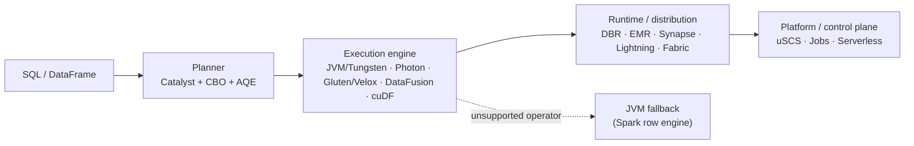
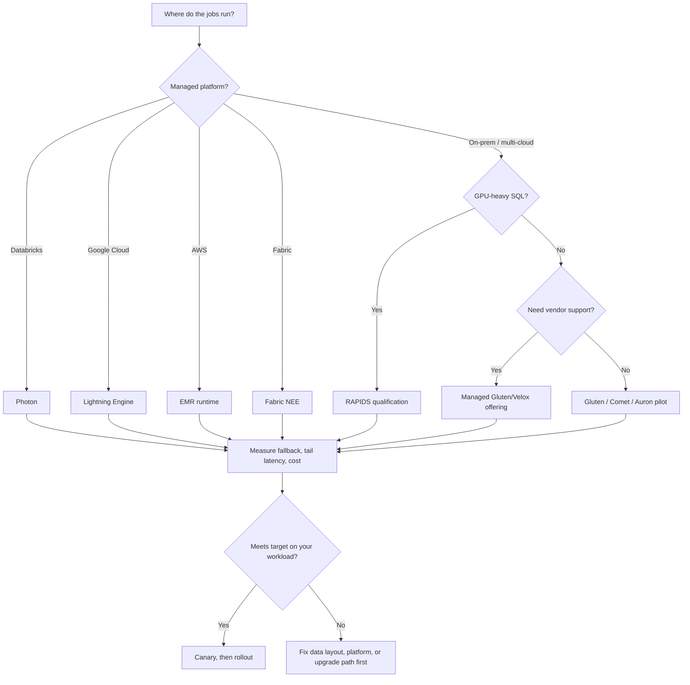

# Appendix C - The Spark Acceleration Landscape (Proprietary & Native Engines)

**Priority:** P1 (ecosystem context)
**Versions:** Apache Spark **3.5.0**.
**Sources:** [SOURCES.md](SOURCES.md) - every vendor claim below is dated and labeled vendor-reported.
**See also:** [03 - Tungsten, Serialization & Data Representation](03%20-%20Tungsten,%20Serialization%20&%20Data%20Representation.md), [04 - Shuffle, Partitioning & Network Transfer](04%20-%20Shuffle,%20Partitioning%20&%20Network%20Transfer.md), [06 - Query Planning (Catalyst & AQE)](06%20-%20Query%20Planning%20%28Catalyst%20&%20AQE%29.md), [Appendix B - Optimization Evolution Map](Appendix%20B%20-%20Optimization%20Evolution%20Map.md).

**TL;DR:** Tungsten supplies representation/execution machinery; Catalyst supplies query planning. This appendix compares four vendor families: Photon (C++ engine), Lightning (a multilayer bundle including Gluten/Velox NQE), EMR (patched runtime), and Synapse/Fabric (optimizer/runtime work and native offload). It also covers Uber's platform control, upgrades and Gluten/Velox plans.

---

## 1. The Map: Four Layers, Not One "Optimizer"

The first interview trap is vocabulary. People say "optimizer" for four different things: a **planner** that rewrites a query, an **execution engine** that runs operators, a **runtime/distribution** that patches or packages Spark, and a **platform** that decides where jobs run. Photon, Lightning, EMR, and Synapse sit in different layers, which is why comparing their headline speedups directly is mostly meaningless.

| Layer | What it decides | Spark examples | Vendor examples |
|-------|-----------------|----------------|-----------------|
| Planner / optimizer | Logical rewrites, join order, join strategy, partition coalescing | Catalyst rules, CBO (2.2), AQE (3.0+), DPP, runtime Bloom filters | Lightning's F1/Spanner-inspired rules; Synapse's exchange placement and pushdown rules; Photon's hash-join preference |
| Execution engine | How rows become operators: row vs columnar, interpreted vs codegen, JVM vs native | Volcano iterator, Tungsten `UnsafeRow`, whole-stage codegen | Photon (C++), Gluten/Velox (C++), Comet/Auron (Rust + DataFusion), RAPIDS (GPU/cuDF) |
| Runtime / distribution | Which Spark binary, defaults, connectors, shuffle, I/O, observability | Apache Spark + configs | Databricks Runtime (DBR), EMR runtime, Synapse runtime, Lightning Engine, Fabric Spark runtime |
| Platform / control plane | Where a job runs, with which version and config, retries, migration | Spark Submit, Livy, Kubernetes, YARN | Uber uSCS, Uber Sparkle, Databricks Jobs, EMR Serverless |



This is why the phrase "Tungsten is just one optimizer" needs correcting. Tungsten is a **data representation and execution backend**: `UnsafeRow`, cache-aware operators, and whole-stage codegen. Catalyst is the optimizer. AQE is runtime re-optimization. Photon and Gluten replace the execution layer; EMR and Synapse patch the whole runtime; Lightning bundles all of the above.

The comparison below groups products by **which layer they change**: planning, execution, runtime or platform.

| Product | Owner | Layer it really occupies | Is it a new engine? |
|---------|-------|--------------------------|---------------------|
| Photon | Databricks | Execution engine inside DBR | **Yes** - C++ engine, closed source |
| Lightning Engine | Google Cloud | Runtime + optimizer + native engine + connectors | Partly - NQE is Gluten + Velox; the rest is a stack |
| EMR runtime for Spark | AWS | Patched Spark runtime | No - same Spark APIs, optimized internals |
| Synapse runtime / Fabric NEE | Microsoft | Patched runtime + managed native engine | No - Synapse patches; NEE is Gluten + Velox |
| Databricks Runtime (DBR) | Databricks | Distribution of Spark with proprietary patches | No - a distribution, not a separate engine |

The practical consequence: "adopt an accelerator" can mean turning on a checkbox (Photon, EMR runtime, Fabric NEE), paying for a premium tier (Lightning), or operating a plugin and its native dependencies yourself (Gluten, Comet, Auron, RAPIDS). Those are very different projects.

---

## 2. Why Native Engines Exist

A speedup only applies to the phase it accelerates. Before comparing engines, know where the job spends its time:

| Phase | What usually dominates | Which lever helps |
|-------|------------------------|-------------------|
| Scan / I/O | Object-store listing, Parquet decoding, predicate evaluation | Connector and metadata optimizations, columnar readers, prefetching |
| Projection / filter | Per-row expression evaluation, boxing, function calls | Vectorized kernels, codegen, SIMD |
| Shuffle | Serialization, network transfer, disk I/O | Columnar shuffle, better partitioning, compression |
| Join / aggregate | Hash-table build/probe, spilling, memory pressure | Native kernels, better join order/strategy, AQE |
| UDF / serialization | Python/Java calls, row <-> column conversion | Usually nothing; keep it in Spark |
| Planning / listing | Catalyst rules, statistics, file listing | Optimizer rules, metadata caching |

This is Amdahl's law with a vendor deck. If 60% of the runtime is scan and listing, a 5x faster compute kernel cannot deliver 5x end-to-end. That is why the strongest products optimize **more than one row** of this table - and why "engine-only" claims often underdeliver on lakehouse workloads.

### A. The JVM ceiling

Spark's original execution path pays three costs per row: object allocation and boxing, virtual dispatch through the Volcano iterator, and garbage collection over a large live set. Tungsten attacked all three - binary rows, cache-aware algorithms, whole-stage codegen - and the chapter 03 numbers show how much it bought: a filter from roughly 15 ns to 1.1 ns per row, a hash join from 115 ns to 4 ns, and a low-entropy sort from 620 ns to 5.3 ns [S11, Databricks 2016].

But codegen does not remove every boundary. It cannot fuse across a shuffle, a Python UDF, or a Java UDF. It still runs on the JVM, so GC pauses and object headers remain part of the cost model. And it is Java code generated per query, which limits how aggressively Spark can use SIMD instructions and explicit columnar memory. A native engine starts from the other side: **columnar batches, explicit memory, SIMD kernels, and no GC**.

### B. What "native" actually buys

| Technique | JVM/Tungsten path | Native engine path | Why it matters |
|-----------|-------------------|--------------------|----------------|
| Data layout | `UnsafeRow` (row-oriented bytes) | Columnar vectors/batches | Compression, cache locality, SIMD |
| Compute | Generated Java loops | Precompiled C++/Rust kernels | No JIT warmup; wider instruction use |
| Memory | JVM heap + off-heap pages | Explicit allocator, spill to disk | Predictable memory; no GC pauses |
| Adaptation | Whole-stage codegen per plan | Runtime-specialized kernels per batch | Adapts to data quality without recompiling the query |
| Boundary | JVM only | JNI/Arrow boundary to Spark | Columnar conversion cost at the edge |

The last row is the catch. Unsupported operations may leave a whole plan on the JVM or split it into fragments; only actual row/columnar transitions pay that conversion cost. Columnar-compatible JVM operators may consume batches directly. JNI and memory-sharing details vary by engine; inspect the actual plan rather than assuming every unsupported operator causes conversion.

### C. The fallback contract

Photon, Gluten-based engines, Comet/Auron and RAPIDS use variants of this **native-offload** pattern:

1. Spark parses, analyzes, and optimizes the plan with Catalyst.
2. The accelerator intercepts the **physical** plan and identifies supported subtrees.
3. Supported operators run in the native engine; the rest stay in the JVM.
4. Results cross the boundary as columnar batches (Arrow or a proprietary format).
5. Spark generally retains task scheduling/retry orchestration and UI; plugins can replace shuffle, memory and I/O paths.

**EMR and the Synapse paper's engine** also improve Spark through runtime patches. Native-offload plugins validate supported plan fragments and use fallback for unsupported work; conversion costs and the fraction offloaded determine the resulting speedup.

### D. The rest of the stack

The engine is only one lever. Lightning and Synapse show that planner rules and I/O can move the needle as much as native execution:

- **Metadata and listing:** listing millions of object-store files can dominate a scan. Caching metadata or shipping a lexicographic listing from driver to executors removes repeated API calls.
- **Connectors:** reading BigQuery directly as Arrow, or GCS through a direct streaming path, avoids row-to-columnar conversions and extra hops.
- **Shuffle:** columnar shuffle avoids serializing rows and re-decoding them on the reduce side.
- **Tuned defaults:** EMR's runtime changes query plans and defaults, not just kernels.
- **Caching/indexing:** broadcast hash-table caching, Delta snapshot caching, and secondary indexes reduce repeated work before execution even starts.

### E. The three conversion boundaries

These costs arise at native-offload boundaries:

| Boundary | What crosses | Why it costs | Where you see it |
|----------|--------------|--------------|------------------|
| Row <-> columnar | Spark `UnsafeRow` <-> Arrow/native batches | Transpose, copy, null handling, variable-width layout | Actual format transitions, not every fallback/native scan |
| JVM <-> native | Plan, pointers, metrics over JNI | Serialization, call overhead, lifecycle management | Photon plan handoff; Gluten/Comet/Auron JNI gateways |
| CPU <-> GPU | Host memory <-> device memory | PCIe/NVLink transfer, smaller GPU memory, kernel launch | RAPIDS scans, joins, shuffles |

A plan that stays entirely inside one engine avoids repeated crossings; a plan that alternates between native and JVM pays the row/column tax at every seam. This is why vendors invest in "smart fallback" and "subtree" conversion rather than operator-by-operator switching: fewer, larger native fragments are cheaper than many small ones.

### F. Why not everything is native

Native engines must reimplement Spark's semantics, not just its algorithms. Null propagation, decimal arithmetic, timestamp/timezone rules, ANSI mode, collations, string formatting, and exception behavior are all part of the contract. Each reimplementation is a test matrix, and each gap becomes a fallback or, worse, a correctness bug.

That is the real reason the long tail stays in the JVM. It is not laziness; it is the cost of matching years of Spark behavior across thousands of functions and types. Coverage improves release by release, but "supports SQL" never means "supports every expression your pipeline uses."

**Memory hook:** *"Native engines rent the hot loops; the best products also fix the I/O and the plan around them - and the bill comes due at the conversion boundary."*

---

## 3. Master Comparison

Read this table as a map, not a scorecard. The "headline claim" column is the vendor's best published number, with its baseline in the next section; none of these numbers are directly comparable to each other.

| Product | Owner | Core technology | Openness | Spark compatibility | Headline claim | Main caveat |
|---------|-------|-----------------|----------|---------------------|----------------|-------------|
| Photon | Databricks | C++ vectorized, pull-based, JNI, partial-plan fallback | Closed source; Databricks only | SQL + DataFrame; unsupported operators stay in Spark | 2x TPC-DS 1TB vs DBR 8.0; average 3x, max >10x customer workloads | Databricks lock-in; stateful streaming unsupported; operator/UDF fallback |
| Lightning Engine | Google Cloud | Multilayer: optimizer + Gluten/Velox NQE + columnar shuffle + GCS/BigQuery connectors | Proprietary service; NQE built on OSS | Spark APIs; smart subtree fallback | Up to 4.9x vs OSS Spark; 2x price-performance vs an unnamed "leading" alternative | Premium tier; GCP-specific; 10TB TPC-H-like vendor benchmark |
| EMR runtime | AWS | Patched Spark runtime: plans, I/O, metadata, defaults | Closed runtime, 100% API compatible | Drop-in on EMR/Glue/EMR Serverless/EKS/Outposts | 4.5x TPC-DS 3TB vs OSS Spark 3.5.6 + Iceberg; 2.7x faster Iceberg writes | EMR-only; version-specific; derived TPC-DS benchmark |
| Synapse runtime | Microsoft | Patched Spark engine: exchange placement, partial pushdown, peephole rules | Closed runtime | Spark APIs | 1.8x vs Spark 3.0.1 on TPC-DS | Older baseline; Synapse lineage is legacy relative to Fabric |
| Fabric NEE | Microsoft | Gluten + Velox managed engine | Proprietary service around OSS | Runtime 1.3 (Spark 3.5), Runtime 2.0 (Spark 4.1); one config | Up to 6x TPC-DS 1TB Delta; ~83% compute-cost savings at fixed size | Fabric-only; vendor cost math; fallback coverage varies |
| Apache Gluten | Apache | Spark plan -> Substrait -> Velox/ClickHouse; Arrow batches | Apache 2.0, TLP | Spark 3.4/3.5/4.0/4.1 documented | 3.34x TPC-H, 3.02x TPC-DS at 3TB | Operator/function coverage; native memory tuning; plugin operations |
| Apache Comet | Apache DataFusion | Rust/DataFusion; Arrow-native; native shuffle | Apache 2.0 | Spark 3.5/4.x line; fallback | ~2x TPC-DS 1TB | Younger coverage; no GPU path |
| Apache Auron | Apache (incubating) | Rust/DataFusion; Spark extension + shims | Apache 2.0 | Spark mainline; expression-level fallback | ~2x vs Spark 3.5; ~50% fewer resources | Incubating; smaller ecosystem; verify version matrix |
| RAPIDS Accelerator | NVIDIA | GPU SQL plugin (cuDF) + UCX shuffle | Apache 2.0; enterprise via AI Enterprise | Spark 3.x/4.x shims; CPU fallback | Up to 5x; 7x NDS 10TB on GH200 | GPU memory limits; RDDs not accelerated; hardware/licensing |

It is equally important to see what these products **do not** replace. Their "no code changes" promise depends on leaving Spark's hard parts alone:

| Concern | Who keeps it | Why the accelerator does not take it |
|---------|--------------|--------------------------------------|
| Query parsing and analysis | Spark (Catalyst) | The accelerator starts at the physical plan |
| Scheduling, stages, retries | Spark | Native engines execute inside Spark tasks |
| Shuffle service and fault tolerance | Spark | Map output tracking, fetch failures, and stage retries stay in Spark |
| Catalog, tables, transactions | Spark + connector | Delta/Iceberg/Hive semantics remain the source of truth |
| Storage and file listing (mostly) | Spark + connector | Some products optimize the connector, but do not replace the table format |
| Cluster management and UI | Spark / platform | Native metrics are surfaced in the Spark UI, not a separate scheduler |
| Unsupported operators, UDFs, stateful streaming | Spark JVM | This is the fallback surface, and it varies by product |

Three patterns: the sampled products span engines, runtimes and managed bundles; Gluten is shared by the described NQE/NEE designs; and **native engines have product-specific fallback surfaces**, whereas patched EMR/Synapse runtimes need not offload at all. Compatibility still needs workload-level testing.

A status timeline prevents the most common factual error - treating a 2022 result as a current product:

| Product | Public status | Date / version anchor | Interview relevance |
|---------|---------------|-----------------------|---------------------|
| Photon | GA, default for SQL warehouses | July/August 2022, DBR 11.1+ [S26] | The reference proprietary native engine |
| Synapse runtime | Legacy optimizer work | VLDB 2022 paper; 1.8x vs Spark 3.0.1 [S34] | Shows planner/data-movement gains without a native engine |
| EMR runtime | Default EMR runtime, refreshed | 2025 benchmark vs Spark 3.5.6 + Iceberg 1.10 [S33] | The "patched runtime" model |
| Fabric NEE | GA | May 2025, Runtime 1.3; Runtime 2.0 on Spark 4.1 [S37, S36] | Gluten/Velox packaged as a managed switch |
| Apache Gluten | Apache TLP | Docs cover Spark 3.4-4.1; 3TB benchmark [S38] | The common open substratum |
| Apache Comet | 1.0 (Aug 2026), 1.1 (Oct 2026) | DataFusion subproject; donated March 2024 [S40] | The Rust/Arrow alternative |
| Apache Auron | Incubating | Formerly Blaze; project benchmarks [S41] | Expression-level fallback and DataFusion |
| RAPIDS | Mature plugin, annual releases | 2024 NDS benchmarks; AI Enterprise licensing [S43] | The GPU axis |
| Lightning Engine | GA | June 2026; premium tier [S29, S31] | The "whole stack" managed bundle |

---

## 4. The Proprietary Four

### A. Databricks Photon

**The story.** Databricks hit the JVM ceiling with its Spark-based runtime and decided not to keep optimizing around it. Photon is a new execution engine written in C++, embedded in the Databricks Runtime through JNI. It was generally available in July 2022 with DBR 11.1, is the default engine for SQL warehouses, and can be toggled on classic compute [S26, S27]. The claim that matters architecturally is not the marketing number; it is that **Catalyst still plans the query, and Photon executes the supported parts**.

**How it works.** Photon is a vectorized, pull-based engine: each operator exposes a `HasNext`/`GetNext` interface and moves **column batches**, not rows, to its parent [S25]. It runs in the same process as the JVM and communicates through JNI; the plan crosses the boundary as a serialized protobuf and is converted into a Photon-internal plan [S25]. Unsupported operators remain in Spark, so a single query can mix native and JVM execution.

The plan handoff is easier to remember as a five-step sequence:

1. Spark's Catalyst optimizer produces the physical plan as usual.
2. DBR decides which subtrees have Photon implementations.
3. The supported subtree is serialized (protobuf) and passed through JNI to the C++ library.
4. Photon deserializes it into its own operator graph and pulls column batches from the leaves.
5. Results come back to the JVM; unsupported subtrees run in Spark and the two sides exchange batches.

The boundary is deliberately at the **subtree**, not the query. That keeps Photon useful on mixed workloads, but it also means a query with a UDF in the middle can split into native and JVM fragments with conversions between them.

The design choice that interviews like: Photon chose **vectorized interpretation over code generation**. The paper's reasoning is operational as much as technical - interpretation is easier to build, profile, debug, and run at scale, and operator boundaries preserve rich metrics. Photon then adds runtime adaptivity and specialized kernels per micro-batch to close the performance gap with codegen [S25]. In other words, it traded some peak instruction efficiency for observability and maintainability, then recovered the gap with specialization.

| Dimension | Whole-stage codegen (Spark) | Vectorized interpretation (Photon) |
|-----------|-----------------------------|-------------------------------------|
| Unit of work | Fused generated function per pipeline | Precompiled operator kernel per batch |
| Peak efficiency | High for simple, predictable expressions | High for columnar kernels with SIMD; specialization closes gaps |
| Warmup | JIT compilation per query | No JIT; kernels are precompiled |
| Profiling | Harder inside one fused function | Operator boundaries expose per-operator metrics |
| Adaptivity | Limited after codegen | Can specialize per micro-batch at runtime |
| Failure mode | A non-fusible operator breaks the pipeline | An unsupported operator falls back to JVM |

Photon also changes some plan choices: Databricks documentation notes that it replaces sort-merge joins with hash joins where possible [S27]. That is a reminder that "engine" and "planner" are not cleanly separable in a product - the engine's capabilities feed back into strategy selection.

**The numbers.** Databricks reports an additional **2x speedup on TPC-DS 1TB** versus DBR 8.0, and **3x-8x faster interactive SQL workloads** for customers [S26, S28]. The SIGMOD paper reports **average 3x and maximum over 10x** across customer workloads versus the previous DBR engine [S25]. Marketing goes further - "up to 12x" price/performance versus traditional cloud warehouses and "up to 80% TCO savings" - but those compare different things: warehouses, not OSS Spark [S26, S28].

**The limits.** Photon is closed source and only available on Databricks, so the lock-in is real even though the APIs are Spark-compatible. Not every operator is native, UDFs can force fallback, and stateful streaming is not supported by Photon (the docs say so explicitly) [S27]. The JNI boundary and columnar conversions are real costs on fallback-heavy plans. The correct mental model is "a fast engine inside Databricks," not "a faster Apache Spark you can install anywhere."

**Memory hook:** *"Photon is a C++ engine inside the JVM process: Catalyst plans, Photon executes the supported subtree, Spark keeps the rest."*

### B. Google Cloud Lightning Engine

**The story.** Google's Lightning Engine is the clearest example of the **stack** strategy. It is not one engine but a set of layers: an optimizer, a native execution runtime, a columnar shuffle, file parsers, and cloud connectors. It became generally available in June 2026 for both serverless and managed-cluster deployments of Managed Service for Apache Spark, and it requires the premium tier [S30, S31]. Google says existing pipelines need no changes [S30].

**The layers.** The GA deep dive describes four distinct contributions [S30]:

1. **Native Query Execution (NQE):** an optional component based on **Apache Gluten and Velox**, with Google-specific enhancements. It compiles physical-plan subtrees into native C++ with SIMD vectorization, accelerates sort and window functions, and falls back per subtree when it sees an unsupported operator or Java UDF.
2. **A cost-based optimizer** inspired by Google's F1 and Spanner engines, with custom rules: single hash-table caching for broadcast joins (build once per executor, reuse), aggregation pushdown below join shuffles, and automatic shuffle-partition sizing from runtime statistics.
3. **Optimized I/O:** a Parquet parser with prefetching and in-filtering; a GCS connector with a direct streaming path and lexicographic listing to avoid repeated metadata calls; a native BigQuery connector that hands data to the engine in Arrow format.
4. **Columnar shuffle:** a serializer/deserializer path that keeps shuffle data columnar to reduce bytes moved.

It is worth separating what Google actually owns from what it packages, because the answer explains why the same Gluten/Velox core appears in multiple clouds:

| Layer | Google-specific? | Built on open source? | Source of advantage |
|-------|------------------|-----------------------|---------------------|
| F1/Spanner-inspired optimizer rules | Yes | Spark Catalyst as host | Single hash-table cache, aggregation pushdown, auto shuffle sizing |
| Native Query Execution | Enhancements | Apache Gluten + Velox | SIMD kernels, vectorized sort/window, smart subtree fallback |
| Columnar shuffle | Yes | Spark shuffle service | Fewer bytes, less serialization |
| Parquet parser | Yes | Spark/Parquet ecosystem | Prefetching, in-filtering, nested-file handling |
| GCS connector | Yes | Hadoop GCS connector lineage | Direct path, lexicographic listing, metadata-cost reduction |
| BigQuery connector | Yes | BigQuery Storage API + Arrow | Native Arrow handoff, no `UnsafeRow` conversion |

That table is the real lesson. The headline compares Lightning to OSS Spark, but a large part of the gain comes from **planner rules and I/O**, not just from Velox kernels. The native engine is necessary but not sufficient; the same is true of Fabric NEE, which also runs on Gluten/Velox but differentiates on OneLake/Delta integration.

**The numbers.** The GA announcement claims **up to 4.9x faster than standard open-source Spark** and **2x the price-performance of "the leading high-speed Spark alternative"** [S30]. Earlier product material claimed "over 4.3x" [S31]. The benchmark context is a **10 TB TPC-H-like workload on Cloud Storage Parquet** [S31]. The 2x price-performance claim is a good example of benchmark ambiguity: the comparator is not named in the post, so it cannot be independently reproduced from the claim alone.

**The limits.** Lightning is GCP-only, premium-tier, and its biggest wins depend on GCS/BigQuery data paths - a workload reading HDFS on another cloud will not see the same profile. NQE is optional and coverage depends on Gluten/Velox operator support. The GA post is vendor-reported; treat 4.9x as a ceiling, not an expectation.

**Memory hook:** *"Lightning is a stack, not an engine: F1/Spanner-style rules + Gluten/Velox + columnar shuffle + GCS/BigQuery connectors."*

### C. Amazon EMR Runtime for Apache Spark

**The story.** AWS took the opposite approach from Databricks: instead of writing a new engine, it ships a **performance-optimized Spark runtime** that is API-compatible and active by default on EMR. The same runtime is used by EMR on EC2, EMR Serverless, EMR on EKS, EMR on Outposts, and AWS Glue [S32, S33]. There is no new programming model and no new engine to learn - which is exactly the selling point.

**What it changes.** AWS describes optimizations across metadata caching, parallel I/O, adaptive query planning, data type handling, and fault tolerance, plus tuned defaults [S33]. The pattern is "make Spark's existing plan faster" rather than "replace Spark's operators." That is why the 100% API-compatibility claim is credible: the runtime is still Spark, with a large patch set and different defaults.

| Category | Typical optimization | Why it helps on EMR specifically |
|----------|----------------------|----------------------------------|
| Metadata and listing | Cache file metadata; reduce repeated S3 listing | Object-store listing is slow and billed per request |
| Parallel I/O | Issue more concurrent reads; tune split sizes | High-latency object storage rewards concurrency |
| Query planning | Better defaults and plan rules (including AQE behavior) | Users rarely tune; good defaults move the median job |
| Data type handling | Faster paths for strings, decimals, timestamps | Real lake data is messy and type-heavy |
| Fault tolerance | Reduce the cost and blast radius of task retries | Large S3/Iceberg jobs see transient failures |
| Iceberg integration | Faster snapshot/planning and write paths | Table-format overhead can dominate small writes |

The key architectural point is that EMR can change **defaults** as well as code. Spark's API stays the same, but the plan you get on EMR is not guaranteed to be the plan you get on OSS Spark with the same SQL. That is both the source of the speedup and the reason to validate behavior, not just runtime.

**The numbers.** On TPC-DS 3TB with Iceberg, EMR 7.12 ran the workload **4.5x faster** than open-source Spark 3.5.6 + Iceberg 1.10: 1,349.62 seconds versus 6,113.92 seconds, with a **3.6x cost-efficiency improvement** ($4.81 versus $17.65 in the published cost model) [S33]. The product page also claims **2.7x faster Iceberg writes** [S32]. Per-query gains vary widely - in the earlier 7.1 benchmark they ranged from about 1.04x to 9.6x - so the average is not a promise for every query [S33].

**The limits.** EMR runtime is EMR-only; it is not a jar you can drop into an on-prem cluster. It tracks EMR's Spark versions, so you may be behind upstream. The benchmark is derived from TPC-DS, not an official audited result, and it uses a specific nine-node `r5d.4xlarge` cluster with Iceberg [S33]. The runtime also changes defaults, which means "same API" does not always mean "same plan" - validate before assuming identical performance.

**Memory hook:** *"EMR does not swap the engine; it ships a faster Spark with better I/O, metadata, and defaults."*

### D. Microsoft: Synapse Runtime and Fabric Native Execution Engine

Microsoft has two generations of the same idea, and separating them is important.

**Synapse runtime (optimizer era).** The VLDB 2022 paper describes query-optimization techniques implemented in the Spark engine that powers Azure Synapse: a new **exchange-placement algorithm** that reduces data movement and enables multi-consumer exchanges, three **partial push-down** optimizations (aggregates, semi-joins, intersections) below stateful operators, and **peephole specializations** for sort and hash aggregate. The measured result was **1.8x faster than Apache Spark 3.0.1** on TPC-DS; exchange placement contributed about 27%, partial push-down about 40%, and the rest came from peephole rules [S34]. This is a planner/runtime story, not a native-engine story.

| Technique | What it does | Reported contribution |
|-----------|--------------|-----------------------|
| Exchange placement | Chooses where to shuffle; minimizes exchanges and reuses multi-consumer exchanges | ~27% |
| Partial aggregate push-down | Computes part of an aggregation before a stateful operator or exchange | Part of ~40% |
| Partial semi-join push-down | Filters the probe side earlier using join-derived predicates | Part of ~40% |
| Intersection push-down | Pushes partial set computation below the exchange | Part of ~40% |
| Peephole specializations | Specializes sort/hash-aggregate code to input parameters | Remainder |

The percentages are a useful interview detail because they show that **data movement, not CPU per row, was the dominant cost** in that workload. A native engine that speeds up kernels but leaves the exchange plan unchanged would not capture the same 1.8x.

**Fabric Native Execution Engine (native era).** Fabric's NEE is a managed **Gluten + Velox** engine. It became generally available in May 2025 with Fabric Runtime 1.3 (Apache Spark 3.5) and supports Runtime 2.0 (Apache Spark 4.1) [S37, S36]. Enabling it is a single configuration - `spark.native.enabled` - and Microsoft says existing notebooks and jobs need no code changes [S35, S36].

The execution path is the standard Gluten pattern:

1. Spark parses, analyzes, and optimizes the query, including Fabric-specific rules.
2. Gluten inspects the physical plan and marks natively supported operators.
3. Supported nodes are replaced with native equivalents; unsupported nodes remain in Spark.
4. Velox executes the native fragment with vectorized C++ kernels over columnar batches.
5. Results return to Spark for the next stage, a shuffle, or an unsupported operator.

Because the interception happens after Spark's logical and physical optimization, Fabric keeps AQE, cost-based rewrites, column pruning, and predicate pushdown active [S36]. The accelerator changes **how** supported operators execute, not **which** plan Spark chooses. That division is why the single-config switch is plausible: the plan remains a Spark plan with native annotations.

The GA release added native Delta writes, optimized Delta snapshot creation, and deletion-vector support [S37]. Microsoft's engineering post reports **up to 6x faster** on TPC-DS SF1000 in Delta format and about **83% compute-cost savings** on a fixed-size Fabric cluster [S35]. The GA announcement is more conservative on TPC-DS (roughly 4x) and attributes the 6x figure to representative big-data jobs [S37] - a good reminder to read the benchmark label, not just the multiplier.

**The limits.** NEE is Fabric-only, and "no vendor lock-in" is a claim about API compatibility, not portability of the operational setup. The 83% cost saving is arithmetic on a fixed cluster, not a general price list. Operator coverage is Gluten's coverage, so UDFs and unusual types can fall back. And Synapse's runtime lineage is now legacy relative to Fabric; verify support windows before building a new platform on it.

**Memory hook:** *"Synapse optimized the plan; Fabric offloads the plan - same vendor, two different levers."*

---

## 5. The Open-Source Engines Vendors Build On

The proprietary products are easier to understand once you know the open-source engines underneath them. Two families dominate: **C++/Velox** (Gluten) and **Rust/DataFusion** (Comet, Auron), with **GPU/cuDF** (RAPIDS) on a separate hardware axis.

| Concern | Managed product (Photon, Lightning, EMR, NEE) | Open engine (Gluten, Comet, Auron, RAPIDS) |
|---------|-----------------------------------------------|--------------------------------------------|
| Upgrade cadence | Vendor-controlled; you wait for the platform | You choose when to move; you own the compatibility matrix |
| Spark version support | Tied to the runtime release | Explicit shims; usually several versions |
| Operations | Bundled into the platform | You tune native memory, shuffle, spill, and dependencies |
| Cost | Platform price / premium tier | Compute + engineering time |
| Lock-in | High; moving means re-platforming | Low; the engine is portable |
| Exit path | Export data and rewrite platform integration | Disable the plugin and fall back to Spark |
| Best fit | Teams that want a checkbox | Teams that control the platform and need portability |

The table is the real build-vs-buy decision. The engine's kernel speed is only one input; the operational model decides whether you can sustain the gain.

### A. Apache Gluten + Velox

**What it is.** Gluten is a middle layer that offloads supported Spark SQL operators to a native backend. Spark's physical plan is converted to **Substrait**, executed by **Velox** (Meta's C++ execution library) or **ClickHouse**, and returned to Spark as Arrow columnar batches. Gluten supplies a columnar shuffle, unified native memory management, metrics in the Spark UI, and automatic fallback for unsupported operators [S38]. It is an Apache top-level project, Apache 2.0 licensed [S38].

The architecture walkthrough:

1. **Plan validation and conversion.** Gluten's JVM side walks the Spark physical plan, identifies supported subtrees, and validates that the native engine can preserve semantics.
2. **Substrait serialization.** The subtree becomes a Substrait plan - a language-neutral representation of relational operations - rather than Spark-specific code.
3. **Backend planning.** The native backend (Velox or ClickHouse) translates Substrait into its own operator plan.
4. **Native execution.** Operators run over Arrow columnar batches, with Gluten's memory pool managing allocation and spill.
5. **Columnar return.** Results return as `ColumnarBatch`; `ColumnarToRow` converts them when the next operator consumes rows.
6. **Fallback and metrics.** Unsupported nodes stay in Spark; native metrics and fallback reasons surface in the Spark UI.

The **backend choice** is a real architectural decision, not a brand detail. Velox is a general-purpose C++ execution library with broad operator coverage and heavy investment from Meta and the wider ecosystem; ClickHouse brings a mature analytical engine but a different execution and type model. Gluten's value is the bridge: it lets a Spark cluster use either backend without changing user code. In practice, Velox is the default choice for most deployments because it was designed as an embeddable library rather than a full database server.

**Why it matters here.** Google's NQE and Microsoft's Fabric NEE are both built on Gluten + Velox [S30, S35]. When a cloud vendor says "native engine," the operator kernels are often Gluten's. The vendor differentiation is the optimizer, connectors, shuffle, and operational integration around it.

**The numbers.** Gluten's own benchmark, on TPC-H and TPC-DS at 3TB with Spark 3.3.1 on Intel Xeon Platinum 8592+, reports **3.34x on TPC-H** and **3.02x on TPC-DS**, with individual queries reaching **23.45x** and **13.75x** respectively [S38]. Those are community/vendor benchmarks, not independent audits, and the per-query tail is much larger than the average - a familiar pattern.

**Integration requirements.** Unsupported functions/types/operators use fallback, and actual row/columnar transitions add conversion cost. Tune native memory and use the plugin release's Spark compatibility matrix [S39]. Native libraries also add packaging and operational work.

### B. Apache DataFusion Comet

**What it is.** Comet is a Spark accelerator built on **Apache DataFusion**, the Rust query engine in the Arrow ecosystem. It was donated to the Apache DataFusion project in March 2024 and reached **1.0 in August 2026** [S40]. Comet keeps the pipeline Arrow-native end to end: operators, expressions, shuffle, and broadcast stay in Arrow columnar format, with native operators implemented in Rust/DataFusion and some JVM operators working directly on Arrow batches [S40].

The execution flow:

1. Comet's Spark extension intercepts the physical plan after Spark optimization.
2. Supported operators are translated into a protobuf plan for the native engine.
3. DataFusion plans and executes the native fragment in Rust.
4. Parquet/Iceberg scans read directly into Arrow; shuffle and broadcast stay columnar.
5. Results return to Spark as Arrow batches; unsupported operators fall back.

**What it accelerates.** Parquet scans, Iceberg Parquet scans, a native columnar shuffle with hash and range partitioning, hash/sort-merge/broadcast joins, aggregations with `FILTER`, and hundreds of Spark expressions [S40]. Unsupported operators fall back automatically, and Comet aims for API compatibility rather than a new API [S40].

**The numbers.** Comet reports **~2x on TPC-DS at SF1000 (1TB)**, translating to roughly 50% cost savings, on commodity CPU hardware [S40]. That is a more modest headline than Gluten's, which is consistent with a younger project and a smaller native surface.

**The limits.** Comet is younger than Gluten/Photon, so coverage and production hardening are still maturing. It is a DataFusion subproject, not a separate top-level project, and its Spark support window tracks upstream maintenance (the 1.0 notes deprecate Spark 3.4 and JDK 11 for 1.1) [S40]. It has no GPU path; it competes on commodity CPU efficiency.

### C. Apache Auron (formerly Blaze)

**What it is.** Auron is an Apache-incubating accelerator that takes a fully optimized Spark physical plan, maps it to **DataFusion**'s execution plan, and runs it natively in Rust. It combines a Spark extension, version-specific shims, and a native engine with its own plan protobuf, JNI gateway, memory management, and fallback framework [S41]. The codebase formerly known as **Blaze** now lives here: the `blaze-init/blaze` repository redirects to `apache/auron` [S41].

Auron's differentiator is expression-level fallback: an unsupported expression can fall back to Spark while the rest of the operator stays native, which matters for SQL containing UDFs/UDTFs and JSON parsing [S41]. It also supports Hudi/Paimon and remote shuffle services such as Celeborn [S41].

| Component | Responsibility |
|-----------|----------------|
| Spark extension | Intercepts the physical plan and decides what to offload |
| Version shims | Maps Spark-version-specific APIs to the native bridge |
| Native engine (Rust/DataFusion) | Plans and executes supported operators over Arrow batches |
| Plan protobuf + JNI gateway | Transfers the plan and batches across the JVM boundary |
| Native memory manager | Allocates, tracks, and spills native memory |
| Fallback framework | Replaces unsupported expressions/operators with Spark equivalents |
| Connectors | Hudi, Paimon, and remote shuffle integrations such as Celeborn |

The expression-level fallback is the interesting design choice. Most engines fall back at the operator boundary, which is simpler but coarse: one unsupported regex or JSON expression can send an entire aggregate back to the JVM. Auron's finer granularity can keep more of the operator native, at the cost of a more complex bridge and more places where semantics must match.

**The numbers.** The project reports **~2x faster than Spark 3.5** on TPC-DS/TPC-H and **~50% cluster-resource savings** [S41]. Treat these as project benchmarks, not audited results.

**The limits.** Auron is incubating, with a smaller community and a narrower production footprint than Gluten. Its version support is shim-based and needs to track Spark releases. It is a credible open alternative in the DataFusion family, but not yet a default choice for risk-averse platforms.

### D. NVIDIA RAPIDS Accelerator for Apache Spark

**What it is.** RAPIDS is a different axis: not native CPU execution, but **GPU execution**. The plugin replaces supported SQL/DataFrame operators with GPU implementations from RAPIDS cuDF, and its shuffle manager can use UCX over NVLink, PCIe, InfiniBand, or RoCE [S42]. Unsupported operations fall back to Spark on the CPU, and RDD-manipulating operations are not accelerated [S42]. The plugin is Apache 2.0; enterprise support and licensing run through NVIDIA AI Enterprise [S43].

**The numbers.** NVIDIA claims **up to 5x faster execution** and **4x lower infrastructure cost**, based on its NDS benchmark [S43]. A GH200 result reports **7x end-to-end** on a 10TB NDS workload versus 16 premium x86 nodes, with individual queries up to 36x [S43]. These are GPU-versus-CPU comparisons and exclude the AI Enterprise license from the cost model, so they answer "what can GPU hardware do?" rather than "what will my bill be?" [S43].

**The limits.** GPU memory is the new bottleneck: joins, aggregations, and shuffles must fit or spill, and performance can collapse when they do not. Not every operator is supported, RDD code is not accelerated, and you need GPU nodes, drivers, CUDA compatibility, and possibly UCX networking. RAPIDS is excellent for GPU-friendly SQL/DataFrame workloads and a poor fit for UDF-heavy or RDD-heavy jobs. The RAPIDS qualification and profiling tools exist precisely to predict fit before migration [S42].

| Failure mode | What happens | Mitigation |
|--------------|--------------|------------|
| GPU memory exhaustion | Join/aggregate state does not fit; spill or retry | Size partitions, enable retry with larger memory, or keep the operator on CPU |
| Low operator coverage | Large parts of the plan fall back, adding transfer overhead | Run the qualification tool; rewrite hot operators or accept CPU |
| Serialization bottleneck | Too many small JVM <-> GPU transfers | Batch more work; avoid row-by-row UDFs |
| Shuffle mismatch | UCX unavailable or misconfigured; shuffle stays on CPU | Validate network/driver setup; use supported shuffle modes |
| RDD or Python UDF code | Not accelerated, sometimes slower due to data movement | Keep those pipelines on CPU Spark |
| Cluster underutilization | GPU nodes idle between stages | Use concurrent jobs or a shared GPU pool; measure GPU utilization |

The qualification workflow is worth memorizing because it is the same discipline every accelerator needs: run the tool on historical query plans, estimate how much of the workload is GPU-compatible, profile the bottlenecks, then pilot on a representative subset. "Lift and shift" is not a migration strategy; "measure, qualify, pilot" is.

**The family tree.** Gluten (C++/Velox, CPU) and Comet/Auron (Rust/DataFusion, CPU) are the two open CPU lineages; RAPIDS is the GPU lineage. Vendors pick one and build a product around it. This is why "proprietary engine" often means "a proprietary optimizer and I/O layer wrapped around an open-source engine."

---

## 6. Platform-Level Optimization: What Uber Actually Built

The common memory is "Uber had some Spark optimizer." The engineering record says otherwise. Uber runs **over 2 million Spark applications per day** across more than **20,000 scheduled workflows** and thousands of interactive sessions, and it migrated the estate from **Spark 2.4 to Spark 3.3** [S44]. There is no Uber-branded execution engine in that story.

What Uber built is the **platform layer**:

| Component | What it is | What it is not |
|-----------|------------|----------------|
| uSCS (Uber Spark Compute Service) | A control plane over Apache Livy that chooses clusters, injects configs, and routes jobs by rules [S45] | An execution engine |
| Sparkle | A modular ETL framework on native Spark: config-based pipelines, test-driven development, shared source/sink integrations [S46] | An optimizer |
| Zeus | Uber's custom shuffle manager - which was not compatible with AQE and had to be adapted during the upgrade [S44] | A general-purpose accelerator |
| Upgrade automation | Binary/ecosystem compatibility, source fixes, shadow testing, automated migration [S44] | A query engine |

The results came from **upgrading the engine and the platform**, not from replacing Spark's execution layer: 85% of the 20,000 jobs moved to Spark 3 within six months, and over 60% of jobs saw more than a 10% improvement from AQE/DPP and related 3.x changes [S44]. Uber also lists onboarding **Apache Gluten and Velox** as a future optimization direction [S44]. That is the correct framing: Uber is an **adopter** of native engines, not the owner of one.

**uSCS in detail.** uSCS sits between users and Livy. Instead of every team choosing a cluster, a Spark version, and a pile of configs, uSCS applies rules: which cluster type, which Spark version, which dependencies, which resource profile, and which retry policy. The control plane also gives Uber a single place to roll out engine upgrades and measure adoption. The architectural lesson is that **the control plane is where fleet-wide change becomes possible**; without it, every upgrade is a negotiation with every team.

**Sparkle in detail.** Sparkle is an ETL framework, not an engine. It provides config-driven pipeline definitions, shared source/sink integrations, testing utilities, and conventions for building jobs on native Spark. It reduces the amount of bespoke code per pipeline, which makes upgrades and platform rules easier to apply uniformly. It does not change the physical plan or the execution kernel.

| Platform capability | What it buys | What it does not buy |
|---------------------|--------------|----------------------|
| Central version/config control | Fast, uniform upgrades | A faster engine |
| Job routing and cluster selection | Better utilization and fewer misconfigurations | Better per-query plans |
| ETL framework and conventions | Less bespoke code; easier testing | Native execution |
| Shadow testing and canaries | Confidence in upgrades | Coverage for unsupported operators |
| Telemetry and cost attribution | Evidence for where to optimize next | Automatic optimization |

The deeper lesson is about upgrade friction. A custom shuffle manager blocked AQE; a custom platform can either accelerate adoption or become the reason you cannot adopt. Platform-level optimization compounds - but it also creates coupling that must be managed. The correct sequence for most companies is: fix the platform and upgrade path first, then adopt a native engine where the profile says it pays.

**Memory hook:** *"Uber optimized the platform and the upgrade path, not the engine; Gluten/Velox is adoption, not invention."*

---

## 7. Benchmark Literacy: Read the Baseline, Not the Multiplier

Every number in this appendix is a ratio, and ratios are easy to flatter. A 4x claim can mean 4x on one query, 4x at 3TB, 4x against an old baseline, 4x before counting fallback, or 4x before the vendor's license cost. The only defensible comparison is your workload, your data format, your hardware, and your cost model.

| Product | Claim | Baseline / workload | Date | What it does not prove |
|---------|-------|---------------------|------|------------------------|
| Photon | 2x TPC-DS 1TB; avg 3x, max >10x | vs DBR 8.0; customer workloads | 2021-22 | Not vs OSS Spark; not UDF-heavy jobs |
| Lightning | Up to 4.9x; 2x price-performance | vs OSS Spark; 10TB TPC-H-like, GCS Parquet | 2026 | Vendor-reported; comparator for 2x unnamed; premium tier |
| EMR runtime | 4.5x; 3.6x cost efficiency | vs Spark 3.5.6 + Iceberg 1.10; TPC-DS 3TB; 9 x r5d.4xlarge | 2025 | Derived TPC-DS; EMR-only; version-specific |
| Synapse runtime | 1.8x | vs Spark 3.0.1; TPC-DS | 2022 | Old baseline; optimizer-only, no native engine |
| Fabric NEE | Up to 6x; ~83% cost savings | vs OSS Spark; TPC-DS 1TB Delta; fixed cluster | 2025-26 | Vendor cost math; Fabric-only; coverage varies |
| Gluten | 3.34x TPC-H; 3.02x TPC-DS | vs Spark 3.3.1; 3TB; Xeon 8592+ | 2026 | Community benchmark; CPU-only; per-query tail huge |
| Comet | ~2x | vs Spark; TPC-DS 1TB | 2026 | Younger coverage; commodity hardware |
| Auron | ~2x; ~50% resources | vs Spark 3.5; TPC-DS/TPC-H | 2026 | Incubating; project benchmark |
| RAPIDS | Up to 5x; 7x GH200 NDS 10TB | vs CPU Spark; NDS 10TB | 2024 | GPU vs CPU; excludes AI Enterprise license |

A checklist that survives vendor decks:

1. **Baseline version and patches.** "OSS Spark" can mean 3.0, 3.5.6, or a distribution with its own fixes. A 4x claim against Spark 3.0 is not a 4x claim against 4.x.
2. **Workload and scale.** TPC-DS at 1TB and 3TB stress different things; a 100GB result may not survive at 10TB. Ask for per-query distributions, not just the total.
3. **File format and storage.** Delta, Iceberg, Parquet, GCS, S3, and HDFS change the I/O share of runtime. A native engine that wins on Parquet may lose on a connector-bound workload.
4. **Hardware and cluster shape.** GPU vs CPU, node count, network, and local disk decide whether the engine or the hardware is doing the work.
5. **Fallback coverage.** What fraction of operators ran natively? What happened to UDFs, Python, stateful streaming, and unsupported types? A high fallback rate can erase the gain.
6. **Cost model.** List price, discounts, premium tiers, and enterprise licenses. "2x price-performance" is meaningless without the price.
7. **Date and status.** Preview vs GA matters; a 2022 baseline is not a 2026 comparison. Date-stamp every claim.
8. **Reproducibility.** Is the benchmark harness public? Are the queries and configs published? If not, treat the number as a directional signal.

What to ask the vendor - or the internal team - before believing a number:

| Question | Why it matters | A good answer sounds like |
|----------|----------------|---------------------------|
| Which Spark version and patches? | The baseline may be years old | A named version and a commit/distribution |
| What fraction of my plan runs natively? | Coverage determines the real gain | "We will run the coverage report on your plans" |
| What is the fallback mechanism and cost? | Fallback can erase the speedup | Operator/subtree/expression-level, with metrics |
| Is the benchmark reproducible? | Vendor decks are not audited | Public harness, queries, configs, data generator |
| What is the pricing metric? | Price-performance needs a price | DBU, core-hour, premium tier, license |
| What happens under spill/OOM? | Native memory behaves differently | A documented spill/retry path, not "it fits" |
| Which UDFs and types are supported? | The long tail is where projects fail | A versioned coverage matrix |
| What is the support lifecycle? | Upgrades are the hidden cost | Aligned Spark/vendor release cadence |

**Run your own bake-off.** A credible internal benchmark is a week of work, not a quarter:

1. **Pick the workload.** Top 20 queries by cost plus a long tail sample; include at least one UDF, one streaming or stateful job if relevant, and one write path.
2. **Freeze the data.** Same snapshot, same file layout, same statistics. Otherwise you are measuring data drift.
3. **Pin the environment.** Same Spark version where possible, same node types, same network, same shuffle settings; record every deviation.
4. **Warm the cache consistently.** Decide whether you are measuring cold or warm; do the same for both engines. Never compare one engine's warm run to the other's cold run.
5. **Run enough iterations.** At least three per query; report medians and p95, not a single best run.
6. **Measure the tail.** Total runtime can improve while p95 regresses. A 2x average with a 5x tail is a production risk.
7. **Count fallback.** Log native versus JVM operators and the reasons. Runtime without coverage is not a portable result.
8. **Price it.** Include compute, storage API calls, licensing, idle capacity, and engineering time. The cheapest engine per query-hour can be the most expensive per month.

**Statistical traps.** Vendor benchmarks often report the **geometric mean of per-query speedups** because it is stable and less sensitive to one huge win. Your finance team cares about **total cost**, which is dominated by the largest jobs. A high geometric mean and a low total-cost saving can both be true. Also watch for result caching, repeated warm runs, and queries dropped from the average because they failed or fell back.

**Read the fine print.** A few phrases should trigger immediate skepticism:

| Phrase | What it usually means | What to ask instead |
|--------|-----------------------|---------------------|
| "Up to Nx" | Best per-query result, not the average | What is the median and p95 per-query speedup? |
| "vs. OSS Spark" | Unspecified version and patches | Which exact Spark release, and with which fixes? |
| "Preview" | Not GA; behavior and pricing may change | When is GA, and what is the support commitment? |
| "TPC-DS derived" | Not an official, audited TPC result | Is the harness and query set published? |
| "Price-performance" | A ratio with an undisclosed price | What is the list price and the comparator? |
| "10TB benchmark" | The result may not transfer down or up | What happens at your data size and file count? |
| "Requires..." | A hidden prerequisite (GPU, premium tier, connector) | What is the total incremental cost? |
| "Results may vary" | The vendor is not committing to your workload | Will you run a paid or free pilot on my data? |

**Memory hook:** *"Ask three questions of every speedup: faster than what, on what, and with what falling back? Then ask who pays for the idle cluster and who operates the plugin."*

---

## 8. Choosing in Practice

There is no universal winner, because the products occupy different layers and different platforms. Start from where the data and jobs already live, then optimize the layer you can actually change.



| Situation | First move | Why | Watch out for |
|-----------|------------|-----|---------------|
| On Databricks | Turn on Photon (often already default); measure fallback | Lowest-friction native engine; SQL/DataFrame coverage | Stateful streaming, UDF-heavy plans, closed-source lock-in |
| On Google Cloud | Evaluate Lightning Engine premium tier, then enable NQE | Optimizer + I/O + Gluten/Velox in one managed stack | Premium pricing; GCS/BigQuery-shaped gains; 10TB vendor benchmark |
| On AWS | Use the default EMR runtime; benchmark against your Spark version | Zero code changes; broad EMR/Glue/Serverless coverage | EMR-only; version lag; derived TPC-DS claims |
| On Azure/Fabric | Use Fabric NEE for new work; treat Synapse runtime as legacy | Managed Gluten/Velox, single config, Delta-aware | Fabric-only; runtime version; fallback coverage |
| On-prem / multi-cloud, CPU | Pilot Gluten or Comet (Auron if DataFusion/Rust fits) | Open, portable, no platform lock-in | Plugin operations; native memory tuning; coverage |
| GPU-heavy or GPU-ready | Run the RAPIDS qualification tool, then pilot | Largest peak gains on join/aggregate-heavy SQL | GPU memory, drivers, UCX, AI Enterprise licensing |
| Large internal platform | Invest in control plane + upgrade automation first | Uber-scale gains came from migration and platform, not a new engine | Custom extensions (e.g., shuffle managers) block upgrades |

A migration checklist that applies to every row:

- **Baseline before you enable.** Run your top queries on the current engine with production data and record p50/p95 runtime, cost, spill, and failure rate.
- **Pin versions.** Spark, the accelerator, the native library, and the connector all have compatibility matrices; record them.
- **Instrument fallback.** Most engines expose fallback reasons and native metrics. A 90% native plan and a 40% native plan are different products.
- **Check the boundaries.** UDFs (Java, Python, Pandas), stateful streaming, ANSI semantics, collations, and custom types are where "no code changes" usually breaks.
- **Validate correctness, not just speed.** Native engines reimplement Spark semantics; run differential tests on your data, especially for nulls, decimals, timestamps, and strings.
- **Measure end-to-end cost.** Include shuffle, storage API calls, idle capacity, licensing, and engineering time to operate the plugin.
- **Canary and roll back.** Route a small percentage of production jobs, compare results, and keep a one-config rollback path.

### A. Cost math without the marketing

A simple break-even model exposes claims that ignore operations:

```
monthly_saving =
    (old_core_hours - new_core_hours) * price_per_core_hour
  - license_or_premium
  - extra_engineering_hours * loaded_hourly_cost
  - migration_amortized
```

Example: 10,000 core-hours/month at $0.05/core-hour costs $500. A 2x engine cuts compute to 5,000 core-hours, saving $250/month. If the premium tier costs $300/month, the "2x" is a net loss. At 1,000,000 core-hours/month, the same 2x saves $25,000 and easily justifies a premium. **The multiplier matters less than the scale and the price.**

The same logic applies to open engines: the plugin is free, but native memory tuning, version upgrades, shuffle configuration, and incident response are not. A managed product bundles those costs into the bill; an open engine exposes them as engineering time. Compare total cost of ownership, not license price.

### B. The five-question judgment framework

Any accelerator decision can be reduced to five questions:

| Question | What "yes" requires | Failure symptom |
|----------|---------------------|-----------------|
| **Workload fit** | Your hot queries are SQL/DataFrame scans, joins, and aggregates | Most time is in UDFs, RDDs, or stateful streaming |
| **Coverage** | High native fraction on your actual plans | Frequent fallback and conversion overhead |
| **Operations** | You can run the plugin or buy the managed version | No owner for native memory, upgrades, and incidents |
| **Economics** | Savings exceed license, premium, and engineering cost | A good multiplier with a bad total cost |
| **Exit** | You can disable it and return to Spark quickly | Deep coupling to a proprietary runtime or custom shuffle |

If any answer is "no," the right next step is usually to fix the platform, data layout, or upgrade path - not to buy a faster engine. The engine amplifies a healthy pipeline; it does not repair a broken one.

### C. Interview scenarios

**"Our CTO saw 12x from Photon. Should we switch everything?"**
Separate the claim from the workload. Photon's headline includes customer SQL/DataFrame workloads against an old DBR baseline; the TPC-DS number is 2x. Ask how much of your estate is SQL/DataFrame versus UDF-heavy, stateful streaming, or RDD code, and measure fallback before committing. The right answer is usually "enable it where it is already available, measure, then expand" - not "rewrite the platform for a multiplier."

**"We are on EMR and only see 1.3x, not 4.5x."**
The reported 4.5x result used derived TPC-DS 3TB against Spark 3.5.6 + Iceberg 1.10 on a nine-node cluster. Compare release/default differences, connectors, file layout and shuffle profile. If an offload plugin is enabled, inspect its fallback path as well.

**"Should we use Gluten or Photon?"**
If you are on Databricks, Photon is the zero-operations default and Gluten's portability buys you little. If you are on-prem or multi-cloud, Gluten (or Comet/Auron) is the open path, but you own the compatibility matrix, native memory tuning, shuffle configuration, and upgrade cadence. The decision is less about kernel speed than about who operates the plugin.

**"Is GPU the obvious next step?"**
Only if your workload qualifies. Run the RAPIDS qualification tool, check that joins/aggregates/scans dominate, and pilot on a representative subset. GPU memory, shuffle networking, and licensing can erase a headline speedup. For UDF-heavy or RDD-heavy pipelines, the answer is usually no.

**"What did Uber build?"**
A platform, not an engine: uSCS for control-plane routing, Sparkle for ETL conventions, upgrade automation for Spark 2.4 to 3.3, and later adoption of Gluten/Velox. The transferable lesson is that fleet-wide upgrades and platform standardization often beat a new execution engine.

### D. Common misconceptions

| Misconception | Correction |
|---------------|------------|
| "Photon replaces Spark." | Catalyst still plans; Photon executes supported subtrees inside the same process, and Spark keeps the rest. |
| "Lightning is Databricks." | Lightning is Google Cloud's managed Spark engine; Databricks' engine is Photon. |
| "EMR runtime is a new engine." | It is a performance-optimized, API-compatible Spark runtime with tuned defaults. |
| "Gluten is a product you install and forget." | It is a bridge/library with a backend, version shims, native memory, and operational tuning. |
| "Native means no fallback." | Every engine has a fallback surface; coverage and fallback cost decide the real speedup. |
| "A benchmark multiplier is portable." | It is tied to baseline, scale, format, hardware, cost model, and date. |
| "Uber built a Spark engine." | Uber built platform/control-plane tooling and upgraded Spark; it is adopting Gluten/Velox. |

**Monitor these after rollout:**

- **Native coverage:** percentage of operators and wall-clock time running natively; track it per job family, not just fleet-wide.
- **Fallback reasons:** the top unsupported expressions/operators; this is your backlog for coverage or rewrites.
- **Tail latency:** p95 and p99 per query, not only the average; native engines can shift the tail.
- **Spill and OOM:** native memory pressure and shuffle spills; these often appear at different thresholds than on the JVM.
- **Shuffle bytes and fetch failures:** columnar shuffle changes the profile; verify it is actually enabled.
- **Result correctness:** differential checks on nulls, decimals, timestamps, and strings after every accelerator or Spark upgrade.
- **Cost per job:** compute, storage API calls, and license/premium allocation; a faster job can still be a more expensive one.

The build-vs-buy trade-off is straightforward. Managed products (Photon, Lightning, EMR, Fabric NEE) trade lock-in and price for zero operations and tight integration. Open engines (Gluten, Comet, Auron, RAPIDS) trade operational burden for portability and control. Neither is universally better; the mistake is comparing a managed checkbox to a six-month plugin rollout as if they were the same decision.

---

## 9. One-Page Recap

1. **Four layers, not one:** planner (Catalyst/CBO/AQE), execution engine (Tungsten/Photon/Gluten/DataFusion/cuDF), runtime (DBR/EMR/Synapse/Lightning/Fabric), platform (uSCS/Sparkle/Jobs).
2. **Four vendor families:** Photon, Lightning, EMR and Synapse/Fabric span native engines, runtime patches and managed bundles.
3. **Photon** is a C++ vectorized, pull-based engine inside the JVM process; Catalyst still plans, Photon executes supported subtrees, Spark keeps the rest. 2x TPC-DS 1TB vs DBR 8.0; avg 3x, max >10x customer workloads.
4. **Lightning** is a stack: F1/Spanner-inspired optimizer + Gluten/Velox NQE + columnar shuffle + GCS/BigQuery connectors. GA June 2026; up to 4.9x vs OSS Spark, premium tier.
5. **EMR runtime** is a patched Spark runtime, not a new engine: 100% API compatible, default on EMR/Glue/Serverless, 4.5x TPC-DS 3TB vs Spark 3.5.6 + Iceberg.
6. **Microsoft** has two eras: Synapse's optimizer work (1.8x vs Spark 3.0.1) and Fabric NEE (managed Gluten/Velox, up to 6x TPC-DS 1TB Delta, one config).
7. **Gluten is the common substratum:** Spark -> Substrait -> Velox/ClickHouse, Arrow batches, columnar shuffle, fallback. Google NQE and Microsoft NEE are built on it.
8. **The DataFusion family** (Comet, Auron/Blaze) and **GPU RAPIDS** are the open alternatives; each trades coverage and operational effort for portability or hardware gains.
9. **Uber has no engine:** uSCS (control plane), Sparkle (ETL framework), version upgrades (85% in six months), and Gluten/Velox adoption drove its results.
10. **Benchmarks are ratios:** baseline, scale, format, hardware, fallback, cost, and date decide whether a 4x claim applies to you. Measure your own workload.

**Memory hook:** *"Separate planning, execution, runtime and platform; for native offload inspect transitions, for runtime patches inspect changed code/defaults."*

---

## 10. Drills (Cover the Answer Column)

| # | Question | Answer |
|---|----------|--------|
| 1 | Is Tungsten an optimizer? | No - it is a data representation and execution backend (`UnsafeRow`, cache-aware algorithms, whole-stage codegen) |
| 2 | Name the four acceleration layers. | Planner/optimizer, execution engine, runtime/distribution, platform/control plane |
| 3 | Which commercial product is a from-scratch proprietary engine? | Databricks Photon |
| 4 | What does Lightning's NQE use underneath? | Apache Gluten + Velox, with Google enhancements |
| 5 | Is the EMR runtime a new engine? | No - a performance-optimized, API-compatible Spark runtime |
| 6 | What is Fabric NEE? | A managed Gluten + Velox engine enabled with `spark.native.enabled` |
| 7 | Do all products intercept native subtrees? | No; native engines offload supported fragments, while EMR/Synapse runtime patches can preserve Spark APIs without native fallback |
| 8 | Describe Photon's execution model. | Vectorized, pull-based C++ engine in the JVM process via JNI; executes supported subtrees only |
| 9 | Why did Photon choose vectorized interpretation over codegen? | Easier to build/profile/debug/operate; operator boundaries preserve metrics; runtime specialization closes the gap |
| 10 | What is Gluten's plan path? | Spark physical plan -> Substrait -> Velox/ClickHouse -> Arrow batches back to Spark |
| 11 | What engine does Comet use? | Apache DataFusion (Rust), Arrow-native, with native columnar shuffle |
| 12 | What was Auron formerly called? | Blaze (`blaze-init/blaze` now redirects to `apache/auron`) |
| 13 | How does RAPIDS accelerate Spark? | GPU SQL plugin (cuDF) for supported operators + optional UCX shuffle; CPU fallback |
| 14 | What does fallback cost? | Lost native acceleration plus conversions only at actual format transitions; whole JVM plans and columnar-compatible boundaries differ |
| 15 | Why are vendor speedups not directly comparable? | Different baselines, scales, formats, hardware, cost models, dates, and fallback coverage |
| 16 | What did Uber actually build? | A platform/control plane (uSCS), an ETL framework (Sparkle), upgrade automation, and Gluten/Velox adoption - not an engine |
| 17 | When choose Gluten/Comet over Photon? | When you need open, portable, on-prem/multi-cloud execution and can operate the plugin |
| 18 | First step before adopting any accelerator? | Benchmark your own queries on your data and check operator/UDF/streaming coverage |
| 19 | Why did Uber's custom shuffle manager matter? | It was incompatible with AQE, creating upgrade friction - a platform coupling problem |
| 20 | What does "2x price-performance" require to be meaningful? | A named comparator, a price model, and a reproducible workload |
| 21 | Which product is a patched Spark runtime rather than a new engine? | Amazon EMR runtime for Apache Spark |
| 22 | What is the Amdahl caveat for accelerator claims? | A speedup only applies to the fraction of runtime the engine accelerates |
| 23 | At what granularity does Photon cross the JVM boundary? | Supported subtrees, not whole queries - so mixed plans pay conversion costs |
| 24 | Which open engine uses Substrait as its plan interchange? | Apache Gluten |
| 25 | Which engine offers expression-level fallback? | Apache Auron (formerly Blaze) |
| 26 | What is the first step of a GPU migration? | Run the RAPIDS qualification tool on historical plans |
| 27 | What is the hidden cost of an open engine? | Operating the plugin: upgrades, native memory, shuffle, coverage, incidents |
| 28 | Name one Uber platform component and what it does. | uSCS routes/configures Spark jobs over Livy; Sparkle is an ETL framework |
| 29 | What does native coverage measure? | The share of operators or wall-clock time running in the native engine; high fallback erodes the speedup |
| 30 | Why can a faster job cost more? | Premium tiers, licensing, idle capacity, storage API calls, and engineering time can exceed compute savings |
| 31 | Which layer does Photon occupy? | The execution engine inside DBR; Catalyst still plans and Spark still schedules |
| 32 | What is Fabric NEE's enablement switch? | `spark.native.enabled` on a supported Fabric runtime |

---

## 11. Sources Used

- [S25](SOURCES.md) - Photon: A Fast Query Engine for Lakehouse Systems (SIGMOD '22): architecture, JNI, vectorized interpretation, 3x average / >10x max
- [S26](SOURCES.md) - Announcing Photon General Availability (Databricks, 2022): GA date, 3-8x interactive, TCO claims
- [S27](SOURCES.md) - Databricks Photon documentation: default enablement, hash-join preference, stateful streaming limitation
- [S28](SOURCES.md) - Databricks Photon product page: 2x TPC-DS 1TB, 3-8x, 12x price/performance marketing claims
- [S29](SOURCES.md) - Introducing Lightning Engine for Apache Spark (Google Cloud, 2025): layers, preview
- [S30](SOURCES.md) - Lightning Engine performance deep dive (Google Cloud, 2026): GA, 4.9x, 2x price-performance, architecture
- [S31](SOURCES.md) - Lightning Engine documentation (Google Cloud): NQE on Gluten/Velox, 10TB TPC-H-like benchmark, premium tier
- [S32](SOURCES.md) - Apache Spark on Amazon EMR product page: default runtime, 100% API compatibility, 4.5x/2.7x claims
- [S33](SOURCES.md) - Run Apache Spark and Iceberg 4.5x faster with Amazon EMR (AWS, 2025): benchmark setup, 1,349.62s vs 6,113.92s, cost
- [S34](SOURCES.md) - New Query Optimization Techniques in the Spark Engine of Azure Synapse (VLDB 2022): exchange placement, partial push-down, 1.8x
- [S35](SOURCES.md) - Under the hood: Fabric Native Execution Engine (Microsoft, 2026): Gluten/Velox architecture, single config, up to 6x
- [S36](SOURCES.md) - Native execution engine for Fabric Data Engineering (Microsoft Learn): Runtime 1.3/2.0, preserved AQE/CBO, formats
- [S37](SOURCES.md) - Fabric NEE generally available (Microsoft, 2025): GA, preview 4x, GA up to 6x, Delta write optimizations
- [S38](SOURCES.md) - Apache Gluten project site: architecture, fallback, 3.34x TPC-H / 3.02x TPC-DS, TLP status
- [S39](SOURCES.md) - Apache Gluten Velox documentation: supported Spark versions and build requirements
- [S40](SOURCES.md) - Apache DataFusion Comet documentation: 1.0/1.1 releases, DataFusion/Rust architecture, ~2x TPC-DS 1TB
- [S41](SOURCES.md) - Apache Auron (incubating) project site and repository: Rust/DataFusion, expression-level fallback, ~2x vs Spark 3.5
- [S42](SOURCES.md) - RAPIDS Accelerator for Apache Spark documentation: plugin architecture, fallback, shuffle manager, RDD limitation
- [S43](SOURCES.md) - RAPIDS Accelerator solution overview (NVIDIA): up to 5x, 4x lower infrastructure cost, NDS/GH200 results, licensing note
- [S44](SOURCES.md) - Uber's Strategy to Upgrading 2M+ Spark Jobs (Uber, 2025): scale, migration, AQE/DPP gains, Zeus, Gluten/Velox
- [S45](SOURCES.md) - Making Apache Spark Effortless for All of Uber (uSCS): control plane over Livy
- [S46](SOURCES.md) - Sparkle: Standardizing Modular ETL at Uber: ETL framework, Hive-to-Spark gains
