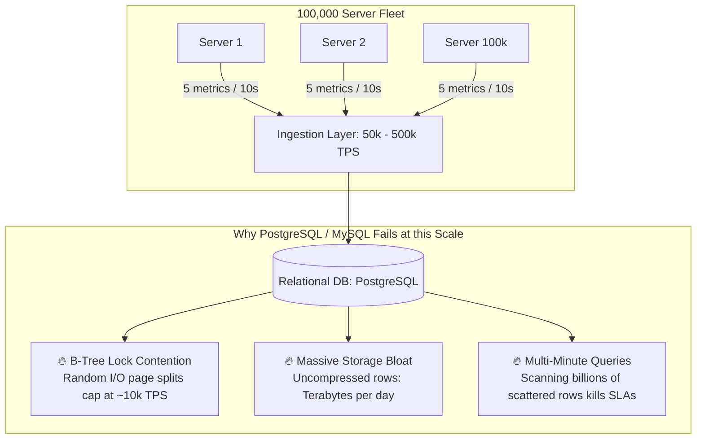
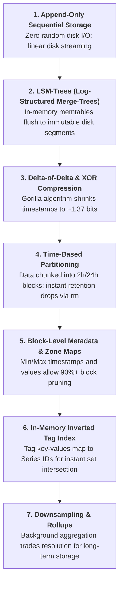
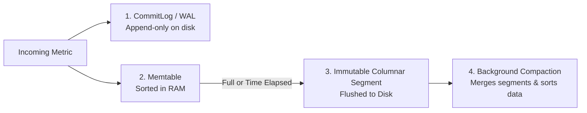
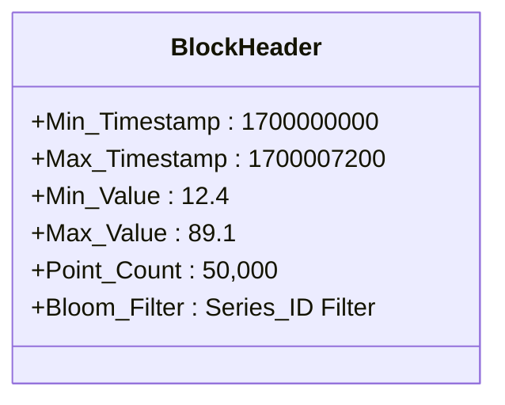
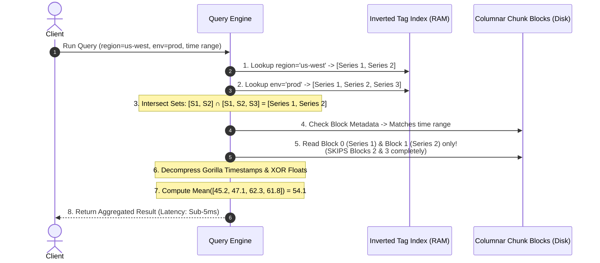
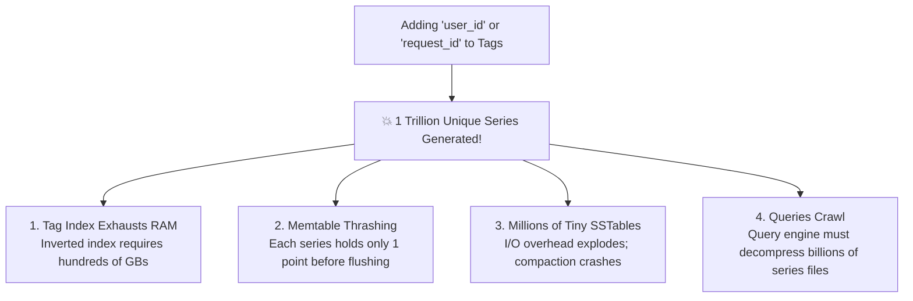

# Time-Series Databases (TSDB) Architecture & Internals

**Sources:** [How do Time Series Databases Work? (Hello Interview)](https://www.youtube.com/watch?v=Qd76ZmfRs_Q) | [Hello Interview Written Guide](https://www.hellointerview.com/learn/system-design/deep-dives/time-series-databases)

**TL;DR:** Time-Series Databases (TSDBs)—such as Prometheus, InfluxDB, TimescaleDB, VictoriaMetrics, and Facebook Gorilla—are specialized storage engines purpose-built for telemetry, metrics monitoring, and IoT event streams where data is append-only, immutable, timestamped, and queried across temporal ranges. By combining **append-only sequential storage**, **LSM-trees**, **Delta-of-Delta / XOR compression (Gorilla algorithm)**, **block-level zone maps**, and **in-memory inverted tag indexes**, TSDBs achieve **$10\times\text{--}100\times$ higher write throughput** and **$90\%+$ storage reduction** compared to relational databases.

---

## 1. The Motivating Problem: Why Relational Databases Fail

Imagine you are designing the monitoring infrastructure for a large cloud platform or tech company (like AWS, Datadog, or Airbnb):
*   **Scale:** A fleet of **100,000 servers**.
*   **Metrics per server:** 5 core metrics (`cpu_usage`, `memory_utilization`, `disk_read_iops`, `disk_write_iops`, `network_bytes_in`).
*   **Reporting Frequency:** Emitted every **10 seconds**.

### Back-of-the-Envelope Ingestion Load
$$\text{Baseline Write Throughput} = \frac{100,000 \text{ servers} \times 5 \text{ metrics}}{10 \text{ seconds}} = \mathbf{50,000\text{ writes/sec}}$$

*If servers synchronize and report on the same 10-second tick, peak burst load surges to **$500,000\text{ writes/sec}$**.*



### The Three Fatal Bottlenecks of RDBMS for Time-Series
1.  **Random Disk I/O & B-Tree Page Splits:**
    *   Standard relational databases store rows in B-Tree leaf pages. When indexing by `(host, timestamp)`, new incoming data causes continuous B-Tree balancing, page splits, and random disk writes.
    *   Mechanical disks cap out at **$100\text{--}200$ mechanical head seeks per second**. Even modern NVMe SSDs suffer from severe write amplification and lock contention, capping single-node relational writes at $\sim 10,000\text{ writes/sec}$.
2.  **Inefficient Storage Overhead:**
    *   In a standard table `(timestamp BIGINT, host VARCHAR, metric VARCHAR, value DOUBLE)`, storing each record costs $8 + 16 + 8 + 8 \approx 40\text{ bytes}$ plus tuple header overhead ($\sim 24\text{ bytes}$).
    *   $50,000 \text{ writes/sec} \times 64 \text{ bytes} \times 86,400 \text{ sec/day} \approx \mathbf{276\text{ GB/day}}$ of pure uncompressed data, accumulating billions of rows every week.
3.  **Row-Oriented Query Latency:**
    *   When an on-call engineer asks: *"What is the average CPU utilization of all web servers in us-west over the last 1 hour?"*, a row-oriented database must fetch the entire row for each point, extract the float value, and aggregate in memory. Reading millions of fragmented disk pages causes queries to take minutes instead of milliseconds.

---

## 2. The 7 Core Architectural Building Blocks of a TSDB

Time-series databases achieve extreme performance by exploiting the unique characteristics of time-series data: **writes are strictly sequential in time, data is never updated in-place, and queries always include a time range filter**.



---

### Building Block 1: Append-Only Sequential Storage
*   **The Physics:** Writing contiguously to disk is **$100\times\text{--}1,000\times$ faster** than random writes ($500\text{ MB/s}$ sequential throughput vs. slow random seeks).
*   **Mechanism:** When new telemetry data arrives, it is appended strictly to the tail of an immutable log. Existing data points are **never updated in place**.

---

### Building Block 2: LSM-Trees (Log-Structured Merge-Trees)
A TSDB applies LSM-tree storage primitives tailored for temporal telemetry:



1.  **Write-Ahead Log (WAL / CommitLog):** An append-only log on disk that guarantees durability. If the server crashes, the WAL replays unflushed writes on boot.
2.  **Memtable (RAM):** An in-memory buffer where active metrics are collected and organized by `(Series_ID, timestamp)`. Because data is mutable in RAM, incoming out-of-order points can be sorted cleanly.
3.  **Immutable Segments (Disk):** Once the Memtable reaches capacity (or after a time interval like 2 hours), it is flushed sequentially to disk as an immutable, compressed columnar file.
4.  **Compaction:** An asynchronous background worker merges adjacent immutable segments and purges deleted series without affecting the active write path.

---

### Building Block 3: Delta Encoding & Specialized Compression (Gorilla Algorithm)

Time-series data exhibits high mathematical regularity: adjacent timestamps arrive on predictable schedules, and adjacent float metrics fluctuate marginally. General-purpose compression (like Gzip or Zstandard) is too CPU-heavy for high-velocity streaming ingestion. TSDBs leverage the **Facebook Gorilla** compression algorithms:

#### A. Timestamps: Delta-of-Delta Encoding
Timestamps are stored as Unix epoch integers (e.g., nanoseconds, requiring 64 bits = 8 bytes per point).
*   **Observation:** Metrics are reported at steady intervals (e.g., every 10 seconds).
*   **Delta ($\Delta$):** The difference between current and previous timestamp:
    $$\Delta_i = t_i - t_{i-1} \approx 10\text{ seconds}$$
*   **Delta-of-Delta ($D$):** The difference between consecutive deltas:
    $$D = \Delta_i - \Delta_{i-1}$$

```text
Raw Timestamps:      [1700000000, 1700000010, 1700000020, 1700000030]  (4 x 8 = 32 bytes)
First Deltas (Δ):    [10, 10, 10]
Delta-of-Deltas (D): [0, 0]                                             (Stored as single bits '0'!)
```

*   **Variable-Length Bit Packing:**
    *   If $D = 0$: Stored as a **single bit `0`**.
    *   If $-63 \le D \le 64$: Stored as bits `10` followed by 7 bits of value.
    *   If $-255 \le D \le 256$: Stored as bits `110` followed by 9 bits of value.
    *   If large jitter: Stored as bits `111` followed by 32 bits.
*   **Compression Result:** **96% of timestamps compress to a single bit `0`**, reducing timestamp storage from **64 bits down to an average of $\sim 1.37$ bits per point**!

#### B. Float Values: XOR Floating-Point Compression
Metric values (e.g., CPU load `56.7`, `58.4`) are stored as 64-bit IEEE 754 floating-point numbers.
*   **Observation:** Consecutive float measurements share identical sign, exponent, and high-order mantissa bits.
*   **Mechanism:** XOR the current float bits with the previous float bits:
    $$\text{XOR} = \text{float}_i \oplus \text{float}_{i-1}$$
*   If the value did not change: $\text{XOR} = 0 \implies$ stored as a **single bit `0`**.
*   If the value changed: Stored using a single control bit `1` followed by variable-length bit packing of only the non-zero mantissa bits between the leading and trailing zero bits.
*   **Compression Result:** Shrinks 64-bit float storage down to an average of **$10\text{--}14$ bits per measurement**.

---

### Building Block 4: Time-Based Partitioning & Chunking
*   Data is partitioned into discrete, non-overlapping time blocks on disk (e.g., 2-hour blocks in Prometheus, daily chunks in InfluxDB).
*   **The Zero-Cost Retention Advantage:**
    *   In a relational database, deleting data older than 30 days requires running:
        ```sql
        DELETE FROM metrics WHERE timestamp < NOW() - INTERVAL '30 days';
        ```
        This triggers a massive row-by-row table scan, locks B-Tree pages, generates huge WAL logs, and leaves empty space that requires costly `VACUUM` operations.
    *   In a TSDB, deleting data older than 30 days is a simple **OS file-system call**:
        ```bash
        rm -rf /data/metrics/2023-10-15/
        ```
        It finishes in **$O(1)$ constant time** and instantly reclaims disk space with zero CPU or database overhead!

---

### Building Block 5: Block-Level Metadata & Zone Maps

Every immutable block written to disk embeds a lightweight header containing summary metadata:



*   **Query Pruning:** When executing a query with `WHERE time >= T1 AND time <= T2 AND value > 90`:
    *   The query planner inspects the block headers.
    *   If a block's `Max_Timestamp < T1` or `Max_Value < 90`, the entire multi-megabyte block is **pruned immediately without decompressing a single byte from disk**.

---

### Building Block 6: In-Memory Inverted Tag Index (TSI)

A single metric line in a TSDB contains labels/tags:
```text
cpu_usage,host=server-1,region=us-west,env=prod value=45.2 1700000000
```
*   **Definition of a "Time Series":** A unique combination of **Measurement Name + Key-Value Tags**.
*   **The Inverted Tag Index:** An in-memory data structure (analogous to Lucene / Elasticsearch) that maps each individual tag value to the list of matching internal `Series_ID` integers:

```text
Inverted Tag Index (RAM):
  region=us-west  --> [Series 1, Series 2]
  region=us-east  --> [Series 3, Series 4]
  env=prod        --> [Series 1, Series 2, Series 3]
  env=staging     --> [Series 4]
  host=server-1   --> [Series 1]
  host=server-2   --> [Series 2]
```

*   **Multi-Tag Filtering via Bitwise Set Intersection:**
    Query: `WHERE region='us-west' AND env='prod'`
    $$\text{Target Series} = [\text{Series } 1, \text{Series } 2] \cap [\text{Series } 1, \text{Series } 2, \text{Series } 3] = [\mathbf{Series\ 1, Series\ 2}]$$
    The database locates the exact matching series in microseconds using bitwise intersections, completely bypassing linear table scans.

---

### Building Block 7: Downsampling & Rollups
*   **The Reality of Monitoring:** High-resolution metrics (e.g., 10-second data) are critical for live incident debugging during the first 24–48 hours. After 30 days, nobody needs 10-second resolution—a 5-minute or 1-hour average is more than sufficient.
*   **Rollup Policies:**
    *   *Raw Data (10s resolution):* Retained for **7 days**.
    *   *5-Minute Rollups (Min, Max, Sum, Count):* Retained for **30 days** ($30\times$ space reduction).
    *   *1-Hour Rollups (Min, Max, Sum, Count):* Retained for **1 year** ($360\times$ space reduction).
*   **Query Performance:** A dashboard loading a 6-month historical graph queries the 1-hour rollup table, fetching only $\sim 4,300$ pre-aggregated data points instead of $1.5$ million raw points, rendering the chart instantly.

---

## 3. Putting It Together: End-to-End Query Walkthrough

Let us trace how data flows from ingestion to a multi-tag aggregation query.

### A. Data Ingestion & Storage Layout
Suppose the monitoring engine ingests metrics across 4 unique series:
*   `Series 1: cpu_usage,host=server-1,region=us-west,env=prod` $\to$ Stored in **Block 0**
*   `Series 2: cpu_usage,host=server-2,region=us-west,env=prod` $\to$ Stored in **Block 1**
*   `Series 3: cpu_usage,host=server-3,region=us-east,env=prod` $\to$ Stored in **Block 2**
*   `Series 4: cpu_usage,host=server-4,region=us-east,env=staging` $\to$ Stored in **Block 3**

```text
┌────────────────────────────────────────────────────────────────────────┐
│ On-Disk Chunk File (2-Hour Partition: Nov 15 00:00 - 02:00)           │
├────────────────────────────────────────────────────────────────────────┤
│ Block 0 (Series 1): Timestamps: [Base+Δ-of-Δ], Values: [XOR Compressed]│
│ Block 1 (Series 2): Timestamps: [Base+Δ-of-Δ], Values: [XOR Compressed]│
│ Block 2 (Series 3): Timestamps: [Base+Δ-of-Δ], Values: [XOR Compressed]│
│ Block 3 (Series 4): Timestamps: [Base+Δ-of-Δ], Values: [XOR Compressed]│
└────────────────────────────────────────────────────────────────────────┘
```

### B. Executing a Multi-Tag Query
The user executes:
```sql
SELECT mean(value) FROM cpu_usage 
WHERE region = 'us-west' AND env = 'prod' 
  AND time >= 1700000000 AND time <= 1700007200;
```



---

## 4. Where Things Break: The High-Cardinality Trap

Every distributed system optimization relies on core assumptions. For time-series databases, **the entire architecture relies on the assumption that the total number of distinct series is small to moderate (thousands to hundreds of thousands)**.

### The Cardinality Explosion
The total number of time series created in a TSDB is the Cartesian product of all unique tag values:

$$\text{Total Series} = \text{Metric Names} \times \prod_{i=1}^k |\text{Tag}_i|$$

*   **The Scenario:** You decide to add a `user_id` or `request_id` tag to your metrics:
    *   100 metric names
    *   1,000 servers
    *   **10,000,000 unique users**
*   **The Result:**
    $$100 \times 1,000 \times 10,000,000 = \mathbf{1,000,000,000,000\text{ (1 Trillion Series!)}}$$



> [!CAUTION]
> ### 🚨 The Cardinality Rule for Interviews
> *   **Tags / Labels:** Must be reserved strictly for **low-cardinality** categorical dimensions (`region`, `env`, `service_name`, `status_code`, `host_id`).
> *   **High-Cardinality Data:** User IDs, session IDs, request URLs, and UUIDs must **never be indexed as tags**. They should be stored as unstructured **Fields / Payloads** (or routed to a log database like Elasticsearch or ClickHouse).

---

## 5. The Top-K Sorting Gotcha in Interviews

In system design interviews, candidates often propose a TSDB for questions like:
> *"Find the top 10 users generating the most API requests in the last hour."*

### Why a TSDB is the WRONG Choice for Top-K:
1.  **Series Organization:** TSDBs organize data along the time dimension *within* a series. They are designed to query: `Given Series X, give me points over Time [T1, T2]`.
2.  **Cross-Series Sorting Overhead:** To find the Top-K users, a TSDB must scan the inverted index, locate millions of user series, decompress all their blocks on disk, compute the sum for each user, and sort them in application memory.
3.  **The Superior Alternative:**
    *   For streaming Top-K: Use Apache Flink / Spark Streaming with a **Count-Min Sketch + Min-Heap** (see [Data Structures for Big Data](../Data%20Structures%20for%20Big%20Data/)).
    *   For analytical Top-K: Use a columnar OLAP database like **ClickHouse**, **Apache Pinot**, or **Google BigQuery**.

---

## 6. Technology Landscape Comparison

| Technology | Underlying Architecture | Best Used For | Limitations in Interviews |
| :--- | :--- | :--- | :--- |
| **Prometheus** | Custom local on-disk TSDB (2h chunks, Gorilla compression) | Kubernetes cluster monitoring, microservice alerts, pull-based metrics | Single-node by default; requires Cortex / Thanos for long-term multi-cluster storage |
| **TimescaleDB** | PostgreSQL extension (automatic table partitioning into *hypertables*) | When you already use PostgreSQL and need relational joins alongside time-series data | Inherits PostgreSQL write overhead; higher storage footprint than pure TSDBs |
| **InfluxDB (v3/IOx)** | Apache Arrow & DataFusion columnar engine with Parquet on object storage | IoT device metrics, event logging, sensor feeds | Historically suffered from high cardinality in v1/v2 (TSI index crashes) |
| **VictoriaMetrics** | High-performance Go-based TSDB, drop-in replacement for Prometheus | Ultra-low RAM usage, massive scale multi-tenant metrics | Specialized for metrics; lacks general-purpose relational features |
| **ClickHouse** | Columnar OLAP database (MergeTree engine) | Log analytics, high-cardinality telemetry (`user_id`, `url`), ad-hoc aggregations | Requires manual partitioning and schema design; heavier setup than Prometheus |

---

## 7. System Design Interview Playbook

```mermaid
flowchart TD
    Start{What are you designing?}

    Start -->|Metrics & Monitoring (Datadog, CloudWatch)| Q1{Are tags low-cardinality?}
    Q1 -->|Yes: host, region, status_code| PickTSDB[<b>CHOOSE TSDB</b><br/>Prometheus, InfluxDB, VictoriaMetrics]
    Q1 -->|No: user_id, request_id, raw traces| PickOLAP[<b>CHOOSE COLUMNAR OLAP</b><br/>ClickHouse, OpenSearch, BigQuery]

    Start -->|Relational data with temporal history| PickTimescale[<b>CHOOSE TIMESCALEDB</b><br/>PostgreSQL Hypertables + Relational JOINs]

    Start -->|Top-K Viral Items / Heavy Hitters| PickStream[<b>CHOOSE STREAMING + SKETCH</b><br/>Kafka + Flink + Count-Min Sketch]

    Start -->|Transactional eCommerce / Payments| PickSQL[<b>CHOOSE RELATIONAL RDBMS</b><br/>PostgreSQL / Spanner]
```

### When to Propose a TSDB
1.  **System Monitoring & Alerting Platforms:** Designing Datadog, Prometheus, or AWS CloudWatch (tracking CPU, RAM, disk, network, error rates).
2.  **IoT & Sensor Telemetry:** Thousands of smart meters, weather sensors, or vehicle fleets sending periodic status pings.
3.  **Financial Market Tick Feeds:** Stock prices, bid/ask trade ticks arriving sequentially over time.

### The 4 Major Interview Traps
1.  **Trap 1: The Cardinality Blindspot:** Blindly putting `user_id` or `uuid` into metric tags without addressing index blowup. Explicitly tell the interviewer: *"I will keep `user_id` in the field payload, not as an indexed tag, to prevent cardinality explosion in the tag index."*
2.  **Trap 2: Proposing SQL Deletions for Retention:** Recommending `DELETE FROM metrics WHERE timestamp < 30_days_ago`. Highlight that TSDBs drop data in $O(1)$ time by deleting partitioned chunk directories from the file system.
3.  **Trap 3: Averaging Percentiles:** Attempting to compute global p99 by averaging server p99 metrics. Use histogram buckets with exponential boundaries instead.
4.  **Trap 4: Missing Downsampling:** Designing a system that stores raw 10-second data forever. Always specify a 3-tier retention policy (Raw 7d $\to$ 5m rollups 30d $\to$ 1h rollups 1y).
