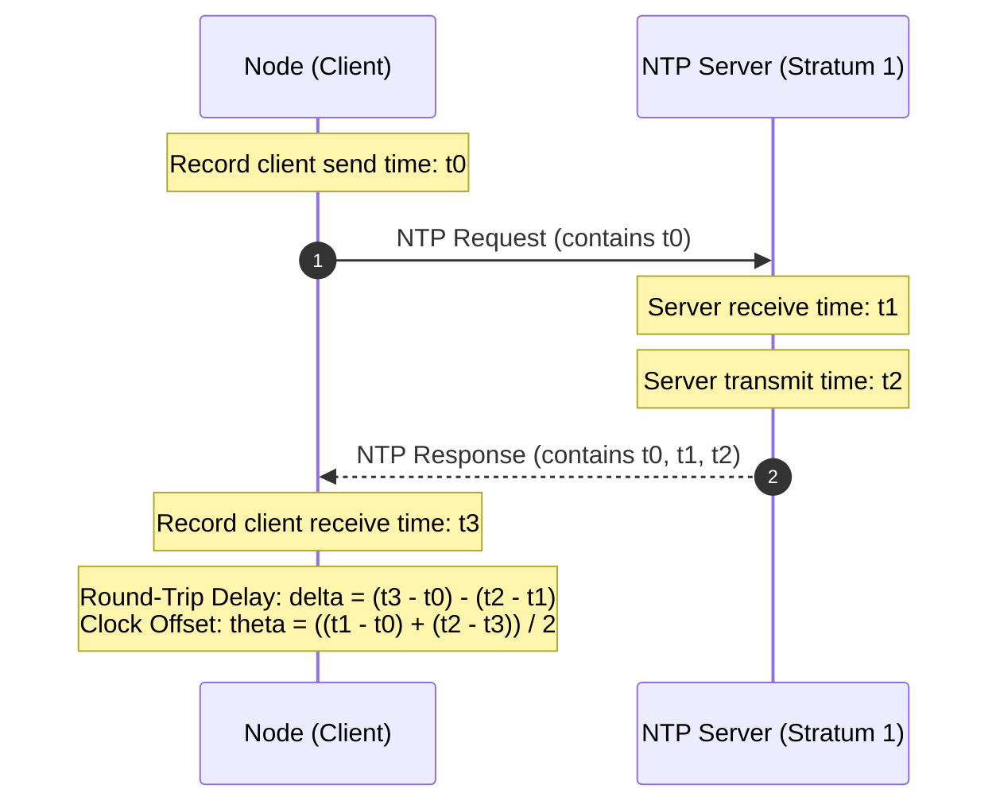
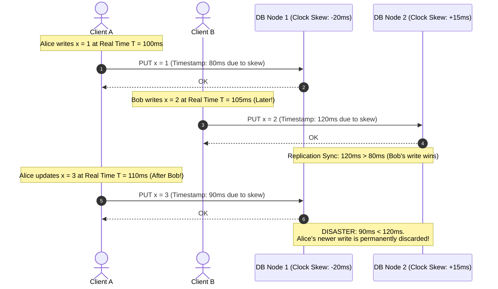
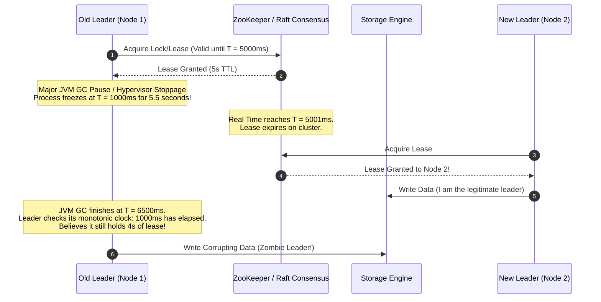
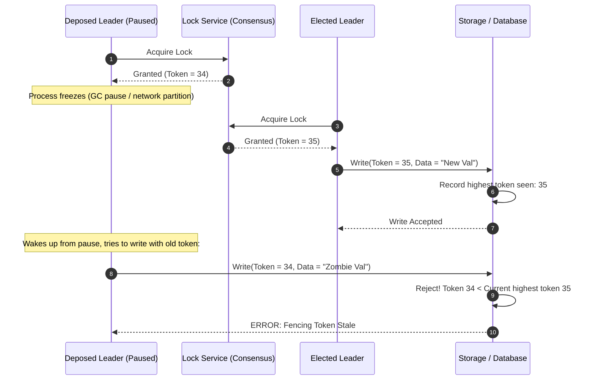
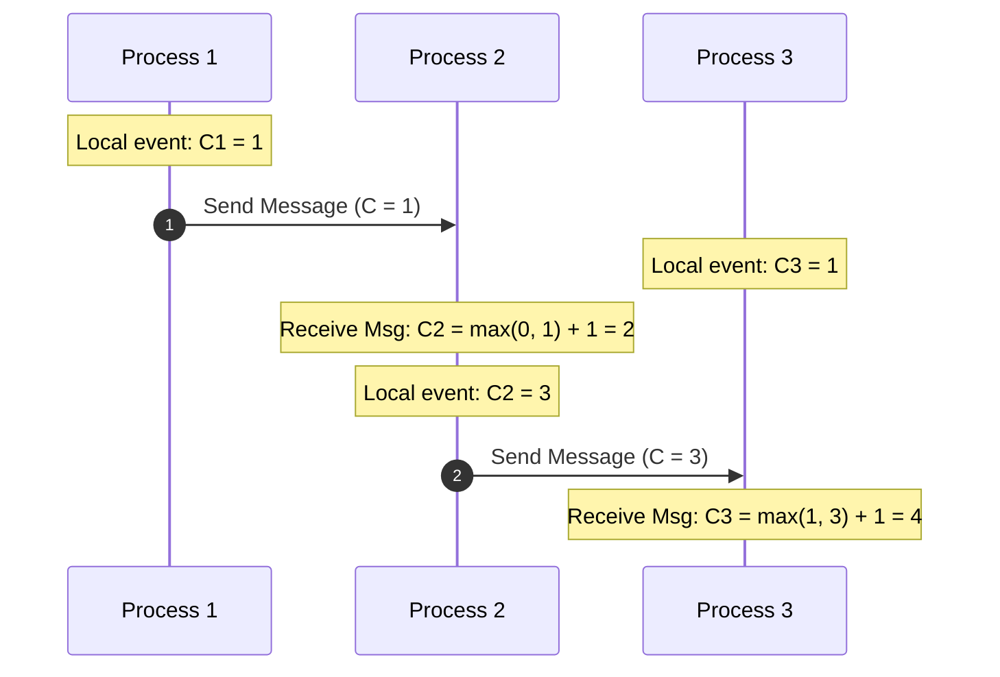
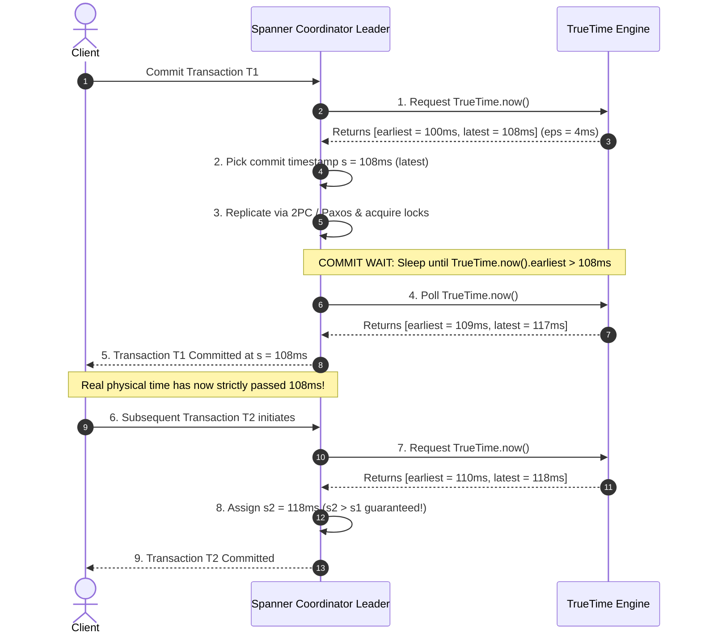
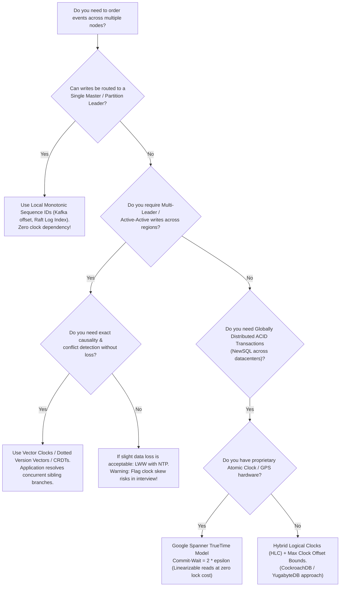

# Timing Mechanisms in Distributed Systems: Physical Clocks, Logical Clocks, Vector Clocks, HLC & TrueTime

**Sources & Foundational References:**
- [Time, Clocks, and the Ordering of Events in a Distributed System (Leslie Lamport, 1978 - CACM)](https://lamport.azurewebsites.net/pubs/time-clocks.pdf)
- [Database Internals: A Deep Dive into How Distributed Data Systems Work (Alex Petrov, 2019 - O'Reilly)](https://www.oreilly.com/library/view/database-internals/9781492040330/) — *Part II: Chapters 8, 11, 13*
- [Understanding Distributed Systems, 2nd Edition (Roberto Vitillo, 2021)](https://understandingdistributed.systems/) — *Chapter 8: Time*
- [Designing Data-Intensive Applications (Martin Kleppmann, 2017 - O'Reilly)](https://dataintensive.net/) — *Chapter 8: The Trouble with Distributed Systems (Unreliable Clocks)*
- [Logical Physical Clocks and Consistent Snapshots in Globally Distributed Databases (Sandeep Kulkarni et al., 2014)](https://cse.buffalo.edu/tech-reports/2014-04.pdf) — *Hybrid Logical Clocks (HLC)*
- [Spanner: Google’s Globally-Distributed Database (James C. Corbett et al., 2012 - OSDI)](https://research.google/pubs/pub39966/) — *TrueTime API & Commit Wait*

---

## Executive Summary (TL;DR)

In single-machine programming, time is taken for granted: CPU instructions execute sequentially, and `System.currentTimeMillis()` provides a globally consistent timeline. In a **Distributed System**, this illusion collapses:
1. **There is no shared global clock:** Every machine has its own physical quartz crystal that drifts due to thermal variations and manufacturing imperfections (**clock drift**).
2. **Network latency is unbounded:** Messages take unpredictable amounts of time to travel across switches and routers, making it mathematically impossible to synchronize clocks perfectly over a network.
3. **Physical time cannot establish causality:** Relying on wall-clock timestamps for operations across nodes causes catastrophic data corruption, such as **Last-Write-Wins (LWW) silent data loss** and **split-brain lease violations**.

To restore order, distributed systems employ an evolutionary hierarchy of timing mechanisms:
* **Physical Clocks (NTP):** Synchronize wall-clock time within milliseconds. Unreliable for strict ordering; subject to non-monotonic backward jumps and unpredictable drift.
* **Lamport Timestamps:** Abstract away wall-clock time into monotonically incrementing scalar counters. Guarantees that if event $A$ caused event $B$, then $L(A) < L(B)$. **Fatal flaw:** The converse is false—it cannot detect concurrency ($A \parallel B$).
* **Vector Clocks:** Use an array of $N$ counters (one per node). Captures exact **causality and concurrency**. **Fatal flaw:** Storage overhead scales linearly ($O(N)$) with the number of actors, causing vector explosion.
* **Hybrid Logical Clocks (HLC):** Combines physical wall-clock time with logical sequence counters into a compact 64/128-bit structure. Tracks causality while remaining tightly bounded to physical time ($|l - pt| \le \epsilon$). Adopted by **CockroachDB, YugabyteDB, and MongoDB**.
* **TrueTime (Hardware-Assisted Physical Clocks):** Google Spanner deploys GPS receivers and Rubidium atomic clocks in every datacenter, exposing time as an uncertainty interval $[t.earliest, t.latest]$ ($\epsilon \le 7\text{ ms}$). By enforcing the **Commit Wait Rule** (sleeping until the uncertainty window passes), Spanner achieves **Strict Serializability (Linearizability)** globally without read coordination.

---

## 1. The Physics of Time: Why Physical Clocks Fail

### A. Quartz Oscillators, Clock Drift & Clock Skew
Computers track time using quartz crystal oscillators. When an electric charge is applied, the quartz vibrates at a specific frequency (typically $32,768\text{ Hz}$). A counter register increments with each oscillation.

```
┌─────────────────┐       ┌─────────────────┐       ┌─────────────────┐
│     Node A      │       │     Node B      │       │     Node C      │
│  Quartz Clock   │       │  Quartz Clock   │       │  Quartz Clock   │
│ (Runs +17 ppm)  │       │ (Exact / Base)  │       │ (Runs -23 ppm)  │
│  12:00:00.000   │       │  12:00:00.000   │       │  12:00:00.000   │
└────────┬────────┘       └────────┬────────┘       └────────┬────────┘
         │                         │                         │
         │  After 48 Hours:        │                         │
         ▼                         ▼                         ▼
   12:00:02.937              12:00:00.000              11:59:56.025
   (+2.9 seconds)                                      (-3.9 seconds)
```

Two critical terms distinguish physical time discrepancies:
1. **Clock Drift:** The difference in the *rate* (frequency) at which two clocks run. Standard server quartz crystals drift by roughly **$10\text{ to }50\text{ ppm}$** (parts per million), translating to **$1\text{ to }5\text{ seconds of error per day}$** if left unsynchronized. Drift varies with ambient temperature, humidity, and component aging.
2. **Clock Skew:** The instantaneous *difference in time* between two clocks at a specific instant:
   $$\text{Skew}(t) = |C_A(t) - C_B(t)|$$

---

### B. Time-of-Day Clocks vs. Monotonic Clocks
Modern operating systems provide two fundamentally distinct physical clock APIs:

| Property | Time-of-Day Clock (`CLOCK_REALTIME`) | Monotonic Clock (`CLOCK_MONOTONIC`) |
| :--- | :--- | :--- |
| **Common API** | `System.currentTimeMillis()`, POSIX `gettimeofday()` | `System.nanoTime()`, `clock_gettime(CLOCK_MONOTONIC)` |
| **Reference Point** | Unix Epoch (Jan 1, 1970 00:00:00 UTC) | Arbitrary point (e.g., system boot time) |
| **Monotonicity** | ❌ **Non-monotonic.** Can jump **backwards** if NTP steps the clock or during leap seconds. | ✅ **Strictly monotonic.** Guaranteed to never jump backwards. |
| **Primary Use Case** | Wall-clock timestamps for human consumption (logging, UI). | Measuring elapsed durations, thread timeouts, local latencies. |
| **Distributed Scope** | Comparable across machines (subject to skew). | **Meaningless across machines** (Node A's boot time $\ne$ Node B's). |

> [!CAUTION]
> **Production Anti-Pattern:** Never calculate timeout durations using `CLOCK_REALTIME` (e.g., `deadline = currentTimeMillis() + 5000`). If NTP synchronizes and steps the server clock backwards by 10 seconds, your thread will hang for 15 seconds instead of 5. Always use `System.nanoTime()` for local timeouts.

---

### C. Network Time Protocol (NTP) & Its Impossibility Boundaries
To combat drift, distributed machines periodically synchronize with NTP servers organized in hierarchical tiers (**Stratums**):
* **Stratum 0:** High-precision reference clocks (Atomic cesium clocks, GPS satellite receivers).
* **Stratum 1:** Servers directly connected to Stratum 0 hardware devices.
* **Stratum 2:** Servers that sync with Stratum 1 servers over the network (most cloud servers sync here).



#### Why NTP Cannot Provide Microsecond Guarantees:
1. **Network Asymmetry:** NTP's offset calculation assumes that the network latency from Client $\to$ Server is identical to Server $\to$ Client. In public clouds or congested cross-datacenter WANs, packet routing and buffering are asymmetrical. If outbound takes $10\text{ ms}$ and inbound takes $50\text{ ms}$, NTP calculates an incorrect clock offset.
2. **Slew vs. Step:** When an offset is detected:
   * **Slewing:** If the skew is small ($< 128\text{ ms}$), the OS kernel gradually warps the clock speed (accelerating or slowing it down by up to $500\text{ ppm}$) to smoothly converge without backward jumps. This convergence takes minutes.
   * **Stepping:** If the skew exceeds $128\text{ ms}$, NTP **steps** the clock, causing an instantaneous forward or backward jump.
3. **The Uncertainty Floor:** In virtualized cloud environments (AWS EC2, GCP Compute Engine), NTP skew typically fluctuates between **$1\text{ ms}$ and $100\text{ ms}$**, with occasional multi-second spikes during VM hypervisor live migrations.

---

## 2. Real-World Failures: When Physical Clocks Break Data

### A. Silent Data Loss in Last-Write-Wins (LWW)
Distributed databases with leaderless architectures (like **Apache Cassandra** and **ScyllaDB**), as well as cross-region active-active replicas (like **Amazon DynamoDB Global Tables** and the original 2007 **Amazon Dynamo** system), resolve concurrent updates to the same key using **Last-Write-Wins (LWW)** based on client-side or coordinator wall-clock timestamps. *(Note: Single-region AWS DynamoDB uses single-leader Paxos consensus per partition and is strongly consistent for writes; LWW only applies to its multi-region Global Tables).*



> **The Catastrophe:** Even though Alice updated $x = 3$ *after* Bob updated $x = 2$ in physical reality, Node 1's slow clock generated timestamp `90ms`. The database evaluated `90ms < 120ms`, quietly discarded Alice's newer write, and permanently resurrected Bob's older data. **LWW violates causality.**

---

### B. Broken Leases & Split-Brain Execution (JVM Pauses)
Many distributed consensus systems use **timed leases** to allow a leader to serve reads locally without consulting a quorum. A leader acquires a lease for, say, $5\text{ seconds}$.



#### The Defense: Fencing Tokens (Epoch Generation)
To survive clock anomalies and process pauses, Martin Kleppmann formalized the **Fencing Token** pattern:



---

## 3. Logical Clocks: Ordering Without Physical Time

In 1978, Leslie Lamport published the foundational paper that redefined distributed systems: **physical time does not matter; what matters is the causal ordering of events.**

### A. The "Happened-Before" Relation ($\to$)
Given two events $a$ and $b$, we say $a$ **happened-before** $b$ ($a \to b$) if and only if:
1. **Intra-Process Order:** $a$ and $b$ occur within the same process, and $a$ occurred before $b$.
2. **Message Passing:** $a$ is the sending of a message by one process, and $b$ is the receipt of that same message by another process.
3. **Transitivity:** If $a \to b$ and $b \to c$, then $a \to c$.

If neither $a \to b$ nor $b \to a$, then $a$ and $b$ are **concurrent** ($a \parallel b$). Concurrent events have no causal relationship.

---

### B. Lamport Timestamps: Algorithm & Guarantees
A **Lamport Clock** is a simple monotonically increasing integer counter maintained independently by each node.

#### The Algorithm:
1. Each process $i$ initializes its local clock: $C_i = 0$.
2. Before executing any local event, process $i$ increments its clock:
   $$C_i \leftarrow C_i + 1$$
3. When sending a message $m$, process $i$ attaches its current clock value: $(m, C_i)$.
4. When process $j$ receives message $(m, C_{msg})$, it updates its local clock:
   $$C_j \leftarrow \max(C_j, C_{msg}) + 1$$



#### The Fundamental Guarantee:
$$\text{If } a \to b \implies C(a) < C(b)$$

#### The Critical Limitation (Why Lamport Clocks Are Not Enough):
The converse is **FALSE**:
$$C(a) < C(b) \not\implies a \to b$$

In the diagram above, look at event $A$ on $P_1$ ($C = 1$) and event $B$ on $P_3$ ($C = 1$). Their timestamps are identical, but they were completely independent. If $P_3$ had an event with $C = 2$ before receiving $P_2$'s message, $C(A) < C(B)$ would be true, **yet $A$ did not cause $B$**! 

> **Summary:** Lamport timestamps impose a **total ordering** (by breaking ties with Process ID: $(C_i, i)$), but **cannot detect whether two events are causally related or concurrent**.

---

## 4. Vector Clocks: Full Concurrency & Causality Detection

To detect concurrency ($a \parallel b$), Colin Fidge and Friedemann Mattern independently invented **Vector Clocks** in 1988.

### A. The Algorithm
In a system of $N$ processes, each process $P_i$ maintains a vector of $N$ integers:
$$V_i = [v_1, v_2, \dots, v_N]$$
Where $V_i[j]$ represents the number of events that $P_i$ knows process $P_j$ has executed.

#### Update Rules:
1. Initially, all processes set all vector elements to zero: $\forall k, V_i[k] = 0$.
2. Before a local event, process $P_i$ increments its own entry:
   $$V_i[i] \leftarrow V_i[i] + 1$$
3. When sending a message, $P_i$ attaches its entire vector: $(m, V_i)$.
4. When process $P_j$ receives $(m, V_{msg})$, it merges the vectors by taking the pairwise maximum, and then increments its own entry:
   $$\forall k, \quad V_j[k] \leftarrow \max(V_j[k], V_{msg}[k])$$
   $$V_j[j] \leftarrow V_j[j] + 1$$

```
Process 1: [1, 0, 0] ───────────────► Send to P2
                                       │
Process 2: [0, 0, 0] ──────────────────┴─► Recv: max([0,0,0], [1,0,0]) + inc P2
                                           Local Clock = [1, 1, 0]
```

---

### B. Determining Causality vs. Concurrency
Given two vector timestamps $V_A$ and $V_B$:

1. **Equal:** $V_A = V_B \iff \forall k, V_A[k] = V_B[k]$
2. **Less Than or Equal:** $V_A \le V_B \iff \forall k, V_A[k] \le V_B[k]$
3. **Causally Precedes ($A \to B$):**
   $$V_A < V_B \iff (V_A \le V_B) \land (\exists k, V_A[k] < V_B[k])$$
4. **Concurrent ($A \parallel B$ - Conflict!):**
   $$A \parallel B \iff \neg(V_A \le V_B) \land \neg(V_B \le V_A)$$

#### Concrete Comparison Example:
* Let $V_A = [2, 1, 0]$
* Let $V_B = [2, 2, 1]$
  * Since $2 \le 2$, $1 \le 2$, and $0 \le 1$ (and $V_A \ne V_B$), **$A \to B$ ($A$ happened before $B$)**.
* Let $V_C = [3, 0, 1]$
  * Compare $V_A [2, 1, 0]$ and $V_C [3, 0, 1]$:
    * In index 0: $2 < 3$ ($V_A < V_C$)
    * In index 1: $1 > 0$ ($V_A > V_C$)
  * **Neither vector dominates the other!** Therefore, **$A \parallel C$ (Concurrent)**. The database must retain both versions as siblings and trigger conflict resolution!

---

### C. The Engineering Problem: Vector Explosion
While vector clocks provide exact causality, they suffer from a fatal production scaling flaw:
* Size of the vector is $O(N)$, where $N$ is the number of participating nodes/writers.
* In Amazon Dynamo's original architecture, client requests updated shopping carts through different stateless edge nodes. Over time, vectors grew to hundreds of entries, consuming kilobytes per database row!

#### Mitigation: Dotted Version Vectors (DVVs)
Modern distributed databases (e.g., **Riak 2.0**) use **Dotted Version Vectors (DVVs)**. A "dot" is a pair `(node_id, counter)` representing a single discrete write. DVVs decouple the causal history of the container from individual values, allowing safe log truncation and pruning of inactive nodes without corrupting causal tracking.

---

## 5. Hybrid Logical Clocks (HLC): The Modern Distributed DB Standard

Vector clocks don't scale to thousands of nodes and don't correlate with physical time. Pure physical clocks suffer from skew and silent data loss. 

In 2014, Sandeep Kulkarni et al. created **Hybrid Logical Clocks (HLC)** to achieve the best of both worlds. HLC is the foundational time engine inside **CockroachDB, YugabyteDB, and MongoDB**.

```
┌────────────────────────────────────────────────────────┐
│             Hybrid Logical Clock (HLC)                 │
├───────────────────────────┬────────────────────────────┤
│ Physical Component (l)    │ Logical Counter (c)        │
│ 48 bits (Milliseconds)    │ 16 bits (Sequence Counter) │
│ Tracks physical time      │ Increments on collisions   │
└───────────────────────────┴────────────────────────────┘
```

### A. The Core Invariants of HLC
An HLC timestamp is a tuple $(l, c)$, where $l$ tracks the highest physical time observed, and $c$ is a logical sequence counter for events occurring within the same physical millisecond.

HLC guarantees four mathematical properties:
1. **Causality:** If $e \to f$, then $HLC(e) < HLC(f)$.
2. **Bounded Drift from Physical Time:** The physical component $l$ is strictly bounded by the maximum NTP offset $\epsilon$:
   $$|l(e) - pt(e)| \le \epsilon$$
   *(Where $pt(e)$ is the local physical wall-clock time).*
3. **Space Efficiency:** Fixed $64$-bit or $128$-bit size (e.g., 48 bits for epoch milliseconds + 16 bits for logical sequence counter). Fits in a single database column without growing with cluster size!
4. **Human Readability:** $l(e)$ directly maps to standard UTC time.

---

### B. The HLC Algorithm (Python Implementation)

```python
import time

class HybridLogicalClock:
    def __init__(self, max_clock_offset_ms=500):
        self.l = 0  # Highest physical time seen (milliseconds)
        self.c = 0  # Logical sequence counter
        self.epsilon = max_clock_offset_ms  # Max tolerated NTP drift

    def physical_time(self) -> int:
        """Reads local OS physical wall-clock in milliseconds."""
        return int(time.time() * 1000)

    def local_event(self) -> tuple[int, int]:
        """Executed on local write mutation or message send."""
        pt = self.physical_time()
        l_old = self.l

        # 1. Update physical component to max of local physical time and previous HLC
        self.l = max(l_old, pt)

        # 2. Update logical sequence counter
        if self.l == l_old:
            self.c += 1
        else:
            self.c = 0

        # 3. Drift check: abort if logical clock ran too far ahead of physical reality
        if self.l - pt > self.epsilon:
            raise RuntimeError("Clock skew exceeded threshold! Aborting to prevent data corruption.")

        return (self.l, self.c)

    def receive_message(self, msg_l: int, msg_c: int) -> tuple[int, int]:
        """Executed when receiving a remote RPC or replication message."""
        pt = self.physical_time()
        l_old = self.l

        # 1. Advance physical component to max of local physical, old HLC, and remote HLC
        self.l = max(l_old, pt, msg_l)

        # 2. Update logical counter based on which timestamp was dominant
        if self.l == l_old and self.l == msg_l:
            self.c = max(self.c, msg_c) + 1
        elif self.l == l_old:
            self.c += 1
        elif self.l == msg_l:
            self.c = msg_c + 1
        else:
            self.c = 0

        # 3. Drift check
        if self.l - pt > self.epsilon:
            raise RuntimeError("Clock skew exceeded threshold on message receive!")

        return (self.l, self.c)
```

---

## 6. Hardware-Synchronized Clocks: Google Spanner & TrueTime

Google solved the distributed time problem not with pure software algorithms, but by combining **specialized datacenter hardware with strict mathematical wait periods**.

### A. The TrueTime Architecture
Every Google datacenter cluster contains dedicated **Time Master** servers equipped with two independent, redundant hardware sources:
1. **GPS Receivers** with dedicated antennas on datacenter roofs.
2. **Rubidium Atomic Clocks** installed in server racks.

```
┌─────────────────────────────────┐       ┌─────────────────────────────────┐
│     GPS Receiver Antenna        │       │      Rubidium Atomic Clock      │
│  (Fails on antenna/sat issues)  │       │     (Independent drift rates)   │
└────────────────┬────────────────┘       └────────────────┬────────────────┘
                 │                                         │
                 └───────────────────┬─────────────────────┘
                                     ▼
                       ┌───────────────────────────┐
                       │   TrueTime Master Daemon  │
                       │   Filters asymmetric lag  │
                       └─────────────┬─────────────┘
                                     │ Periodic sync via daemon
                                     ▼
                       ┌───────────────────────────┐
                       │   Spanner Worker Node     │
                       │ TrueTime.now() -> [earliest, latest] │
                       │    Uncertainty: eps <= 7ms│
                       └───────────────────────────┘
```

Why pair GPS and Atomic Clocks? **They have orthogonal, independent failure modes:**
* GPS can fail due to antenna damage, solar storms, or satellite misconfigurations, but when working, has zero drift.
* Atomic clocks never lose satellite signal, but slowly drift over months.
* If GPS fails, the atomic clock holds drift within microsecond bounds until technicians intervene.

---

### B. The TrueTime API: Time as an Uncertainty Interval
TrueTime never returns a single scalar timestamp. It explicitly returns an **uncertainty interval**:

$$\text{TrueTime.now}() = [t.\text{earliest}, \quad t.\text{latest}]$$

Where:
$$\text{Width of Interval} = 2\epsilon = t.\text{latest} - t.\text{earliest}$$
* In Google data centers, $\epsilon$ is typically **$< 1\text{ ms}$**, with worst-case bounds guaranteed at **$\epsilon \le 7\text{ ms}$**.

---

### C. The Commit Wait Rule (Engineering Linearizability)
Google Spanner's crowning achievement is providing **External Consistency (Strict Serializability / Linearizability)** for multi-datacenter distributed transactions:
> **External Consistency:** If transaction $T_2$ starts *after* transaction $T_1$ commits in real-world physical time, then $T_2$'s commit timestamp **must be strictly greater than** $T_1$'s commit timestamp ($s_2 > s_1$).

How does Spanner guarantee this without cross-datacenter locking on reads? **By waiting out the clock uncertainty.**



#### Why Read Transactions Cost Zero Coordination:
Because every write is guaranteed to commit at a timestamp $s$ that reflects absolute real physical time:
* Any read query specifying timestamp $T_{\text{read}}$ can be served by **any local read replica** whose local Write-Ahead Log has caught up to $T_{\text{read}}$.
* The read transaction **takes zero locks** and **makes zero cross-region network RPCs** to the leader!

---

## 7. Distributed Monotonic ID Generation

When systems do not require full transactional linearizability but need globally unique, monotonically increasing IDs (e.g., database primary keys, payment transactions, message sequence IDs), coordinate-free ID generators are used.

```
┌────────────────────────────────────────────────────────────────────────┐
│                   64-Bit Snowflake ID Layout                           │
├───────────────┬───────────────────────────────┬───────────┬────────────┤
│ 1 Bit (Unused)│ 41 Bits (Millisecond Timestamp)│ 10 Bits   │ 12 Bits    │
│ Always 0      │ ~69 Years from Custom Epoch   │ Worker ID │ Sequence ID│
│               │ (e.g. Nov 4, 2010 Twitter)    │ (1024 IDs)│ (4096/ms)  │
└───────────────┴───────────────────────────────┴───────────┴────────────┘
```

| ID Scheme | Size | Structure | Lexicographically Sortable? | Standard / Implementation |
| :--- | :--- | :--- | :--- | :--- |
| **Twitter Snowflake** | 64 bits | 41-bit time + 10-bit machine ID + 12-bit sequence | ✅ Yes (Within ~1ms) | Sonyflake, Discord IDs, Instagram |
| **ULID** | 128 bits | 48-bit time + 80-bit crypto-randomness | ✅ Yes (Base32 encoded) | Open-source standard |
| **UUIDv7** | 128 bits | 48-bit time + 12-bit rand + 62-bit rand | ✅ Yes (Native UUID format) | **RFC 9562 (Official IETF Standard)** |
| **UUIDv4** | 128 bits | 122 bits pure pseudorandomness | ❌ No (Completely random) | Causes B-Tree page splits |

---

## 8. Master Comparison & Technology Selection Matrix

| Timing Mechanism | Ordering Guarantee | Concurrency Detection ($A \parallel B$)? | Storage Overhead | Physical Time Correlation | Production Adopters | Primary Trade-Off / Pitfall |
| :--- | :--- | :--- | :--- | :--- | :--- | :--- |
| **Physical NTP Clocks** | Non-monotonic; Weak | ❌ No | 64-bit int | ✅ Real wall-clock | Standard Linux OS | Silent data loss via LWW; clock backward steps. |
| **Lamport Timestamps** | Total ordering (with PID) | ❌ No | 64-bit counter | ❌ None (Arbitrary) | Automerge, distributed mutexes | Cannot distinguish concurrent from causal events. |
| **Vector Clocks** | Causal Partial ordering | ✅ **Yes (Exact)** | $O(N)$ vector array | ❌ None | Riak, Amazon Dynamo (original) | Vector explosion; high metadata payload overhead. |
| **Hybrid Logical Clocks (HLC)** | Causal Partial ordering | ⚠️ Partial (Causal order, bounded drift) | 64 / 128 bits (Fixed) | ✅ Tightly bounded ($|l - pt| \le \epsilon$) | **CockroachDB, YugabyteDB, MongoDB** | If node clock drifts beyond $\epsilon$, node must self-terminate. |
| **Google TrueTime** | **Strict Serializability (Linearizability)** | ✅ Yes (Physical intervals) | 128-bit interval | ✅ High-precision absolute UTC | **Google Spanner** | Requires proprietary atomic clocks & GPS hardware; commit-wait latency penalty. |

---

## 9. Staff-Level Interview Decision Framework



### The 4 Golden Rules for System Design Interviews:
1. **Never Propose Physical Timestamps for Distributed Mutexes or Consensus:** If an interviewer asks you to build a distributed lock or leader election, never rely on `System.currentTimeMillis()`. Always use **Raft/Paxos leader leases with Fencing Tokens (monotonically increasing epochs)** to prevent zombie leaders after JVM pauses.
2. **Call Out the LWW Pitfall Proactively:** If designing a system like Cassandra, Couchbase, or DynamoDB Global Tables, demonstrate seniority by saying: *"We can use Last-Write-Wins for simplicity if updates are commutative, but because NTP clocks skew by 10–50ms, a newer write can be silently overwritten by an older write. For strict consistency, we must use Vector Clocks, CRDTs, or Paxos consensus."*
3. **Explain Spanner's Commit Wait Intuitively:** Explain that Spanner achieves global linearizability not by eliminating clock uncertainty ($\epsilon$), but by **deliberately sleeping for $2\epsilon$** so that the future is guaranteed to start after the transaction's commit timestamp.
4. **Prefer UUIDv7 over UUIDv4 for Database Keys:** UUIDv4 is random, which violently fragments database B+ Tree indexes, forcing constant disk page splits. Recommend **UUIDv7**, which embeds a 48-bit Unix millisecond timestamp at the front, preserving sequential append performance on B+ Trees while eliminating global lock coordination.
