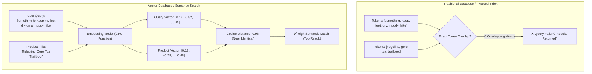
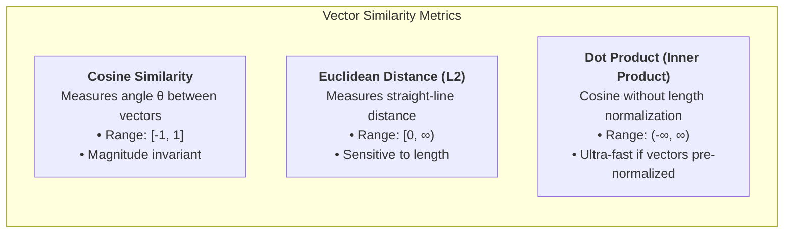
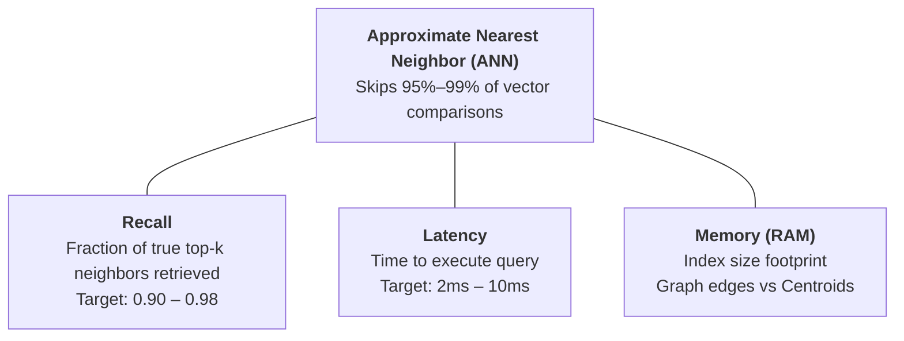
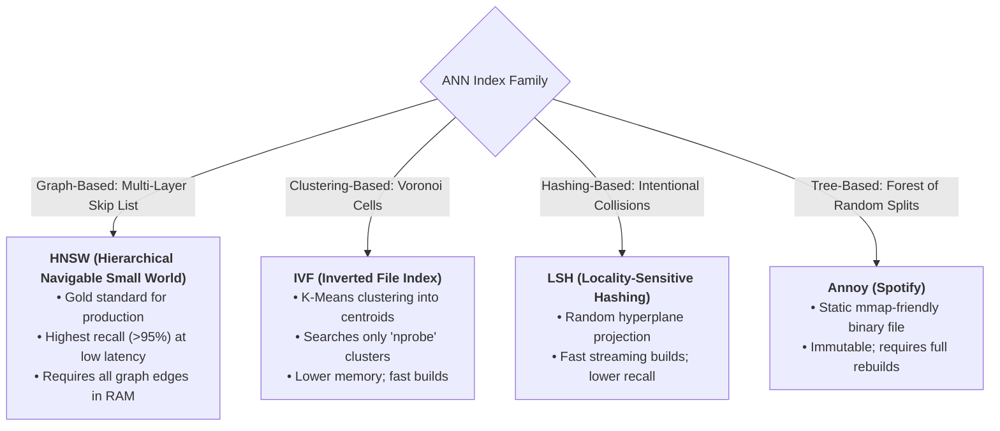
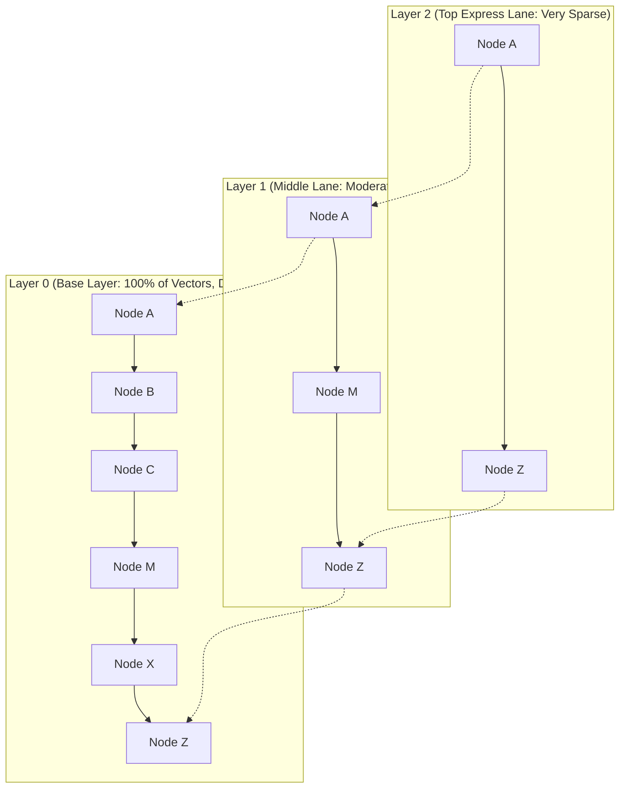
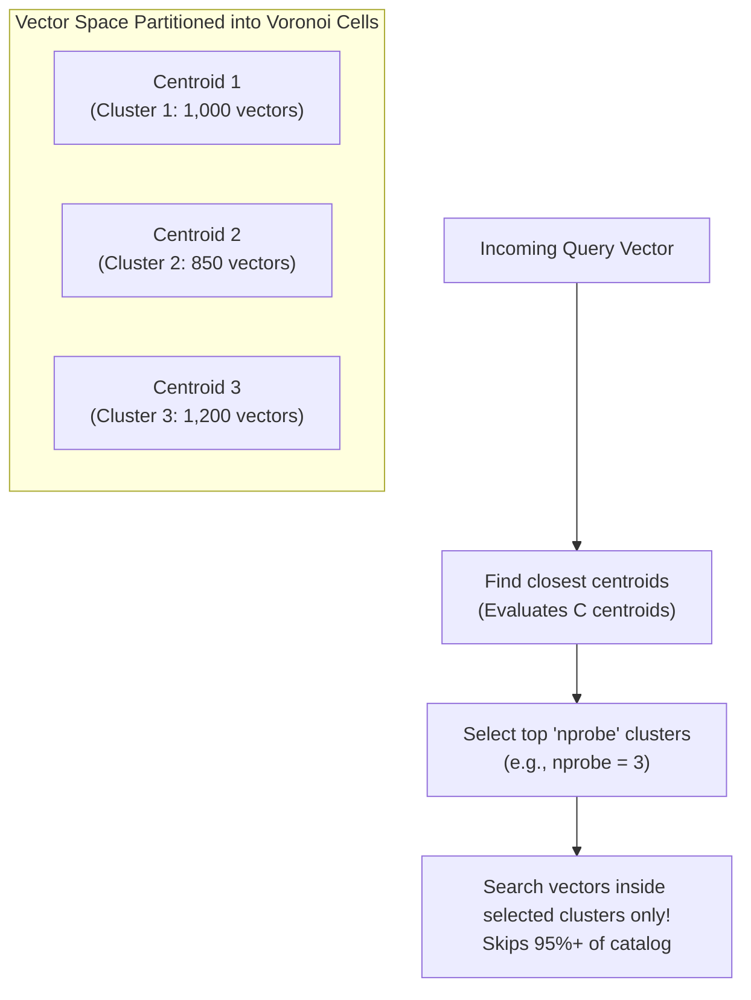
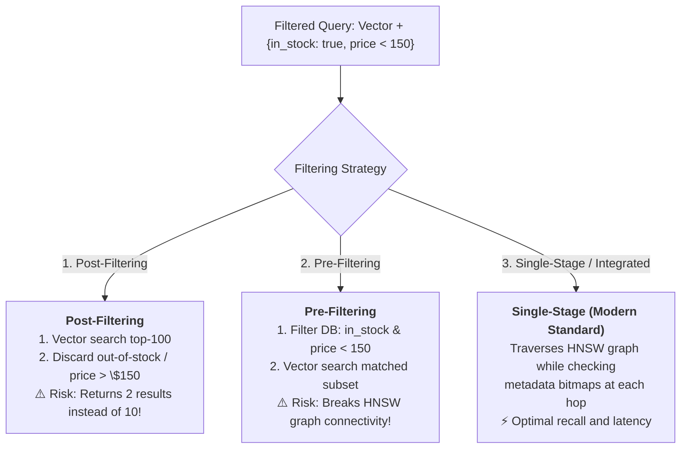
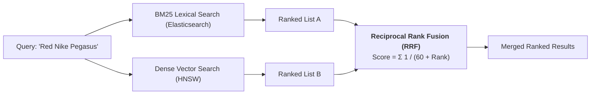
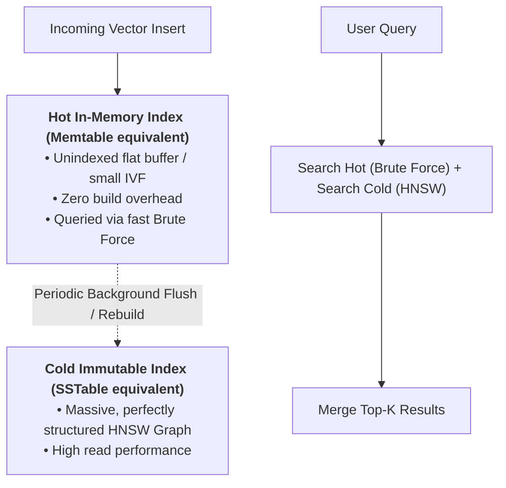
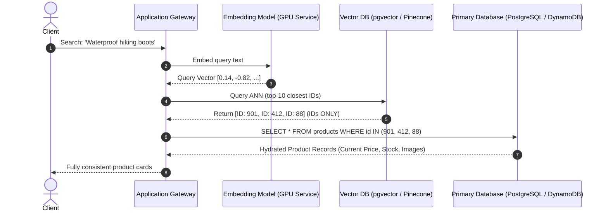

# Vector Databases & Approximate Nearest Neighbor (ANN) Search

**Sources:**
- [Vector Databases Explained for System Design Interviews (Hello Interview)](https://www.youtube.com/watch?v=Fq73E8DQprc) | [Hello Interview Written Guide](https://www.hellointerview.com/learn/system-design/deep-dives/vector-databases)
- [Efficient and robust approximate nearest neighbor search using Hierarchical Navigable Small World graphs (Malkov & Yashunin, 2018)](https://arxiv.org/abs/1603.09320)
- [Billion-scale similarity search with GPUs (FAISS - Johnson, Douze, Jégou, Meta AI)](https://arxiv.org/abs/1702.08734)

**TL;DR:** Traditional relational databases and search engines index data using B-Trees and Inverted Indexes for exact lookups or sorted scans. However, they cannot query by **conceptual meaning or semantic similarity**. Vector databases solve this gap by representing data (text, images, audio, user behavior) as high-dimensional **embeddings** (vectors of floating-point numbers) where geometric distance reflects semantic closeness. While exact nearest neighbor search ($k$-NN) requires an $O(N \cdot D)$ linear scan that becomes intractable at scale, production vector databases leverage **Approximate Nearest Neighbor (ANN)** algorithms—most prominently **HNSW (Hierarchical Navigable Small World)** and **IVF (Inverted File Index)**—to trade a tiny fraction of accuracy (**Recall**) for single-digit millisecond retrieval. In modern system design interviews, a vector database should be treated as an **ephemeral, eventually consistent index, never the primary source of truth**.

---

## 1. Motivation: The Semantic Search Gap

### A. Why Traditional Databases Fail at Meaning
Consider an outdoor e-commerce store (e.g., *Trailhead*). A customer enters the query:
> *"Something to keep my feet dry on a muddy hike"*

The store catalog contains the exact product they want:
> *"Ridgeline Gore-Tex Trailboot"*

If the search engine relies on traditional **Keyword Search (BM25 / Elasticsearch inverted indexes)** or **Relational B-Trees (PostgreSQL)**, the query returns **zero results**. Not a single word in the customer's query matches the product title.



* **The Relational Limitation:** B-Trees sort scalars along a single linear dimension (`1, 2, 3...` or `'A', 'B', 'C...'`). You cannot pre-sort items based on multi-dimensional "closeness in meaning."
* **The Vector Solution:** Transform unstructured data into geometric coordinates such that concepts with related meaning cluster together in high-dimensional vector space.

---

### B. What is a Vector Embedding?
An **embedding** is an array of floating-point numbers produced by passing raw data through a machine learning model (e.g., OpenAI `text-embedding-3-small`, BERT, CLIP for images):
$$\vec{v} = [x_1, x_2, x_3, \dots, x_D]$$

* **Dimensionality ($D$):** Typically ranges from **384 to 1536** dimensions (though specialized models use 64 to 3072+ dimensions).
* **Model as a GPU Function:** Think of the embedding model as an expensive, stateless mathematical projection function:
  $$\text{Data In (Text / Image / User Profile)} \implies \text{Fixed-Length Vector Out}$$
* **What "Similarity" Means:** The embedding model dictates the geometry:
  * A general NLP text model might see *"diapers"* and *"baby bottles"* as only distantly related words.
  * An e-commerce co-purchase model trained on user cart behavior will place *"diapers"* and *"baby bottles"* immediately adjacent to each other.

---

## 2. Mathematical Foundations of Vector Similarity

To determine how "close" two items are, vector engines compute distance metrics between the query vector $\vec{q}$ and stored vectors $\vec{v}$.



### 1. Cosine Similarity
Compares the angle $\theta$ between two vectors, completely ignoring their magnitudes:
$$\text{Cosine Similarity}(\vec{u}, \vec{v}) = \frac{\vec{u} \cdot \vec{v}}{\|\vec{u}\| \|\vec{v}\|} = \frac{\sum_{i=1}^D u_i v_i}{\sqrt{\sum_{i=1}^D u_i^2} \sqrt{\sum_{i=1}^D v_i^2}}$$
* **Best Used For:** Text and document similarity, where document length should not bias the relevance score.

### 2. Euclidean Distance ($L_2$ Norm)
Measures the straight-line physical distance between points in $D$-dimensional Euclidean space:
$$d(\vec{u}, \vec{v}) = \|\vec{u} - \vec{v}\| = \sqrt{\sum_{i=1}^D (u_i - v_i)^2}$$
* **Best Used For:** Image features and embeddings where vector magnitude represents feature intensity.

### 3. Dot Product (Inner Product)
Multiplies corresponding dimensions without division:
$$\vec{u} \cdot \vec{v} = \sum_{i=1}^D u_i v_i$$
* **The Production Optimization Trick:** If all vectors are pre-normalized to unit length ($\|\vec{u}\| = 1, \|\vec{v}\| = 1$) upon insertion, **Dot Product is mathematically identical to Cosine Similarity**:
  $$\text{Cosine Similarity} = \frac{\vec{u} \cdot \vec{v}}{1 \times 1} = \vec{u} \cdot \vec{v}$$
  This eliminates costly square root and division operations at query time, enabling pure hardware-accelerated SIMD (Single Instruction, Multiple Data) dot-product matrix instructions.

> **💡 Staff Interview Tip:** In an infrastructure system design interview, stating: *"We will pre-normalize our embeddings to unit length upon insertion so our search engine computes dot products via SIMD rather than full cosine distance,"* instantly demonstrates senior production experience.

---

## 3. Exact Search ($k$-NN) vs. Approximate Nearest Neighbors (ANN)

### A. The Computational Wall of Exact $k$-NN
To find the top-$k$ most similar products using exact search ($k$-Nearest Neighbors):
1. Compute the distance between the query vector $\vec{q}$ and **every single vector** in the database.
2. Maintain a min-heap of size $k$ to track the closest items.
3. Complexity is strictly linear: $O(N \cdot D)$.

#### The Scale Breakdown:
* At **$10,000$ items** ($D=1536$): Exact search performs $1.5 \times 10^7$ operations. Easily handled in single-digit milliseconds by modern CPUs.
* At **$1,000,000$ items** ($D=1536$): Every single user query requires **$1.536 \times 10^9$ (1.5 billion) floating-point multiply-adds**.
* At 1,000 queries per second (QPS), the system must compute **1.5 trillion multiply-adds per second**. The infrastructure collapses.

---

### B. The Approximate Nearest Neighbor (ANN) Paradigm
Production systems accept that **we do not need the 100% exact top-$k$ items every time**. Finding 9 out of the true 10 nearest neighbors in $3\text{ ms}$ is vastly superior to finding all 10 in $800\text{ ms}$.



#### The Primary Performance Metric: Recall
$$\text{Recall}@k = \frac{|\text{Retrieved Top-}k \cap \text{True Top-}k|}{k}$$
* If the true closest 10 items contain items $[A, B, C, D, E, F, G, H, I, J]$, and the ANN index returns $[A, B, C, D, E, F, G, H, I, Z]$, 9 out of 10 match: $\text{Recall} = 0.90$ (90%).
* Every ANN index is a mathematical knob balancing **Recall vs. Query Latency vs. Memory Overhead**.

---

## 4. Deep Dive: The 4 Major ANN Indexing Strategies



---

### A. HNSW (Hierarchical Navigable Small World) — The Industry Default

HNSW is the most popular, performant, and widely deployed ANN index in modern systems (underlying Pinecone, Milvus, Weaviate, Qdrant, `pgvector`, and Elasticsearch).

#### 1. The Core Intuition: Skip Lists in Multi-Dimensional Space
In a 1D linked list, searching takes $O(N)$. A **Skip List** adds hierarchical "express lanes" on top, allowing you to skip long stretches before dropping down to the base list to achieve $O(\log N)$ search.

**HNSW applies the Skip List concept to a multi-layer graph:**



#### 2. The Layer Mechanics:
* **Layer 0:** Contains **every single vector** in the database. Vectors are connected to their $M$ closest neighbors by bidirectional graph edges.
* **Higher Layers (Layer 1, Layer 2...):** Each vector inserted into Layer 0 has an exponentially decaying probability ($P = e^{-l}$) of being promoted to higher layers.
* **Top Layer:** Contains very few nodes with long-range geometric edges that span vast distances across the vector space.

#### 3. How HNSW Search Executes (Greedy Routing):
1. **Entry:** Search begins at a pre-designated entry node on the topmost layer.
2. **Greedy Traversal:** The algorithm inspects the neighbors of the current node, calculates distances to the query vector $\vec{q}$, and steps to the neighbor closest to $\vec{q}$. It repeats this until no neighbor is closer to $\vec{q}$ than the current node (a local minimum on that layer).
3. **Drop Layer:** The search drops down to the corresponding node in the layer below.
4. **Refine:** It resumes greedy routing with shorter hops.
5. **Layer 0 Beam Search:** Upon reaching Layer 0, it performs a local beam search (controlled by parameter `efSearch`) to collect the top-$k$ closest neighbors.

#### 4. Trade-offs:
* **Pros:** Consistently achieves **$>95\%$ recall** with **$2\text{--}5\text{ ms}$ latency**.
* **Cons (The RAM Trap):** The entire graph structure (vectors, node IDs, and all bidirectional edge pointers) **must reside permanently in RAM**. Memory overhead is high ($\approx 1.5\text{--}2\times$ raw vector size). Furthermore, inserting new vectors is CPU-intensive because each write must execute graph traversals across all layers to wire new edges.

---

### B. IVF (Inverted File Index) — Clustering-Based Index

IVF partitions the vector space using unsupervised clustering ($K$-Means).



#### 1. Mechanics:
1. **Training Phase:** Runs $K$-Means clustering across a sample of vectors to generate $C$ cluster centroids (Voronoi cells).
2. **Indexing:** Every vector in the catalog is assigned to its single nearest centroid.
3. **Querying:**
   * Step 1: Compare the query vector $\vec{q}$ against the $C$ centroids to find the closest clusters.
   * Step 2: Search only the vectors contained within those chosen clusters.
   * If there are 1,000 clusters and you search the top 10, **you skip 99% of all vector comparisons**.

#### 2. The `nprobe` Knob & The Boundary Problem:
Why not search only the *single* closest cluster?
* **The Voronoi Boundary Problem:** A query vector might land near the edge of Cluster 1, while its true nearest neighbor sits just across the boundary inside Cluster 2.
* **The `nprobe` parameter:** Controls how many nearby centroids to search.
  * Higher `nprobe` $\implies$ Higher Recall, Higher Latency.
  * Lower `nprobe` $\implies$ Lower Recall, Sub-millisecond Latency.

#### 3. Trade-offs:
* **Pros:** Far lower RAM usage than HNSW (no graph edges to store). Fast index build times. New writes are appended to the nearest centroid list quickly.
* **Cons:** Lower recall than HNSW at identical latency. Suffers from **Data Drift**: as new catalog vectors arrive, original cluster centroids become skewed, requiring expensive periodic $K$-Means retraining.

---

### C. LSH (Locality-Sensitive Hashing)
Standard hash functions (SHA-256, Murmur3) minimize collisions. LSH does the exact reverse: **it maximizes hash collisions for geometrically close vectors**.

* **Mechanics:** Projects vectors across multiple random hyperplanes. If a vector is on the positive side of a hyperplane, its bit is `1`; if negative, `0`. An 8-hyperplane projection yields an 8-bit hash bucket. Vectors sharing the same hash bucket are searched. Multiple tables are used to mitigate boundary splits.
* **Verdict:** Fast streaming builds, but significantly lower recall in high dimensions compared to HNSW. Largely superseded in production vector engines.

---

### D. Annoy (Approximate Nearest Neighbors Oh Yeah — Spotify)
Developed by Spotify to drive music recommendations across millions of tracks.

* **Mechanics:** Recursively splits the vector space using random hyperplanes to build a binary search tree until leaves contain $\le 100$ items. It constructs a forest of hundreds of such trees.
* **The Killer Feature (`mmap`):** The entire index compiles into a **single static binary file** that can be memory-mapped (`mmap`) into RAM. Multiple operating system processes can read the exact same index file simultaneously with zero memory duplication.
* **The Fatal Flaw (Immutability):** **Annoy indexes are 100% immutable.** You cannot dynamically insert or update a vector. Adding a new song requires rebuilding the entire forest from scratch. Suitable for nightly batch recommendation jobs, unviable for real-time applications.

---

## 5. Filtered Vector Search (The Metadata Dilemma)

In real applications, queries are never just vector similarity. Users apply structured business filters:
> *"Waterproof hiking boots (`vector`) AND in_stock = true (`boolean`) AND price < \$150 (`scalar`)"*

Combining vector distance with relational metadata filtering is notoriously difficult:



### 1. Post-Filtering (Vector First, Metadata Second)
* **Flow:** Perform standard HNSW vector search to fetch the top 100 closest items, then discard items where `in_stock == false` or `price >= 150`.
* **The Failure Mode:** If the filter is **highly selective** (e.g., only 1% of boots are under \$150), the top 100 vector results might contain only 1 or 2 matching items. The user requested 10 products but sees only 2. Over-sampling to 1,000 candidates slows down query latency tenfold.

### 2. Pre-Filtering (Metadata First, Vector Second)
* **Flow:** Use a traditional SQL/B-Tree index to find all items matching the filter, then perform vector search across that subset.
* **The Graph-Disconnection Trap:** An HNSW graph relies on dense interconnections. Carving out an arbitrary 5% subset of nodes breaks the edges, leaving the graph fragmented. Greedy search gets stranded in disconnected subgraphs, destroying recall.
* **The Brute-Force Golden Rule:** If the metadata filter is *extremely selective* and narrows the candidate set down to $< 1,000$ items, **skip the vector index entirely and run exact brute-force $k$-NN search over the subset**. Brute-force over 500 items takes $< 1\text{ ms}$ and yields 100% recall!

### 3. Single-Stage / Integrated Filtering (The Modern Standard)
Modern vector engines (Pinecone, Qdrant, `pgvector`, Elasticsearch) integrate metadata filtering directly into graph traversal:
* The engine maintains inverted index postings or bitsets for metadata attributes alongside the vector store.
* As HNSW hops from node to node, it evaluates the metadata bitset before adding candidates to the search beam.

---

### B. Hybrid Search: Keyword (BM25) + Semantic (Vector)
Some queries require exact keyword matching combined with semantic intent:
> *"Red Nike Pegasus running shoes"*

* *"Red"* and *"Pegasus"* require **exact lexical keyword matching** (BM25).
* *"Running shoes"* benefits from **semantic vector understanding** (catching trail runners or marathon sneakers).

**Production Architecture: Reciprocal Rank Fusion (RRF)**
Run both searches in parallel and fuse the ranked lists:



$$\text{RRF Score}(d) = \sum_{m \in M} \frac{1}{k + r_m(d)}$$
Where $r_m(d)$ is the rank of document $d$ in system $m$, and $k$ is a smoothing constant (typically 60).

---

## 6. The Write Path & Index Maintenance

Vector databases are heavily optimized for reads. **Writes are notoriously expensive.**

### A. The Graph Degradation Problem
Inserting a new vector into an HNSW index requires finding its nearest neighbors at every layer and rewriting graph edge lists. Over millions of dynamic inserts and deletes:
* Graph edges become suboptimal.
* Search paths elongate.
* Recall and latency gradually degrade compared to a fresh, clean build.

### B. The Dual-Index Architecture (LSM-Tree Analogy)
To maintain high write throughput without constantly locking the HNSW graph, production vector databases adopt a dual-index architecture similar to an LSM-tree:



1. **Hot Buffer:** New vectors land immediately in an unindexed in-memory buffer.
2. **Scatter-Gather Read:** Queries search the large Cold HNSW index and the small Hot Buffer simultaneously, merging the top-$k$ results.
3. **Background Compaction / Rebuild:** A background worker folds the hot buffer into a fresh HNSW segment.
4. **Soft Deletes:** Deletions mark a tombstone bit in memory. The vector is skipped during search and reclaimed during the next segment rebuild.
5. **Blue-Green Index Swaps:** For large catalog updates, systems build a new HNSW index alongside the active one on separate workers, atomically swapping the read pointer upon completion.

---

## 7. Database Selection: Existing vs. Dedicated Purpose-Built

A classic system design interview question is: *"Should we deploy a dedicated vector database like Pinecone or Milvus, or use pgvector / Elasticsearch?"*

```mermaid
flowchart TD
    ScaleCheck{Vector Scale & Infrastructure}
    
    ScaleCheck -->|< 5–10 Million Vectors & Already on Postgres| PG["<b>PostgreSQL + pgvector</b><br/>• Zero extra infrastructure<br/>• Direct SQL joins with user/order tables<br/>• Supports HNSW and IVF"]
    
    ScaleCheck -->|Text Search Heavy & Already on ELK| ES["<b>Elasticsearch / OpenSearch</b><br/>• Native HNSW vector search<br/>• Free hybrid search (BM25 + Vector)"]
    
    ScaleCheck -->|Ultra-Low Latency (<2ms) In-Memory| Redis["<b>Redis Vector Search</b><br/>• Entire index in RAM<br/>• Ephemeral session/caching tier"]
    
    ScaleCheck -->|> 50–100 Million Vectors / Billions| Dedicated["<b>Dedicated Vector DB (Pinecone / Milvus / Qdrant)</b><br/>• Distributed sharding across machines<br/>• GPU-accelerated builds & PQ quantization<br/>• Separated storage & compute"]
```

### The Sizing Arithmetic (When Single-Node Fails):
Let's compute the physical memory required for **100 Million Vectors**:
* **Vector Dimension ($D$):** 1536 floats (OpenAI standard).
* **Storage per Vector:** $1536 \times 4\text{ bytes (Float32)} \approx 6.144\text{ KB}$.
* **Raw Vector Memory:** $100{,}000{,}000 \times 6.144\text{ KB} \approx \mathbf{614\text{ GB}}$.
* **HNSW Graph Overhead:** Connecting $M=32$ edges per node adds another $\sim 300\text{ GB}$ of graph topology metadata.
* **Total RAM Needed:** **$\approx 1\text{ TB}$ of physical RAM.**

Because HNSW requires random memory pointer chasing, paging graph segments from NVMe SSDs causes catastrophic latency spikes ($>100\text{ ms}$). When vector memory exceeds a single server's physical RAM, **dedicated distributed vector databases (Milvus, Pinecone, Qdrant)** earn their place by sharding the graph across a cluster or employing **Product Quantization (PQ)** to compress 32-bit floats into 8-bit codes.

---

## 8. Senior / Staff System Design Interview Playbook

In a system design interview, candidates often fail by over-engineering with vector databases prematurely. Follow these core architectural rules:

### Rule 1: The Vector Database is an INDEX, NOT the Source of Truth
Never store your primary business attributes (user profiles, pricing, order history) exclusively inside a vector database.


* **Why?** Primary databases provide strong consistency, relational integrity, backups, and point-in-time recovery. The vector database is merely an index returning entity IDs.

---

### Rule 2: The Two-Stage Retrieval Pattern (Recommender Systems)
In high-scale recommendation architectures (YouTube, Netflix, TikTok):
1. **Stage 1: Fast Candidate Generation (Vector ANN):**
   * Uses an HNSW vector index to retrieve the top **1,000 candidates** from a library of 100 million videos in $< 10\text{ ms}$.
2. **Stage 2: Heavy Multi-Task Ranking (ML Scoring Model):**
   * A complex neural network evaluates hundreds of real-time features (user watch history, network speed, creator affinity) over those 1,000 candidates to output the final **top 20 recommendations**.

---

### Rule 3: Anticipate Critical Interview Probes

#### Probe A: *"The ML team just shipped an improved embedding model. How do we upgrade?"*
* **The Trap:** Naively embedding new queries with Model B and searching against vectors generated by Model A.
* **The Reality:** Vectors from different models **live in completely different mathematical coordinate systems**. A query vector from Model B compared against Model A vectors produces garbage results.
* **The Senior Solution:**
  1. Add a `model_version` tag to all stored embeddings.
  2. Spin up a new vector index in the background and re-embed the entire product catalog using Model B.
  3. Keep the old Model A index live to serve ongoing traffic.
  4. Perform an atomic blue-green cutover to the Model B index once backfill is 100% complete.

#### Probe B: *"Why not use the maximum embedding dimension available (e.g., 3072 instead of 384)?"*
* Memory consumption, network transfer, index build time, and query latency scale **linearly with dimension count ($D$)**.
* Reducing dimensions from 1536 to 384 cuts RAM costs by **75%** while often sacrificing less than 2% in search relevance. Always benchmark dimensional trade-offs using Matryoshka Representation Learning (MRL) embeddings.

#### Probe C: *"What consistency model should we expect?"*
* Vector search is almost universally **eventually consistent**. If a seller adds a new product, it is acceptable if it becomes searchable after a 5–10 second ingestion buffer. Never compromise write latency by demanding immediate read-your-writes consistency across distributed vector graphs.

---

## 9. Comprehensive Architectural Comparison Matrix

| Dimension | Exact Search ($k$-NN) | HNSW (Hierarchical Graph) | IVF (Inverted File Index) | Annoy (Spotify Trees) | PostgreSQL (`pgvector`) | Dedicated Vector DB (Pinecone / Milvus) |
| :--- | :--- | :--- | :--- | :--- | :--- | :--- |
| **Search Paradigm** | Brute Force Linear Scan | Multi-layer Small World Graph | Voronoi Centroid Clustering | Forest of Random Projection Trees | Extends relational engine with HNSW/IVF | Distributed, purpose-built vector engine |
| **Recall Accuracy** | **100% (Ground Truth)** | **95% – 99%** | 80% – 92% | 85% – 95% | 90% – 98% | 95% – 99% |
| **Query Latency** | High ($O(N \cdot D)$) | **Ultra-Low ($2\text{--}5\text{ ms}$)** | Low ($5\text{--}15\text{ ms}$) | Low ($5\text{--}15\text{ ms}$) | Low ($3\text{--}10\text{ ms}$) | **Ultra-Low ($2\text{--}5\text{ ms}$)** |
| **RAM Footprint** | Low (Sequential disk reads) | **High (Vectors + Edges in RAM)**| Moderate (Centroids in RAM) | Low (`mmap` file sharing) | Moderate (Uses Postgres Buffer Pool) | High (RAM cached + PQ compressed) |
| **Dynamic Writes** | Instant append | Slow (Graph re-wiring) | Fast (Assign to centroid) | ❌ **Impossible (Immutable)** | Moderate (ACID WAL + HNSW build) | Fast (LSM-style Hot/Cold Buffers) |
| **Metadata Filtering**| Trivial SQL `WHERE` | Single-stage integrated | Pre-filter / Post-filter | Post-filter only | **Native Relational Joins & SQL** | Integrated bitset inverted indexes |
| **Ideal Scale Boundary** | $< 10{,}000$ items | $10\text{K} - 100\text{M}$ items | High-write streaming data | Batch recommendation exports | $\le 10\text{M}$ vectors | **$10\text{M} - 10\text{B}+$ vectors** |
