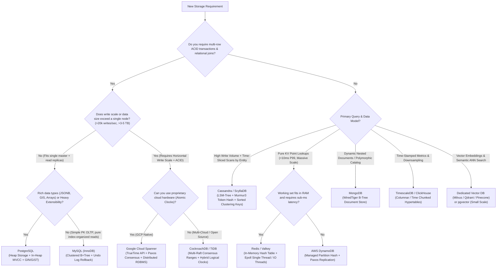

# Layer 01: Storage & Database Selection Playbook

> **The System Design Interview Lens:** In a Staff/Principal interview, you are never asked *"what database exists?"*—you are asked *"why this storage engine for this access pattern, what are the mechanical trade-offs at the hardware level (CPU, disk I/O, memory, network), and how does your choice fail when scale increases by 100x?"*

---

## 1. 60-Second Interview Decision Matrix & Flowchart

### The Master Decision Matrix

| Workload / Primary Access Pattern | Primary Choice | Alternative / Runner-Up | Never Choose / Red Flag | Decisive Mechanical Reason |
| :--- | :--- | :--- | :--- | :--- |
| **Financial Ledger / Double-Entry Bookkeeping** | **PostgreSQL** | **CockroachDB** (if dataset > 5–10TB) | Cassandra, DynamoDB, MongoDB | Strict ACID, Serializability, no lost updates, multi-row transactional integrity via WAL and MVCC. |
| **Ultra-High Write Throughput + Time-Sliced Scans** (Chat history, IoT, Audit logs) | **Cassandra / ScyllaDB** | **DynamoDB** (if AWS-native managed preferred) | Single-node RDBMS (Postgres/MySQL) | LSM-Tree append-only writes bypass in-place page splits; token hash + sorted clustering keys enable contiguous disk scans. |
| **Global Distributed OLTP with Strong Consistency** (Multi-region user accounts) | **CockroachDB / Google Cloud Spanner** | **Sharded Postgres (Vitess / Citus)** | Traditional Master-Slave Async Replication | Automatic multi-Raft/Paxos consensus ranges prevent split-brain; external consistency via HLC / TrueTime. |
| **Low-Latency Key-Value Lookups at Massive Scale** (User profiles, session store, shopping carts) | **AWS DynamoDB** | **Redis / Valkey** (if sub-millisecond RAM latency required) | Relational DB without caching | Single-digit millisecond P99 via distributed partition hash table; zero operational overhead; auto-sharding. |
| **Hierarchical / Semi-Structured Documents with Rapid Schema Mutation** | **MongoDB** | **PostgreSQL (JSONB + GIN)** | Pure Key-Value or Rigid Wide-Column | BSON native document model, rich expressive query engine for nested arrays/objects, flexible indexing. |
| **Time-Series Metrics & Observability** | **TimescaleDB / InfluxDB** | **ClickHouse** (if large-scale analytical scans) | Standard B-Tree RDBMS | Chunk-based time partitioning (Hypertables), Gorilla/delta-of-delta time compression, automatic rollups. |
| **High-Dimensional Vector Embeddings (RAG / Semantic Search)** | **Dedicated: Milvus / Qdrant** | **pgvector** (if vector set < a few million) | Standard Relational Indexes (B+ Tree) | Specialized graph-based ANN indexes (HNSW, IVF-PQ) require massive dedicated vector RAM and SIMD hardware acceleration. |

---

### The Architecture Decision Flowchart



---

## 2. Mechanical First Principles: The Physics of Storage Engines

In an interview, you demonstrate seniority by rooting your choice in the **physical constraints of disk, memory, and CPU cache lines**.

```
┌─────────────────────────────────────────────────────────────────────────────┐
│                           STORAGE ENGINE PARADIGMS                          │
├───────────────────────────────────┬─────────────────────────────────────────┤
│          B+ TREE ENGINES          │             LSM-TREE ENGINES            │
│  (Postgres, MySQL, WiredTiger)    │  (Cassandra, RocksDB, ScyllaDB, LevelDB)│
├───────────────────────────────────┼─────────────────────────────────────────┤
│ • In-place page updates (8KB-16KB)│ • Append-only sequential writes to log  │
│ • Optimized for: Point/Range READS│ • Optimized for: Extremely fast WRITES  │
│ • Random Disk I/O on updates      │ • Sequential Disk I/O on writes         │
│ • Write Amplification: High       │ • Read Amplification: Higher (Compaction)│
│ • Storage fragmentation over time │ • Space Amplification: Transient bloat  │
└───────────────────────────────────┴─────────────────────────────────────────┘
```

### 1. B+ Trees vs. Log-Structured Merge (LSM) Trees

#### B+ Tree Physics (Postgres, MySQL InnoDB, SQLite)
*   **The Structure:** Balanced search tree stored on disk in fixed-size blocks/pages (typically 8KB in Postgres, 16KB in InnoDB). Leaves form a doubly linked list, enabling fast range scans.
*   **Write Path:** Updating a single 50-byte record requires rewriting the entire 8KB or 16KB disk page (**in-place update**). If the page is full, it causes a **Page Split** (allocating a new page, moving half the keys, updating parent node pointers). To ensure crash recovery, the database must write to a Write-Ahead Log (WAL / Redo log) *first* before modifying dirty pages in the buffer cache.
*   **Trade-off:** Fast, predictable point lookups ($O(\log N)$ with minimal page reads) at the expense of **heavy write amplification** and random I/O during dirty page flushes.

#### LSM Tree Physics (Cassandra, ScyllaDB, RocksDB, Bigtable)
*   **The Structure:** Decouples memory from disk. Writes are appended sequentially to a **Commit Log** on disk for durability, then inserted into an in-memory sorted data structure called the **Memtable** (SkipList or Red-Black Tree).
*   **Flush & Compaction:** When the Memtable fills up (e.g., 64MB–256MB), it is flushed to disk as an immutable, sorted file called an **SSTable (Sorted String Table)**. Because older SSTables accumulate duplicate keys and deletes (tombstones), a background **Compaction** process reads multiple SSTables, merges them (merge-sort), discards superseded versions and expired tombstones, and writes a new compacted SSTable.
*   **Trade-off:** Sub-millisecond sequential writes with almost zero write stalls, at the expense of **read amplification** (a point read may need to check the Memtable, Row Cache, and multiple SSTables via Bloom Filters) and periodic CPU/IO spikes during major compactions.

---

### 2. Multi-Version Concurrency Control (MVCC): In-Heap vs. Rollback Undo Log

One of the most lethal questions interviewers ask is: *"How does MVCC actually store old versions of a row?"*

```
POSTGRESQL (In-Heap Versioning):
Table File (Heap):
[Tuple v1: xmin=100, xmax=105]  ← DEAD (Requires VACUUM cleanup)
[Tuple v2: xmin=105, xmax=NULL] ← LIVE
* Every UPDATE creates a new physical tuple on the heap.
* Dead tuples cause table bloat until autovacuum reclaims space.

MYSQL / INNODB (Rollback Undo Log):
Clustered Index Page:
[Tuple v2 (Current in-place)] ──points to──> Undo Log Tablespace:
                                            [v1 Delta (xmin=100)] ──> [v0 Delta]
* UPDATE modifies the row in-place inside the clustered index page.
* Old versions stored as reverse deltas in Undo Segments.
* No table file bloat; undo log purged automatically when transactions finish.
```

*   **Postgres (In-Heap):**
    *   Row updates insert a new tuple into the data block and mark the old tuple dead (`xmax = updating_txn_id`).
    *   **Pro:** Rolling back a transaction is instantaneous (simply mark transaction aborted in `pg_xact`).
    *   **Con:** High table and index bloat. Secondary indexes must update pointers to the new heap tuple unless **HOT (Heap-Only Tuple)** optimization applies. Requires continuous background **`autovacuum`** to sweep pages and reclaim dead space.
*   **MySQL InnoDB (Undo Log):**
    *   Row updates modify the clustered index in-place; the previous column values are pushed into an **Undo Log** segment.
    *   **Pro:** The primary table file never bloats from dead rows. Secondary indexes remain untouched if indexed columns are not changed.
    *   **Con:** Long-running read transactions prevent undo log purging, creating a massive undo log history that degrades query performance across the entire database.

---

### 3. Distributed Consistency & Consensus (CAP vs. PACELC)

In distributed databases, the classic CAP theorem is too coarse. Use **PACELC**:
$$\text{If } \mathbf{P} \text{ (Partition): } \mathbf{A} \text{ vs } \mathbf{C} \quad \Big| \quad \text{EL} \text{ (Else / Normal Operations): } \mathbf{L} \text{ vs } \mathbf{C}$$

| Database | PACELC Classification | Under-the-Hood Behavior |
| :--- | :--- | :--- |
| **CockroachDB / Spanner** | **CP / PC** (Consistent during partitions; prioritizes Consistency over Latency normally) | Uses Raft/Paxos quorums. If network partitions isolate nodes, the minority partition halts writes. Every write requires network round-trip consensus. |
| **Cassandra / ScyllaDB** | **PA / EL** (Available during partitions; prioritizes Latency over Consistency normally) | Masterless peer-to-peer. Reads and writes succeed even during partitions. Consistency is tunable per query ($R + W > N$). Anti-entropy repair runs asynchronously via Merkle Trees. |
| **DynamoDB** | **PA / EL** (Default) or **PA / EC** (Strong Consistency flag) | By default, reads use eventually consistent replication ($R=1$). Setting `ConsistentRead = true` directs read to the Paxos leader ($R=2$). |

---

## 3. Head-to-Head Architectural Shootouts

### Shootout 1: PostgreSQL vs. MySQL (InnoDB)

```
┌─────────────────────────────────────────────────────────────────────────────┐
│                            POSTGRESQL vs. MYSQL                             │
├───────────────────────────────────┬─────────────────────────────────────────┤
│            POSTGRESQL             │              MYSQL (INNODB)             │
├───────────────────────────────────┼─────────────────────────────────────────┤
│ Heap Table + Secondary Index TID  │ Clustered Index (Primary Key B+Tree)    │
│ In-Heap MVCC (Tuple versioning)   │ In-Place MVCC + Undo Log segments       │
│ Process-per-connection (~10MB/conn)│ Thread-per-connection (~256KB/conn)     │
│ JSONB + GIN / PostGIS / pgvector  │ JSON (Generated cols) / Basic GIS       │
│ Physical WAL Streaming Replica    │ Logical Binlog (Row-based / GTID)       │
└───────────────────────────────────┴─────────────────────────────────────────┘
```

#### 1. Data Organization on Disk
*   **Postgres:** Tables are unordered **Heap Files**. The Primary Key is just a regular unique B-tree index whose leaf nodes store a physical Tuple ID (`TID` = Block Number + Item Offset). Secondary indexes also store `TID`.
    *   *Interview Impact:* Reading any row via an index requires an extra random I/O hop from the index leaf to the heap block (unless an *Index-Only Scan* satisfies the query using the visibility map).
*   **MySQL (InnoDB):** Tables are **Index-Organized (Clustered Index)**. The table *is* the Primary Key B+Tree; row data is stored directly in the leaf pages. Secondary indexes do *not* store physical disk offsets; they store the Primary Key value.
    *   *Interview Impact:* If you query by a secondary index (`SELECT * FROM users WHERE email = ?`), MySQL performs a **Secondary Index Lookup** to find the PK, followed by an **Index Bookmark Lookup** traversing the primary B+Tree. However, PK lookups (`SELECT * FROM users WHERE id = ?`) require zero extra hops.

#### 2. Write Amplification & Updates
*   **Postgres:** If you update a non-indexed column on a row, Postgres must create a new tuple in the heap. If the new tuple cannot fit on the same page, **every secondary index on the table must be updated** to point to the new `TID`. Postgres mitigates this with **HOT (Heap-Only Tuple)** updates only when: (1) no indexed columns change, and (2) the current page has enough free space.
*   **MySQL:** Updating a non-indexed column modifies the clustered index leaf in-place and writes an undo record. **Secondary indexes are completely untouched**.

#### 3. Concurrency & Connection Scaling
*   **Postgres:** Uses a **Process-per-connection** model (each connection is a separate forked OS process consuming 5MB–10MB).
    *   *Production Reality:* Postgres degrades rapidly above 300–500 active connections due to OS context switching and IPC overhead. In any high-scale architecture, you **must explicitly place a connection pooler** (such as **PgBouncer** or **pgcat**) in front of Postgres.
*   **MySQL:** Uses a **Thread-per-connection** model. Can handle 2,000–5,000 idle/active connections with substantially lower memory overhead.

#### 4. The Interview Verdict: When to Pick Which
*   **Pick PostgreSQL if:**
    1.  The domain requires complex query patterns: analytical window functions, Common Table Expressions (CTEs), rich full-text search, or specialized data types (`JSONB`, `PostGIS`, arrays, `pgvector`).
    2.  You are building financial or auditing systems requiring strict transaction isolation (Postgres implements true Serializable Snapshot Isolation - SSI).
*   **Pick MySQL (InnoDB) if:**
    1.  The workload is high-concurrency, simple read/write OLTP dominated by Primary Key lookups (e.g., standard consumer web apps).
    2.  The schema has many secondary indexes that undergo heavy updates to non-indexed fields (minimizing write amplification).
    3.  You want simpler horizontal read replication without external connection pooler mandates.

---

### Shootout 2: AWS DynamoDB vs. Apache Cassandra / ScyllaDB

```
┌─────────────────────────────────────────────────────────────────────────────┐
│                       DYNAMODB vs. CASSANDRA / SCYLLADB                     │
├───────────────────────────────────┬─────────────────────────────────────────┤
│            AWS DYNAMODB           │          CASSANDRA / SCYLLADB           │
├───────────────────────────────────┼─────────────────────────────────────────┤
│ Fully Managed Serverless (AWS)    │ Self-Managed Cluster / Multi-Cloud      │
│ Partition Key + Sort Key (B-Tree) │ Partition Key + Clustering Column (LSM) │
│ Hard limit: 1k WCU / 3k RCU/part  │ Hardware-bound per token range          │
│ Cross-partition queries: Scan only│ Token-range ring pagination             │
│ Max item size: 400 KB             │ Max cell size: 2 GB (Practical: <10 MB) │
│ Storage: Managed SSD / B-Tree     │ Storage: Pure LSM-Tree (SSTables)       │
└───────────────────────────────────┴─────────────────────────────────────────┘
```

#### 1. Partitioning and Range Scanning
*   **DynamoDB:** Uses a **Partition Key (PK)** and an optional **Sort Key (SK)**. The PK is hashed to select a physical storage partition. Within that partition, items are indexed using a B-Tree ordered by the SK.
    *   *The Trap:* Range queries (`Query` API using `begins_with`, `BETWEEN`, `>`, `<`) are **strictly supported only within a single Partition Key**. If you need to query across partition keys, you are forced to run a full table `Scan` (which reads every single item in the entire table, destroying performance and cost).
*   **Cassandra:** Uses a **Partition Key** (hashed via Murmur3 to determine the node on the consistent hash ring) and one or more **Clustering Columns** (which determine the physical on-disk sorted order inside the SSTables on that node).
    *   *The Advantage:* While queries should ideally be constrained to a single partition key, Cassandra supports native token-range iteration (`WHERE token(id) > ? AND token(id) <= ?`), allowing distributed parallel batch processing and analytical range extractions across the ring.

#### 2. Hot Partition Bottlenecks & Throttling
*   **DynamoDB:** Imposes a strict hard limit on each individual partition: **1,000 Write Capacity Units (WCU)** and **3,000 Read Capacity Units (RCU)** per second (1 WCU = 1KB write; 1 RCU = 4KB strongly consistent read).
    *   *Interview Gotcha:* Even if your table has 50,000 provisioned WCUs globally, if a celebrity user or viral post routes 1,500 writes/sec to a *single* Partition Key, DynamoDB will reject writes with a `ProvisionedThroughputExceededException` (HTTP 400). You must mitigate this via **Write Sharding** (appending a random suffix `PK#1..10` to scatter writes).
*   **Cassandra:** Has no artificial software throttling caps. A single node accepts writes up to the physical limits of its NVMe SSD sequential write bandwidth and network interface. However, a severe hot spot can lead to excessive memory pressure in the Memtable and high JVM garbage collection pauses.

#### 3. Storage Internals: LSM Compaction & Tombstone Storms
*   **Cassandra:** When a row or column is deleted in Cassandra, it is not erased from disk immediately; the engine writes a marker called a **Tombstone** into the Memtable.
    *   *Production Failure Mode (The Tombstone Storm):* If a query reads a range with thousands of deleted records, Cassandra must scan all tombstones from disk into memory. If the tombstone count exceeds `tombstone_failure_threshold` (default 100,000), **Cassandra aborts the query to prevent node OOM crashes**.
*   **ScyllaDB:** A drop-in C++ rewrite of Cassandra. By using the asynchronous **Seastar engine** with a **thread-per-core** architecture and direct Linux AIO, it bypasses JVM garbage collection entirely, offering 5x–10x higher throughput and flat, predictable P99 latencies.

#### 4. The Interview Verdict: When to Pick Which
*   **Pick DynamoDB if:**
    1.  You are designing an AWS-native system prioritizing zero operational management (no cluster provisioning, node replacement, or compaction tuning).
    2.  Workload consists of discrete Key-Value point lookups or 1-to-many lookups bounded strictly by an entity ID (e.g., `UserID` $\to$ `Orders`).
*   **Pick Cassandra / ScyllaDB if:**
    1.  You require cloud-agnostic deployment, on-premise infrastructure, or multi-cloud active-active replication.
    2.  Write volume is enormous (hundreds of thousands of writes/sec, such as IoT sensor telemetry or massive event logs) where DynamoDB's WCU pricing would be cost-prohibitive.

---

### Shootout 3: Distributed SQL (CockroachDB / Spanner) vs. Sharded RDBMS (Vitess / Citus)

```
┌─────────────────────────────────────────────────────────────────────────────┐
│                 DISTRIBUTED NEWSQL vs. SHARDED RDBMS                        │
├───────────────────────────────────┬─────────────────────────────────────────┤
│  DISTRIBUTED NEWSQL (CockroachDB) │      SHARDED RDBMS (Vitess / Citus)     │
├───────────────────────────────────┼─────────────────────────────────────────┤
│ Native Multi-Raft Range Splitting │ Proxy-routed sharding over MySQL/PG     │
│ HLC / TrueTime External Consist.  │ Single-shard ACID; 2PC across shards    │
│ Higher P99 latency (Consensus hop)│ Sub-millisecond single-shard P99 latency│
│ Zero manual re-sharding overhead  │ Operational complexity in resharding    │
└───────────────────────────────────┴─────────────────────────────────────────┘
```

#### 1. Architecture Mechanics
*   **CockroachDB / Spanner (Distributed SQL):**
    *   Table data is divided into contiguous, sorted key-value chunks called **Ranges** (typically 64MB in CockroachDB).
    *   Each range is replicated across multiple nodes using an independent **Raft** (CockroachDB) or **Paxos** (Spanner) consensus group (**Multi-Raft architecture**).
    *   When a range grows beyond its size limit, CockroachDB automatically splits it into two ranges and rebalances them across the cluster. Transactions spanning multiple ranges execute a distributed 2-Phase Commit (2PC) over Raft.
*   **Vitess / Citus (Sharded RDBMS):**
    *   Shards are standard, standalone MySQL (Vitess) or PostgreSQL (Citus) instances.
    *   A stateless proxy layer (`vtgate` in Vitess) inspects SQL queries, extracts the sharding key (keyspace ID), and routes the query directly to the target shard.
    *   Cross-shard queries require the proxy to scatter-gather results and perform joins in memory.

#### 2. The Latency vs. Operational Trade-off
*   *Distributed SQL Trade-off:* You gain fully automated horizontal write scaling, automatic rebalancing, and cross-node ACID. However, **every single write incurs a network consensus round-trip** (minimum 3-node Raft quorum). A single-row insert that takes 0.5ms in local Postgres takes 3ms–10ms in CockroachDB.
*   *Sharded RDBMS Trade-off:* Single-shard operations execute at native bare-metal speed (sub-millisecond). However, cross-shard transactions are slow and fragile, and re-sharding (splitting shards live under traffic) requires complex operational choreography.

#### 3. The Interview Verdict: When to Pick Which
*   **Pick CockroachDB / Spanner if:** The business requires global write-scaling, automatic high availability across data centers, and multi-record ACID transactions where the application cannot tolerate manual sharding logic.
*   **Pick Sharded RDBMS (or vertically scaled Postgres) if:** The workload can be cleanly partitioned by an entity key (e.g., `tenant_id` or `company_id`), cross-tenant queries never happen, and latency budgets demand sub-millisecond single-digit P99s.

---

### Shootout 4: MongoDB vs. PostgreSQL with JSONB

```
┌─────────────────────────────────────────────────────────────────────────────┐
│                       MONGODB vs. POSTGRESQL (JSONB)                        │
├───────────────────────────────────┬─────────────────────────────────────────┤
│              MONGODB              │            POSTGRESQL (JSONB)           │
├───────────────────────────────────┼─────────────────────────────────────────┤
│ Native BSON (Binary JSON) storage │ Deconstructed binary JSON container     │
│ Document-level locking (WiredTiger)│ In-Heap MVCC Tuple locking              │
│ Horizontal Sharding via mongos    │ Single-node master (or Citus extension) │
│ In-place partial document updates │ Rewrites entire JSONB document on write │
│ Dynamic, polymorphic collections  │ Hybrid: Strict relational + JSONB cols  │
└───────────────────────────────────┴─────────────────────────────────────────┘
```

#### 1. In-Place Updates vs. Full Rewrite
*   **Postgres JSONB:** The `jsonb` data type is stored as a parsed binary hierarchy inside the heap tuple.
    *   *The Trap:* If you store a 50KB JSON document in a Postgres column and update a single nested counter, **Postgres must rewrite the entire 50KB JSON document into a brand new heap tuple**. This generates massive WAL traffic and heap bloat.
*   **MongoDB (WiredTiger):** Supports deep partial document updates (`$set`, `$inc`) directly in its WiredTiger cache pages, avoiding full document write amplification.

#### 2. Sharding & Horizontal Scale
*   **MongoDB:** Features built-in horizontal sharding out of the box using a cluster architecture: `mongos` (routing routers), Config Servers (cluster metadata via Raft), and Shard Replica Sets.
*   **Postgres:** Core Postgres has no native horizontal write sharding. Partitioning is declarative table inheritance on a single node. Scaling writes horizontally requires external extensions (Citus) or manual application sharding.

#### 3. The Interview Verdict: When to Pick Which
*   **Pick PostgreSQL with JSONB if:** 80% of your domain is relational (Users, Payments, Orders) with strict integrity, but a few entities require semi-structured flexibility (e.g., third-party webhook payloads, user preference blobs).
*   **Pick MongoDB if:** The entire core domain model is document-centric with high structural polymorphism (e.g., product catalogs with 10,000 distinct attribute schemas), documents are heavily updated, and native horizontal clustering is mandatory.

---

### Shootout 5: Specialized Storage Engines

#### 1. Time-Series Databases: TimescaleDB vs. InfluxDB
*   **TimescaleDB:** Packaged as a PostgreSQL extension. Automatically partitions relational tables into time-and-space chunks called **Hypertables**.
    *   *Best for:* Systems where time-stamped metrics must join directly against relational business entities (e.g., joining IoT device telemetry against the `devices` and `customers` SQL tables). Retains full SQL support.
*   **InfluxDB:** Purpose-built engine using a Time-Structured Merge tree (TSM) and Time Series Index (TSI).
    *   *Best for:* Pure DevOps monitoring and high-cardinality metric counters where write volume is millions of metrics/sec and relational joins are unnecessary.

#### 2. Vector Databases: Dedicated (Milvus / Qdrant) vs. pgvector
*   **Dedicated (Milvus / Qdrant / Pinecone):** Built specifically for **Approximate Nearest Neighbor (ANN)** search on high-dimensional vectors (e.g., 1536-dimension OpenAI embeddings). Utilizes graph-based indexes (**HNSW**) and quantization (**IVF-PQ**), with all vectors kept memory-resident and accelerated via CPU SIMD / AVX-512 instructions.
    *   *Best for:* Large-scale RAG, image search, or semantic matching with >5–10 million vectors where sub-15ms search latency is mandatory.
*   **pgvector:** An open-source Postgres extension enabling vector storage and HNSW/IVFFlat indexing inside relational tables.
    *   *Best for:* Standard applications with <1–2 million vectors. Avoids introducing an entire new database into your infrastructure stack.

---

## 4. The Interview Defense Playbook: Scripts & Trap Rebuttals

### The 3-Sentence Justification Formula

When announcing your database choice, use this rigid three-sentence template:
1.  **Sentence 1 (The Access Pattern):** State the primary read/write shape and consistency requirement.
2.  **Sentence 2 (The Choice & Mechanical Justification):** State your database and the specific engine mechanism that optimizes for this shape.
3.  **Sentence 3 (The Disqualification of Alternatives):** Call out why the obvious alternative fails under scale.

#### Example: Financial Ledger (Chapter 26 Payment System)
> *"For the double-entry ledger balance table, our access pattern demands strict serializable ACID transactions across multi-row transfers to guarantee zero lost updates. I am selecting **PostgreSQL** because its Write-Ahead Log (WAL) and row-level locking natively ensure consistency without distributed consensus overhead on a single master. While NoSQL databases like Cassandra offer higher write availability, their eventual consistency model would allow race conditions and balance corruption during concurrent transfers."*

#### Example: User Messaging History (Chapter 12 Chat System)
> *"For the message storage layer, the access pattern is characterized by massive, append-only write ingestion with reads strictly bounded to contiguous time-slice ranges within a specific `channel_id`. I am selecting **Apache Cassandra** because its LSM-Tree storage engine eliminates random disk I/O on writes, while its composite key (Partition Key: `channel_id`, Clustering Column: `message_timestamp`) stores message blocks sequentially on disk. A relational database like MySQL is disqualified here because continuous high-volume writes would trigger heavy B+ Tree page splits and lock contention on index leaves."*

---

### Interviewer Trap Questions & Battle-Tested Rebuttals

#### Trap 1: *"Why don't we just shard MySQL or PostgreSQL instead of introducing Cassandra or CockroachDB?"*
*   **The Trap:** Interviewers test whether you understand the operational complexity and query limitations of manual application-level sharding.
*   **The High-Scoring Response:**
    > *"Sharding an RDBMS provides excellent single-shard latency, but it pushes enormous complexity into the application layer or proxy. Once sharded, cross-shard joins become impossible without scatter-gather queries, cross-shard distributed transactions require a slow and fragile application 2-Phase Commit (2PC), and live re-sharding (splitting shards when a node fills up) requires dual-writing and complex data backfilling. If our data access naturally requires cross-entity transactions or dynamic range rebalancing, a native distributed database like CockroachDB handles range splitting and consensus under the hood, significantly reducing application failure modes."*

#### Trap 2: *"What happens when your DynamoDB Partition Key encounters a celebrity hot spot?"*
*   **The Trap:** Probing whether you know the internal partition limits of DynamoDB.
*   **The High-Scoring Response:**
    > *"DynamoDB hard-caps each individual physical partition at 1,000 WCUs and 3,000 RCUs. If a celebrity user (like Justin Bieber) posts an update, millions of reads and writes targeting `PK = user_id` will immediately trigger `ProvisionedThroughputExceededException`. To defend against this, we apply two strategies:
    > 1. **Write Sharding (Salting):** We append an integer suffix to the partition key (`user_id#1`, `user_id#2` up to `user_id#N`) generated uniformly at random, scattering the writes across $N$ distinct physical partitions.
    > 2. **Read Ingress Caching:** For read hotspots, we place an in-memory caching layer (**DAX** or **Redis**) in front of DynamoDB to absorb point reads before they hit the storage partition."*

#### Trap 3: *"Why not just use MongoDB for everything? It has flexible schemas and supports ACID transactions now."*
*   **The Trap:** Testing if you fall for marketing claims versus production realities.
*   **The High-Scoring Response:**
    > *"While MongoDB added multi-document ACID transactions in version 4.0, its distributed transactions incur severe latency penalties because they execute via two-phase commits across replica sets and hold locks in the WiredTiger storage engine, creating write stalls. Furthermore, 'flexible schema' in high-scale systems is often an anti-pattern: without schema enforcement at the database layer, data corruption and backward-compatibility bugs are simply pushed into application code. For core relational entities with fixed invariants (like Orders and Payments), PostgreSQL’s strict schemas and battle-tested MVCC engine offer far higher write throughput and deterministic query plans."*

#### Trap 4: *"Can DynamoDB perform range queries across different partition keys?"*
*   **The Trap:** A technical trick question to see if you know DynamoDB's API constraints.
*   **The High-Scoring Response:**
    > *"No. The DynamoDB `Query` API strictly requires an equality condition on a **single** Partition Key; range conditions (such as `BETWEEN` or `begins_with`) can only be applied to the **Sort Key** within that specific partition. Attempting to query ranges across different partition keys forces a full table `Scan`, which reads every single partition sequentially, resulting in massive RCU consumption, high latency, and table throttling. If cross-partition range queries are a primary access pattern, we must either design a **Global Secondary Index (GSI)** with a synthetic coarse-grained partition key (e.g., date bucket `2026-10-21`), or use an LSM-based engine like Cassandra or a distributed SQL engine."*

---

## 5. System Design Mapping: Where These Databases Live in Real Architectures

Below is the definitive cross-reference mapping how these database choices are applied across the systems in this repository:

| Chapter / Architecture | Primary Database Selected | Specific Justification & Pattern |
| :--- | :--- | :--- |
| [**04. Rate Limiter**](file:///Users/abhinnaagarwal/Documents/system-design-notes/04.%20Rate%20Limiter/README.md) | **Redis / Valkey** | In-memory atomic token bucket / sliding window counters using Lua scripts. |
| [**06. Key-Value Store**](file:///Users/abhinnaagarwal/Documents/system-design-notes/06.%20Key-Value%20Store/README.md) | **SSTable / LSM-Tree Engine** | Custom distributed Dynamo-style KV store with consistent hash ring and vector clocks. |
| [**07. Unique-Id Generator**](file:///Users/abhinnaagarwal/Documents/system-design-notes/07.%20Unique-Id%20Generator/README.md) | **No Database (Snowflake) or MySQL Ticket Server** | Snowflake avoids DB locks; Ticket Server uses MySQL `REPLACE INTO` for centralized IDs. |
| [**12. Chat System**](file:///Users/abhinnaagarwal/Documents/system-design-notes/12.%20Chat%20System/README.md) | **Cassandra / HBase** | Massive append-only message history; sequential range scans by timestamp per channel. |
| [**16. Proximity Service**](file:///Users/abhinnaagarwal/Documents/system-design-notes/16.%20Proximity%20Service/README.md) | **PostgreSQL (PostGIS) or Redis Geo / Geospatial Index** | R-Tree / Geohash / S2 Cell spatial lookups for bounding-box coordinates. |
| [**20. Metrics Monitoring**](file:///Users/abhinnaagarwal/Documents/system-design-notes/20.%20Metrics%20Monitoring%20and%20Alerting%20System/README.md) | **OpenTSDB / InfluxDB / TimescaleDB** | Time-series metrics with Gorilla compression, rollup aggregations, and high write ingestion. |
| [**22. Hotel Reservation**](file:///Users/abhinnaagarwal/Documents/system-design-notes/22.%20Hotel%20Reservation%20System/README.md) | **PostgreSQL (with Pessimistic/Optimistic Locking)** | Strict transactional guarantees to prevent overbooking rooms across dates. |
| [**24. S3-like Object Storage**](file:///Users/abhinnaagarwal/Documents/system-design-notes/24.%20S3-like%20Object%20Storage/README.md) | **PostgreSQL / Cassandra (Metadata) + Raw File Store (Data)** | Separates high-frequency metadata queries from multi-part immutable blob chunks. |
| [**25. Real-time Leaderboard**](file:///Users/abhinnaagarwal/Documents/system-design-notes/25.%20Real-time%20Gaming%20Leaderboard/README.md) | **Redis Sorted Sets (ZSET)** | In-memory SkipList maintains $O(\log N)$ real-time rank updates and range extractions. |
| [**26. Payment System**](file:///Users/abhinnaagarwal/Documents/system-design-notes/26.%20Payment%20System/README.md) | **PostgreSQL (Double-Entry Ledger)** | Serializable ACID transactions, immutable append-only ledger rows, idempotency keys. |
| [**27. Digital Wallet**](file:///Users/abhinnaagarwal/Documents/system-design-notes/27.%20%20Digital%20Wallet/README.md) | **PostgreSQL / CockroachDB** | Strict balance invariants: total debits must equal total credits at all times. |

---

### Cross-Repository Deep Dive Links
*   PostgreSQL Internals: [`coding-practice: storage/postgres.md`](file:///Users/abhinnaagarwal/Documents/coding-practice/systems-engineering/storage/postgres.md)
*   Cassandra Architecture: [`coding-practice: storage/cassandra.md`](file:///Users/abhinnaagarwal/Documents/coding-practice/systems-engineering/storage/cassandra.md)
*   LSM-Trees & Compaction: [`coding-practice: data-structures/lsm-trees.md`](file:///Users/abhinnaagarwal/Documents/coding-practice/systems-engineering/data-structures/lsm-trees.md)
*   RocksDB Internals: [`coding-practice: data-structures/rocksdb.md`](file:///Users/abhinnaagarwal/Documents/coding-practice/systems-engineering/data-structures/rocksdb.md)
*   Data Modeling Playbook: [`coding-practice: data-modeling/data-modeling-interview-playbook.md`](file:///Users/abhinnaagarwal/Documents/coding-practice/systems-engineering/data-modeling/data-modeling-interview-playbook.md)
*   Cassandra Core Concept: [`Core Concepts/Cassandra/README.md`](file:///Users/abhinnaagarwal/Documents/system-design-notes/Core%20Concepts/Cassandra/README.md)
*   CockroachDB Core Concept: [`Core Concepts/CockroachDB/README.md`](file:///Users/abhinnaagarwal/Documents/system-design-notes/Core%20Concepts/CockroachDB/README.md)
*   DynamoDB Core Concept: [`Core Concepts/DynamoDB/README.md`](file:///Users/abhinnaagarwal/Documents/system-design-notes/Core%20Concepts/DynamoDB/README.md)
