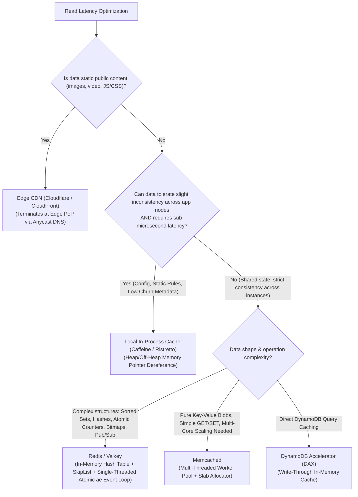
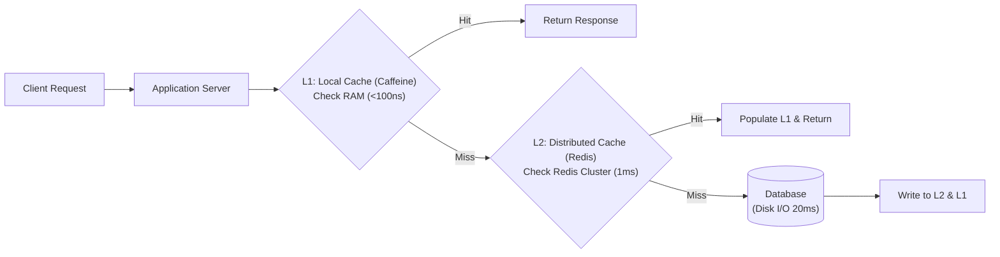

# Layer 02: Caching & In-Memory Storage Playbook

> **The System Design Interview Lens:** An interviewer asks you to add a cache to "speed up reads." Junior engineers simply say *"I'll put Redis in front of the DB."* Staff/Principal engineers specify the **caching topology (L1 local vs L2 distributed)**, defend the **invalidation lifecycle**, calculate **memory sizing and eviction pressure**, and systematically neutralize **cache stampedes, penetration, and avalanches**.

---

## 1. 60-Second Interview Decision Matrix & Flowchart

### The Master Decision Matrix

| Requirement / Workload Constraint | Primary Selection | Runner-Up / Alternative | Never Choose / Red Flag | Decisive Mechanical Reason |
| :--- | :--- | :--- | :--- | :--- |
| **Rich Data Structures + Atomic Operations** (Counters, Leaderboards, Sets, Sliding Windows) | **Redis / Valkey** | Custom In-Memory Go/Rust Service | Memcached | Single-threaded atomic command execution; native sorted sets (SkipList), bitmaps, HyperLogLog. |
| **Ultra-High Multi-Core Throughput for Raw Static Blobs** (>1M QPS pure GET/SET) | **Memcached** | **Redis (with I/O threads enabled)** | Local DB without cache | Multi-threaded lock-based shared hash table scales linearly across 32–64 CPU cores for simple byte payloads. |
| **Sub-Microsecond Latency on Static Configuration / Metadata** | **Local In-Process Cache** (Caffeine / Ristretto) | Distributed Redis | Remote DB | Zero network serialization hop ($<100\text{ns}$ memory pointer dereference vs $1\text{ms}$ TCP round-trip). |
| **Static Assets & Public Media Delivery** (Images, video segments, JS/CSS bundles) | **Edge CDN** (Cloudflare / CloudFront) | Application Object Cache | Relational DB BLOB | Edge points of presence (PoPs) terminate TCP/TLS close to end users; Anycast BGP routing. |
| **Zero-Code Read Acceleration for DynamoDB** | **DynamoDB Accelerator (DAX)** | Redis / Valkey | Memcached | Microsecond in-memory item/query cache tightly integrated with DynamoDB SDK with zero application code changes. |
| **Real-Time Gaming Leaderboards & Proximity Rank** | **Redis Sorted Sets (ZSET)** | PostgreSQL B-Tree Index | Memcached | In-memory SkipList maintains $O(\log N)$ inserts and range scans (`ZREVRANGEBYSCORE`) in memory. |

---

### The Caching Topology & Decision Flowchart



---

## 2. Mechanical First Principles: The Physics of In-Memory Systems

In-memory caching is bounded by **RAM capacity, CPU memory bus bandwidth, and network serialization overhead**.

```
┌─────────────────────────────────────────────────────────────────────────────┐
│                       LATENCY NUMBERS THAT SHAPE CACHING                    │
├─────────────────────────────────────────────────┬───────────────────────────┤
│ L1 CPU Cache Reference                          │ 0.5 – 1 ns                │
│ Main Memory (RAM) Pointer Dereference           │ 50 – 100 ns               │
│ Local In-Process Cache Read (Caffeine)          │ 150 – 300 ns              │
│ Same-Rack TCP Loopback (Redis GET via socket)   │ 200 – 500 µs (0.2-0.5 ms) │
│ Cross-AZ Network Hop inside AWS VPC             │ 1 – 2 ms                  │
│ NVMe SSD Random Read (Database Buffer Pool Miss)│ 10 – 50 µs                │
│ Spinning Disk / Relational Complex Join Query   │ 10 – 100 ms               │
└─────────────────────────────────────────────────┴───────────────────────────┘
```

### 1. Concurrency Models: Redis Single-Threaded Event Loop vs. Memcached Multi-Threading

```
REDIS / VALKEY (Single-Threaded Command Execution):
Clients ──> [epoll_wait() Event Loop] ──> [Serialized Command Execution on Data]
(Zero locking overhead, zero race conditions on data structures, atomic by construction)

MEMCACHED (Multi-Threaded Lock-Based):
Clients ──> [Listener Thread] ──dispatch──> [Worker Threads 1..N]
                                                    │
                                         [Shared Hash Table (Bucket Locks)]
(High multi-core throughput on simple GET/SET, but lock contention under heavy concurrency)
```

*   **Redis Architecture:**
    *   Command execution is strictly **single-threaded** inside the `ae` (Async Events) loop using OS I/O multiplexing (`epoll` on Linux, `kqueue` on macOS).
    *   *Why this works:* Memory access is instantaneous (~100ns). Eliminating thread context switches, mutex locking, and race condition defenses allows a single core to execute 100,000+ operations/second.
    *   *Modern Evolution (Redis 6.0+ / Valkey):* Network socket read/write and protocol parsing are delegated to **I/O threads**, while data structure mutation remains strictly serialized on the main thread.
*   **Memcached Architecture:**
    *   Uses a **Master-Worker multi-threaded model**. The master thread listens for incoming connections and dispatches them to worker threads via `libevent`. Each worker thread handles its own client connections, reading and writing to a globally shared hash table protected by fine-grained bucket locks.
    *   *Why this works:* For raw, simple byte GET/SET requests, Memcached scales across 32+ physical CPU cores on a single high-memory box, reaching millions of requests/second.

---

### 2. Memory Allocation & Fragmentation: Slabs vs. Dynamic Allocators

How memory is allocated dictates whether your cache crashes under memory fragmentation:

#### Memcached Slab Allocator
*   **The Mechanics:** Memcached does not use standard `malloc()` for every key. Upon startup, it pre-allocates memory into 1MB pages and divides pages into fixed-size chunks called **Slab Classes** (e.g., Slab 1 = 96 bytes, Slab 2 = 120 bytes, Slab 3 = 150 bytes, scaling by a growth factor, default 1.25).
*   **The Trap (Internal Fragmentation):** If a value is 97 bytes, it must be placed into a 120-byte chunk in Slab 2. The remaining 23 bytes are wasted. Furthermore, once memory is assigned to a slab class, it cannot easily be reassigned to another slab class without slab rebalancing.
*   **The Benefit:** **Zero external memory fragmentation** and zero OS memory re-allocations during runtime.

#### Redis Memory Management
*   **The Mechanics:** Uses a general-purpose memory allocator (typically **`jemalloc`**). Redis dynamically adapts memory structures based on data size:
    *   Small lists/hashes are encoded as compact contiguous memory blocks called **`listpack`** (formerly `ziplist`). This eliminates pointer overhead (a 64-bit pointer is 8 bytes; for a 2-byte integer, pointers waste 80% of RAM).
    *   When the collection exceeds a threshold (e.g., `hash-max-listpack-entries 512`), Redis converts it in memory to a standard doubly linked list or chained hash table.
*   **The Trade-off:** Memory usage is drastically more efficient for varied data types, but prolonged update/delete churn can lead to OS memory fragmentation (`mem_fragmentation_ratio > 1.5`), requiring active defragmentation (`CONFIG SET activedefrag yes`).

---

### 3. Eviction Algorithms: True vs. Approximated

When `maxmemory` is reached, the cache must evict keys to make room for new writes:

| Eviction Policy | Mechanical Working | Real-World Application |
| :--- | :--- | :--- |
| **noeviction** | Rejects writes with an out-of-memory error when memory limit is hit. Reads continue working. | Essential when Redis is used as a message broker or queue, where data loss is unacceptable. |
| **allkeys-lru** | Evicts the least recently used key among all keys. | General-purpose web application cache where access follows a Power Law / Pareto distribution (80% traffic hits 20% data). |
| **volatile-lru** | Evicts least recently used keys *only* among keys with an explicit TTL set. | Hybrid deployments where some keys are permanent persistent state and others are temporary cache. |
| **allkeys-lfu** | Evicts keys with the lowest access frequency counter. | Superior to LRU when periodic batch scans (e.g., daily crawler) touch all keys and would flush hot items out of an LRU cache. |

> **Under the Hood (Redis Approximated LRU):** True LRU requires a doubly linked list linking all keys; moving a key to the head on *every single read* requires pointer mutations and memory locks. Instead, Redis uses **Approximated LRU**: it samples $N$ random keys (default `maxmemory-samples 5`), checks their idle time (stored in a 24-bit timestamp inside the `redisObject` header), and evicts the best candidate among the sample. At $N=10$, it approaches true LRU behavior with zero lock contention.

---

## 3. Head-to-Head Architectural Shootouts

### Shootout 1: Distributed Cache Contenders: Redis / Valkey vs. Memcached vs. Aerospike

```
┌─────────────────────────────────────────────────────────────────────────────┐
│                    REDIS / VALKEY vs. MEMCACHED vs. AEROSPIKE               │
├───────────────────┬─────────────────────┬───────────────────┬───────────────┤
│ FEATURE           │ REDIS / VALKEY      │ MEMCACHED         │ AEROSPIKE     │
├───────────────────┼─────────────────────┼───────────────────┼───────────────┤
│ Concurrency Model │ Single-threaded ae  │ Multi-threaded    │ Multi-threaded│
│                   │ command loop (+I/O) │ worker pool (Locks│ C/C++ engine  │
│ Storage Medium    │ Pure DRAM           │ Pure DRAM (Slabs) │ RAM + NVMe SSD│
│ Data Model        │ Rich data structures│ Opaque byte blob  │ Bin/Record KV │
│ Multi-Core Scaling│ Requires clustering │ Linear on 1 node  │ Linear on SSDs│
│ Cost for >5TB Data│ Very High (All RAM) │ Very High (RAM)   │ 1/5th (Flash) │
│ Durability        │ RDB + AOF (Optional)│ None (Ephemeral)  │ Real-time WAL │
└───────────────────┴─────────────────────┴───────────────────┴───────────────┘
```

#### 1. Operations and Data Model
*   **Memcached:** Treats every value as an opaque byte array. If you have an object with 50 fields and want to update one field, you must fetch the entire 1MB blob over the network, deserialize it, modify the field, serialize it, and send the full 1MB blob back.
*   **Redis:** Understands data structures natively. You can mutate an individual field inside a Hash in-place (`HSET user:100 status active`), append to a List (`LPUSH`), compute Set intersections (`SINTER`), or update a leaderboard rank (`ZINCRBY`) directly in RAM without moving bytes over the network.
*   **Aerospike (Hybrid Flash Cache):** While Redis and Memcached require 100% of data to sit in expensive DRAM, Aerospike keeps *only* the 64-byte primary index in RAM, streaming cached values directly from raw NVMe flash blocks using `O_DIRECT` (bypassing the OS page cache).

#### 2. Durability & State Survival
*   **Memcached:** 100% volatile. A server crash or reboot means instant, total cache loss.
*   **Redis:** Offers configurable durability via **RDB** (point-in-time Copy-on-Write snapshots) and **AOF** (append-only write log).
*   **Aerospike:** Enterprise-grade persistence with immediate synchronous write-ahead logging to flash, surviving crashes with zero cache warming penalty.

#### 3. The Interview Verdict: Presenting the Triad
*   **Pick Memcached if:** You are building a pure, simple key-value cache layer where values are static serialized blobs, read throughput demands millions of QPS scaling across large multi-core servers on single boxes, and no persistence or advanced data structures are needed.
*   **Pick Aerospike if:** Your cache working set exceeds **2TB to 20TB+** (e.g., ad-tech cookies, user profile caches, real-time ML feature caches) where storing everything in pure DRAM in Redis is cost-prohibitive, but you still require strict **sub-1.5ms P99** read latency.
*   **Pick Redis / Valkey for everything else:** In standard modern system design, Redis is the primary choice due to atomic multi-step operations, rich data types (ZSET, Hashes, Bitmaps), and pub/sub signaling.

---

### Shootout 2: Distributed Cache (Redis) vs. Local In-Process Cache (Caffeine / Ristretto)

```
┌─────────────────────────────────────────────────────────────────────────────┐
│                 DISTRIBUTED CACHE vs. LOCAL IN-PROCESS CACHE                │
├───────────────────────────────────┬─────────────────────────────────────────┤
│     DISTRIBUTED CACHE (Redis)     │     LOCAL CACHE (Caffeine / Guava)      │
├───────────────────────────────────┼─────────────────────────────────────────┤
│ Network hop required (0.5–2 ms)   │ Sub-microsecond (<100 ns)               │
│ Consistent across all app nodes   │ Inconsistent (Each node has local view) │
│ Scales memory independently       │ Steals heap memory from application     │
│ Survives application restarts     │ Cleared on application deployment       │
│ Network bandwidth can bottleneck  │ Zero network serialization overhead     │
└───────────────────────────────────┴─────────────────────────────────────────┘
```

#### The L1/L2 Two-Tier Caching Pattern
In ultra-low-latency systems (e.g., Ad Click Serving, Feature Flag Evaluation, Session Metadata), choosing between Local and Distributed is a false dichotomy. You deploy **Multi-Tier Caching**:



*   **How Invalidation Works in Two-Tier Caching:** When data is updated in the database, the updater writes to the DB, evicts the key in Redis (L2), and publishes an invalidation event over a **Redis Pub/Sub channel**. All application instances listening to the channel evict the key from their local L1 cache within milliseconds.

---

### Shootout 3: Caching Patterns & Write Semantics

```
┌─────────────────────────────────────────────────────────────────────────────┐
│                          CACHE WRITE PATTERNS                               │
├───────────────────┬─────────────────────────────────┬───────────────────────┤
│ PATTERN           │ MECHANISM                       │ PROS / CONS           │
├───────────────────┼─────────────────────────────────┼───────────────────────┤
│ Cache-Aside       │ App reads Cache; on miss, reads │ Pro: Resilient to     │
│ (Lazy Loading)    │ DB, populates Cache. On write,  │   cache downtime.     │
│                   │ App writes DB, deletes Cache.   │ Con: Initial read lag.│
├───────────────────┼─────────────────────────────────┼───────────────────────┤
│ Read-Through      │ App treats Cache as primary store.│ Pro: Clean app code.│
│                   │ Cache library transparently     │ Con: Requires cache   │
│                   │ loads from DB on miss.          │   plugin/adapter.     │
├───────────────────┼─────────────────────────────────┼───────────────────────┤
│ Write-Through     │ App writes to Cache; Cache      │ Pro: Cache always hot.│
│                   │ synchronously writes to DB.     │ Con: Higher write     │
│                   │ Returns after both succeed.     │   latency (2 writes). │
├───────────────────┼─────────────────────────────────┼───────────────────────┤
│ Write-Back        │ App writes to Cache; Cache      │ Pro: Ultra-fast write │
│ (Write-Behind)    │ acks immediately and buffers    │   throughput (asynch).│
│                   │ write to DB asynchronously.     │ Con: Data loss on     │
│                   │                                 │   cache node crash!   │
└───────────────────┴─────────────────────────────────┴───────────────────────┘
```

#### The Golden Rule of Cache Invalidation: "Update DB, then Delete from Cache"
*   **Why not Update DB and Update Cache?**
    *   *Race Condition:* Imagine two concurrent writes: Txn A and Txn B.
    *   Txn A writes DB $\to$ Txn B writes DB $\to$ Txn B updates Cache $\to$ Txn A updates Cache.
    *   The cache now permanently holds Txn A's stale data while the DB holds Txn B's data!
*   **Why Delete Cache instead of Updating?**
    *   Deleting the key is idempotent and forces the next read to fetch the authoritative database state.
*   **Why Update DB first, then Delete Cache (and not Delete first)?**
    *   If you delete cache first: Thread 1 deletes cache key $\to$ Thread 2 reads (cache miss, fetches old DB value) $\to$ Thread 1 writes new DB value $\to$ Thread 2 writes old value back into cache! The stale value stays indefinitely until TTL expires.

---

## 4. Cache Failure Modes & Mitigation Strategies (The Senior Interview Crucible)

Every Staff-level interview will stress-test your caching design with three classic failure modes:

```
┌─────────────────────────────────────────────────────────────────────────────┐
│                          THE 3 CRITICAL CACHE TRAPS                         │
├──────────────────────────┬──────────────────────────────────────────────────┤
│ 1. CACHE STAMPEDE        │ One hot key expires; 10,000 concurrent requests  │
│    (Thundering Herd)     │ hit the DB simultaneously for that same key.     │
├──────────────────────────┼──────────────────────────────────────────────────┤
│ 2. CACHE PENETRATION     │ Malicious or non-existent keys (id=-1) queried;  │
│                          │ always misses cache and slams the DB.            │
├──────────────────────────┼──────────────────────────────────────────────────┤
│ 3. CACHE AVALANCHE       │ Millions of keys set with identical 1-hour TTLs; │
│                          │ all expire at the exact same second, killing DB. │
└──────────────────────────┴──────────────────────────────────────────────────┘
```

### 1. Mitigating Cache Stampede (Thundering Herd)
When a viral item (e.g., World Cup final score, breaking news article) expires, thousands of incoming requests miss the cache in the same millisecond and hammer the database.

*   **Mitigation Strategy A: Distributed Mutex Locking (`SETNX`)**
    *   The first thread that misses the cache attempts to acquire a short-lived distributed lock:
        `SET lock:product:123 token NX PX 5000`
    *   If acquired, that thread queries the DB, updates the cache, and releases the lock.
    *   All other threads fail to acquire the lock, sleep for 50ms, and retry reading the cache.
*   **Mitigation Strategy B: Probabilistic Early Expiration (XFetch Algorithm)**
    *   Instead of letting the key expire passively, worker threads compute a probabilistic formula on every read:
        $$\Delta \cdot \beta \cdot \ln(\text{random}()) > \text{TTL} - \text{currentTime}$$
    *   As the key approaches its expiration time, the probability that a background read triggers an early asynchronous refresh from the DB increases, ensuring the cache is refreshed *before* it ever expires.
*   **Mitigation Strategy C: Stale-While-Revalidate**
    *   Store two timestamps in the cache value: `hard_expiry` and `soft_expiry`. If `now > soft_expiry`, return the stale cached value to the client immediately, but trigger an asynchronous background thread to fetch fresh data from the DB.

---

### 2. Mitigating Cache Penetration
Attackers query keys that do not exist in the database (e.g., `GET /user?id=-99999` or random UUIDs). Since the key is not in the DB, it is never cached, and every request hits disk.

*   **Mitigation Strategy A: Bloom Filter at Cache Ingress**
    *   Maintain a **Bloom Filter** containing all valid IDs in the system.
    *   When a request arrives, check the Bloom filter first:
        *   If the Bloom filter returns `False`, the ID definitively does not exist—return 404 immediately without touching Redis or the Database.
        *   If the Bloom filter returns `True`, proceed to check Redis and DB.
*   **Mitigation Strategy B: Null Value Caching**
    *   If a database lookup returns empty/not found, cache a special null token (`SET user:-99999 "NULL" EX 60`) with a short TTL (e.g., 30–60 seconds). Subsequent requests for the non-existent key hit the cache and return 404 instantly.

---

### 3. Mitigating Cache Avalanche
Occurs when a massive batch of keys is cached during deployment or morning startup with an identical TTL (e.g., `EXPIRE key 3600`). Exactly one hour later, every single key expires simultaneously.

*   **Mitigation: Jittered TTL (Randomized Expiration)**
    *   Never use a static expiration duration. Always add a random delta:
        $$\text{TTL} = \text{Base\_TTL} + \text{Random\_Uniform}(0, \text{Jitter\_Window})$$
        *(e.g., 3600 seconds + Random(0, 300) seconds).*
    *   This scatters expiration events uniformly across a 5-minute window, smoothing database traffic into a manageable baseline.

---

## 5. The Interview Defense Playbook: Scripts & Trap Rebuttals

### The 3-Sentence Justification Formula

#### Example: Rate Limiter Counter (Chapter 04 Rate Limiter)
> *"For the sliding window rate limiter state, I am selecting **Redis** over Memcached or a relational database. Redis executes commands in a single-threaded event loop, allowing us to perform atomic increments, window trims, and count evaluations using Lua scripts without distributed lock overhead. Memcached cannot execute multi-step atomic scripts, and an RDBMS would saturate disk I/O under hundreds of thousands of write counter updates per second."*

#### Example: User Feed Timeline Cache (Chapter 11 News Feed)
> *"For the user home timeline, I am selecting **Redis List / ZSET structures** deployed in a distributed Redis Cluster using the Cache-Aside pattern. By holding the top 800 post IDs in memory per active user, we satisfy feed reads in sub-2ms without expensive relational joins across the social graph. To protect our primary database from cache stampedes on viral posts, we will enforce probabilistic early expiration (XFetch) and apply TTL jitter."*

---

### Interviewer Trap Questions & Battle-Tested Rebuttals

#### Trap 1: *"Why don't we just update the cache when a database write happens, instead of deleting it?"*
*   **The Trap:** Checking if you understand concurrency race conditions between dual-writes.
*   **The High-Scoring Response:**
    > *"Updating the cache directly creates a classic concurrency race condition. If two clients, Client A and Client B, update the same row simultaneously, their network writes can arrive out of order: Client A writes to the DB, Client B writes to the DB, Client B updates the Cache, and finally Client A updates the Cache. Now the cache holds Client A's stale value indefinitely while the DB holds Client B's value. 
    > By instead **deleting** the cache key after writing to the database, we ensure idempotency and force the subsequent read to fetch the latest committed DB state."*

#### Trap 2: *"What happens if your local in-process cache (Caffeine) runs out of memory on the JVM?"*
*   **The Trap:** Testing if you know the failure modes of JVM memory management versus external processes.
*   **The High-Scoring Response:**
    > *"Uncontrolled local caching on the JVM creates massive heap bloat, triggering frequent Stop-The-World Major GC pauses that spike our P99 latency, or worse, cause `java.lang.OutOfMemoryError` pod crashes. 
    > To prevent this, we configure strict bounds:
    > 1. We enforce a hard `maximumSize` or `maximumWeight` policy using Caffeine's **W-TinyLFU** eviction algorithm.
    > 2. We use soft references or off-heap memory buffers for large payloads.
    > 3. For any dataset larger than a few hundred megabytes, we push state out of the application process and into a distributed Redis Cluster."*

#### Trap 3: *"How does Redis handle sharding and cross-slot operations in Redis Cluster?"*
*   **The Trap:** Testing deep knowledge of Redis Cluster mechanics and the hash slot model.
*   **The High-Scoring Response:**
    > *"Redis Cluster partitions data into **16,384 logical Hash Slots**. Every key is mapped to a slot via `CRC16(key) mod 16384`. Each node in the cluster is responsible for a subset of these slots.
    > The limitation: multi-key commands (like `MGET`, transactions, or Lua scripts) **fail with a `CROSSSLOT Keys in request don't hash to the same slot` error** if the keys reside on different nodes. 
    > To support multi-key atomic operations in a clustered environment, we use **Redis Hash Tags**: by wrapping a common prefix in curly braces (e.g., `{user:100}:profile` and `{user:100}:orders`), Redis computes the hash *only* on the text inside `{...}`, guaranteeing that both keys hash to the identical hash slot and live on the exact same physical node."*

---

## 6. System Design Mapping: Where Caches Live in Real Architectures

| Chapter / Architecture | Cache Technology & Pattern | Specific Functionality |
| :--- | :--- | :--- |
| [**04. Rate Limiter**](file:///Users/abhinnaagarwal/Documents/system-design-notes/04.%20Rate%20Limiter/README.md) | **Redis + Lua Script** | Sliding window log / token bucket atomic decrement in RAM. |
| [**08. URL Shortener**](file:///Users/abhinnaagarwal/Documents/system-design-notes/08.%20URL%20Shortener/README.md) | **Redis (Cache-Aside) + Bloom Filter** | Caches `short_url` $\to$ `long_url` mapping; Bloom filter prevents penetration. |
| [**11. News Feed System**](file:///Users/abhinnaagarwal/Documents/system-design-notes/11.%20News%20Feed%20System/README.md) | **Redis List / ZSET** | Holds pre-computed feed post IDs for active users (Fan-out on write). |
| [**12. Chat System**](file:///Users/abhinnaagarwal/Documents/system-design-notes/12.%20Chat%20System/README.md) | **Redis Pub/Sub & Key-Value** | Manages user online presence, connection server mapping, and unread counters. |
| [**14. Youtube**](file:///Users/abhinnaagarwal/Documents/system-design-notes/14.%20Youtube/README.md) | **Edge CDN + Multi-Tier Cache** | Video chunks cached at CDN PoPs; video metadata cached in distributed Redis. |
| [**25. Real-time Leaderboard**](file:///Users/abhinnaagarwal/Documents/system-design-notes/25.%20Real-time%20Gaming%20Leaderboard/README.md) | **Redis Sorted Set (ZSET)** | $O(\log N)$ point rank extraction and leaderboard range paging. |

---

### Cross-Repository Deep Dive Links
*   Redis vs Memcached Mechanics: [`coding-practice: caching/redis-vs-memcached.md`](file:///Users/abhinnaagarwal/Documents/coding-practice/systems-engineering/caching/redis-vs-memcached.md)
*   Caching Strategies Core Concept: [`Core Concepts/Caching Strategies/README.md`](file:///Users/abhinnaagarwal/Documents/system-design-notes/Core%20Concepts/Caching%20Strategies/README.md)
*   Redis Core Concept: [`Core Concepts/Redis/README.md`](file:///Users/abhinnaagarwal/Documents/system-design-notes/Core%20Concepts/Redis/README.md)
*   CDC Cache Invalidation via Debezium: [`coding-practice: streaming/debezium.md`](file:///Users/abhinnaagarwal/Documents/coding-practice/systems-engineering/streaming/debezium.md)
