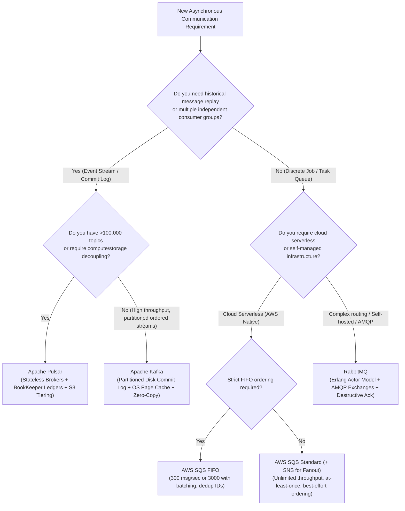
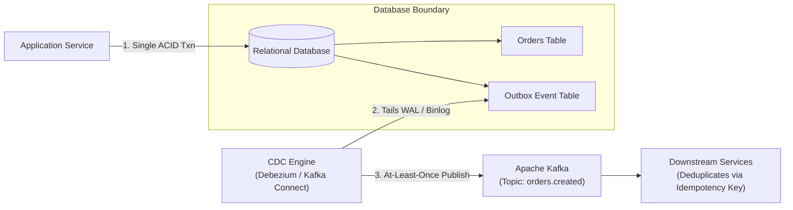

# Layer 03: Messaging, Streaming & Event-Driven Systems Playbook

> **The System Design Interview Lens:** The fatal mistake in asynchronous architecture is conflating a **Task Queue** with an **Event Stream**. Junior engineers pick Kafka for everything because "it handles scale." Staff/Principal engineers analyze **consumer consumption semantics (destructive ack vs immutable replay)**, **ordering boundaries (per-key vs total)**, **backpressure resilience**, and **end-to-end exactly-once delivery via the Transactional Outbox pattern**.

---

## 1. 60-Second Interview Decision Matrix & Flowchart

### The Master Decision Matrix

| Workload / Primary Access Pattern | Primary Selection | Runner-Up / Alternative | Never Choose / Red Flag | Decisive Mechanical Reason |
| :--- | :--- | :--- | :--- | :--- |
| **High-Throughput Event Streaming & Replay** (User activity logs, CDC pipelines, metrics) | **Apache Kafka** | **Apache Pulsar** | RabbitMQ / SQS | Append-only partitioned commit log; sequential disk I/O; zero-copy OS `sendfile()`; immutable replay by offset. |
| **Complex Routing, AMQP Exchanges & Transient Tasks** (E-commerce order fulfillment, RPC workflows) | **RabbitMQ** | **AWS SQS** | Kafka | Smart broker / dumb consumer; flexible routing keys (Topic, Direct, Fanout, Headers); selective per-message ack and redelivery. |
| **Serverless Task Queuing & Cloud-Native Decoupling** (Background thumbnail generation, webhooks) | **AWS SQS (+ SNS)** | **RabbitMQ** | Kafka (overkill) | Fully managed zero-maintenance queue; elastic auto-scaling; native Dead-Letter Queue (DLQ); per-message visibility timeouts. |
| **Tiered Storage & Multi-Tenant Large-Scale Streaming** (>100k topics, auto-offload to S3) | **Apache Pulsar** | **Apache Kafka** | Redis Streams | Decoupled compute (stateless Pulsar brokers) and storage (Apache BookKeeper); native tiered storage to S3/GCS. |
| **Lightweight In-Memory Event Streaming** (Within an existing Redis deployment) | **Redis Streams** | **Kafka** (if durability/retention > RAM) | RabbitMQ | Low-latency stream abstraction with consumer groups (`XADD`, `XREADGROUP`) without introducing a new cluster. |

---

### The Messaging & Streaming Decision Flowchart



---

## 2. Mechanical First Principles: Queues vs. Distributed Commit Logs

Understanding the physics of how messages are stored and consumed is the single biggest differentiator in interview performance.

```
┌─────────────────────────────────────────────────────────────────────────────┐
│                       MESSAGE BROKER vs. COMMIT LOG                         │
├───────────────────────────────────┬─────────────────────────────────────────┤
│    TRADITIONAL BROKER (RabbitMQ)  │      DISTRIBUTED LOG (Kafka/Pulsar)     │
├───────────────────────────────────┼─────────────────────────────────────────┤
│ • Smart broker, dumb consumer     │ • Dumb broker, smart consumer           │
│ • Destructive read (Ack deletes)  │ • Non-destructive read (Offset pointer) │
│ • State kept in broker RAM        │ • State is immutable append-only on disk│
│ • Backpressure: Drops/RAM crash   │ • Backpressure: Consumer lag only       │
│ • Message replay: IMPOSSIBLE      │ • Message replay: TRIVIAL (Rewind offset)│
└───────────────────────────────────┴─────────────────────────────────────────┘
```

### 1. Destructive Reads vs. Immutable Offsets

#### Traditional Queue (RabbitMQ, SQS)
*   **The Model:** A message is placed in a queue. A consumer polls the message. The broker marks the message as "in-flight" (visibility timeout). Once the consumer acknowledges (`ACK`), **the broker immediately purges the message from disk/RAM**.
*   **Consequence:** Messages cannot be re-read. If a new analytics service is deployed next week, it cannot read yesterday's events. If consumers fall behind, memory usage spikes on the broker until the broker crashes or enforces aggressive throttling.

#### Distributed Commit Log (Kafka)
*   **The Model:** A topic is divided into **Partitions**. Each partition is an **append-only, immutable ordered log** written to disk. Messages are retained for a configurable time window (e.g., 7 days) or size threshold, **completely independent of whether they have been read**.
*   **Consequence:** Reading does not delete data; consumers simply track an integer **Offset** pointing to the last message processed. Ten different microservices can read the same partition independently at their own pace. Message replay is as simple as resetting the consumer group's offset backwards (`SEEK`).

---

### 2. Kafka Storage Physics: Zero-Copy and the OS Page Cache

How does Kafka achieve millions of messages per second on standard spinning disks or SSDs?

```
TRADITIONAL PROXY READ (4 Context Switches, 3 Memory Copies):
Disk ──(DMA)──> Kernel Page Cache ──(CPU)──> JVM User Space Buffer
JVM User Space Buffer ──(CPU)──> Socket Buffer ──(DMA)──> Network NIC

KAFKA ZERO-COPY READ via sendfile() (2 Context Switches, 0 CPU Copies):
Disk ──(DMA)──> Kernel Page Cache ────────────(DMA)───────────> Network NIC
```

1.  **Sequential Append Disk I/O:** Kafka never modifies data in-place. All writes are appended to the active segment file (`.log`). Modern OS kernels heavily optimize sequential I/O via read-ahead and write-behind caching, matching or exceeding random memory access speeds.
2.  **OS Page Cache (Bypassing JVM GC):** Kafka does not cache messages in the JVM heap. All messages live directly in the Linux OS Page Cache. This eliminates JVM Garbage Collection pauses and prevents memory duplication between user and kernel space.
3.  **Linux Zero-Copy (`sendfile` system call):** When sending messages to consumers, Kafka uses the `sendfile()` system call. The OS transfers bytes directly from the page cache to the Network Interface Card (NIC) via Direct Memory Access (DMA), completely bypassing application memory and eliminating CPU copy overhead.

---

### 3. High Availability: ISR (In-Sync Replicas) and Quorum Math

Kafka replicates each partition across $N$ brokers (Replication Factor = $N$).

```
PARTITION 0 REPLICATION:
Broker 1 (Leader):    [Msg 0][Msg 1][Msg 2][Msg 3]  ─── High Watermark (Committed)
Broker 2 (Follower):  [Msg 0][Msg 1][Msg 2][Msg 3]  ─── In ISR Set
Broker 3 (Follower):  [Msg 0][Msg 1]                ─── Lagging! (Dropped from ISR)
```

*   **Leader & Followers:** Only the **Leader** broker accepts writes and reads from clients (by default). **Follower** brokers act as consumers, fetching messages sequentially to replicate the log.
*   **The In-Sync Replicas (ISR) Set:** The subset of replicas that are actively caught up with the leader's High Watermark. If a follower falls behind (configured by `replica.lag.time.max.ms`), the leader kicks it out of the ISR set.
*   **Producer Durability (`acks` setting):**
    *   `acks = 0`: Producer fires and forgets. Lowest latency, guaranteed data loss on failure.
    *   `acks = 1`: Leader writes to its local log and acks immediately without waiting for replicas. Risk of data loss if leader crashes before replication.
    *   `acks = all` (or `-1`): Leader waits until **all replicas currently in the ISR set** acknowledge the write. Paired with `min.insync.replicas = 2`, this guarantees zero data loss even during node crashes.

---

## 3. Head-to-Head Architectural Shootouts

### Shootout 1: Apache Kafka vs. RabbitMQ

```
┌─────────────────────────────────────────────────────────────────────────────┐
│                             KAFKA vs. RABBITMQ                              │
├───────────────────────────────────┬─────────────────────────────────────────┤
│            APACHE KAFKA           │                 RABBITMQ                │
├───────────────────────────────────┼─────────────────────────────────────────┤
│ Distributed Commit Log            │ Traditional Message Broker (AMQP)       │
│ Dumb broker / Smart consumer      │ Smart broker / Dumb consumer            │
│ Ordering per-partition only       │ Total ordering within a single queue    │
│ Throughput: 1,000,000+ msg/sec    │ Throughput: 20,000 – 50,000 msg/sec     │
│ Retention: Days/Weeks on disk     │ Retention: Cleared upon consumer ACK    │
│ Routing: Topic/Partition Key only │ Routing: Exchanges (Direct/Topic/Fanout)│
│ Consumer scaling: Max = Partitions│ Consumer scaling: Unlimited workers     │
└───────────────────────────────────┴─────────────────────────────────────────┘
```

#### 1. Routing Flexibility vs. Raw Ingestion
*   **RabbitMQ:** Exceptional routing sophistication. A publisher sends a message to an **Exchange** with a routing key (e.g., `order.us.eu.created`). The exchange binds to queues using pattern matching (e.g., `order.us.*` or `order.#`), splitting, filtering, and directing messages dynamically.
*   **Kafka:** Minimal routing at the broker. Messages are published strictly to a **Topic**. Partitioning is determined solely by `hash(partition_key) % num_partitions`. Any advanced filtering must be performed by consumer application logic or stream processing engines (Kafka Streams / Flink).

#### 2. Consumer Scaling and Concurrency
*   **Kafka (The Partition Ceiling):** In a Kafka consumer group, **each partition can only be consumed by at most one consumer thread at any given time**.
    *   *The Trap:* If a topic has 8 partitions, deploying 16 consumer pods means 8 pods will sit completely idle doing zero work. To scale consumers, you *must* increase partition count.
*   **RabbitMQ (Competing Consumers):** A single RabbitMQ queue can have 100 worker pods consuming from it simultaneously. The broker dispatches messages round-robin to all available workers based on prefetch count (`basic.qos`).

#### 3. The Interview Verdict: When to Pick Which
*   **Pick RabbitMQ if:** You are coordinating discrete, asynchronous transactional tasks between microservices (e.g., PDF generation, email sending, payment dispatch) where flexible routing is needed, message volume is moderate (<50k msg/sec), and messages should be discarded once completed.
*   **Pick Apache Kafka if:** You are building high-volume event streaming architectures (event sourcing, analytics ingestion, clickstream, CDC database synchronization) where message volume is massive, messages must be retained for replay, and multiple independent downstream consumers process the same data stream.

---

### Shootout 2: Apache Kafka vs. AWS SQS / SNS

```
┌─────────────────────────────────────────────────────────────────────────────┐
│                            KAFKA vs. AWS SQS / SNS                          │
├───────────────────────────────────┬─────────────────────────────────────────┤
│            APACHE KAFKA           │               AWS SQS / SNS             │
├───────────────────────────────────┼─────────────────────────────────────────┤
│ Provisioned / Clustered (MSK/Self)│ Fully Managed Serverless                │
│ Long-term retention (Disk-backed) │ Ephemeral (Max 14 days, auto-purged)    │
│ Partition-ordered stream          │ SQS Standard: Unordered                 │
│                                   │ SQS FIFO: Ordered (300 msg/sec cap)     │
│ Manual partition rebalancing      │ Transparent auto-scaling                │
│ Complex operations (ZooKeeper/KRaft) Zero operational maintenance           │
└───────────────────────────────────┴─────────────────────────────────────────┘
```

#### 1. Operations & Scalability
*   **AWS SQS/SNS:** Zero cluster provisioning, zero broker patches, zero partition capacity planning. SNS provides push fanout to multiple SQS queues. SQS Standard provides practically unlimited throughput with best-effort ordering.
*   **Kafka:** High operational footprint. Requires managing broker nodes, disk storage thresholds, JVM tuning, and partition rebalancing during cluster expansion.

#### 2. The Ordering Bottleneck in SQS FIFO
*   Standard SQS does not guarantee message ordering. AWS provides **SQS FIFO**, but it imposes a hard throughput limit: **300 transactions/second** (or up to 3,000/sec with maximum batching). If your workload demands 50,000 ordered messages/second across customer IDs, SQS FIFO is fundamentally disqualified; Kafka partitions easily satisfy this requirement.

---

### Shootout 3: Apache Kafka vs. Apache Pulsar

```
┌─────────────────────────────────────────────────────────────────────────────┐
│                             KAFKA vs. APACHE PULSAR                         │
├───────────────────────────────────┬─────────────────────────────────────────┤
│            APACHE KAFKA           │              APACHE PULSAR              │
├───────────────────────────────────┼─────────────────────────────────────────┤
│ Monolithic Broker (Compute+Disk)  │ Decoupled: Stateless Broker + BookKeeper│
│ Partitions tied to physical disks │ Ledgers striped across storage Bookies  │
│ Max topics: A few thousands       │ Max topics: 1,000,000+ native topics    │
│ Rebalancing copies gigabytes/node │ Rebalancing is instant metadata update  │
│ Tiered storage: Add-on (KIP-405)  │ Tiered storage: Native first-class S3   │
└───────────────────────────────────┴─────────────────────────────────────────┘
```

*   **The Pulsar Advantage:** Pulsar decouples the serving layer (stateless brokers) from the persistence layer (Apache BookKeeper). If storage runs out, you add BookKeeper storage nodes without touching broker compute. Expanding partitions requires zero data copying because segments (ledgers) are distributed across the BookKeeper cluster automatically.
*   **The Kafka Advantage:** Far larger global ecosystem, vastly simpler architecture to operate (single binary with KRaft consensus vs Pulsar requiring ZooKeeper + BookKeeper + Pulsar Brokers), and significantly broader community tooling and managed cloud support.

---

## 4. Delivery Semantics & The Transactional Outbox Pattern

### 1. Delivery Guarantees Demystified

```
┌───────────────────┬───────────────────────────────────┬─────────────────────┐
│ SEMANTIC          │ MECHANICS                         │ PRODUCTION RISK     │
├───────────────────┼───────────────────────────────────┼─────────────────────┤
│ At-Most-Once      │ Consumer commits offset FIRST,    │ Data Loss! If worker│
│                   │ then processes the message.       │ crashes, message is │
│                   │                                   │ permanently dropped.│
├───────────────────┼───────────────────────────────────┼─────────────────────┤
│ At-Least-Once     │ Consumer processes message FIRST, │ Duplicates! If node │
│ (Industry Default)│ then commits offset.              │ crashes before ack, │
│                   │                                   │ message is re-read. │
├───────────────────┼───────────────────────────────────┼─────────────────────┤
│ Exactly-Once      │ Kafka Idempotent Producer +       │ Latency overhead;   │
│ Processing (EOS)  │ Transactional Coordinator +       │ requires strict end-│
│                   │ Consumer DB Idempotency Keys.     │ to-end integration. │
└───────────────────┴───────────────────────────────────┴─────────────────────┘
```

> **The Critical Senior Reality:** True "Exactly-Once Delivery" across a network is mathematically impossible (The Two Generals' Problem). Kafka's "Exactly-Once Semantics" (EOS) strictly guarantees **Exactly-Once Processing within Kafka itself** (from Kafka topic A to Kafka topic B via Kafka Streams). When writing out to an external database or external API, you **must achieve idempotency at the consumer application layer**.

---

### 2. The Transactional Outbox Pattern (Dual-Write Protection)

The single most common bug in microservice architectures is the **Dual-Write Anti-Pattern**:

```
// ANTI-PATTERN: THE DUAL-WRITE BUG
@Transactional
void placeOrder(Order order) {
    db.save(order);               // Step 1: Save to Postgres
    kafka.send("order-topic", order); // Step 2: Publish to Kafka
}
// FAILURE SCENARIO: If the database commits, but the network fails or Kafka broker
// is down before send() completes, your database has the order, but downstream
// billing/inventory services NEVER get notified! (State desynchronization).
```

#### The Production Solution: Transactional Outbox + CDC



1.  **Atomic Local Commit:** The application writes the `Order` record **and** an event record into an `outbox` table in the *same local database ACID transaction*. Either both succeed or both roll back.
2.  **Log-Tailing (Zero App Overhead):** A Change Data Capture (CDC) engine (such as **Debezium**) tails the database transaction log (Postgres WAL or MySQL Binlog).
3.  **Guaranteed Event Delivery:** Debezium reads committed outbox events from the WAL and publishes them to Kafka with `acks=all`. Once acknowledged by Kafka, it updates its offset.
4.  **Downstream Idempotency:** The consumer receives the event and checks its local database for the unique `event_id` before processing, guaranteeing exact-once business outcomes.

---

## 5. The Interview Defense Playbook: Scripts & Trap Rebuttals

### The 3-Sentence Justification Formula

#### Example: Video Transcoding Pipeline (Chapter 14 YouTube)
> *"For the video upload and transcoding pipeline, I am selecting **RabbitMQ / AWS SQS** as a task queue over Kafka. Our workload consists of discrete, long-running transcoding jobs where each video task must be independently acknowledged, reassigned upon worker failure via visibility timeouts, and routed dynamically based on codec targets. Kafka’s partition model would needlessly constrain worker scaling to the partition count and lacks per-message ack granularity."*

#### Example: Ad Click Event Aggregation (Chapter 21 Ad Click)
> *"For the ad click event ingestion pipeline, I am selecting **Apache Kafka** over traditional message queues. We need to ingest 500,000 click events per second with high durability, where sequential append writes to disk and zero-copy network transfer maximize throughput. Furthermore, Kafka's immutable commit log enables both our real-time Flink aggregation job and our cold-storage S3 backup consumer to stream the exact same event topic independently without interference."*

---

### Interviewer Trap Questions & Battle-Tested Rebuttals

#### Trap 1: *"Why use Kafka instead of RabbitMQ if our throughput is only 5,000 messages per second?"*
*   **The Trap:** Checking whether you know that Kafka is chosen for *architectural patterns* (replay, multi-subscriber, event sourcing), not just raw volume.
*   **The High-Scoring Response:**
    > *"Even at 5,000 msg/sec, Kafka is selected if our architectural pattern requires **data replayability and decoupled multi-consumer streams**. With RabbitMQ, if we build a new fraud detection model tomorrow, it cannot analyze yesterday's events because consumer acks destroy messages. With Kafka, the append-only commit log preserves historical events for 14 days, allowing new consumers to rewind their offset to the beginning and backfill state without placing any load on our operational OLTP database."*

#### Trap 2: *"What happens if a Kafka consumer in a consumer group crashes or takes too long to process a batch?"*
*   **The Trap:** Testing deep operational knowledge of consumer heartbeats and rebalances.
*   **The High-Scoring Response:**
    > *"Kafka detects consumer failure through two distinct mechanisms:
    > 1. **Heartbeat Thread:** The consumer sends background heartbeats to the Group Coordinator. If no heartbeat is received within `session.timeout.ms` (e.g., 45s), the broker assumes the pod died and triggers a group rebalance.
    > 2. **Processing Livelock (`max.poll.interval.ms`):** If a consumer's worker thread gets stuck processing a heavy batch and fails to call `poll()` before the interval expires (default 5 minutes), the coordinator revokes its partitions and triggers a rebalance.
    > During a naive **Eager Rebalance**, all consumers stop consuming, dropping processing throughput to zero. To prevent this, we configure the **Cooperative Sticky Assignor (`CooperativeStickyAssignor`)**, which allows unaffected consumers to continue processing their partitions while reassignment occurs incrementally."*

#### Trap 3: *"How do you handle a poison pill message that crashes your consumer repeatedly?"*
*   **The Trap:** Probing fault tolerance and error isolation in event-driven systems.
*   **The High-Scoring Response:**
    > *"If a malformed payload causes a consumer to throw an unhandled exception, retrying in-place blocks the entire partition indefinitely (consumer lag climbs). We resolve this using a **Dead-Letter Queue (DLQ) with Non-Blocking Retry Topics**:
    > 1. When processing fails, the consumer increments a retry header and publishes the message to a retry topic (`orders-retry-5m`).
    > 2. The consumer commits its offset on the main topic and proceeds to the next message, preventing partition stalls.
    > 3. A dedicated retry worker processes the delayed topic with exponential backoff. If it fails after 3 attempts, it is routed to an `orders-dlq` topic for alerting and manual investigation."*

---

## 6. System Design Mapping: Where Messaging Lives in Real Architectures

| Chapter / Architecture | Messaging Technology | Specific Architectural Role |
| :--- | :--- | :--- |
| [**10. Notification System**](file:///Users/abhinnaagarwal/Documents/system-design-notes/10.%20Notification%20System/README.md) | **RabbitMQ / AWS SQS** | Priority queues for transactional SMS vs marketing emails; rate-limiting per provider. |
| [**11. News Feed System**](file:///Users/abhinnaagarwal/Documents/system-design-notes/11.%20News%20Feed%20System/README.md) | **Apache Kafka** | Fan-out service consumes post-created events; updates follower Redis timelines asynchronously. |
| [**19. Distributed Message Queue**](file:///Users/abhinnaagarwal/Documents/system-design-notes/19.%20Distributed%20Message%20Queue/README.md) | **Custom Distributed Log** | In-depth architectural blueprint of Kafka internals (segments, zero-copy, ISR, leader election). |
| [**21. Ad Click Aggregation**](file:///Users/abhinnaagarwal/Documents/system-design-notes/21.%20Ad%20Click%20Event%20Aggregation/README.md) | **Apache Kafka + Flink** | Ingests 100k+ click events/sec; partitioned by `ad_id` for windowed stream aggregation. |
| [**26. Payment System**](file:///Users/abhinnaagarwal/Documents/system-design-notes/26.%20Payment%20System/README.md) | **Kafka + Transactional Outbox** | Publishes payment completion events; drives async reconciliation with external banks. |

---

### Cross-Repository Deep Dive Links
*   Kafka Architecture & Internals: [`coding-practice: streaming/kafka.md`](file:///Users/abhinnaagarwal/Documents/coding-practice/systems-engineering/streaming/kafka.md)
*   CDC & Debezium Outbox: [`coding-practice: streaming/debezium.md`](file:///Users/abhinnaagarwal/Documents/coding-practice/systems-engineering/streaming/debezium.md)
*   Message Brokers Core Concept: [`Core Concepts/Message Brokers and Consistency/README.md`](file:///Users/abhinnaagarwal/Documents/system-design-notes/Core%20Concepts/Message%20Brokers%20and%20Consistency/README.md)
