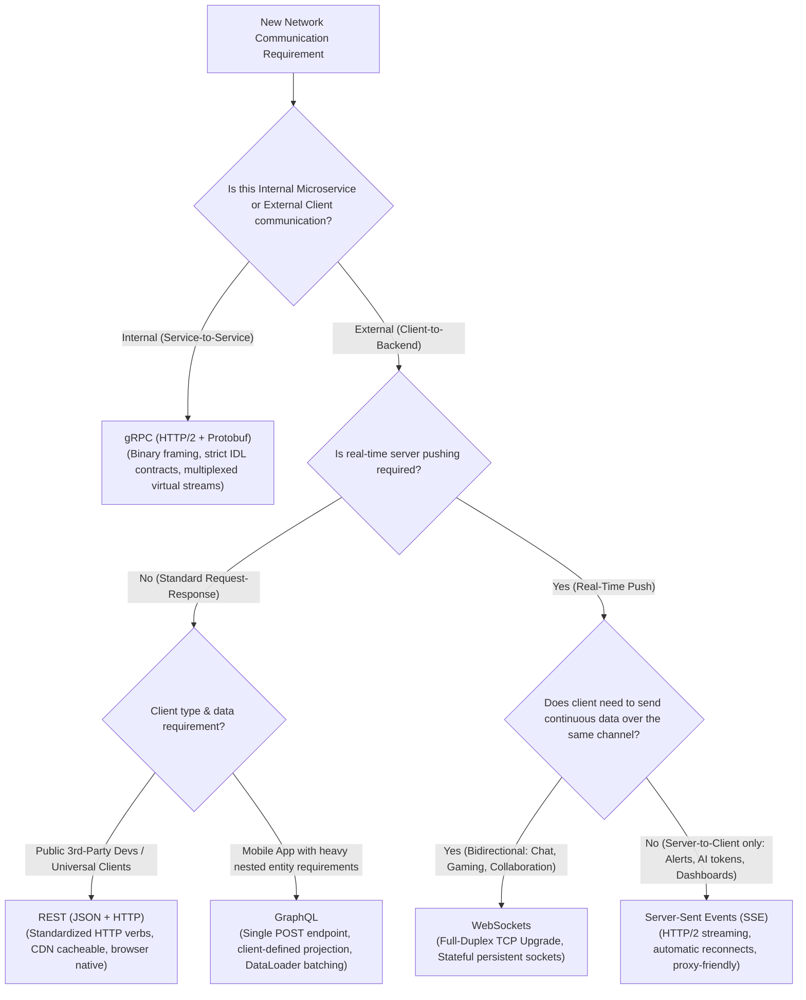
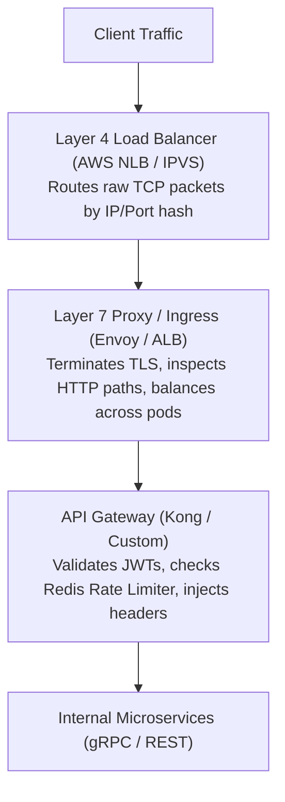

# Layer 04: Networking, Transport Protocols & API Gateway Playbook

> **Design inputs:** API style, encoding, transport, application acknowledgments, retry IDs, payload, RTT, fanout and active/idle connection mix.

> **The System Design Interview Lens:** In networking, junior engineers default to *"I will expose a REST API."* Staff/Principal engineers select protocols based on **transport-level physics**: packet framing, serialization CPU costs, duplex requirements (unidirectional vs bidirectional), connection statefulness (socket limits, ephemeral port exhaustion), and **L4 vs L7 ingress routing topology**.

---

## 1. 60-Second Interview Decision Matrix & Flowchart

### The Master Decision Matrix

| Communication Pattern / Use Case | Primary Protocol | Alternative / Runner-Up | Never Choose / Red Flag | Decisive Mechanical Reason |
| :--- | :--- | :--- | :--- | :--- |
| **Internal Microservice-to-Microservice RPC** | **gRPC (HTTP/2 + Protobuf)** | REST (HTTP/1.1 + JSON) | WebSockets | Binary serialization (Protobuf) reduces CPU parsing overhead by 5x–10x; HTTP/2 stream multiplexing over a single persistent TCP connection. |
| **External Public API / Developer Platform** | **REST (HTTP/1.1 or HTTP/2 + JSON)** | GraphQL | gRPC (without transcoding proxy) | Universally supported by all HTTP clients/browsers; self-describing; simple caching via standard HTTP headers (`ETag`, `Cache-Control`). |
| **Complex Mobile Client Aggregation** (Varied screens, low bandwidth) | **GraphQL** | REST (BFF - Backend for Frontend) | Raw RPC | Solves over-fetching and under-fetching in a single request; client defines exact response shape. |
| **Bidirectional Real-Time Communication** (Chat, collaborative docs, gaming) | **WebSockets** | WebRTC Data Channel | Long Polling | Full-duplex persistent TCP connection with minimal framing overhead (2–10 bytes) after initial HTTP upgrade handshake. |
| **Unidirectional Server-to-Client Push** (Live notifications, stock tickers, LLM token streaming) | **Server-Sent Events (SSE)** | WebSockets | Short Polling | Native HTTP/2 streaming (`text/event-stream`); built-in client reconnection and event ID tracking; traverses standard HTTP proxies/firewalls. |
| **Ultra-High Throughput Ingress Load Balancing** (>1M connections/sec) | **Layer 4 Load Balancer** (AWS NLB / IPVS / Maglev) | Layer 7 Load Balancer | Application reverse proxy | Operates at TCP/UDP level; routes packets without terminating TLS or parsing HTTP headers; supports Direct Server Return (DSR). |

---

### The Protocol & Ingress Decision Flowchart



---

## 2. Mechanical First Principles: The Physics of Transport & Serialization

Networking bottlenecks trace directly to **TCP handshakes, Head-of-Line blocking, OS socket buffers, and CPU serialization cycles**.

```
┌─────────────────────────────────────────────────────────────────────────────┐
│                          HTTP GENERATION EVOLUTION                          │
├───────────────────────┬─────────────────────────┬───────────────────────────┤
│ HTTP/1.1              │ HTTP/2                  │ HTTP/3 (QUIC)             │
├───────────────────────┼─────────────────────────┼───────────────────────────┤
│ Text-based framing    │ Binary framing          │ Binary framing over UDP   │
│ 1 request/stream per  │ Multiplexed streams on  │ Multiplexed streams       │
│   TCP connection      │   single TCP connection │   independent of TCP      │
│ Application HoL Block │ TCP Transport HoL Block │ ZERO Head-of-Line Blocking│
│ Redundant headers     │ HPACK header compress   │ QPACK header compression  │
│ 1-RTT TLS Handshake   │ 1-RTT TLS Handshake     │ 0-RTT Connection Restart  │
└───────────────────────┴─────────────────────────┴───────────────────────────┘
```

### 1. Head-of-Line (HoL) Blocking: Application vs. Transport Level

*   **HTTP/1.1 (Application HoL Blocking):** A browser can only send one request over a TCP connection at a time; it must wait for the entire response before sending the next. Browsers work around this by opening 6 parallel TCP connections per domain, multiplying server socket usage.
*   **HTTP/2 (Multiplexing over Single TCP):** Multiple logical requests/responses are interleaved as binary frames over a single shared TCP connection.
    *   *The Trap (Transport HoL Blocking):* Because all virtual streams share one underlying TCP byte stream, if **a single IP packet is dropped by the network**, the kernel's TCP stack halts delivery for *all streams on that connection* until the missing packet is retransmitted.
*   **HTTP/3 (QUIC over UDP):** Replaces TCP with UDP. Each stream handles its own packet loss recovery independently. A dropped packet on Stream 3 does not stall Stream 1 or Stream 2.

---

### 2. Serialization Physics: JSON Text vs. Protocol Buffers (Protobuf)

gRPC/Protobuf can reduce serialization cost through binary encoding and generated code. REST APIs can also use binary formats and HTTP/2 or HTTP/3.

```
JSON PAYLOAD: {"user_id": 1048576, "is_active": true}
• Wire Size: ~45 bytes (ASCII strings, field keys repeated in every message).
• CPU Cost: High. Parser must scan strings, convert ASCII numbers to binary integers,
  and allocate memory for strings and maps dynamically on the heap.

PROTOBUF BINARY ENCODING:
• Wire Size: ~7 bytes.
• Format: [Tag 1 (Varint)] [Value: 1048576] [Tag 2 (Varint)] [Value: 1]
• CPU Cost: Generated typed decoding can avoid some dynamic parsing, but varints
  still require decoding and allocations depend on language, fields and reuse.
```

* **Comparison inputs:** Schema, language/runtime, compression, payload distribution and allocation profile determine the byte and CPU savings.

---

### 3. Connection Capacity: The Mechanics of 1 Million Concurrent Connections

When designing chat servers (Chapter 12) or push notifications (Chapter 10), interviewers probe: *"Can a single server handle 1,000,000 persistent WebSocket connections?"*

*   **The OS File Descriptor Limit:** Every TCP socket is represented as a file descriptor. Default Linux limits (`nofile = 1024`) will immediately reject connections. Systems must tune `/etc/security/limits.conf` to `nofile = 2,000,000`.
*   **Memory Footprint per Socket:**
    * Linux buffer settings control limits and autotuning; resident allocation grows with queued data and memory pressure.
    * At 128 KB actually allocated per socket, one million sockets consume 128 GB for buffers. Include socket metadata, TLS/application state and active-connection distribution in the memory budget.
    * Budget socket/slab state, TLS and application objects, active send/receive queues, fanout and reconnect bursts. Measure representative idle and active populations with `ss -m`, process RSS and slab metrics on the chosen kernel/runtime; tune buffers only against throughput/latency tests.
*   **The Ephemeral Port Myth:** A common junior belief is that a server can only accept 65,535 connections because of port limits. **This is false.** A TCP connection is identified by a **4-tuple**:
    $$\text{(Source IP, Source Port, Destination IP, Destination Port)}$$
    Because the server listens on a fixed `(Dest IP, Dest Port)` (e.g., port 443), it can accept millions of connections as long as client `(Source IP, Source Port)` pairs are unique.

---

## 3. Head-to-Head Architectural Shootouts

### Shootout 1: gRPC vs. REST (JSON)

```
┌─────────────────────────────────────────────────────────────────────────────┐
│                              gRPC vs. REST (JSON)                           │
├───────────────────────────────────┬─────────────────────────────────────────┤
│                gRPC               │               REST (JSON)               │
├───────────────────────────────────┼─────────────────────────────────────────┤
│ Protocol: HTTP/2 (Binary framing) │ Protocol: HTTP/1.1 or HTTP/2 (Text)     │
│ Data format: Protocol Buffers     │ Data format: JSON / XML                 │
│ Contract: Strict `.proto` IDL     │ Contract: Loosely coupled (OpenAPI/docs)│
│ Latency: Ultra-low (Sub-ms)       │ Latency: Higher (Serialization lag)     │
│ Streaming: Bi-directional native  │ Streaming: Unnatural / Chunked encoding │
│ Browser support: Requires Envoy   │ Browser support: Native out of the box  │
└───────────────────────────────────┴─────────────────────────────────────────┘
```

#### The Interview Verdict: When to Pick Which
*   **Use gRPC for:** All internal backend microservice-to-microservice traffic. Strict contract enforcement catches breaking API changes at compile time; binary serialization saves megawatts of CPU in large clusters.
*   **Use REST for:** External-facing APIs consumed by third-party developers, web browsers, and public mobile apps where ease of integration, human-readable payloads, and standard CDN caching are paramount.

---

### Shootout 2: WebSockets vs. Server-Sent Events (SSE) vs. Long Polling

```
┌─────────────────────────────────────────────────────────────────────────────┐
│                 WEBSOCKETS vs. SERVER-SENT EVENTS vs. LONG POLLING          │
├───────────────────┬─────────────────────┬───────────────────────────────────┤
│ FEATURE           │ WEBSOCKETS          │ SERVER-SENT EVENTS (SSE)          │
├───────────────────┼─────────────────────┼───────────────────────────────────┤
│ Communication     │ Full-Duplex         │ Unidirectional (Server-to-Client) │
│ Protocol          │ TCP (Upgraded HTTP) │ Standard HTTP (HTTP/2 streaming)  │
│ Framing Overhead  │ 2 – 10 bytes        │ UTF-8 text (`data: ...\n\n`)      │
│ Firewall/Proxies  │ Often blocked/cut   │ 100% transparent through proxies  │
│ Auto-Reconnection │ Application logic   │ Built-in client retry protocol    │
│ Multiplexing      │ 1 socket per tab    │ Multiplexed over 1 HTTP/2 conn    │
│ Best For          │ Chat, Gaming, Whiteboards | Stock feeds, Notifications, LLMs │
└───────────────────┴─────────────────────┴───────────────────────────────────┘
```

#### Why SSE Wins Over WebSockets for AI / Dashboard / Notification Feeds
Many candidates choose WebSockets whenever they see the word "real-time." This is an interview anti-pattern:
1.  **State Management Overhead:** WebSockets require stateful infrastructure. If you terminate 500,000 WebSocket connections, you must maintain a persistent routing directory (e.g., Redis mapping `user_id` $\to$ `server_pod_ip`) so other servers know which pod holds the socket.
2.  **SSE Simplicity:** SSE is pure HTTP. If you are only streaming data *down* to the client (such as ChatGPT token streaming or financial stock tickers), SSE avoids custom protocol handshakes, works over standard HTTP/2, auto-reconnects natively with event ID tracking, and flows cleanly through API gateways and corporate proxies without port blocks.

---

### Shootout 3: Layer 4 vs. Layer 7 Load Balancing vs. API Gateway

```
┌─────────────────────────────────────────────────────────────────────────────┐
│                     THE INGRESS INFRASTRUCTURE STACK                        │
├───────────────────┬─────────────────────────────────┬───────────────────────┤
│ LAYER             │ TECHNOLOGIES                    │ PRIMARY FUNCTION      │
├───────────────────┼─────────────────────────────────┼───────────────────────┤
│ L4 Load Balancer  │ AWS NLB, IPVS, HAProxy (TCP mode)│ Fast TCP/UDP routing; │
│                   │ Maglev, Linux LVS               │ Direct Server Return; │
│                   │                                 │ Million QPS scale.    │
├───────────────────┼─────────────────────────────────┼───────────────────────┤
│ L7 Load Balancer  │ AWS ALB, Nginx, Envoy           │ HTTP path/host routing;│
│                   │                                 │ TLS termination;      │
│                   │                                 │ Cookie sticky sessions│
├───────────────────┼─────────────────────────────────┼───────────────────────┤
│ API Gateway       │ Kong, Apisix, Envoy Gateway     │ JWT authentication;   │
│                   │ AWS API Gateway                 │ Rate limiting;        │
│                   │                                 │ Quota enforcement.    │
└───────────────────┴─────────────────────────────────┴───────────────────────┘
```



#### Why Layer 4 and Layer 7 are Paired Together
*   **L4 (The Brawn):** Operates at the transport layer without looking inside the packet payload. Because it never decrypts TLS or parses HTTP text, a single L4 balancer can route millions of packets per second with microsecond latency.
*   **L7 (The Brain):** Terminates the TLS connection and reads the HTTP request headers. It routes requests based on URL path (`/orders` $\to$ Order Service; `/users` $\to$ User Service). It is computationally heavier (decrypting TLS and parsing headers), which is why it sits behind L4.

---

## 4. The Interview Defense Playbook: Scripts & Trap Rebuttals

### The 3-Sentence Justification Formula

#### Example: Chat System Connection Layer (Chapter 12 Chat System)
> *"For the client messaging connection layer, I am selecting **WebSockets** over HTTP Long Polling and SSE. Chat requires bi-directional, low-latency communication where users both send and receive messages with minimal per-packet framing overhead. While WebSockets require stateful connection tracking on the backend, terminating connections at an Envoy-managed WebSocket gateway allows us to multiplex incoming user events efficiently while utilizing Redis Pub/Sub for cross-server message routing."*

#### Example: Inter-Service RPC (Chapter 26 Payment System)
> *"For communication between the Payment Gateway and the Ledger Service, I am selecting **gRPC over HTTP/2** with Protocol Buffers instead of standard REST/JSON. The payment critical path demands minimal serialization latency and strict compile-time contract enforcement to eliminate field schema discrepancies. The HTTP/2 transport allows connection reuse through multiplexing, preventing TCP handshake overhead on high-frequency inter-service calls."*

---

### Interviewer Trap Questions & Battle-Tested Rebuttals

#### Trap 1: *"Why not use WebSockets for live sports score updates or stock market tickers?"*
*   **The Trap:** Probing whether you recognize that unidirectional traffic does not require bidirectional socket complexity.
*   **The High-Scoring Response:**
    > *"WebSockets are over-engineered for sports scores and stock tickers because the client never sends data back to the server over that channel; traffic is 100% unidirectional. 
    > Using **Server-Sent Events (SSE)** is mechanically superior:
    > 1. It operates over standard HTTP/2, multiplexing multiple event streams over a single TLS connection alongside normal web traffic.
    > 2. It includes native browser reconnection logic with `Last-Event-ID` tracking out of the box, ensuring missed scores are replayed seamlessly upon network reconnection.
    > 3. It easily traverses corporate firewalls and HTTP caching proxies that frequently terminate or block long-lived WebSocket TCP upgrades."*

#### Trap 2: *"Why can't we use gRPC directly in client-side web browsers?"*
*   **The Trap:** Testing your knowledge of browser security sandboxes and HTTP/2 framing limitations in JavaScript.
*   **The High-Scoring Response:**
    > *"Standard web browsers do not expose fine-grained control over HTTP/2 framing to JavaScript. The browser `fetch()` and `XMLHttpRequest` APIs do not allow web applications to access HTTP/2 trailing headers (trailers), which gRPC strictly requires to communicate call status codes (`grpc-status`). 
    > To connect browser applications to gRPC backends, we must either use **gRPC-Web** paired with an **Envoy proxy** that translates browser HTTP/1.1 or standard HTTP/2 calls into gRPC frames, or expose standard REST endpoints that our API gateway transcodes into internal gRPC calls."*

#### Trap 3: *"How do you prevent a slow client from exhausting server memory on a WebSocket push server?"*
*   **The Trap:** Testing knowledge of backpressure and socket write buffers.
*   **The High-Scoring Response:**
    > *"If a client has a poor 3G connection and cannot read incoming WebSocket frames as fast as our server produces them, the server's TCP write buffer (`wmem`) fills up. If the application continues pushing messages into the user's queue, memory usage balloons until the pod crashes with an Out-of-Memory error. 
    > We enforce **Backpressure and Drop Policies**:
    > 1. We monitor the application-level socket write queue length.
    > 2. For non-critical updates (e.g., live stock quotes), we apply a **Drop-Oldest policy (coalescing)**, retaining only the latest price.
    > 3. If the unacknowledged queue exceeds a critical threshold (e.g., 5MB or 1,000 frames), we terminate the slow WebSocket connection to protect server memory integrity."*

---

## 5. System Design Mapping: Where Protocols Live in Real Architectures

| Chapter / Architecture | Protocol / Ingress Technology | Specific Architectural Role |
| :--- | :--- | :--- |
| [**04. Rate Limiter**](../04.%20Rate%20Limiter/Readme.md) | **API Gateway (L7 Envoy / Kong)** | Inspects client IP / API Token; calls Redis rate limiting filter before routing. |
| [**10. Notification System**](../10.%20Notification%20System/Readme.md) | **APNs / FCM + SSE** | Pushes notifications to mobile devices via Apple/Google gateways; web via SSE. |
| [**12. Chat System**](../12.%20Chat%20System/Readme.md) | **WebSockets + Epoll Gateway** | Maintains persistent full-duplex TCP connections for instant message delivery. |
| [**17. Nearby Friends**](../17.%20Nearby%20Friends/README.md) | **WebSockets + Geo-Redis** | Bi-directional client location streaming and nearby peer update broadcast. |
| [**28. Stock Exchange**](../28.%20Stock%20Exchange/README.md) | **L4 UDP Multicast / FIX Protocol** | Ultra-low-latency market data dissemination to trading firms. |

---

### Cross-Repository Deep Dive Links
*   Networking Layers & Sockets: [`coding-practice: networking/networking-layers.md`](https://github.com/abhinnaagrawal/coding-practice/blob/HEAD/systems-engineering/networking/networking-layers.md)
*   gRPC Architecture & Mechanics: [`coding-practice: networking/grpc.md`](https://github.com/abhinnaagrawal/coding-practice/blob/HEAD/systems-engineering/networking/grpc.md)
*   Networking Foundations: [`Core Concepts/Networking Foundations/README.md`](../Core%20Concepts/Networking%20Foundations/README.md)
*   WebSockets Deep Dive: [`Core Concepts/WebSockets/README.md`](../Core%20Concepts/WebSockets/README.md)
*   gRPC Core Concept: [`Core Concepts/gRPC/README.md`](../Core%20Concepts/gRPC/README.md)
