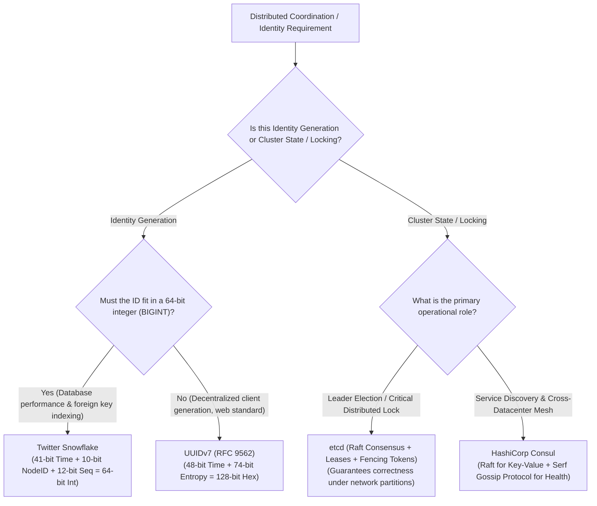

# Layer 05: Distributed Coordination, Consensus & Identity Playbook

> **Design inputs:** Quorum membership, failure model, durable tokens and worker-ID reuse. Protected resources validate ownership/fencing on every mutation.

> **The System Design Interview Lens:** Distributed coordination is where subtle bugs bring down entire systems: split-brain, clock drift, and phantom lock releases during Garbage Collection pauses. In Staff/Principal interviews, you must prove mastery over **quorum math ($N/2 + 1$)**, **linearizable consensus (Raft vs Paxos)**, **monotonic fencing tokens**, and **collision-free ID generation**.

---

## 1. 60-Second Interview Decision Matrix & Flowchart

### The Master Decision Matrix

| Problem Space / Requirement | Primary Selection | Alternative / Runner-Up | Never Choose / Red Flag | Decisive Mechanical Reason |
| :--- | :--- | :--- | :--- | :--- |
| **Cluster Metadata, Leader Election & Dynamic Config** (Kubernetes, distributed DB metadata) | **etcd** | **Apache ZooKeeper** (if existing Java ecosystem) | Redis or relational DB | Raft consensus guarantees linearizable reads/writes; MVCC revisions allow continuous, efficient gRPC streaming watches without polling. |
| **Mission-Critical Distributed Locking** (Preventing split-brain controllers or double-execution) | **etcd Leases + Fencing Tokens** | **ZooKeeper Ephemeral Nodes** | Redis Redlock (for strong consistency) | Raft consensus enforces lease timeouts; monotonically increasing revision IDs provide storage-layer fencing tokens against GC pauses. |
| **High-Throughput, 64-bit Ordered ID Generation** (Tweet IDs, payment transaction IDs) | **Twitter Snowflake (or custom epoch bitfield)** | **UUIDv7** (if 128-bit acceptable) | MySQL Auto-Increment Ticket Servers | 64-bit integer fits in standard database BIGINT; chronological ordering preserves B+ Tree insertion locality; zero network coordination. |
| **Standardized Client-Side Unique IDs without Central Coordination** | **UUIDv7 (RFC 9562)** | **ULID** | UUIDv4 (Random) | Combines 48-bit millisecond timestamp with 74 random bits; time-ordered sorting prevents catastrophic B+ Tree page fragmentation. |
| **Service Discovery & Multi-Datacenter Health Checking** | **HashiCorp Consul** | **etcd / CoreDNS** | Static Load Balancer IPs | Combines Raft (for linearizable state) with Serf Gossip Protocol (SWIM algorithm) for decentralized, fast failure detection across thousands of nodes. |

---

### The Coordination & ID Generation Decision Flowchart



---

## 2. Mechanical First Principles: Consensus Physics & The Fallacy of Time

### 1. Quorum Math: Why Cluster Sizes Must Be Odd ($2F + 1$)

All modern consensus engines (Raft, Paxos, ZAB) require a **Quorum** to commit state or elect a leader:
$$\text{Quorum Size} = \left\lfloor \frac{N}{2} \right\rfloor + 1$$

```
CLUSTER TOLERANCE COMPARISON:
• 3 Nodes: Quorum = 2. Tolerates 1 dead node.  (33% failure tolerance)
• 4 Nodes: Quorum = 3. Tolerates 1 dead node! (25% failure tolerance - 4th node adds ZERO resilience!)
• 5 Nodes: Quorum = 3. Tolerates 2 dead nodes. (40% failure tolerance - Optimal balance)
• 7 Nodes: Quorum = 4. Tolerates 3 dead nodes. (Higher latency due to consensus broadcast)
```

*   **Split-Brain Prevention:** If a 5-node cluster partitions into a 3-node group and a 2-node group, only the 3-node partition achieves quorum. The 2-node partition cannot form a majority and immediately rejects writes, preventing inconsistent split-brain states.
*   **Why Even Numbers are Redundant:** A 4-node cluster still requires 3 nodes for quorum; losing 2 nodes kills the cluster just like a 3-node cluster. Adding the 4th node increased network latency without increasing fault tolerance.

---

### 2. The Fallacy of Physical Time: Clock Skew & Leap Seconds

In distributed systems, relying on physical wall-clock time (`System.currentTimeMillis()`) to order events is dangerous:
*   **Clock Drift:** Quartz oscillators inside commodity servers drift by several milliseconds every day due to thermal variations.
*   **NTP Asynchronous Steps:** Network Time Protocol (NTP) synchronizes clocks over the network, but if the local clock drifts too far, NTP can abruptly step the clock backward, causing duplicate IDs or out-of-order transaction timestamps.
*   **The Solutions:**
    1.  **Logical Clocks (Lamport & Vector Clocks):** Order events by causal sequence rather than wall-clock time.
    2.  **Hybrid Logical Clocks (HLC - CockroachDB):** Combines physical time with a logical counter, ensuring time always moves forward monotonically.
    3.  **TrueTime API (Google Spanner):** Relies on GPS receivers and atomic clocks in every datacenter, bounding clock uncertainty within an explicit error window ($\epsilon \approx 1\text{ms} - 7\text{ms}$).

---

### 3. The Distributed Locking Trap: The GC Pause & The Need for Fencing Tokens

The single most dangerous failure mode in distributed locking is **process pauses (Stop-The-World Garbage Collection, hypervisor VM migration, or network lag)**.

```
THE DISTRIBUTED LOCK BUG (Without Fencing):
Client 1 (Holds Lock) ──> [STW GC Pause for 45s!] ──> Lock Leases Expire in etcd/Redis!
                                                         │
Client 2 ───────────────> Acquires Lock ───────────────> Writes to Shared Storage!
                                                         │
Client 1 Wakes Up! ─────> Believes it STILL has lock ──> OVERWRITES STORAGE! (DATA CORRUPTED)
```

#### The Mechanical Fix: Monotonic Fencing Tokens
Martin Kleppmann’s classic proof demonstrates that **a lock server cannot guarantee safety alone**; the storage layer must participate using a **Fencing Token**.

```
THE FENCING TOKEN SOLUTION:
1. Client 1 acquires lock from etcd ──> receives monotonic token: Revision 31
2. Client 1 undergoes 45s GC pause; Lease expires.
3. Client 2 acquires lock ───────────> receives monotonic token: Revision 32
4. Client 2 writes to Storage: [Data, Token = 32]. Storage records "Highest Token = 32".
5. Client 1 wakes up and attempts write: [Data, Token = 31].
6. Storage checks: Token 31 < Highest Token 32 ──> REJECTS WRITE! (System Safe!)
```

---

## 3. Head-to-Head Architectural Shootouts

### Shootout 1: etcd vs. Apache ZooKeeper vs. HashiCorp Consul

```
┌─────────────────────────────────────────────────────────────────────────────┐
│                          etcd vs. ZOOKEEPER vs. CONSUL                      │
├───────────────────┬─────────────────────┬───────────────────────────────────┤
│ FEATURE           │ etcd                │ APACHE ZOOKEEPER                  │
├───────────────────┼─────────────────────┼───────────────────────────────────┤
│ Language / Runtime│ Go (Single binary)  │ Java (JVM Tuning required)        │
│ Consensus Engine  │ Raft                │ ZAB (ZooKeeper Atomic Broadcast)  │
│ API & Protocol    │ gRPC / HTTP/2       │ Custom binary Jute protocol       │
│ Data Model        │ Flat Key-Value with │ Hierarchical file-system like     │
│                   │ MVCC Revisions      │ tree (ZNodes)                     │
│ Watch Mechanism   │ Streaming gRPC      │ One-time triggers (Must be        │
│                   │ Continuous Watches  │ re-registered after firing!)      │
│ Primary Ecosystem │ Kubernetes Backbone │ Apache Hadoop, Kafka (Legacy)     │
└───────────────────┴─────────────────────┴───────────────────────────────────┘
```

#### 1. Why etcd Replaced ZooKeeper in Modern Systems
*   **One-Time Watches vs. Continuous Streams:** In ZooKeeper, setting a watch on a znode fires *once*. If the key updates again before the client re-registers the watch, the client misses intermediate updates. In **etcd**, watches are persistent gRPC HTTP/2 streams backed by an MVCC event history; a client can reconnect and resume streaming from an exact historical revision ID.
*   **Operational Footprint:** ZooKeeper requires managing a JVM runtime, fine-tuning garbage collection, and configuring snapshot purges. `etcd` is a compiled static Go binary with minimal configuration and native Prometheus telemetry.

---

### Shootout 2: Distributed Locking: Redis Redlock vs. etcd Leases

```
┌─────────────────────────────────────────────────────────────────────────────┐
│                            REDLOCK vs. etcd LEASES                          │
├───────────────────────────────────┬─────────────────────────────────────────┤
│          REDIS REDLOCK            │               etcd LEASES               │
├───────────────────────────────────┼─────────────────────────────────────────┤
│ Multi-master consensus-free lock  │ Raft-backed linearizable consensus      │
│ Relies on physical system clocks  │ Logical Raft terms & monotonic revisions│
│ Vulnerable to clock skew & NTP step│ Immune to physical clock jumps          │
│ No native fencing token mechanism │ Native monotonic `revision_id` token    │
│ Fast (Sub-ms memory operations)   │ Slower (Disk fsync + Raft round-trip)   │
└───────────────────────────────────┴─────────────────────────────────────────┘
```

#### The Senior Verdict on Redlock
*   **The Problem:** Salvatore Sanfilippo (antirez) designed Redlock to achieve distributed locks by writing to a majority of independent Redis master nodes. However, as proven by distributed systems researchers (Martin Kleppmann), **Redlock makes dangerous assumptions about physical clock drift**. If an NTP step occurs, or if a node experiences a sudden VM hypervisor stall, the lease duration is violated, allowing two clients to hold the lock simultaneously.
*   **The Rule for Interviews:**
    *   If the lock is an **optimization** where occasional double-execution is harmless (e.g., preventing two redundant email notifications), **Redis (`SETNX` with TTL)** is acceptable and fast.
    *   If the lock is for **correctness** where double-execution corrupts data (e.g., financial ledger transfers or cluster leader election), **never use Redis Redlock**. Mandate **etcd or ZooKeeper with explicit fencing tokens**.

---

### Shootout 3: Distributed ID Generation: Snowflake vs. UUIDv7 vs. Ticket Server

```
┌─────────────────────────────────────────────────────────────────────────────┐
│                         UNIQUE ID GENERATION ENGINES                        │
├───────────────────┬─────────────────────┬───────────────────────────────────┤
│ FEATURE           │ TWITTER SNOWFLAKE   │ UUIDv7 (RFC 9562)                 │
├───────────────────┼─────────────────────┼───────────────────────────────────┤
│ Size on Wire/Disk │ 64 bits (8 bytes)   │ 128 bits (16 bytes / 36-char hex) │
│ DB Index Impact   │ Optimal (Fits BIGINT│ Higher memory footprint; good     │
│                   │ primary key B-Tree) │ insertion locality                │
│ Coordination      │ Requires unique     │ Completely decentralized;         │
│                   │ NodeID coordination │ zero worker coordination          │
│ Generation Speed  │ 4,096 IDs/ms/node   │ Millions/sec locally              │
│ Standard          │ Proprietary format  │ Official IETF Standard            │
└───────────────────┴─────────────────────┴───────────────────────────────────┘
```

#### 1. Twitter Snowflake Structure (64 Bits)
```
 1 bit   41 bits (Timestamp in ms)         10 bits (Worker ID)   12 bits (Sequence)
┌─────┬──────────────────────────────────┬─────────────────────┬────────────────────┐
│  0  │   Millisecond epoch difference   │  5-bit DC, 5-bit    │ Increments from 0  │
│     │   (Good for 69 years of runtime) │  Worker (1024 nodes)│ to 4095 per millisc│
└─────┴──────────────────────────────────┴─────────────────────┴────────────────────┘
```
*   *Why B+ Trees Love Snowflake:* Because the most significant 41 bits represent time, IDs are **monotonically increasing**. When inserted into a relational database (Postgres or MySQL InnoDB), new rows append neatly to the rightmost leaf of the B+ Tree. This avoids **random page splits and index fragmentation**, which destroy disk performance under random UUIDv4 keys.

#### 2. The Disaster of MySQL Ticket Servers (The Flickr Pattern)
*   *The Legacy Pattern:* An application calls an auto-incrementing table in a centralized MySQL database using `REPLACE INTO Tickets64 (stub) VALUES ('a'); SELECT LAST_INSERT_ID();`.
*   *Why it fails in modern interviews:* Single point of failure (SPOF). Sharding it into two databases (one generating odd numbers, one even) creates operational fragility during node failure and limits throughput to disk write I/O. **Snowflake and UUIDv7 generate IDs locally in RAM without network round-trips.**

---

## 4. The Interview Defense Playbook: Scripts & Trap Rebuttals

### The 3-Sentence Justification Formula

#### Example: Cluster Leader Election (Chapter 31 Distributed Job Scheduler)
> *"For leader election among our worker coordinators, I am selecting **etcd** over Redis. etcd utilizes the Raft consensus algorithm to provide linearizable consistency, ensuring that even during network partitions, a split-brain condition cannot occur where two nodes believe they are the active coordinator. We will bind the leader status to an etcd Lease with automated heartbeats, guaranteeing that if the active leader crashes, the lease expires deterministically and followers safely elect a successor."*

#### Example: Primary Key ID Generation (Chapter 07 Unique-Id Generator)
> *"For global unique ID generation across our order services, I am selecting a **Snowflake-based 64-bit ID scheme**. Because the timestamp forms the most significant bits, IDs are naturally time-ordered, preventing B+ Tree index fragmentation and page splits in our MySQL storage layer. Furthermore, local in-memory generation ensures sub-microsecond latency and eliminates a centralized network bottleneck on the order ingestion path."*

---

### Interviewer Trap Questions & Battle-Tested Rebuttals

#### Trap 1: *"What happens if the system clock rolls backward on a Snowflake ID generator node?"*
*   **The Trap:** Testing your defense against NTP clock adjustments causing duplicate IDs.
*   **The High-Scoring Response:**
    > *"If the operating system clock steps backward, a naive Snowflake generator will produce duplicate IDs. To defend against this, the generator tracks the `last_timestamp`:
    > 1. If the current timestamp is less than `last_timestamp`, we detect clock drift.
    > 2. If the drift is minor (< 5ms), the generator thread sleeps and waits for the physical clock to catch up.
    > 3. If the drift is severe (> 5ms), the generator raises an alert and refuses to issue IDs on that node, allowing traffic to fail over to other worker nodes.
    > 4. In production environments, we configure NTP daemons with **clock slewing** (gradually slowing the clock rate rather than stepping it backward)."*

#### Trap 2: *"Why does an etcd cluster always deploy an odd number of nodes (3, 5, or 7)?"*
*   **The Trap:** Checking if you can calculate quorum boundaries accurately.
*   **The High-Scoring Response:**
    > *"Consensus requires a strict majority of nodes to commit state: $\lfloor N/2 \rfloor + 1$. 
    > A 3-node cluster requires 2 nodes for quorum, tolerating 1 node failure. If you add a 4th node, quorum becomes $\lfloor 4/2 \rfloor + 1 = 3$, which **still tolerates only 1 node failure**. The 4th node adds no resilience whatsoever; it only increases network communication overhead. 
    > A 5-node cluster requires 3 nodes for quorum, tolerating 2 simultaneous failures. Therefore, clusters are deployed in odd numbers ($2F + 1$) to maximize fault tolerance relative to node count."*

#### Trap 3: *"Why are fencing tokens mandatory when using distributed locks?"*
*   **The Trap:** Testing if you understand that a lock lease timeout does not stop a paused client from executing.
*   **The High-Scoring Response:**
    > *"A distributed lock server cannot forcefully terminate a client process that is holding a lock. If Client A acquires a lock with a 10-second lease and experiences a 15-second Stop-The-World JVM GC pause, the lock server will expire the lease and grant it to Client B. When Client A wakes up, it has no idea that its lock expired and proceeds to write to shared storage, causing data corruption. 
    > A **monotonic fencing token** solves this by passing an incrementing integer (such as etcd's `revision_id`) with every write to storage. The storage engine rejects any incoming write whose token is lower than the highest token it has already processed, safely neutralizing zombie writes."*

---

## 5. System Design Mapping: Where Coordination Lives in Real Architectures

| Chapter / Architecture | Technology Selected | Specific Functionality |
| :--- | :--- | :--- |
| [**07. Unique-Id Generator**](../07.%20Unique-Id%20Generator/Readme.md) | **Twitter Snowflake (64-bit)** | Central-free ordered ID generation; 4,096 IDs per ms per node. |
| [**19. Distributed Message Queue**](../19.%20Distributed%20Message%20Queue/README.md) | **KRaft / ZooKeeper** | Metadata controller, partition leader election, and broker cluster registration. |
| [**22. Hotel Reservation System**](../22.%20Hotel%20Reservation%20System/README.md) | **Pessimistic DB Locks / etcd** | Prevents concurrent overbooking of rooms during booking confirmation workflows. |
| [**27. Digital Wallet**](../27.%20%20Digital%20Wallet/README.md) | **Distributed Sagas + Fencing** | Coordinates balance updates across accounts without distributed deadlock. |
| [**31. Distributed Job Scheduler**](../31.%20Distributed%20Job%20Scheduler/README.md) | **etcd Leases & Watches** | Active-passive scheduler leader election and job execution state tracking. |

---

### Cross-Repository Deep Dive Links
*   etcd Architecture & Mechanics: [`coding-practice: coordination/etcd.md`](https://github.com/abhinnaagrawal/coding-practice/blob/HEAD/systems-engineering/coordination/etcd.md)
*   Consensus (Raft vs Paxos): [`coding-practice: distributed-systems/consensus-raft-vs-paxos.md`](https://github.com/abhinnaagrawal/coding-practice/blob/HEAD/systems-engineering/distributed-systems/consensus-raft-vs-paxos.md)
*   Clocks & Ordering in Distributed Systems: [`coding-practice: distributed-systems/clocks-and-ordering.md`](https://github.com/abhinnaagrawal/coding-practice/blob/HEAD/systems-engineering/distributed-systems/clocks-and-ordering.md)
*   Distributed Transactions & Sagas: [`Core Concepts/Distributed Transactions/README.md`](../Core%20Concepts/Distributed%20Transactions/README.md)
