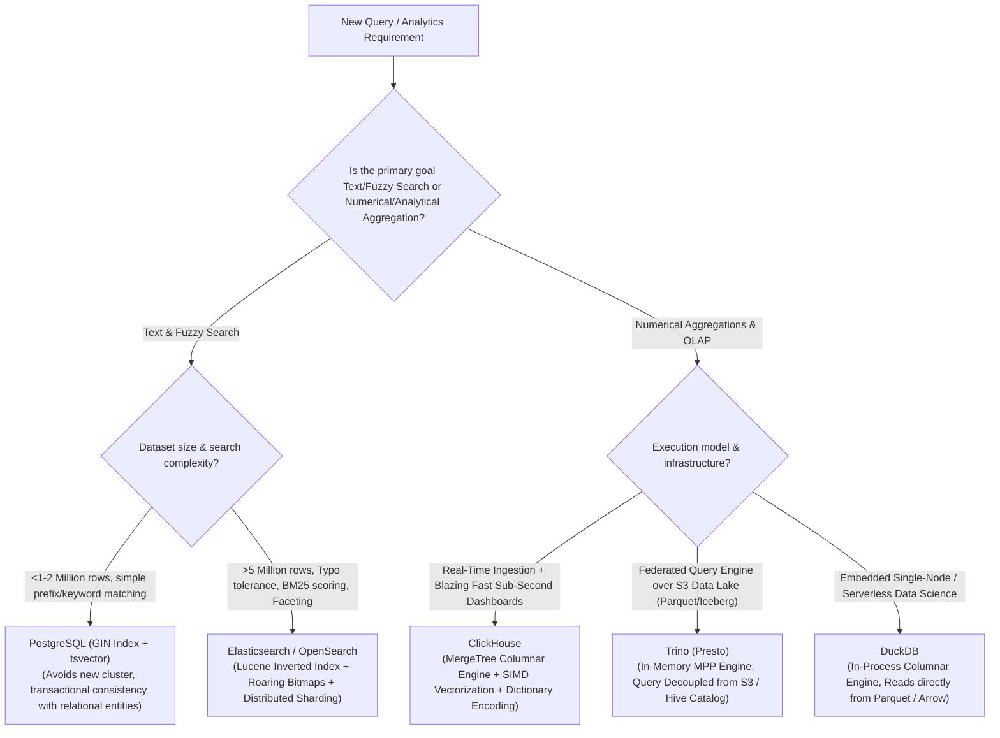

# Layer 06: Search & OLAP Analytical Engines Playbook

> **The System Design Interview Lens:** Running analytical aggregates or fuzzy search queries against an operational OLTP database is an instant red flag. In Staff/Principal interviews, you must cleanly delineate **Transactional Row Stores** from **Analytical Columnar Engines** (ClickHouse, Trino) and **Inverted Search Indexes** (Elasticsearch/Lucene), explaining the mechanics of **I/O projection pruning, SIMD vectorization, and Posting List compression**.

---

## 1. 60-Second Interview Decision Matrix & Flowchart

### The Master Decision Matrix

| Workload / Primary Access Pattern | Primary Selection | Alternative / Runner-Up | Never Choose / Red Flag | Decisive Mechanical Reason |
| :--- | :--- | :--- | :--- | :--- |
| **Full-Text Fuzzy Search, Autocomplete & Relevance Scoring** | **Elasticsearch / OpenSearch** | **PostgreSQL (GIN + `tsvector`)** (if <1M docs) | Relational `LIKE '%query%'` | Inverted index maps terms to compressed Posting Lists; native BM25 relevance scoring; tokenization and N-gram analyzers. |
| **Ultra-Fast Real-Time Aggregations on High-Volume Events** (Ad clicks, telemetry, finance analytics) | **ClickHouse** | **Apache Pinot / Druid** | PostgreSQL / MySQL | Vectorized SIMD execution on pure columnar MergeTree storage; reads only queried columns; 10x–50x compression via dictionary encoding. |
| **Distributed Federated SQL Querying Across Diverse Sources** (Querying S3 + Postgres + Kafka together) | **Trino (Presto)** | **DuckDB** (if embedded local single-node) | Hive / MapReduce | In-memory massively parallel processing (MPP) query engine without local storage; decouples query compute from underlying data lake. |
| **Embedded In-Process Analytical Querying** (Python data science, local microservices, serverless OLAP) | **DuckDB** | **SQLite** (if purely transactional) | PostgreSQL / MySQL | In-process columnar engine; zero network serialization; direct vectorized execution over local Parquet, CSV, and Arrow memory buffers. |
| **ACID Data Lakehouse Storage on Cloud Object Storage** | **Apache Iceberg (with Parquet)** | **Delta Lake** | Raw S3 Parquet without catalog | Snapshot-based metadata tree (Manifest files) provides ACID transactions, partition evolution, and eliminates slow S3 file `LIST` operations. |

---

### The Search & Analytics Decision Flowchart



---

## 2. Mechanical First Principles: Columnar Physics & Inverted Indexes

### 1. Row-Oriented (OLTP) vs. Columnar (OLAP) Physics

Why does running `SELECT AVG(price), SUM(tax) FROM orders` on PostgreSQL take 45 seconds, while ClickHouse executes it in 12 milliseconds?

```
ROW-ORIENTED STORAGE (PostgreSQL / MySQL):
Page 1: [Order 1: ID, CustID, Price, Tax, Shipping, Address, Timestamp, Status, Notes...]
Page 2: [Order 2: ID, CustID, Price, Tax, Shipping, Address, Timestamp, Status, Notes...]
• Mechanical Problem: To aggregate "Price" and "Tax", the disk controller must read
  ALL unneeded columns (Address, Status, Notes) into RAM. Massive wasted I/O bandwidth!

COLUMNAR STORAGE (ClickHouse / Parquet):
File "Price.col": [Price 1, Price 2, Price 3, Price 4, Price 5, Price 6...]
File "Tax.col":   [Tax 1,   Tax 2,   Tax 3,   Tax 4,   Tax 5,   Tax 6...]
• Mechanical Superpower 1 (I/O Projection Pruning): The engine only touches the 2 files
  needed for the query. 80%-90% of total disk I/O is eliminated before execution begins!
• Mechanical Superpower 2 (SIMD Vectorization): Values of the same data type sit
  contiguously in memory. A single CPU SIMD instruction (e.g., AVX-512) adds 16 numbers
  in a single hardware clock cycle!
• Mechanical Superpower 3 (Extreme Compression): Consecutive numbers or repeated strings
  compress by 10x-20x using Run-Length Encoding (RLE) and Dictionary Encoding.
```

---

### 2. Inverted Index Physics (Elasticsearch / Lucene)

How does Elasticsearch find documents containing `"system design"` in 5 milliseconds across 100 million documents?

```
DOCUMENT CORPUS:
Doc 1: "System design is hard"
Doc 2: "System performance matters"
Doc 3: "Design is critical"

INVERTED INDEX (Term Dictionary ──> Posting Lists):
"critical"    ──> [Doc 3]
"design"      ──> [Doc 1, Doc 3]
"hard"        ──> [Doc 1]
"performance" ──> [Doc 2]
"system"      ──> [Doc 1, Doc 2]
```

1.  **Analysis & Tokenization:** Ingested text is normalized (lowercased, stripped of punctuation, stemmed via Porter Stemmer: "designing" $\to$ "design", stopwords removed).
2.  **The Inverted Index:** Maps distinct search terms (lexicon) to a sorted list of Document IDs where the term appears (**Posting List**).
3.  **Posting List Compression (Roaring Bitmaps & Frame of Reference):** Posting lists are compressed using integer delta encoding and bit-packing to fit millions of doc IDs into a few kilobytes of RAM.
4.  **Query Intersection (`system AND design`):** The search engine fetches the posting list for `"system"` `[1, 2]` and `"design"` `[1, 3]` and intersects them using **Skip Pointers** in $O(M + N)$ time, identifying `Doc 1` instantaneously without scanning a single document payload.

---

## 3. Head-to-Head Architectural Shootouts

### Shootout 1: Elasticsearch / OpenSearch vs. PostgreSQL GIN Index

```
┌─────────────────────────────────────────────────────────────────────────────┐
│                       ELASTICSEARCH vs. POSTGRESQL (GIN)                    │
├───────────────────────────────────┬─────────────────────────────────────────┤
│    ELASTICSEARCH / OPENSEARCH     │            POSTGRESQL (GIN)             │
├───────────────────────────────────┼─────────────────────────────────────────┤
│ Distributed cluster (Shards)      │ Single-node relational table            │
│ Inverted index via Apache Lucene  │ Generalized Inverted Index (GIN)        │
│ Native BM25 relevance scoring     │ Basic `ts_rank` text ranking            │
│ Typo tolerance (Levenshtein/Fuzzy)│ Requires `pg_trgm` extension            │
│ Dynamic schema & nested JSON      │ Rigid relational schema + JSONB         │
│ Eventual consistency (Refresh 1s) │ Immediate ACID read-your-writes         │
│ High operational complexity (JVM) │ Zero new infrastructure overhead        │
└───────────────────────────────────┴─────────────────────────────────────────┘
```

#### The Interview Verdict: When to Pick Which
*   **Pick PostgreSQL GIN if:** You have <1–2 million records, queries are exact keyword or simple phrase matches (e.g., searching for products by SKU or title in an e-commerce admin portal), and you want to avoid operating a secondary search cluster with data synchronization pipelines.
*   **Pick Elasticsearch / OpenSearch if:** You require customer-facing search with typo tolerance ("did you mean?"), autocompletion, multi-faceted filtering (filtering by category, price range, and rating simultaneously), and relevance scoring where matching titles score higher than matching descriptions.

---

### Shootout 2: ClickHouse vs. Trino (Presto)

```
┌─────────────────────────────────────────────────────────────────────────────┐
│                            CLICKHOUSE vs. TRINO                             │
├───────────────────────────────────┬─────────────────────────────────────────┤
│            CLICKHOUSE             │                  TRINO                  │
├───────────────────────────────────┼─────────────────────────────────────────┤
│ Storage + Compute Engine (Coupled)│ Pure Query Engine (Compute Only)        │
│ Own proprietary columnar format   │ Reads S3 Parquet, Iceberg, DBs, Kafka   │
│ Ultra-fast sub-second aggregations│ Slower queries (Network transfer lag)   │
│ Optimized for single-table scans  │ Optimized for massive multi-table JOINs │
│ Requires ingesting data into CH   │ Queries data where it already lives     │
└───────────────────────────────────┴─────────────────────────────────────────┘
```

#### The Interview Verdict: When to Pick Which
*   **Pick ClickHouse if:** You need an external-facing, real-time analytics dashboard (e.g., Google Analytics clone, Cloudflare-style traffic graphs) where queries must return in **sub-200 milliseconds** under concurrent user load.
*   **Pick Trino if:** You are building an internal business intelligence (BI) data platform where data scientists and analysts need to join 500GB of historical logs in S3 with a PostgreSQL customer table and a Kafka topic without migrating data into a single database.

---

### Shootout 3: Apache Iceberg vs. Raw Parquet on S3

```
┌─────────────────────────────────────────────────────────────────────────────┐
│                        APACHE ICEBERG vs. RAW PARQUET                       │
├───────────────────────────────────┬─────────────────────────────────────────┤
│           APACHE ICEBERG          │             RAW PARQUET ON S3           │
├───────────────────────────────────┼─────────────────────────────────────────┤
│ ACID Transactions (Snapshot tree) │ Zero transactions (Dirty reads possible)│
│ Instant metadata-driven pruning   │ Requires slow S3 file `LIST` operations │
│ Safe Schema & Partition evolution │ Renaming columns breaks old files       │
│ Time Travel queries natively      │ Manual directory versioning required    │
│ Eliminates S3 eventual consist lag│ Subject to file listing delays          │
└───────────────────────────────────┴─────────────────────────────────────────┘
```

*   **The S3 `LIST` Bottleneck:** On an S3 bucket with 500,000 Parquet files, a query engine querying raw Parquet must issue thousands of HTTP `LIST` requests to discover which files exist. This initial listing phase alone can take 30–60 seconds before a single byte of data is read.
*   **The Iceberg Solution:** Iceberg replaces directory-based file listing with an explicit **hierarchical metadata tree** (Snapshots $\to$ Manifest Lists $\to$ Manifest Files). The query engine reads a single tiny JSON metadata file to determine the exact list of required data files in milliseconds, completely bypassing S3 file listing.

---

## 4. The Interview Defense Playbook: Scripts & Trap Rebuttals

### The 3-Sentence Justification Formula

#### Example: Ad Click Event Aggregation (Chapter 21 Ad Click)
> *"For the aggregated advertising reporting layer, I am selecting **ClickHouse** over PostgreSQL and MongoDB. The reporting queries consist of compute-intensive `COUNT`, `SUM`, and `GROUP BY` aggregations over billions of time-stamped ad click events. ClickHouse’s columnar MergeTree engine eliminates 90% of disk I/O by reading only the relevant metric columns, utilizing SIMD vectorization to execute aggregations in sub-second response times."*

#### Example: Product Catalog Search (Chapter 13 Search Autocomplete)
> *"For the product catalog search service, I am selecting **Elasticsearch** as a dedicated search index populated via CDC from our primary PostgreSQL database. Customer search requires fuzzy typo tolerance, N-gram autocomplete matching, and BM25 relevance ranking across multiple attributes—capabilities that would trigger expensive table scans in an RDBMS. Storing only the searchable text fields in Elasticsearch keeps the index memory-resident, ensuring P99 search latencies under 20 milliseconds."*

---

### Interviewer Trap Questions & Battle-Tested Rebuttals

#### Trap 1: *"Why can't we just run our analytical reporting queries on a PostgreSQL read replica?"*
*   **The Trap:** Checking if you understand the architectural limitations of row-oriented storage engines for analytical workloads.
*   **The High-Scoring Response:**
    > *"A PostgreSQL read replica isolates the master from reporting CPU load, but it does not change the physical storage engine: it is still a row-oriented B+ Tree/Heap file. 
    > When an analytical query runs `SUM(amount)` over 50 million rows, Postgres must read the entire 50 million row tuples from disk into RAM—including unused columns like addresses, names, and notes. This saturates the buffer pool, evicts hot OLTP pages, and saturates disk I/O bandwidth. 
    > A columnar engine like ClickHouse or an OLAP lakehouse reads **only the 8-byte `amount` column file**, consuming 95% less disk I/O and completing in milliseconds."*

#### Trap 2: *"Why not use Elasticsearch as our primary database of record and eliminate PostgreSQL entirely?"*
*   **The Trap:** Probing whether you know why search engines are not general-purpose transactional databases.
*   **The High-Scoring Response:**
    > *"Elasticsearch is not built for primary persistence and transaction integrity:
    > 1. **No ACID or Cross-Document Transactions:** Elasticsearch has no concept of multi-document transactions, foreign key constraints, or serializable isolation.
    > 2. **Near-Real-Time (NRT) Refresh Lag:** Writes in Elasticsearch are appended to an in-memory buffer and are not visible to search queries until a Lucene index `refresh` occurs (default 1 second). Reading immediately after writing often returns stale data.
    > 3. **High Write Amplification & JVM GC Pauses:** Frequent updates force segment merging and heavy garbage collection, which can stall the cluster. 
    > The industry standard pattern is **CQRS (Command Query Responsibility Segregation)**: write authoritatively to an ACID RDBMS like PostgreSQL, and asynchronously project searchable data into Elasticsearch via CDC (Debezium)."*

#### Trap 3: *"How do you sync data from your primary SQL database to Elasticsearch without dual-write bugs?"*
*   **The Trap:** Testing your end-to-end data pipeline integrity.
*   **The High-Scoring Response:**
    > *"Never dual-write from the application code (`db.save()` then `es.index()`), as network timeouts will cause permanent data drift between the two systems. 
    > We enforce **Change Data Capture (CDC) via the Transactional Outbox pattern**:
    > 1. All business mutations commit to PostgreSQL in standard ACID transactions.
    > 2. A CDC engine (such as **Debezium**) tails the PostgreSQL Write-Ahead Log (WAL) and publishes ordered row mutation events into an **Apache Kafka** topic.
    > 3. An Elasticsearch Sink connector consumes from Kafka and batches index writes (`_bulk` API) into Elasticsearch, ensuring at-least-once delivery and deterministic recovery upon failures."*

---

## 5. System Design Mapping: Where Search & OLAP Live in Real Architectures

| Chapter / Architecture | Engine Selected | Specific Architectural Role |
| :--- | :--- | :--- |
| [**09. Web Crawler**](file:///Users/abhinnaagarwal/Documents/system-design-notes/09.%20Web%20Crawler/README.md) | **Inverted Index (Lucene / ES)** | Indexes crawled page text for fast keyword retrieval and PageRank ranking. |
| [**13. Search Autocomplete**](file:///Users/abhinnaagarwal/Documents/system-design-notes/13.%20Search%20Autocomplete/README.md) | **Trie in RAM + Elasticsearch** | Serves top-5 search suggestions via prefix matching and query frequency counters. |
| [**18. Google Maps**](file:///Users/abhinnaagarwal/Documents/system-design-notes/18.%20Google%20Maps/README.md) | **Spatial GIN / S2 Index** | Geospatial point and polyline search for addresses and business routing. |
| [**20. Metrics Monitoring**](file:///Users/abhinnaagarwal/Documents/system-design-notes/20.%20Metrics%20Monitoring%20and%20Alerting%20System/README.md) | **Time-Series Columnar Store** | High-cardinality metric rollups and sliding window alert threshold evaluation. |
| [**21. Ad Click Aggregation**](file:///Users/abhinnaagarwal/Documents/system-design-notes/21.%20Ad%20Click%20Event%20Aggregation/README.md) | **ClickHouse / Apache Pinot** | Aggregates ad impressions and clicks across 1-minute, 1-hour, and 1-day windows. |
| [**29. Tagging Service**](file:///Users/abhinnaagarwal/Documents/system-design-notes/29.%20Tagging%20Service/README.md) | **Inverted Bitmap Index** | Intersects millions of tags across media items via Roaring Bitmaps. |

---

### Cross-Repository Deep Dive Links
*   ClickHouse Mechanics & MergeTree: [`coding-practice: query-engines/clickhouse.md`](file:///Users/abhinnaagarwal/Documents/coding-practice/systems-engineering/query-engines/clickhouse.md)
*   OpenSearch / Elasticsearch Internals: [`coding-practice: query-engines/opensearch.md`](file:///Users/abhinnaagarwal/Documents/coding-practice/systems-engineering/query-engines/opensearch.md)
*   Trino Distributed Query Engine: [`coding-practice: query-engines/trino.md`](file:///Users/abhinnaagarwal/Documents/coding-practice/systems-engineering/query-engines/trino.md)
*   DuckDB Embedded Analytics: [`coding-practice: query-engines/duckdb.md`](file:///Users/abhinnaagarwal/Documents/coding-practice/systems-engineering/query-engines/duckdb.md)
*   Apache Iceberg Architecture: [`coding-practice: data-formats/apache-iceberg.md`](file:///Users/abhinnaagarwal/Documents/coding-practice/systems-engineering/data-formats/apache-iceberg.md)
*   Parquet & Columnar Formats: [`coding-practice: data-formats/parquet.md`](file:///Users/abhinnaagarwal/Documents/coding-practice/systems-engineering/data-formats/parquet.md)
