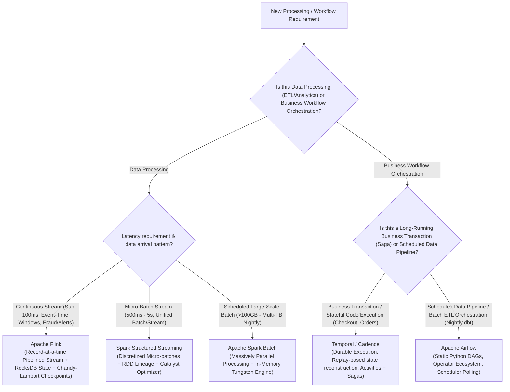

# Layer 07: Compute, Stream Processing & Orchestration Playbook

> **The System Design Interview Lens:** System design isn't just about where data rests; it's about how data moves and transforms. In Staff/Principal interviews, you must articulate the boundary between **true event streaming (Apache Flink)**, **micro-batch processing (Apache Spark)**, and **durable code workflows (Temporal)** versus **scheduled batch DAG orchestrators (Apache Airflow)**.

---

## 1. 60-Second Interview Decision Matrix & Flowchart

### The Master Decision Matrix

| Problem Space / Requirement | Primary Selection | Alternative / Runner-Up | Never Choose / Red Flag | Decisive Mechanical Reason |
| :--- | :--- | :--- | :--- | :--- |
| **Ultra-Low Latency Stateful Stream Processing** (Real-time fraud detection, CEP, ad click aggregations) | **Apache Flink** | **Spark Structured Streaming** (if latency > 500ms OK) | Cron batch jobs | True continuous record-by-record pipelined execution; native event-time watermarking; incremental state checkpoints via RocksDB. |
| **Massive Batch Data Processing & Machine Learning Pipelines** (>10TB daily ETL, model feature extraction) | **Apache Spark** | **DuckDB** (if dataset < 500GB on single node) | Apache Flink | Directed Acyclic Graph (DAG) query optimizer (Catalyst), Tungsten memory engine, resilient distributed datasets (RDD) lineage. |
| **Lightweight Stream Transformations within Microservices** (Filter/enrich events from Kafka topic A to B) | **Kafka Streams** | **Apache Flink** | Custom consumer while-loops | Embedded client library running directly inside your service; no dedicated cluster; embedded RocksDB for local state. |
| **Mission-Critical Transactional Business Workflows** (Payment checkout saga, customer onboarding, multi-step orders) | **Temporal (or Cadence)** | **AWS Step Functions** | Apache Airflow | **Durable execution:** Code-as-workflow; event history replay recreates exact execution state after worker or network crashes. |
| **Scheduled Analytical Batch Pipeline Orchestration** (Nightly data warehouse ELT, dbt syncs) | **Apache Airflow** | **Argo Workflows** (if 100% Kubernetes-native) | Temporal | Rich ecosystem of database/data lake operators; calendar-aware scheduling; data lineage and metadata visibility. |
| **Event-Driven Autoscaling Infrastructure** | **Kubernetes + Keda + Karpenter** | **Serverless (AWS Lambda)** | Fixed static EC2 instances | Keda scales pods to zero based on Kafka consumer lag / SQS queue depth; Karpenter provisions right-sized nodes in seconds. |

---

### The Compute & Orchestration Decision Flowchart



---

## 2. Mechanical First Principles: Streaming Physics & Durable Execution

### 1. True Streaming (Record-by-Record) vs. Micro-Batch Processing

```
APACHE FLINK (True Streaming / Pipelined):
Kafka ──> [Stream Operator 1] ──(network/buffer)──> [Stream Operator 2] ──> Sink
• Latency: Sub-10 milliseconds.
• Execution: Each record triggers immediate state update and passes downstream.
• Checkpointing: Asynchronous Chandy-Lamport barrier injection (zero stop-the-world).

SPARK STRUCTURED STREAMING (Micro-Batching):
Kafka ──> [Buffer for 500ms] ──> Batch Job N ──> [Buffer for 500ms] ──> Batch Job N+1
• Latency: 200ms – 2,000 milliseconds.
• Execution: Chops the infinite stream into discrete mini-batches; runs classic Spark jobs.
• Checkpointing: Offsets and state snapshots committed between micro-batch boundaries.
```

---

### 2. Time Physics in Stream Processing: Event Time vs. Watermarks

In real-world networks, mobile phones drop into subway tunnels and upload queued events 30 minutes late. A stream processor must distinguish:
*   **Processing Time:** The local clock time of the machine executing the stream transformation. Easiest to implement, but produces non-deterministic results upon data replay.
*   **Ingestion Time:** The timestamp when the record was received by the Kafka broker partition.
*   **Event Time:** The actual physical timestamp when the event occurred on the user's device (`event.created_at`).
*   **Watermarks (Handling Out-of-Order Data):** A Watermark is a control signal flowing inside the stream telling the engine: *"Assume all events with timestamp $\le T$ have arrived."*
    *   *The Mechanic:* A watermark with a 5-second lag means that if an event with timestamp `12:00:00` arrives at `12:00:06`, the 1-minute tumbling window `11:59:00 - 12:00:00` has already closed. The late record is either discarded or routed to a **Side Output** for dead-letter reprocessing.

---

### 3. The Durable Execution Paradigm (How Temporal Works)

Traditional systems use database tables to track multi-step workflow states (e.g., `ORDER_PENDING`, `PAYMENT_CHARGED`, `INVENTORY_RESERVED`). If a worker crashes mid-step, you need complex state-reconciliation recovery cron jobs.

**Temporal replaces this with Event Sourcing & Replay:**

```
TEMPORAL DURABLE EXECUTION MECHANICS:
1. Workflow code is written in pure Go/TypeScript/Java as standard sequential code.
2. When the code calls `Workflow.ExecuteActivity(ChargePayment)`:
   - Temporal records an event `ActivityTaskScheduled` in its database.
   - A worker executes the activity and returns the result.
   - Temporal records `ActivityTaskCompleted`.
3. If the worker crashes or restarts mid-workflow:
   - A new worker boots up and runs the exact same workflow function from line 1.
   - When it reaches `ExecuteActivity(ChargePayment)`, Temporal intercepts the call:
     "I already executed this activity! Here is the recorded result from history."
   - The function skips re-execution and resumes right where it left off!
```

---

## 3. Head-to-Head Architectural Shootouts

### Shootout 1: Apache Flink vs. Spark Structured Streaming

```
┌─────────────────────────────────────────────────────────────────────────────┐
│                       APACHE FLINK vs. SPARK STREAMING                      │
├───────────────────────────────────┬─────────────────────────────────────────┤
│            APACHE FLINK           │        SPARK STRUCTURED STREAMING       │
├───────────────────────────────────┼─────────────────────────────────────────┤
│ Execution: True record-by-record  │ Execution: Micro-batch (Discretized)    │
│ Latency: Single-digit ms (1–10ms) │ Latency: 200ms – 1,000ms                │
│ State engine: Embedded RocksDB    │ State engine: In-Memory + Delta state   │
│ Complex Event Processing (CEP): Yes│ Complex Event Processing: Limited       │
│ Batch model: Batch is a special   │ Streaming model: Stream is a series     │
│   case of streaming               │   of mini-batches                       │
│ Operational complexity: High      │ Operational complexity: Moderate        │
└───────────────────────────────────┴─────────────────────────────────────────┘
```

#### The Interview Verdict: When to Pick Which
*   **Pick Apache Flink if:** Sub-50ms latency is mandatory (e.g., real-time credit card fraud detection where the transaction must be blocked before completion), or if the system requires complex sliding windows with heavy out-of-order event watermarking (e.g., Chapter 21 Ad Click Aggregation).
*   **Pick Spark Structured Streaming if:** You already run an Apache Spark cluster for batch processing, your latency budget allows 500ms–2 seconds, and you want unified codebase and tooling across batch ETL and streaming.

---

### Shootout 2: Temporal vs. Apache Airflow

```
┌─────────────────────────────────────────────────────────────────────────────┐
│                            TEMPORAL vs. APACHE AIRFLOW                      │
├───────────────────────────────────┬─────────────────────────────────────────┤
│             TEMPORAL              │             APACHE AIRFLOW              │
├───────────────────────────────────┼─────────────────────────────────────────┤
│ Role: Stateful Business Execution │ Role: Batch Orchestration & Scheduling  │
│ Trigger: Event-driven (Sub-second)│ Trigger: Cron / Schedule-driven polling │
│ Paradigm: Code-as-Workflow        │ Paradigm: Static Directed Acyclic Graph │
│ State: Event Sourcing History     │ State: Relational DB task state metadata│
│ Task duration: Millis to Months   │ Task duration: Minutes to Hours         │
│ Worker communication: gRPC Poll   │ Worker communication: Celery/Redis queue│
└───────────────────────────────────┴─────────────────────────────────────────┘
```

#### Why Airflow Fails for Business Transactions
Many candidates propose Airflow for order processing or payment sagas. **This is an interview red flag:**
1.  **Poller Latency:** Airflow's scheduler polls the metadata database in cycles (often 5–15 seconds). Launching a task takes several seconds. A customer waiting at an e-commerce checkout cannot wait 30 seconds for an Airflow worker to poll and execute the payment step.
2.  **No Native Sagas or Compensation:** Airflow is built for forward-only DAG execution (Task A $\to$ Task B $\to$ Task C). If Task C fails, rolling back Task B and Task A requires complex custom logic. Temporal natively supports the **Saga Pattern**: if an activity fails, compensation functions execute automatically in reverse order.

---

### Shootout 3: Serverless (AWS Lambda) vs. Containerized Kubernetes (EKS + Keda)

```
┌─────────────────────────────────────────────────────────────────────────────┐
│                        AWS LAMBDA vs. KUBERNETES (EKS)                      │
├───────────────────────────────────┬─────────────────────────────────────────┤
│             AWS LAMBDA            │             KUBERNETES (EKS)            │
├───────────────────────────────────┼─────────────────────────────────────────┤
│ Cold Starts: 100ms – 1,000ms      │ Zero cold start on warm pods            │
│ Execution cap: 15 minutes max     │ Unlimited execution duration            │
│ Autoscaling: Instant to thousands │ Scaling lag: 30–90 seconds for node     │
│ Connections: Ephemeral, bypasses  │ Persistent connection pooling native    │
│   connection poolers              │   (gRPC, WebSockets, DB connections)    │
│ Cost at scale: Prohibitive        │ Cost at scale: Highly cost-effective    │
└───────────────────────────────────┴─────────────────────────────────────────┘
```

#### The Interview Verdict: When to Pick Which
*   **Pick Serverless (AWS Lambda / Cloud Run) if:** Traffic is spiky or unpredictable with periods of zero traffic (scales to zero), execution is stateless and takes <1–2 minutes, and developer velocity is prioritized over infrastructure tuning.
*   **Pick Kubernetes (EKS / GKE) if:** Workloads maintain long-lived state (WebSockets, persistent gRPC streams, local caching), high steady-state traffic where serverless execution costs become exorbitant, or when tasks require more than 15 minutes of uninterrupted execution.

---

## 4. The Interview Defense Playbook: Scripts & Trap Rebuttals

### The 3-Sentence Justification Formula

#### Example: Ad Click Aggregation (Chapter 21 Ad Click)
> *"For real-time ad click event aggregation, I am selecting **Apache Flink** deployed alongside Kafka. Our system requires sub-second windowed aggregations across sliding 1-minute and 1-hour intervals, where late-arriving events from mobile clients must be reconciled using event-time watermarking. Flink's pipelined execution and incremental RocksDB state checkpoints provide true low-latency streaming without the multi-second latency floor of Spark's micro-batching."*

#### Example: Payment Saga Orchestration (Chapter 26 Payment System)
> *"For orchestrating the multi-step payment fulfillment workflow, I am selecting **Temporal** rather than Apache Airflow or an asynchronous Kafka chain. The payment lifecycle requires durable execution across payment authorization, ledger reserve, and third-party bank capture, where transient network failures must be safely retried without double-charging. Temporal's event-sourcing replay model guarantees that our compensating rollback activities execute deterministically even if worker nodes crash mid-transaction."*

---

### Interviewer Trap Questions & Battle-Tested Rebuttals

#### Trap 1: *"How does Apache Flink achieve exactly-once processing state recovery when a worker node crashes?"*
*   **The Trap:** Testing your mechanical knowledge of distributed stream checkpointing.
*   **The High-Scoring Response:**
    > *"Flink achieves exactly-once state consistency through the **Chandy-Lamport distributed checkpointing algorithm**:
    > 1. Checkpoint Coordinator periodically injects special **Checkpoint Barriers** into the Kafka consumer input streams.
    > 2. These barriers flow downstream alongside normal data records without halting the stream.
    > 3. When an operator receives a barrier from all incoming channels, it takes an incremental snapshot of its local state (stored in **embedded RocksDB**) and writes it asynchronously to durable storage (S3/HDFS).
    > 4. Upon a worker failure, Flink halts the pipeline, resets all Kafka consumer offsets back to the last successful checkpoint barrier, and reloads operator states from the RocksDB snapshot, guaranteeing identical state reconstruction without duplicate side-effects."*

#### Trap 2: *"Why can't we just write a simple while-loop in a Go or Node.js service to consume Kafka instead of running Flink?"*
*   **The Trap:** Probing whether you appreciate the massive complexity of stateful stream processing.
*   **The High-Scoring Response:**
    > *"A naive while-loop works for simple stateless event transformations (e.g., read event $\to$ send email). However, the moment you need **stateful windowing** (e.g., 'count clicks per ad over a 5-minute sliding window updated every 10 seconds'):
    > 1. You must maintain state in memory; if your custom pod crashes, all uncommitted in-flight window counters are permanently lost.
    > 2. You must manually implement watermarking to handle late-arriving events that belong to a previous window.
    > 3. You must synchronize state across multiple horizontally scaled instances. 
    > Apache Flink provides battle-tested state backends, automatic checkpointing, and event-time window management out of the box."*

---

## 5. System Design Mapping: Where Compute Lives in Real Architectures

| Chapter / Architecture | Compute / Engine Selected | Specific Architectural Role |
| :--- | :--- | :--- |
| [**14. Youtube**](file:///Users/abhinnaagarwal/Documents/system-design-notes/14.%20Youtube/README.md) | **DAG Task Engine (Temporal / SQS Workers)** | Orchestrates video chunking, parallel multi-resolution encoding, watermarking, and CDN upload. |
| [**20. Metrics Monitoring**](file:///Users/abhinnaagarwal/Documents/system-design-notes/20.%20Metrics%20Monitoring%20and%20Alerting%20System/README.md) | **Flink / Custom Stream Engine** | Evaluates sliding alert rules over metric streams; triggers PagerDuty alerts. |
| [**21. Ad Click Aggregation**](file:///Users/abhinnaagarwal/Documents/system-design-notes/21.%20Ad%20Click%20Event%20Aggregation/README.md) | **Apache Flink + RocksDB** | Sliding window aggregations of ad click events with watermarking. |
| [**26. Payment System**](file:///Users/abhinnaagarwal/Documents/system-design-notes/26.%20Payment%20System/README.md) | **Temporal Saga Orchestrator** | Coordinates distributed payments across payment gateways, double-entry ledger, and external banks. |
| [**31. Distributed Job Scheduler**](file:///Users/abhinnaagarwal/Documents/system-design-notes/31.%20Distributed%20Job%20Scheduler/README.md) | **Distributed Worker Pool (K8s / Celery)** | Pulls scheduled jobs from etcd/Kafka; executes tasks with resource isolation. |

---

### Cross-Repository Deep Dive Links
*   Apache Flink Architecture: [`coding-practice: compute/flink.md`](file:///Users/abhinnaagarwal/Documents/coding-practice/systems-engineering/compute/flink.md)
*   Apache Spark Internals: [`coding-practice: compute/spark.md`](file:///Users/abhinnaagarwal/Documents/coding-practice/systems-engineering/compute/spark.md)
*   Airflow Internals: [`coding-practice: orchestration/airflow-internals.md`](file:///Users/abhinnaagarwal/Documents/coding-practice/systems-engineering/orchestration/airflow-internals.md)
*   Argo Workflows: [`coding-practice: orchestration/argo-workflows.md`](file:///Users/abhinnaagarwal/Documents/coding-practice/systems-engineering/orchestration/argo-workflows.md)
*   Kubernetes Autoscaling (Keda & Karpenter): [`coding-practice: orchestration/keda.md`](file:///Users/abhinnaagarwal/Documents/coding-practice/systems-engineering/orchestration/keda.md)
