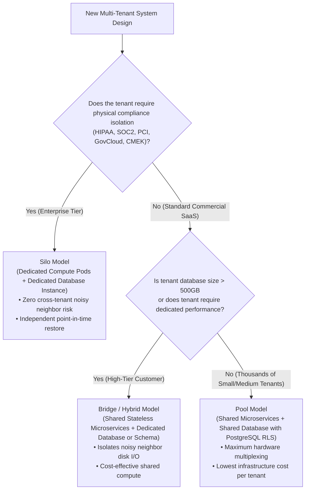
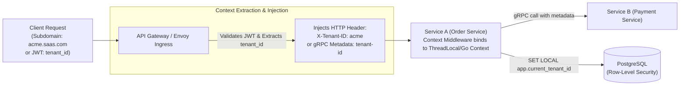

# Layer 08: Multi-Tenant Architecture & Isolation Playbook

> **The System Design Interview Lens:** When designing B2B SaaS platforms (Slack, Shopify, Stripe, Jira), junior engineers simply add a `tenant_id` column to every database table. Staff/Principal engineers analyze **tenancy isolation models (Silo vs. Pool vs. Bridge)**, **noisy neighbor mitigation**, **per-tenant connection pool starvation**, **Row-Level Security (RLS)**, and **tenant-aware cache namespacing**.

---

## 1. 60-Second Interview Decision Matrix & Flowchart

### The Master Decision Matrix

| Tenancy Model / Requirement | Primary Architecture | Alternative / Runner-Up | Never Choose / Red Flag | Decisive Mechanical Reason |
| :--- | :--- | :--- | :--- | :--- |
| **Enterprise / Strictly Regulated Tenants** (Healthcare HIPAA, Banking, GovCloud) | **Silo Model** (Dedicated VPC / Dedicated DB) | **Bridge Model** (Shared compute, dedicated DB) | Pool Model (Shared DB with `tenant_id`) | Strict physical data isolation; eliminates cross-tenant blast radius; allows tenant-specific encryption keys (CMEK) and point-in-time recovery. |
| **High-Volume, Low-Cost Standard SaaS Tier** (Free & Starter tiers, thousands of small tenants) | **Pool Model** (Shared Compute + Shared DB with RLS) | **Bridge Model** (Schema-per-tenant) | Silo Model (Overkill cost) | Maximum hardware consolidation and resource multiplexing; lowest cost-per-tenant; automated centralized scaling and schema migrations. |
| **Mid-Market / Premium Tier** (Wants performance guarantee, cost-sensitive) | **Bridge Model** (Shared Compute + Isolated Schema/DB) | **Pool Model** with Tiered Quotas | Manual Sharding | Balances hardware efficiency of shared stateless microservices with logical or physical database isolation for large customers. |
| **Multi-Tenant Database Row Isolation** (Preventing cross-tenant data leaks) | **PostgreSQL Row-Level Security (RLS)** | Application ORM Interceptors | Manual `WHERE tenant_id = ?` in raw SQL | Database kernel enforces tenant isolation policies at the engine level; immune to developer coding mistakes or forgotten `WHERE` clauses. |
| **Noisy Neighbor Ingestion Protection** (Preventing one tenant from choking shared Kafka/Queues) | **Tenant-Sharded Queues + Weighted Fair Queuing (WFQ)** | Per-Tenant Dedicated SQS Queues | Single Shared FIFO Queue without quotas | Enforces per-tenant rate limits and concurrency caps; prevents a single tenant batch job from monopolizing downstream workers. |

---

### The Tenancy Architecture Decision Flowchart



---

## 2. Mechanical First Principles: The Physics of Multi-Tenancy

In multi-tenant architectures, systems fail when **shared resources (CPU, memory, disk I/O, database connection pools, and thread queues)** are saturated by a single tenant.

```
┌─────────────────────────────────────────────────────────────────────────────┐
│                       THE THREE TENANCY ARCHITECTURES                       │
├───────────────────┬─────────────────────────────────┬───────────────────────┤
│ ARCHITECTURE      │ COMPUTE LAYER                   │ STORAGE LAYER         │
├───────────────────┼─────────────────────────────────┼───────────────────────┤
│ Silo Model        │ Dedicated Pods / VMs per tenant │ Dedicated Database    │
│ Bridge Model      │ Shared Microservices (Multi-ten)│ Dedicated DB / Schema │
│ Pool Model        │ Shared Microservices (Multi-ten)│ Shared DB + tenant_id │
└───────────────────┴─────────────────────────────────┴───────────────────────┘
```

---

### 1. Database Multi-Tenancy: The 3 Core Storage Strategies

```
STRATEGY 1: SEPARATE DATABASE PER TENANT
[App Pod] ──connection pool──> [DB Instance: Tenant_A]
          ──connection pool──> [DB Instance: Tenant_B]
• Isolation: Absolute physical isolation.
• Blast Radius: Zero. If Tenant A corrupts their DB, Tenant B is completely unaffected.
• The Trap: Cost & Connection Pooling. Running 1,000 DB instances is financially disastrous
  and exhausts application database connection pool limits.

STRATEGY 2: SEPARATE SCHEMA PER TENANT (Shared Instance)
[DB Instance: Postgres]
  ├── Schema: tenant_a (Tables: orders, users)
  └── Schema: tenant_b (Tables: orders, users)
• Isolation: Logical schema separation.
• The Trap: DDL Migration Nightmare. Running a schema migration (`ALTER TABLE orders ADD COLUMN...`)
  across 10,000 schemas requires 10,000 DDL transactions, taking hours and causing catalog lock contention.

STRATEGY 3: SHARED DATABASE, SHARED SCHEMA (Discriminator Column)
[DB Instance: Postgres]
  └── Table: orders (tenant_id, order_id, amount, status)
• Indexing: Composite index ALWAYS prefixed by tenant: INDEX(tenant_id, created_at).
• Isolation: Logical only.
• The Trap: Data leakage via buggy queries. Fixed via PostgreSQL Row-Level Security (RLS).
```

---

### 2. Eliminating Developer Bugs: PostgreSQL Row-Level Security (RLS)

The nightmare of shared-table multi-tenancy is a developer forgetting `WHERE tenant_id = 'acme'` in a critical query, exposing Customer A’s data to Customer B. 

**The Mechanical Solution: Engine-Level Row-Level Security (RLS)**

```sql
-- 1. Enable RLS on the table
ALTER TABLE orders ENABLE ROW LEVEL SECURITY;

-- 2. Define a security policy bound to a session context variable
CREATE POLICY tenant_isolation_policy ON orders
    FOR ALL
    USING (tenant_id = current_setting('app.current_tenant_id')::uuid);

-- 3. Application sets the session tenant context before executing queries
SET LOCAL app.current_tenant_id = 'a0eebc99-9c0b-4ef8-bb6d-6bb9bd380a11';

-- 4. Even if the application runs a broad query:
SELECT * FROM orders;
-- PostgreSQL kernel automatically injects: WHERE tenant_id = 'a0eebc99...' under the hood!
```

---

### 3. Tenant Context & Propagation Across Distributed RPCs

How does a microservice mesh know which tenant is executing a request without passing `tenant_id` manually through 50 function arguments?



*   **Extraction at Ingress:** The API Gateway validates the incoming JWT, extracts the `tenant_id` claim, and injects it as a trusted internal header (`X-Tenant-ID`) or gRPC metadata key.
*   **Context Binding:** Application middleware intercepts incoming calls and stores `tenant_id` inside thread-local storage (Java) or `context.Context` (Go).
*   **Propagation:** HTTP clients and gRPC interceptors automatically copy the tenant context into outgoing RPC headers.

---

## 3. Head-to-Head Architectural Shootouts

### Shootout 1: Silo vs. Pool vs. Bridge Model

```
┌─────────────────────────────────────────────────────────────────────────────┐
│                        SILO vs. POOL vs. BRIDGE MODEL                       │
├───────────────────┬─────────────────────┬───────────────────┬───────────────┤
│ DIMENSION         │ SILO MODEL          │ POOL MODEL        │ BRIDGE MODEL  │
├───────────────────┼─────────────────────┼───────────────────┼───────────────┤
│ Infrastructure    │ 100% Dedicated      │ 100% Shared       │ Shared Compute│
│                   │ per tenant          │                   │ Dedicated DB  │
│ Cost per Tenant   │ Extremely High      │ Minimal (Optimal) │ Moderate      │
│ Noisy Neighbor    │ IMPOSSIBLE          │ High Risk         │ Contained to  │
│ Risk              │                     │ (Requires quotas) │ compute only  │
│ Compliance (HIPAA)│ Trivial (Certified) │ Complex (Audit)   │ Easy          │
│ Tenant Migration  │ Trivial (Drop VM)   │ Complex ETL       │ Move DB chunk │
│ Per-Tenant Restore│ Instant Point-in-Time Point-in-Time is  │ Simple DB     │
│                   │ via disk snapshot   │ table-wide!       │ restore       │
└───────────────────┴─────────────────────┴───────────────────┴───────────────┘
```

#### The Interview Verdict: Presenting the Tiered Hybrid Strategy
In modern SaaS interviews (e.g., designing Slack or Shopify), the winning answer is **Tiered Multi-Tenancy**:
*   **Free & Starter Tiers:** Run in the **Pool Model** (Shared compute + shared PostgreSQL database with RLS). Maximizes resource density and minimizes infrastructure overhead.
*   **Enterprise / High-Paying Tiers:** Run in the **Bridge Model** or **Silo Model** (Dedicated database instance and dedicated worker pools). Insulates enterprise clients from noisy neighbors and enables Custom Managed Encryption Keys (CMEK).

---

### Shootout 2: Noisy Neighbor Ingestion: Shared Queue vs. Tenant-Sharded Queues with Fair Dispatching

In event-driven architectures (Kafka / RabbitMQ), if Tenant A dumps 500,000 bulk webhook events while Tenant B sends 1 interactive checkout event, how do you prevent Tenant B from waiting 45 minutes?

```
ANTI-PATTERN: SINGLE SHARED QUEUE (Head-of-Line Blocking)
Queue: [TenantA][TenantA][TenantA][TenantA]...[TenantA (500k)][TenantB] ──> Worker
• Result: Tenant B's interactive request is blocked for hours behind Tenant A's bulk dump!
```

#### The Mechanical Solution: Weighted Fair Queuing (WFQ) & Tenant Sharding

```mermaid
flowchart TD
    Ingress["Incoming Events"] --> Router{"Tenant Queue Router"}
    
    Router -->|Tenant A (Bulk)| QA["Tenant A Queue (Cap: 10,000)"]
    Router -->|Tenant B (Interactive)| QB["Tenant B Queue"]
    Router -->|Tenant C (Interactive)| QC["Tenant C Queue"]
    
    subgraph Fair_Scheduler ["Fair Round-Robin Worker Dispatcher"]
        Scheduler["Weighted Fair Dispatcher\n(Pulls 1 message per tenant in round-robin)"]
    end
    
    QA & QB & QC --> Scheduler
    Scheduler --> Workers["Worker Pool\n(Processes Tenant B and C immediately!)"]
```

1.  **Tenant-Keyed Queues:** Route messages to discrete queues or partitioned Kafka topics keyed by `tenant_id`.
2.  **Round-Robin Fair Polling:** The consumer worker pool does not drain one queue to completion. It fetches 1 batch from Tenant A, 1 batch from Tenant B, and 1 batch from Tenant C. Tenant A’s backlog never stalls Tenant B’s execution.
3.  **Tenant Rate Limiting at Ingress:** Apply an API Gateway **Token Bucket rate limiter** per `tenant_id` to reject traffic before it hits the message broker.

---

### Shootout 3: Tenant-Aware Caching: Namespacing & Eviction Blast Radius

```
┌─────────────────────────────────────────────────────────────────────────────┐
│                       TENANT CACHING STRATEGIES                             │
├───────────────────┬─────────────────────────────────┬───────────────────────┤
│ STRATEGY          │ MECHANISM                       │ PROS / CONS           │
├───────────────────┼─────────────────────────────────┼───────────────────────┤
│ Key Prefixing     │ `tenant:{id}:user:{id}`         │ Simple; risk of cache │
│                   │                                 │ pollution by 1 tenant.│
├───────────────────┼─────────────────────────────────┼───────────────────────┤
│ Redis Hash Tags   │ `{tenant:id}:user:id`           │ Guarantees all keys for│
│                   │ (Pins to single hash slot)      │ tenant live on 1 node.│
├───────────────────┼─────────────────────────────────┼───────────────────────┤
│ Dedicated Redis   │ Separate Redis instance per     │ Total isolation; high │
│ Cluster per Tier  │ enterprise tenant               │ cost for small tenants│
└───────────────────┴─────────────────────────────────┴───────────────────────┘
```

#### How to Flush a Single Tenant's Cache Safely
*   *The Trap:* Running `KEYS tenant_123:*` in Redis to evict a tenant's cache blocks the single-threaded event loop, taking down the entire cache cluster.
*   *The Solution (Virtual Epoch Invalidation):*
    1.  Store an integer `tenant_version` in a metadata key: `SET tenant:123:version 1`.
    2.  Append the version to all cached keys: `SET tenant:123:v1:user:456 "{...}"`.
    3.  To invalidate Tenant 123's entire cache instantaneously without deleting keys:
        `INCR tenant:123:version` $\to$ Version becomes `2`.
    4.  All future reads look for `tenant:123:v2:...`, causing an instant cache miss and repopulation. Old keys expire harmlessly via background TTL.

---

## 4. The Interview Defense Playbook: Scripts & Trap Rebuttals

### The 3-Candidate Justification Formula (Multi-Tenancy)

When asked how to architect a multi-tenant B2B SaaS platform, structure your response as:
1.  **State the 3 Models Evaluated:** Silo, Pool, and Hybrid/Bridge.
2.  **Highlight the Hardware Bottlenecks:** Explain connection pool exhaustion, noisy neighbors, and DDL migration overhead.
3.  **Propose the Tiered Strategy:** Bind the architecture directly to the customer tiers.

#### Verbal Script: Designing a Multi-Tenant SaaS Backend (e.g., Slack or Shopify)
> *"For our multi-tenant SaaS architecture, I evaluated three models: a **Silo model** with dedicated databases, a pure **Pool model** with shared tables, and a **Hybrid Bridge model**.*
> * * A pure Silo model eliminates noisy neighbors and simplifies compliance, but provisioning dedicated PostgreSQL instances for 50,000 free-tier tenants is cost-prohibitive and exhausts connection pool capacity.*
> * * A naive Pool model without strict database guarantees introduces severe risk of cross-tenant data leakage if developers write queries with missing `tenant_id` clauses.*
> * * **Our Architecture (The Tiered Bridge):** We will deploy a hybrid model:
>   1. **Free & Standard Tiers** share compute and database instances, utilizing **PostgreSQL Row-Level Security (RLS)** to enforce database kernel-level row isolation.
>   2. **Enterprise Tiers (e.g., Nike on Shopify)** are provisioned dedicated database shards and isolated worker pools to guarantee dedicated IOPS and zero noisy neighbor impact.
>   3. Ingress requests extract the `tenant_id` from the JWT and propagate it across gRPC metadata, while asynchronous background jobs enforce **Weighted Fair Queuing** to prevent bulk batch operations from stalling interactive tenants.*"

---

### Interviewer Trap Questions & Battle-Tested Rebuttals

#### Trap 1: *"What happens if one enterprise tenant runs a massive analytical report and locks the shared database table?"*
*   **The Trap:** Testing if you know how analytical locks degrade transactional OLTP tenants.
*   **The High-Scoring Response:**
    > *"Heavy analytical reports should never execute against the operational OLTP database:
    > 1. **Read-Replica Routing:** Analytical queries must be routed to read replicas or a dedicated columnar OLAP store (such as ClickHouse or Snowflake) populated via CDC.
    > 2. **Statement Timeouts:** On the shared OLTP database, we enforce strict `statement_timeout = 3000ms` to automatically abort long-running runaway queries.
    > 3. **Resource Governor / Connection Limits:** We allocate dedicated connection pools per tenant tier using **PgBouncer**, ensuring that a tenant executing heavy queries can only saturate their allotted connection budget without starving other tenants."*

#### Trap 2: *"How do you safely restore a single tenant's data to a point in time 3 days ago without rolling back other tenants in a shared database?"*
*   **The Trap:** Highlighting the biggest operational drawback of the shared-table Pool model.
*   **The High-Scoring Response:**
    > *"In a shared-table database, you **cannot simply restore a physical database snapshot**, because doing so rolls back all other tenants sharing that table. 
    > To restore a single tenant's data:
    > 1. We restore the 3-day-old physical disk snapshot to an **isolated staging database instance**.
    > 2. We run an automated ETL pipeline that extracts only the records matching `WHERE tenant_id = 'target_tenant'` from the staging database.
    > 3. We stream those extracted records back into the production database via an upsert/merge script.
    > 4. For enterprise tenants who mandate instant point-in-time recovery SLAs, this exact operational complexity is why we place them in the **Bridge Model** with a dedicated database instance, where standard AWS RDS point-in-time snapshot restores work natively."*

#### Trap 3: *"How do you prevent developer bugs from querying data across tenant boundaries without relying on manual `WHERE tenant_id = ?` clauses?"*
*   **The Trap:** Probing defense-in-depth security.
*   **The High-Scoring Response:**
    > *"Never rely on developer discipline or code reviews to enforce multi-tenant isolation. We enforce isolation through two automated layers:
    > 1. **PostgreSQL Row-Level Security (RLS):** We define security policies on tables bound to session variables (`current_setting('app.current_tenant_id')`). The database engine automatically injects the tenant filter into the query execution plan, rejecting any query that attempts to access rows outside that tenant context.
    > 2. **ORM & Query Interceptors:** At the application layer, our database client middleware intercepts every outgoing SQL AST (Abstract Syntax Tree) and injects the `tenant_id` parameter automatically before the query is serialized over the wire."*

---

## 5. System Design Mapping: Where Multi-Tenancy Lives in Real Architectures

| Architecture / System | Tenancy Challenge | Selected Architecture & Pattern |
| :--- | :--- | :--- |
| [**04. Rate Limiter**](file:///Users/abhinnaagarwal/Documents/system-design-notes/04.%20Rate%20Limiter/README.md) | Per-Tenant Quotas & Abuse Prevention | Redis Token Bucket keyed by `tenant_id:client_ip` with tier-based bucket capacities. |
| [**10. Notification System**](file:///Users/abhinnaagarwal/Documents/system-design-notes/10.%20Notification%20System/README.md) | High-volume marketing dumps choking 2FA | Tenant-sharded priority queues with Weighted Fair Queuing (WFQ). |
| [**24. S3-like Object Storage**](file:///Users/abhinnaagarwal/Documents/system-design-notes/24.%20S3-like%20Object%20Storage/README.md) | Multi-tenant bucket metadata & IAM | Multi-tenant Cassandra/Postgres metadata with bucket namespace isolation and Customer Managed Keys (CMEK). |
| [**30. Distributed Rate Limiter**](file:///Users/abhinnaagarwal/Documents/system-design-notes/30.%20Distributed%20Rate%20Limiter/README.md) | Multi-region global quotas per tenant | Centralized Redis sync + local in-memory token leak synchronization. |
| [**31. Distributed Job Scheduler**](file:///Users/abhinnaagarwal/Documents/system-design-notes/31.%20Distributed%20Job%20Scheduler/README.md) | Preventing bulk job submission starvation | Fair scheduler algorithm balancing job dispatch across tenant queues. |

---

### Cross-Repository Deep Dive Links
*   AWS IAM Multi-Tenant Policies: [`coding-practice: cloud-aws/aws-iam.md`](file:///Users/abhinnaagarwal/Documents/coding-practice/systems-engineering/cloud-aws/aws-iam.md)
*   PostgreSQL Architecture & RLS: [`coding-practice: storage/postgres.md`](file:///Users/abhinnaagarwal/Documents/coding-practice/systems-engineering/storage/postgres.md)
*   Argo Workflows Multi-Tenancy: [`coding-practice: orchestration/argo-workflows.md`](file:///Users/abhinnaagarwal/Documents/coding-practice/systems-engineering/orchestration/argo-workflows.md)
