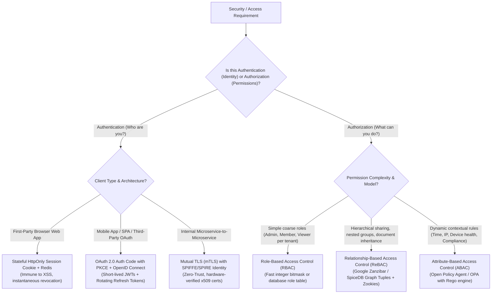
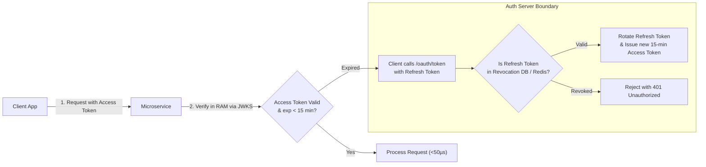
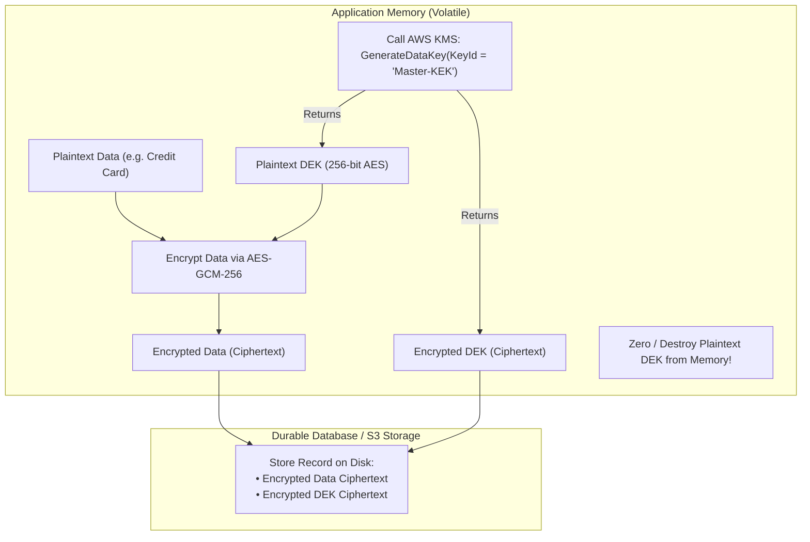

# Layer 09: Security, Authentication (AuthN) & Authorization (AuthZ) Playbook

> **The System Design Interview Lens:** In Staff/Principal interviews, security is not an afterthought; it is an architectural pillar. Junior engineers say *"I will validate JWTs in my service."* Staff/Principal engineers analyze **asymmetric cryptographic verification via JWKS**, **the token revocation dilemma**, **Envelope Encryption with KMS/HSM**, and **Relationship-Based Access Control (ReBAC / Google Zanzibar)** to solve fine-grained hierarchical permissions without hitting the "New Enemy" stale-read bug.

---

## 1. 60-Second Interview Decision Matrix & Flowchart

### The Master Decision Matrix

| Dimension / Use Case | Primary Selection | Alternative / Runner-Up | Never Choose / Red Flag | Decisive Mechanical Reason |
| :--- | :--- | :--- | :--- | :--- |
| **User Login & Session Management** (Web Browsers, First-Party Web Apps) | **Stateful Session Cookies** (`HttpOnly`, `SameSite=Strict` + Redis) | Short-Lived JWT + Refresh Token | JWTs stored in `localStorage` | Cookies marked `HttpOnly` and `SameSite` are completely immune to JavaScript XSS token theft; instantaneous session revocation via Redis delete. |
| **Single-Page Apps (SPA) & Mobile Client Login** (Cross-platform, API-driven) | **OAuth 2.0 with PKCE + OIDC** | Stateful Session Cookies | OAuth 2.0 Implicit Grant (Deprecated) | Proof Key for Code Exchange (PKCE) prevents authorization code interception on public mobile/SPA clients without exposing client secrets. |
| **Service-to-Service Microservice Authentication** | **Mutual TLS (mTLS) via SPIFFE/SPIRE** | Signed Internal JWTs | Static Shared API Keys | Zero-Trust architecture; ephemeral x509 certificates rotated continuously; hardware-backed cryptographic identity at the transport layer. |
| **Fine-Grained Resource Sharing & Hierarchies** (Google Drive folders, Figma workspaces, Notion docs) | **ReBAC (Google Zanzibar / SpiceDB)** | **ABAC (Open Policy Agent / OPA)** | Basic RBAC (`role_id` in users table) | Models permissions as a directed relationship graph (`object#relation@subject`); solves transitive folder inheritance and group nesting in sub-15ms. |
| **Enterprise Compliance & Environmental Context** (Attribute rules: "Only users from corporate IP during business hours") | **ABAC via OPA (Open Policy Agent)** | ReBAC | Hardcoded application `if/else` logic | Decouples declarative policy evaluation (Rego language) from application code; evaluates dynamic environmental attributes at runtime. |
| **Data-at-Rest Protection for Sensitive Payloads** (Credit cards, PII, healthcare records) | **Envelope Encryption** (KMS / HSM + Local DEK) | Database TDE (Transparent Data Encryption) | Storing raw plaintext or single static key | Master Key (KEK) never leaves secure HSM hardware; unique Data Encryption Key (DEK) encrypts payload in memory and is discarded immediately. |

---

### The AuthN & AuthZ Architecture Decision Flowchart



---

## 2. Mechanical First Principles: Cryptography, AuthN & Zanzibar

### 1. The Anatomy of a JWT & The Verification Dilemma

A JSON Web Token consists of three base64url-encoded parts separated by dots:
$$\text{JWT} = \underbrace{\text{Header}}_{\text{Algorithm \& Key ID}} \;.\; \underbrace{\text{Payload}}_{\text{Claims: sub, exp, tenant\_id}} \;.\; \underbrace{\text{Signature}}_{\text{Cryptographic Hash / Digital Signature}}$$

```
HEADER: {"alg": "RS256", "kid": "auth-key-2026-v1"}
PAYLOAD: {"sub": "usr_99182", "tenant_id": "acme", "role": "admin", "exp": 1792684800}
SIGNATURE: RSASHA256(base64(Header) + "." + base64(Payload), PrivateKey)
```

```
┌─────────────────────────────────────────────────────────────────────────────┐
│                 SYMMETRIC (HS256) vs. ASYMMETRIC (RS256/ES256)              │
├───────────────────────────────────┬─────────────────────────────────────────┤
│    SYMMETRIC (HMAC SHA-256)       │    ASYMMETRIC (RSA / ECDSA - RS256)     │
├───────────────────────────────────┼─────────────────────────────────────────┤
│ • Single secret key signs & verifs│ • Private Key signs (Auth Server only)  │
│ • FATAL FLAW IN MICROSERVICES:    │ • Public Key verifies (All services)    │
│   Every microservice must possess │ • Services fetch public keys via JWKS   │
│   the shared signing secret! If 1 │   (`.well-known/jwks.json`) and verify  │
│   service is breached, attacker   │   locally with ZERO network calls and   │
│   can forge valid tokens for ALL! │   ZERO ability to forge signatures.     │
└───────────────────────────────────┴─────────────────────────────────────────┘
```

#### How Microservices Verify JWTs Locally with Zero Network Latency
1. The Auth Server publishes its public verification keys at `https://auth.company.com/.well-known/jwks.json`.
2. Microservices download and cache the **JSON Web Key Set (JWKS)** in local memory on startup.
3. When an incoming request arrives with `Authorization: Bearer <jwt>`, the microservice extracts the `kid` (Key ID) from the JWT header, verifies the signature using the cached public key, and checks `exp > now()`.
4. **Result:** Cryptographic identity verification takes **$<50$ microseconds in RAM** with zero network round-trips to the Auth service!

---

### 2. The Token Revocation Dilemma: The Price of Statelessness

If a user clicks "Logout", or if an employee is terminated, or if a laptop is stolen: **how do you revoke a stateless JWT immediately?**

```
THE STATELESS PARADOX:
If a JWT is truly stateless, it is cryptographically valid until its expiration time (`exp`).
The database or Auth server has NO way to invalidate a token that lives in the client's hands!
```

#### The Production Solution: Dual-Token Architecture + Revocation Denylist



1.  **Ultra-Short-Lived Access Tokens:** The access token expires in **10 to 15 minutes**. Even if stolen, the window of vulnerability is minimal.
2.  **Long-Lived Rotating Refresh Tokens:** Stored in an `HttpOnly` cookie or secure mobile keychain, with a lifetime of 7 to 30 days.
3.  **Refresh Token Rotation (Family Detection):** Every time a refresh token is used, it is invalidated and replaced with a new one. If an old refresh token is reused, the Auth server detects token theft and immediately revokes the **entire token family**, logging the user out across all devices.
4.  **Instant Kill-Switch (Redis Denylist):** For immediate security revocations (e.g., password reset), store revoked `user_id`s or `jti` (JWT ID) in a centralized **Redis Bloom Filter / Key-Value store** with a TTL equal to the 15-minute access token lifespan. Services check Redis *only* for sensitive mutations.

---

### 3. Google Zanzibar & Relationship-Based Access Control (ReBAC)

Why do traditional database permission models collapse in collaborative applications like Google Drive, Figma, or GitHub?

```
TRADITIONAL ACL TABLE (Doesn't Scale):
UserAlice -> Can Edit -> Doc1
UserBob   -> Can View -> Doc1
• Failure Mode 1: What if Doc1 is inside "Project Folder" which is inside "Company Drive"?
  Computing nested permissions requires recursive SQL CTE joins that bring down the database!
• Failure Mode 2: What if User Alice shares with "Engineering Team", which contains "Frontend Group"?
  Resolving nested group memberships in relational tables takes hundreds of milliseconds!
```

#### The Zanzibar Relationship Tuple Model
Zanzibar models the entire authorization universe as **Relationship Tuples**:
$$\mathbf{\text{object}} \; \# \; \mathbf{\text{relation}} \; @ \; \mathbf{\text{subject}}$$

```
// File and folder structural relations
doc:design_doc#parent@folder:eng_folder
folder:eng_folder#parent@folder:company_drive

// Permission inheritance relations
folder:company_drive#viewer@group:all_employees#member
group:all_employees#member@user:alice

// The Question: "Can user:alice view doc:design_doc?"
// Zanzibar traverses the graph:
// user:alice -> member of group:all_employees
// group:all_employees -> viewer of folder:company_drive
// folder:company_drive -> parent of folder:eng_folder
// folder:eng_folder -> parent of doc:design_doc
// RESULT: TRUE! (Resolved via graph reachability in <10ms)
```

#### The "New Enemy" Problem & Zookies
A famous distributed systems bug documented in the Zanzibar paper:
1. Alice removes Bob from a confidential document.
2. Alice writes a message to Bob: *"I just revoked your access to the document."* (Communication occurs over an external channel).
3. Bob immediately clicks the link to view the document.
4. If the authorization read replica is lagging behind the write by 500ms, **Bob's read hits the stale replica and succeeds!** Bob sees confidential data he was explicitly told was revoked.
*   **The Zanzibar Fix (Zookies):** Every mutation returns a cryptographically signed consistency token called a **Zookie** containing an external snapshot timestamp. Subsequent checks pass this Zookie; the authorization server ensures it only reads from replicas that are at least as fresh as the Zookie timestamp, eliminating the New Enemy bug.

---

### 4. Envelope Encryption: Protecting Data at Rest

When storing sensitive data (credit cards, medical records, private keys), encrypting directly with a single database master key is an architectural failure (if the key leaks, everything leaks).

**The Solution: Envelope Encryption with KMS/HSM**



1.  **Key Encryption Key (KEK / Master Key):** Managed inside a certified Hardware Security Module (**HSM / AWS KMS**). The KEK **never leaves the HSM hardware**.
2.  **Data Encryption Key (DEK):** The application requests KMS to generate a unique, ephemeral 256-bit AES key. KMS returns the DEK in two forms: **Plaintext DEK** and **Encrypted DEK** (encrypted by the KEK).
3.  **Local Memory Encryption:** The application encrypts the user's data in memory using the Plaintext DEK via AES-GCM-256, **and immediately zeros out the Plaintext DEK from RAM**.
4.  **Storage:** The database stores the **Encrypted Payload** alongside the **Encrypted DEK**.
5.  **Decryption Flow:** To read, the app sends the Encrypted DEK back to KMS. KMS decrypts it using the KEK inside the HSM and returns the plaintext DEK, which the app uses to decrypt the data in memory.

---

## 3. Head-to-Head Architectural Shootouts

### Shootout 1: Stateful Session Cookies vs. Stateless JWTs

```
┌─────────────────────────────────────────────────────────────────────────────┐
│                       SESSION COOKIES vs. STATELESS JWTs                    │
├───────────────────┬─────────────────────────────────┬───────────────────────┤
│ FEATURE           │ STATEFUL SESSION COOKIES        │ STATELESS JWTs        │
├───────────────────┼─────────────────────────────────┼───────────────────────┤
│ Storage Location  │ Browser Cookie (`HttpOnly`)     │ Memory / SecureStorage│
│ XSS Resistance    │ 100% Immune (`HttpOnly` flag)   │ Vulnerable if in Web  │
│ CSRF Resistance   │ Requires SameSite / CSRF token  │ Immune (Bearer header)│
│ Revocation Speed  │ Instantaneous (Delete in Redis) │ Impossible until exp  │
│ Network Overhead  │ Tiny (32-byte opaque session ID)│ Large (1KB–2KB headers│
│ Microservice Auth │ Centralized lookups to Redis    │ Decentralized (JWKS)  │
│ Best For          │ First-party web applications    │ Mobile apps & SPAs    │
└───────────────────┴─────────────────────────────────┴───────────────────────┘
```

#### The Interview Verdict: When to Pick Which
*   **Pick Stateful Session Cookies for:** Traditional web applications with server-side rendering or first-party browser dashboards. Cookies marked `HttpOnly`, `Secure`, and `SameSite=Strict` provide the highest security posture against credential theft and allow immediate administrative logouts.
*   **Pick Stateless JWTs (Dual-Token OAuth2/OIDC) for:** Multi-platform mobile applications, third-party developer APIs, and distributed microservice meshes where hitting a centralized session database for every RPC call would bottleneck performance.

---

### Shootout 2: Authorization Models: RBAC vs. ABAC vs. ReBAC (Zanzibar)

```
┌─────────────────────────────────────────────────────────────────────────────┐
│                          RBAC vs. ABAC vs. ReBAC                            │
├───────────────────┬─────────────────────┬───────────────────┬───────────────┤
│ MODEL             │ RBAC (Role-Based)   │ ABAC (Attribute)  │ ReBAC (Zanzibar)│
├───────────────────┼─────────────────────┼───────────────────┼───────────────┤
│ Core Primitive    │ User $\to$ Role     │ Policy Engine     │ Entity Graph  │
│                   │ $\to$ Permission    │ (Rego / OPA)      │ Tuple Graph   │
│ Expressiveness    │ Low (Coarse roles)  │ Infinite (Dynamic)│ High (Relational)│
│ Nested Hierarchy  │ Terrible            │ Poor              │ Native First-Class│
│ Evaluation Speed  │ Instant ($O(1)$)    │ Moderate (Rules)  │ Graph walk (<15ms)│
│ Production Tech   │ Database tables     │ Open Policy Agent │ SpiceDB, OpenFGA│
│ Typical Use Case  │ Admin vs User portals Enterprise Compl. │ Google Drive, Docs│
└───────────────────┴─────────────────────┴───────────────────┴───────────────┘
```

#### The Interview Verdict: Presenting the Triad
*   **Choose RBAC if:** The application has simple, static roles (e.g., standard B2B SaaS with `Admin`, `Billing_Manager`, and `Employee`) where permissions do not depend on who owns the individual resource.
*   **Choose ABAC if:** Access depends on environmental or dynamic attributes (e.g., *"Allow access only if employee is in the US, using a company-managed laptop, between 9 AM and 5 PM"*).
*   **Choose ReBAC (Zanzibar / SpiceDB) if:** The domain features fine-grained collaborative sharing, hierarchical inheritance (Folder $\to$ Subfolder $\to$ Document), and cross-team delegation (e.g., Google Drive, Figma, Notion, GitHub organizations).

---

## 4. The Interview Defense Playbook: Scripts & Trap Rebuttals

### The 3-Candidate Justification Formula (Security & Access Control)

#### Verbal Script: Authorizing Document Sharing in a Collaborative Workspace (e.g., Google Drive / Figma)
> *"For our authorization layer, I evaluated three models: **Role-Based Access Control (RBAC)**, **Attribute-Based Access Control (ABAC)**, and **Relationship-Based Access Control (ReBAC)**.*
> * * **RBAC:** Simple to implement via database role tables, but fails completely on collaborative file systems where permissions depend on individual resource ownership, group nesting, and folder inheritance.*
> * * **ABAC (via OPA):** Highly expressive for environmental rules, but recursive inheritance checks across deep directory trees require complex runtime evaluations that introduce multi-second latency bottlenecks.*
> * * **ReBAC / Google Zanzibar (The Winner):** We will deploy **SpiceDB / OpenFGA**, an open-source implementation of Google Zanzibar. By storing permissions as graph relationship tuples (`document#viewer@folder#member`), Zanzibar resolves deep transitive inheritance in sub-15ms using distributed graph reachability algorithms, while **Zookies** prevent the New Enemy stale-read bug."*

#### Verbal Script: Microservice Authentication & Zero-Trust
> *"For inter-service communication across our payment and ledger microservices, I evaluated **Static API Keys**, **Signed Internal JWTs**, and **Mutual TLS (mTLS)**.*
> * * Static API keys introduce severe credential-leak risks and require complex secret rotation choreography.*
> * * Signed JWTs provide claim propagation, but verifying signatures in application code does not encrypt the underlying TCP transport layer.*
> * * **mTLS with SPIFFE/SPIRE (The Winner):** We enforce a Zero-Trust network architecture using Envoy sidecar proxies. Envoy terminates mutual TLS at the transport layer using short-lived x509 certificates rotated every 12 hours by SPIRE, guaranteeing both bidirectional cryptographic identity verification and in-transit wire encryption without application code overhead."*

---

### Interviewer Trap Questions & Battle-Tested Rebuttals

#### Trap 1: *"How do you immediately revoke an access token if a user's phone is stolen, given that JWTs are stateless?"*
*   **The Trap:** Probing whether you recognize that pure statelessness makes instantaneous revocation impossible without a stateful component.
*   **The High-Scoring Response:**
    > *"Stateless access tokens cannot be revoked by themselves until their expiration timestamp (`exp`). To defend against stolen devices:
    > 1. We keep access token lifespans strictly bounded to **10 to 15 minutes**, limiting the exposure window.
    > 2. When a user reports a stolen phone, the Auth server revokes the user's **Refresh Token** in the database, preventing the attacker from refreshing the session once the 15 minutes expire.
    > 3. For immediate zero-second kill-switches, we write the `user_id` to an in-memory **Redis Revocation Blocklist** with a 15-minute TTL. Our API Gateway checks this Redis cache before proxying requests; if blacklisted, it rejects the JWT immediately."*

#### Trap 2: *"Why is symmetric HMAC (HS256) dangerous for microservice JWT verification compared to asymmetric RSA/ECDSA (RS256/ES256)?"*
*   **The Trap:** Testing your knowledge of secret distribution across distributed architectures.
*   **The High-Scoring Response:**
    > *"With symmetric signing (HS256), the exact same secret key used to **sign** tokens is also required to **verify** them. In a microservice architecture with 50 services, every single service must hold the master signing secret in its configuration. If a low-security service (like an image thumbnailer) is compromised, the attacker steals the secret and can forge valid administrator tokens for the Payment and User services! 
    > With asymmetric signing (RS256/ES256), the private key stays exclusively on the hardened Auth Server. Microservices only download the **Public Key via the JWKS endpoint**, allowing them to verify signatures locally without ever possessing the ability to forge a token."*

#### Trap 3: *"What is the 'New Enemy' problem in distributed authorization, and how does Google Zanzibar solve it?"*
*   **The Trap:** Testing mastery over consistency bugs in distributed authorization replicas.
*   **The High-Scoring Response:**
    > *"The 'New Enemy' problem occurs when a permission revocation is followed by an external out-of-band communication:
    > Alice removes Bob from a confidential document and texts him: 'I took away your access.' Bob immediately clicks the link. If the authorization cluster uses asynchronous replication, Bob's query hits a lagging read replica that hasn't received the revocation yet, granting Bob access!
    > Zanzibar solves this using **Zookies (Consistency Tokens)**:
    > When Alice revokes access, Zanzibar commits to Spanner and returns a token containing the transaction's commit timestamp. When Bob accesses the document, the request passes a token; Zanzibar's evaluation engine ensures it only serves reads from a snapshot timestamp that is **at least as fresh as the revocation timestamp**, mathematically preventing stale access leaks."*

---

## 5. System Design Mapping: Where Security Lives in Real Architectures

| Architecture / System | Security / Auth Challenge | Selected Architecture & Pattern |
| :--- | :--- | :--- |
| [**12. Chat System**](file:///Users/abhinnaagarwal/Documents/system-design-notes/12.%20Chat%20System/README.md) | WebSocket Handshake Authentication | Validates short-lived JWT during HTTP `101 Switching Protocols` upgrade; binds user identity to persistent socket. |
| [**15. Google Drive**](file:///Users/abhinnaagarwal/Documents/system-design-notes/15.%20Google%20Drive/README.md) | Hierarchical folder sharing & nested permissions | **ReBAC (Google Zanzibar / SpiceDB)** relationship tuples with Zookie consistency tokens. |
| [**24. S3-like Object Storage**](file:///Users/abhinnaagarwal/Documents/system-design-notes/24.%20S3-like%20Object%20Storage/README.md) | Encrypted data chunks & bucket policies | **Envelope Encryption** (AWS KMS / HSM with local DEK per chunk) + IAM Policy engine. |
| [**26. Payment System**](file:///Users/abhinnaagarwal/Documents/system-design-notes/26.%20Payment%20System/README.md) | PCI-DSS Compliance & Card Data Vault | Tokenization server isolates raw card numbers; payload encrypted via AES-GCM-256 with KMS Envelope Encryption. |
| [**27. Digital Wallet**](file:///Users/abhinnaagarwal/Documents/system-design-notes/27.%20%20Digital%20Wallet/README.md) | Non-repudiation & Transaction Signing | Asymmetric ECDSA client digital signatures verifying transfer authorizations before ledger commit. |

---

### Cross-Repository Deep Dive Links
*   Google Zanzibar Architecture: [`coding-practice: authz/zanzibar.md`](file:///Users/abhinnaagarwal/Documents/coding-practice/systems-engineering/authz/zanzibar.md)
*   SpiceDB ReBAC Implementation: [`coding-practice: authz/spicedb.md`](file:///Users/abhinnaagarwal/Documents/coding-practice/systems-engineering/authz/spicedb.md)
*   AWS IAM & Security Policies: [`coding-practice: cloud-aws/aws-iam.md`](file:///Users/abhinnaagarwal/Documents/coding-practice/systems-engineering/cloud-aws/aws-iam.md)
*   Encryption & TLS Foundations: [`Core Concepts/Encryption and TLS/README.md`](file:///Users/abhinnaagarwal/Documents/system-design-notes/Core%20Concepts/Encryption%20and%20TLS/README.md)
*   AuthN & AuthZ Core Concept: [`Core Concepts/Authentication and Authorization/README.md`](file:///Users/abhinnaagarwal/Documents/system-design-notes/Core%20Concepts/Authentication%20and%20Authorization/README.md)
