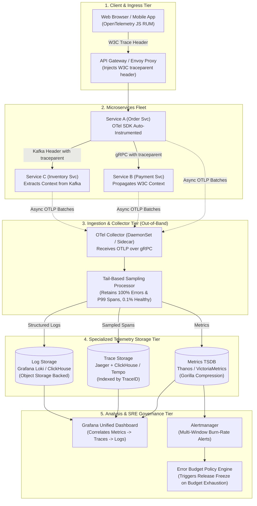
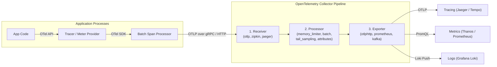
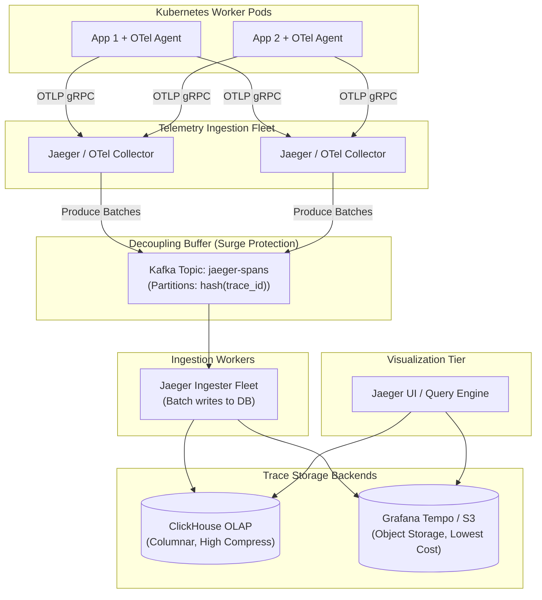

# Layer 10: Observability, Telemetry & SRE Reliability Playbook

> **The System Design Interview Lens:** In Staff and Principal (L6/L7+) interviews, observability is not a generic bullet point like *"I will use Prometheus and Grafana."* Mid-level engineers treat monitoring as an afterthought. Staff/Principal engineers treat observability as an **architectural pillar (Pillar 4: Operational Mindset)**: they establish mathematical **SLIs, SLOs, and Error Budgets**, design **W3C context-propagated distributed tracing via OpenTelemetry and Jaeger**, enforce **tail-based sampling** to prevent petabyte storage explosions, guard against **metric cardinality disasters**, and configure **multi-window burn-rate alerting** to eliminate alert fatigue.

---

## 1. 60-Second Interview Decision Matrix & Flowchart

### The Master Observability Decision Matrix

| Dimension / Use Case | Primary Production Selection | Alternative / Runner-Up | Never Choose in Production | Decisive Mechanical Reason |
| :--- | :--- | :--- | :--- | :--- |
| **Telemetry Instrumentation Standard** | **OpenTelemetry (OTel)** (Vendor-neutral API + SDK) | Cloud-Native SDKs (AWS X-Ray SDK, Datadog tracer) | Proprietary hardcoded vendor agents | OTel prevents vendor lock-in; standardizes metrics, traces, and logs over high-performance **OTLP (Protobuf over gRPC)** with unified W3C context propagation. |
| **Distributed Tracing Engine** | **Jaeger** or **Grafana Tempo** | Zipkin, Apache SkyWalking | Storing raw traces in relational SQL | Tracing graphs generate millions of spans/sec. Tempo/Jaeger with ClickHouse or Object Storage (S3 + Parquet) scale cost-effectively without crushing DB indexes. |
| **Trace Sampling Strategy** | **Tail-Based Sampling** (at OTel Collector tier) | Adaptive / Probabilistic Head-Based Sampling | 100% Unsampled Tracing at Scale | Storing 100% of traces at $100\text{k}+$ QPS creates petabytes of useless `200 OK` noise. Tail sampling buffers traces in memory and captures **100% of errors and P99 latency spikes** while keeping $<1\%$ of healthy traces. |
| **Metrics Storage Engine (TSDB)** | **VictoriaMetrics** or **Prometheus + Thanos/Cortex** | M3DB, InfluxDB | Elasticsearch / Relational DB for metrics | TSDBs use **Gorilla float XOR bit-packing and delta-of-deltas timestamp compression** ($16\text{ bytes} \to 1.37\text{ bytes}$), enabling millions of samples/sec per node. |
| **Log Aggregation & Storage** | **Grafana Loki** or **ClickHouse** | Elasticsearch / OpenSearch | Grepping flat files across hosts; Unindexed Mongo | Loki indexes only metadata labels (like Prometheus) and leaves log payloads unindexed/chunked in S3, slashing storage costs by $80\%$ compared to Elasticsearch inverted indices. |
| **Reliability Target Definition** | **SLO with 30-Day Rolling Error Budget** | Static Threshold Alerts (e.g., "CPU > 80%") | Vague uptime slogans ("We want 5 Nines") | Ties operational telemetry to business impact. Governs deployment velocity: if error budget depletes, feature releases freeze and reliability work takes priority. |
| **Alerting Methodology** | **Multi-Window Multi-Burn-Rate Alerting** (Google SRE standard) | Single-window error rate threshold | Alerting on internal server causes (CPU/Memory spikes) | Cause-based alerts create deafening alert storms. Multi-burn-rate alerts notify engineers only when an outage is mathematically consuming significant error budget. |

---

### Observability Architecture & Telemetry Pipeline Flowchart



---

## 2. The 5 Levels of Observability (The Full-Stack Hierarchy)

In a high-scale architecture, telemetry must span five concentric layers. If your observability stops at CPU utilization, you are blind to user-facing outages.

```
┌────────────────────────────────────────────────────────────────────────────────────────┐
│                        THE 5 LEVELS OF OBSERVABILITY HIERARCHY                         │
├─────────────────────────┬───────────────────────────────┬──────────────────────────────┤
│ Observability Level     │ Signals & Primitives          │ Production Tools             │
├─────────────────────────┼───────────────────────────────┼──────────────────────────────┤
│ 5. Business & Domain    │ Payment checkout success %,   │ Kafka Flink Aggregations,    │
│                         │ revenue velocity, order churn │ ClickHouse OLAP, Stripe webhooks│
├─────────────────────────┼───────────────────────────────┼──────────────────────────────┤
│ 4. User Experience (RUM)│ Core Web Vitals (LCP, FID),   │ OpenTelemetry Browser SDK,   │
│                         │ client crash rate, app FPS    │ Sentry, Datadog RUM          │
├─────────────────────────┼───────────────────────────────┼──────────────────────────────┤
│ 3. Application Services │ Golden Signals (Latency, QPS, │ OpenTelemetry, Jaeger,       │
│    (Distributed Mesh)   │ Errors, Saturation), Traces   │ Prometheus, Grafana Tempo    │
├─────────────────────────┼───────────────────────────────┼──────────────────────────────┤
│ 2. Runtime & Concurrency│ GC pauses, thread contention, │ JFR (Java), Go pprof,        │
│                         │ goroutine leaks, heap memory  │ Continuous Profiling (Pyroscope)│
├─────────────────────────┼───────────────────────────────┼──────────────────────────────┤
│ 1. OS & Infrastructure  │ CPU cycles, disk I/O, page    │ eBPF (Cilium / Pixie),       │
│    (Bare Metal & K8s)   │ faults, TCP retransmits, OOMs │ Node Exporter, cAdvisor      │
└─────────────────────────┴───────────────────────────────┴──────────────────────────────┘
```

### Level 1: OS, Kernel & Hardware Infrastructure
* **Signals:** CPU steal time, NVMe IOPS/queue depth, context switch rate, TCP listen queue drops (`netstat -s`), NIC buffer overruns.
* **Modern Mechanism: eBPF (Extended Berkeley Packet Filter):**
  Instead of injecting heavy user-space logging daemons, modern systems attach lightweight sandboxed bytecode directly into the Linux kernel (e.g., Cilium, Pixie). eBPF monitors socket allocations, TCP drops, and system calls with **zero code modification and $<1\%$ CPU overhead**.

### Level 2: Runtime & Concurrency Engine
* **Signals:** Stop-the-world garbage collection pauses (JVM GC / Go GC), goroutine pool exhaustion, thread-pool lock contention, off-heap memory leak growth.
* **Modern Mechanism: Continuous Profiling (e.g. Pyroscope, Grafana Phlare):**
  Continuously samples CPU call stacks and memory allocations in production across time. Allows engineers to click on a latency spike in Grafana and see a flame graph of the exact lines of code that consumed CPU during that minute.

### Level 3: Application Services & The 4 Golden Signals
Google SRE defines the **Four Golden Signals** of service health:
1. **Latency:** The time taken to service a request. Crucial distinction: **Track percentiles (P50, P90, P99, P99.9)**, *never* averages (averages hide catastrophic long-tail latency).
2. **Traffic:** Demand placed on the system (e.g. HTTP QPS, concurrent WebSocket connections, Kafka messages/sec).
3. **Errors:** Rate of requests that fail (explicit 5xx errors, implicit incorrect responses, or policy timeouts).
4. **Saturation:** How full the service's constrained resource is (e.g. database connection pool occupancy, Kafka partition lag, memory fraction utilized).

### Level 4: User Experience & Real User Monitoring (RUM)
* Backend servers might report HTTP 200 OK, but client JavaScript crashed, or CDN assets stalled on mobile networks.
* **Mechanisms:** OpenTelemetry Browser SDK instruments Web Vitals:
  * **LCP (Largest Contentful Paint):** Perceived load speed ($<2.5\text{s}$).
  * **INP (Interaction to Next Paint):** User responsiveness ($<200\text{ms}$).
  * **CLS (Cumulative Layout Shift):** Visual stability ($<0.1$).

### Level 5: Business & Domain Health
* A deployment might have 0 HTTP errors and 10ms latency, but payment gateway processing volume dropped to zero because of a silent currency conversion configuration bug.
* **Mechanisms:** Domain event stream aggregation (orders completed/min, dollar volume transacted/min) evaluated via sliding window aggregations in Apache Flink or ClickHouse.

---

## 3. SRE Mathematics: SLI, SLO, SLA & Error Budgets

Staff engineers differentiate between engineering telemetry and business agreements using the formal SRE reliability taxonomy.

```
┌────────────────────────────────────────────────────────────────────────────────────────┐
│                              SRE RELIABILITY DEFINITIONS                               │
├────────────────────┬───────────────────────────────────┬───────────────────────────────┤
│ Concept            │ What It Is                        │ Concrete Production Example   │
├────────────────────┼───────────────────────────────────┼───────────────────────────────┤
│ **SLI** (Indicator)│ The quantifiable metric measuring │ "Percentage of successful     │
│                    │ service performance right now.    │ HTTP requests served in <50ms"│
├────────────────────┼───────────────────────────────────┼───────────────────────────────┤
│ **SLO** (Objective)│ The internal engineering target   │ "99.9% of requests over a     │
│                    │ for an SLI over a rolling window. │ rolling 30-day window"        │
├────────────────────┼───────────────────────────────────┼───────────────────────────────┤
│ **SLA** (Agreement)│ The external business contract    │ "99.5% uptime; failure to meet│
│                    │ with customers + financial penalty│ gives customer 10% bill credit"│
├────────────────────┼───────────────────────────────────┼───────────────────────────────┤
│ **Error Budget**   │ The permitted room for unreliability│ $100\% - 99.9\% = 0.1\%$      │
│                    │ ($100\% - \text{SLO}$).           │ (= 43.2 minutes downtime/month)│
└────────────────────┴───────────────────────────────────┴───────────────────────────────┘
```

### 1. The Mathematical SLI Formulation
An SLI must always be expressed as the ratio of valid good events to total valid events:

$$\text{SLI} = \frac{\sum \text{Good Events}}{\sum \text{Total Valid Events}} \times 100\%$$

$$\text{Latency SLI} = \frac{\text{Count of HTTP requests where status} = 200 \text{ AND latency} \le 100\text{ms}}{\text{Count of all valid HTTP requests}} \times 100\%$$

* **Why Ratios Win:** Ratios naturally scale from 10 QPS to 100,000 QPS without needing threshold re-calibration.

---

### 2. The Golden Rule: $\text{SLO} > \text{SLA}$
* **Always set your internal SLO strictly higher than your external customer SLA:**
  $$\text{Internal SLO: } 99.9\% \quad > \quad \text{External SLA: } 99.5\%$$
* This creates a **safety buffer**: your team detects degradation, fires alerts, and fixes incidents *before* a contractual SLA breach triggers financial penalty credits.

---

### 3. Error Budget & The Feature Velocity Contract

The **Error Budget** is the allowable failure margin:

$$\text{Error Budget} = 100\% - \text{SLO}$$

For a **99.9% SLO over a 30-day rolling window** ($43,200\text{ minutes}$):
$$\text{Allowed Downtime / Failure Margin} = 0.001 \times 43,200\text{ min} = \mathbf{43.2\text{ minutes}}$$

#### The Organizational SRE Policy:
```
                       ┌───────────────────────────────┐
                       │     Error Budget Status       │
                       └───────────────┬───────────────┘
                                       │
                 ┌─────────────────────┴─────────────────────┐
                 ▼                                           ▼
       [ Budget Remaining > 0% ]                   [ Budget Exhausted (<= 0%) ]
                 │                                           │
    • Normal feature deployment                 • AUTOMATIC RELEASE FREEZE
    • Experimental rollouts permitted           • 100% engineering effort diverted
    • CI/CD pipeline unblocked                    to technical debt & reliability
                                                • Production changes require VP approval
```

---

### 4. Multi-Window Multi-Burn-Rate Alerting (Google SRE Standard)

Why do traditional alerts fail in production?
* **Problem A (Alert Fatigue):** Alerting on a single 5-minute spike causes pages for harmless transient blips that self-heal.
* **Problem B (Too Slow):** Alerting only on a 30-day window means a catastrophic outage that burns 100% of the budget in 2 hours won't trigger an alert for days!

#### The Solution: Burn Rate Math
**Burn Rate ($1.0$)** means the error budget will be consumed in exactly the SLO period (e.g. 30 days).
* **Burn Rate $14.4$:** Consumes **$2\%$ of the monthly budget in 1 hour**. This is an active P0 fire $\implies$ **Page engineer immediately!**
* **Burn Rate $6.0$:** Consumes **$5\%$ of the monthly budget in 6 hours**. This is a slow bleed $\implies$ **Page engineer during daytime hours.**
* **Burn Rate $1.0$:** Consumes **$10\%$ in 3 days** $\implies$ **Create Jira ticket (no page).**

```
┌────────────────────────────────────────────────────────────────────────────────────────┐
│                        GOOGLE SRE MULTI-BURN-RATE ALERT MATRIX                         │
├────────────┬─────────────┬──────────────┬──────────────────┬──────────────┬────────────┤
│ Severity   │ Burn Rate   │ Budget Spent │ Long Window      │ Short Window │ Action     │
├────────────┼─────────────┼──────────────┼──────────────────┼──────────────┼────────────┤
│ **P0 Page**│ **14.4x**   │ 2%           │ **1 Hour**       │ **5 Minutes**│ Page on-call│
│ **P1 Page**│ **6.0x**    │ 5%           │ **6 Hours**      │ **30 Minutes**│ Page on-call│
│ **P2 Ticket**│ **1.0x**  │ 10%          │ **3 Days**       │ **6 Hours**  │ File ticket│
└────────────┴─────────────┴──────────────┴──────────────────┴──────────────┴────────────┘
```
> **Staff Insight:** The **Short Window** (5 min) is the sanity check: it ensures the problem is *still actively happening right now* before waking up an on-call engineer, preventing alerts for short self-healing blips!

---

## 4. OpenTelemetry (OTel) Deep Dive: The Industry Standard

OpenTelemetry is an open-source observability framework under the Cloud Native Computing Foundation (CNCF) formed by merging **OpenTracing** and **OpenCensus**.



### 1. OTel Core Components
1. **OTel API:** The instrumentation interface called in application code (`tracer.startSpan("processPayment")`). Has zero implementation logic; safe to import in libraries.
2. **OTel SDK:** The concrete implementation loaded at runtime. Manages thread-safe span buffering, context propagation, and metric aggregation.
3. **OTel Collector:** A high-performance, vendor-neutral proxy daemon written in Go:
   * **Receivers:** Ingest telemetry from apps (OTLP, Jaeger, Zipkin, Prometheus pull).
   * **Processors:** Batch events, scrub sensitive PII, limit memory, and apply **tail sampling**.
   * **Exporters:** Ship telemetry in parallel to multiple backends (Jaeger, ClickHouse, Datadog).

---

### 2. Distributed Context Propagation & The W3C Trace Context Standard

How does a distributed trace follow a request across 10 microservices and Kafka queues?

#### The W3C `traceparent` HTTP Header Specification:
Every outgoing HTTP/gRPC request carries a standardized header:

```
traceparent: 00-4bf92f3577b34da6a3ce929d0e0e4736-00f067aa0ba902b7-01
             │  └──────────────┬───────────────┘ └───────┬──────┘ └─┬┘
             │                 │                         │          │
         Version           Trace ID                  Parent ID    Flags
         (2 hex)           (32 hex)                  (16 hex)    (01=Sampled)
```

```
Service A (Order)                 Service B (Payment)              Service C (Bank Gateway)
   Span ID: 00f067aa0ba902b7         Span ID: 5c88b0a1d4133499        Span ID: 7a93c41189283711
   Trace ID: 4bf92f35...             Trace ID: 4bf92f35...            Trace ID: 4bf92f35...
   Parent ID: null                   Parent ID: 00f067aa0ba902b7      Parent ID: 5c88b0a1d4133499
          │                                  │                                   │
          ├── traceparent: 00-4bf92... ─────>│                                   │
          │                                  ├── traceparent: 00-4bf92... ──────>│
```

* **W3C `tracestate`:** Propagates vendor-specific routing metadata without breaking cross-vendor trace trees.
* **W3C `baggage`:** Transports business-level key-value metadata across the entire distributed execution tree (e.g., `baggage: tenant_id=acme,customer_tier=enterprise`). Accessible by every downstream service without database lookups.

---

### 3. Trace Sampling: Head-Based vs. Tail-Based

At $100,000\text{ QPS}$, generating $10\text{ spans/request} = 1,000,000\text{ spans/second}$. Storing all of them generates **$\approx 300\text{ Terabytes of traces/month}$**, costing millions in disk and network bandwidth.

```
┌────────────────────────────────────────────────────────────────────────────────────────┐
│                        HEAD-BASED vs. TAIL-BASED TRACE SAMPLING                        │
├────────────────────┬───────────────────────────────────┬───────────────────────────────┤
│ Dimension          │ Head-Based Sampling               │ Tail-Based Sampling           │
├────────────────────┼───────────────────────────────────┼───────────────────────────────┤
│ **Where Decision** │ At the **ingress / API gateway**  │ At the **OTel Collector tier**│
│ **is Made**        │ when the request starts.          │ *after* all spans finish.     │
├────────────────────┼───────────────────────────────────┼───────────────────────────────┤
│ **Context Known**  │ None. The system cannot predict   │ Complete. Knows duration, HTTP│
│                    │ if the request will fail or lag.  │ status, error logs, and tags. │
├────────────────────┼───────────────────────────────────┼───────────────────────────────┤
│ **Accuracy**       │ **Poor for incidents.** A 1% head │ **100% incident capture.**    │
│                    │ sampler drops 99% of rare errors! │ Drops healthy spans; keeps all│
│                    │                                   │ errors and P99 latency outliers│
├────────────────────┼───────────────────────────────────┼───────────────────────────────┤
│ **Resource Cost**  │ Zero collector RAM buffer needed. │ Requires memory buffer at the │
│                    │ Cheap and simple.                 │ collector to hold in-flight   │
│                    │                                   │ traces for 30 seconds.        │
└────────────────────┴───────────────────────────────────┴───────────────────────────────┘
```

#### Production Recommendation (Tail Sampling Rule):
Configure the OTel Collector `tail_sampling` processor:
1. Sample **$100\%$** of traces containing any span with `http.status_code >= 500` or `error = true`.
2. Sample **$100\%$** of traces where total duration $> 500\text{ms}$ (P99 outliers).
3. Sample **$100\%$** of traces for prioritized VIP tenants (`baggage: customer_tier=enterprise`).
4. Sample **$0.1\%$** of healthy, fast $200\text{ OK}$ traces for baseline performance profiling.
* **Result:** **Reduces storage footprint by $95\%$ while guaranteeing that $100\%$ of production failures are captured.**

---

## 5. Distributed Tracing Architecture: Jaeger & Backends

**Jaeger** (inspired by Google Dapper) is an end-to-end distributed tracing platform.



### Trace Storage Engine Shootout: ClickHouse vs. Tempo vs. Elasticsearch

| Feature / Engine | Elasticsearch / OpenSearch | Apache Cassandra | ClickHouse | Grafana Tempo (S3) |
| :--- | :--- | :--- | :--- | :--- |
| **Storage Architecture** | Inverted Index per tag | Wide-Column (by Trace ID) | Columnar DBMS | Object Storage (Parquet blocks) |
| **Storage Cost** | High (1x baseline) | Medium (0.6x) | **Low (0.2x compression)** | **Lowest (0.05x on S3)** |
| **Tag Search Speed** | Extremely fast ($O(1)$) | Terrible (needs 2i) | Blazing fast (vectorized SIMD)| Fast via dedicated parquet index |
| **Single Trace Lookup** | Fast | Instant ($O(1)$ PK seek) | Sub-15ms | Sub-50ms |
| **Staff Verdict** | **Legacy / Expensive.** Deprecated for large tracing fleets. | **Maintenance heavy.** Painful repair/tombstone issues. | **Best balance** of sub-second arbitrary tag querying and low disk cost. | **Best for massive scale on a budget** if traces are looked up primarily by TraceID. |

---

## 6. Metrics & TSDB Under the Hood (Prometheus, VictoriaMetrics, Gorilla)

### 1. Prometheus Architecture: The Pull vs. Push Dilemma

```
┌────────────────────────────────────────────────────────────────────────────────────────┐
│                              PULL vs. PUSH METRICS DEBATE                              │
├────────────────────┬───────────────────────────────────┬───────────────────────────────┤
│ Dimension          │ Pull Model (Prometheus Default)   │ Push Model (OTel / StatsD)    │
├────────────────────┼───────────────────────────────────┼───────────────────────────────┤
│ **Mechanism**      │ Server scrapes HTTP `/metrics`    │ Client pushes metrics to an   │
│                    │ endpoint on workers every 15s.    │ agent/gateway via UDP/gRPC.   │
├────────────────────┼───────────────────────────────────┼───────────────────────────────┤
│ **Liveness Check** │ **Automatic.** If scrape fails,   │ Silent failure. Cannot tell if│
│                    │ server marks instance `DOWN`.     │ service died or just quiet.   │
├────────────────────┼───────────────────────────────────┼───────────────────────────────┤
│ **Overload Defense**│ **Pull protects the collector.** │ A traffic surge can DDoS the  │
│                    │ Collector controls scrape rate.   │ metrics collector with pushes.│
├────────────────────┼───────────────────────────────────┼───────────────────────────────┤
│ **Ephemeral Jobs** │ Bad for short serverless tasks    │ **Ideal for AWS Lambda** and  │
│                    │ (job terminates before scrape).   │ short-lived batch jobs.       │
└────────────────────┴───────────────────────────────────┴───────────────────────────────┘
```
> **Staff Recommendation:** Use the **Hybrid Pattern**: Services push OTLP metrics locally to an **OTel Collector sidecar** (zero network overhead); the centralized Prometheus/Thanos cluster pulls/scrapes aggregated batches from the OTel Collector.

---

### 2. The Cardinality Explosion Disaster (The #1 SRE Trap)

In a TSDB, every unique combination of key-value labels creates a separate physical time-series stream in RAM.

$$\text{Total Series} = \prod_{i=1}^N \text{Cardinality}(\text{Label}_i)$$

#### The Anti-Pattern:
```promql
# DANGEROUS: High cardinality tags!
http_requests_total{method="POST", handler="/checkout", user_id="849201", order_id="ord_9182"}
```
* If you have $10,000,000$ users and $50,000,000$ orders, this creates **$500\text{ Trillion}$ time-series in memory**, instantly crashing Prometheus with an Out-of-Memory (OOM) panic!

#### SRE Rules for Metric Labels:
1. **Never put unbounded entity IDs into metric labels** (No `user_id`, `order_id`, `email`, or raw query params).
2. Use metrics for **bounded enums** (`http_status_code` [~10 values], `region` [~10 values], `method` [~5 values]).
3. If you need to debug a specific `order_id`, look it up in **Distributed Traces or Logs**, not Metrics!

---

### 3. Gorilla TSDB Compression (Meta's Benchmark)
Modern TSDBs compress floating-point metrics using Meta's Gorilla algorithm:
1. **Timestamps (Delta-of-Deltas):** Because metrics are scraped at regular intervals (e.g. every 15s), the difference between consecutive timestamps ($\Delta t_i - \Delta t_{i-1}$) is almost always $0$. Variable-length bit encoding stores $0$ in **a single bit**!
2. **Values (XOR Floating Point):** Consecutive floats ($v_i \oplus v_{i-1}$) share identical sign, exponent, and leading mantissa bits. XOR bit-packing stores only changed bits.
* **Result:** Compresses 16-byte `(timestamp, value)` pairs down to **1.37 bytes**, enabling a single node to hold billions of samples in RAM.

---

## 7. The 7 Deadly Observability Sins in System Design Interviews

| Mistake / Anti-Pattern | Why It Fails in Production | Staff / Principal Remediation |
| :--- | :--- | :--- |
| **1. Alerting on Symptoms Instead of User Pain** | Alerting when "Server CPU > 85%" triggers pages while users experience 0 errors. | Alert on **SLI burn rates** (P99 Latency & Error Rate); treat CPU as a diagnostic signal. |
| **2. Cardinality Explosion in TSDB** | Putting `user_id` or `email` in Prometheus labels causes cluster-killing OOMs. | Restrict metric labels to low-cardinality enums; put entity IDs in traces/logs. |
| **3. Synchronous Logging in Request Path** | Writing logs synchronously over network/disk adds 20–50ms to P99 user latency. | Log asynchronously to memory buffers; use background daemons (Fluentbit/Vector) to ship. |
| **4. 100% Trace Sampling at Scale** | Storing all traces at $100\text{k}+$ QPS creates petabytes of useless $200\text{ OK}$ data. | Implement **Tail-Based Sampling** at the OTel Collector to capture 100% of errors and P99 latency. |
| **5. Stripping Trace Context Across Queues** | Publishing an event to Kafka without copying `traceparent` headers breaks the trace graph. | Inject W3C trace context into Kafka message record headers before publishing. |
| **6. The Log Cascade Disaster** | During an outage, 50 services generate millions of error logs/sec, DDoS-ing the logging cluster. | Configure log rate-limiters, sampling, and circuit breakers in edge log shippers. |
| **7. No Error Budget Policy** | Having SLOs on dashboards without an enforcement policy makes them meaningless vanity metrics. | Establish automated deployment freeze gates in CI/CD when error budgets are exhausted. |

---

## 8. The Interview Defense Playbook (Formulas & Candidate Scripts)

When the interviewer asks: *"How will you design monitoring, observability, and alerting for this system?"*

### The 4-Step Staff Justification Formula:

1. **Step 1: Define User-Facing SLIs & SLOs (The Business Contract)**
   > *"Rather than setting static server thresholds, I define our reliability contract using customer-facing SLIs based on the 4 Golden Signals. For our payment API, the SLI is the ratio of HTTP requests returning status 200 within $<150\text{ms}$. We set an internal SLO of $99.95\%$ availability over a rolling 30-day window, giving us an error budget of $21.6\text{ minutes}$. This is strictly higher than our external $99.9\%$ SLA to ensure we detect and mitigate incidents before contractual penalties hit."*

2. **Step 2: Instrument with OpenTelemetry & Context Propagation (The Ingestion Layer)**
   > *"We instrument all microservices with the vendor-neutral OpenTelemetry SDK over OTLP Protobuf. All inter-service calls—including gRPC, HTTP, and asynchronous Kafka events—propagate the W3C `traceparent` header to maintain continuous distributed trace context across service and queue boundaries."*

3. **Step 3: Guard Against Cost & Scale Outliers (The Storage Strategy)**
   > *"To prevent telemetry storage explosions at $100\text{k}+$ QPS, we deploy an OTel Collector fleet with two specific guardrails:
   > 1. In Prometheus, we strictly disallow high-cardinality tags like `user_id`, storing only low-cardinality enums to prevent TSDB memory panics.
   > 2. For distributed tracing in Jaeger/Tempo, we implement **Tail-Based Sampling**: the collector buffers spans for 30 seconds, capturing **$100\%$ of all traces with errors or P99 latency outliers**, while retaining only **$0.1\%$ of normal $200\text{ OK}$ traces**. This captures all incidents while reducing storage costs by $95\%$."*

4. **Step 4: Configure Multi-Window Multi-Burn-Rate Alerting (The Operations Layer)**
   > *"To eliminate alert fatigue, we configure Google SRE multi-window multi-burn-rate alerts:
   > - A $14.4\times$ burn rate consuming $2\%$ of our budget in 1 hour triggers a P0 page to on-call engineers, validated by a 5-minute short window to ensure the incident is actively occurring.
   > - If the monthly error budget is fully depleted, our CI/CD pipeline triggers an automated release freeze, blocking new feature deployments until technical debt and reliability items are resolved."*

---

## 9. System Design Mapping: Where to Apply This Playbook

| System Design Chapter | Direct Observability Application |
| :--- | :--- |
| **[Chapter 04: Rate Limiter](file:///Users/abhinnaagarwal/Documents/system-design-notes/04.%20Rate%20Limiter/Readme.md)** | Shadow mode telemetry, tracking `429 Too Many Requests` metrics, Redis latency SLIs. |
| **[Chapter 08: URL Shortener](file:///Users/abhinnaagarwal/Documents/system-design-notes/08.%20URL%20Shortener/Readme.md)** | Async edge telemetry via `event.waitUntil` & CDN Logpush streaming to Kafka/ClickHouse. |
| **[Chapter 19: Message Queue](file:///Users/abhinnaagarwal/Documents/system-design-notes/19.%20Distributed%20Message%20Queue/Readme.md)** | Tracking Kafka Consumer Lag as the primary saturation SLI; W3C trace context in Kafka headers. |
| **[Chapter 20: Metrics & Monitoring](file:///Users/abhinnaagarwal/Documents/system-design-notes/20.%20Metrics%20Monitoring%20and%20Alerting%20System/Readme.md)** | Deep dive into TSDB engine internals, Gorilla compression, and alert storm suppression rules. |
| **[Chapter 26: Payment System](file:///Users/abhinnaagarwal/Documents/system-design-notes/26.%20Payment%20System/Readme.md)** | High-severity SLIs on transaction failure rates, 3-way reconciliation audit logs, idempotency tracking. |
| **[Chapter 31: Job Scheduler](file:///Users/abhinnaagarwal/Documents/system-design-notes/31.%20Distributed%20Job%20Scheduler/Readme.md)** | Worker heartbeat registries, dead letter queue (DLQ) alerts, task execution latency percentiles. |
