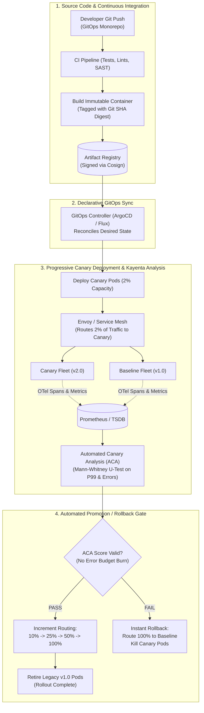
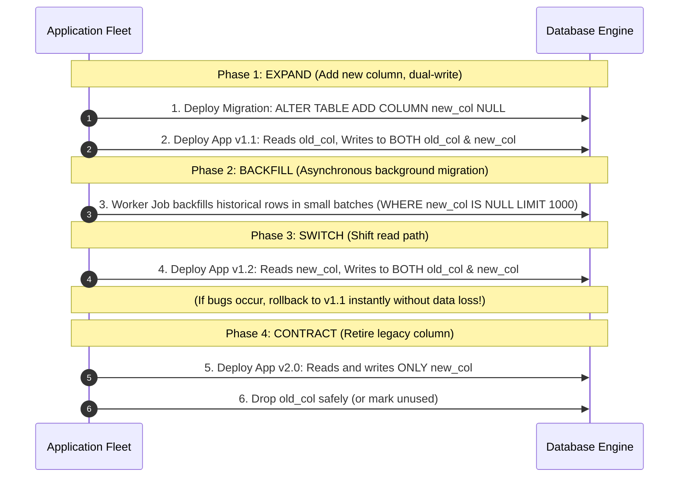

# Layer 11: Deployment Strategies, Release Engineering & CI/CD Playbook

> **Design inputs:** Version skew, schema compatibility, migration checkpoints, release gates, data recovery and rollback/roll-forward ownership.

> **The System Design Interview Lens:** In Staff and Principal (L6/L7+) interviews, deployment is not a casual comment like *"I will push Docker containers with Jenkins."* Mid-level engineers treat deployments as an operational afterthought. Staff and Principal engineers treat release engineering as an **architectural pillar (Pillar 4: Operational Mindset)**: they plan for **continuous API version skew**, design **zero-downtime database schema migrations via the Expand/Contract pattern**, automate **statistically grounded Canary Analysis (ACA)** tied directly to Error Budget burn rates, and implement **GitOps and dark launching (traffic shadowing)** to de-risk high-throughput distributed systems.

---

## 1. 60-Second Interview Decision Matrix & Flowchart

### The Master Deployment Strategy Matrix

| Deployment Strategy | Resource Overhead | Blast Radius | Rollback Speed | Version Skew Duration | Best Suited Use Case | Never Choose When |
| :--- | :--- | :--- | :--- | :--- | :--- | :--- |
| **Rolling Update** | **$0\%$ extra** (replaces pods in-place) | **Medium** ($10\% \to 25\%$ of traffic per batch) | **Slow** (must roll back batch by batch) | **Long** (old and new versions run concurrently during rollout) | Stateless microservices with strict backward compatibility and budget limits. | Incompatible stateful migrations or APIs with non-backward-compatible breaking changes. |
| **Blue/Green (Red/Black)** | **$+100\%$ extra** ($2\times$ full production fleet) | **High** (all-or-nothing switchover) | **Instant ($O(1)$)** (re-point load balancer / DNS) | **Zero** (atomic switchover once green is validated) | Mission-critical monolithic services, stateful caches, or zero version-skew tolerance. | Massive petabyte clusters where running a parallel $2\times$ fleet is economically impossible. |
| **Canary Deployment** | **$+1\%$ to $+10\%$** | **Minimal** ($1\% \to 5\%$ isolated traffic) | **Fast** (drain canary router rules) | **Controlled** (only small % exposed until ACA passes) | High-throughput distributed systems ($100\text{k}+$ QPS), core payment/checkout flows. | Low-traffic internal APIs where statistical significance takes hours to achieve. |
| **Dark Launch / Shadowing** | **$+50\%$ to $+100\%$** (shadow cluster) | **Zero** (mirrored traffic discarded/shadowed) | **N/A** (users never see shadow output) | **None** (shadow results do not impact live users) | Major backend rewrites, algorithmic ranking changes, database engine transitions. | Non-idempotent write paths with external side effects (charging credit cards, sending SMS). |
| **Feature Flags / Toggles** | **$0\%$** (in-process conditional logic) | **Micro** (per-user / per-tenant / cohort) | **Instant ($<1\text{s}$)** (push toggle state via etcd/Redis) | **Infinite** (multiple code paths exist in binary permanently) | Gradual feature rollouts, beta testing, kill switches for circuit breaking. | Long-term architectural rewrites; flags left without cleanup cause combinatorial testing debt. |

---

### Production CI/CD & Automated Canary Analysis (ACA) Pipeline Flowchart



---

## 2. Mechanical First Principles of Release Engineering

### 2.1 The Two Fundamental Constraints: State vs Stateless Physics
* **Stateless Tiers:** Compute instances that hold no local persistent data. Can be terminated, replaced, or scaled horizontally at will. Version skew is purely a wire-protocol compatibility problem.
* **Stateful Tiers:** Databases, distributed caches (Redis), message brokers (Kafka partitions), and local disk systems. 
  * You cannot simply "swap a pod" without handling data replication, partition rebalancing, schema compatibility, and storage engine locking.
  * In distributed systems, **code deploy is fast ($O(1)$ to $O(N)$), but data migration is slow ($O(\text{Data Volume})$)**.

### 2.2 Wire Protocol Version Skew & The N-1 Compatibility Rule
In any progressive rollout (Rolling or Canary), **Version $N$ and Version $N-1$ will run simultaneously** across the cluster for minutes or hours.
* **The Forward/Backward Compatibility Axiom:**
  * **Backward Compatibility:** New code (v2) must be able to parse data and RPCs produced by old code (v1).
  * **Forward Compatibility:** Old code (v1) must be able to safely receive data and RPCs produced by new code (v2) without crashing or dropping unknown fields.
* **Serialization Invariant:**
  * In **Protobuf / gRPC**, never renumber field tags. Unknown fields are retained in the unknown field set and safely re-serialized.
  * In **JSON / REST**, serializers must be configured with `FAIL_ON_UNKNOWN_PROPERTIES = false`. Adding a new field must never crash legacy clients.

### 2.3 Control Plane vs Data Plane Isolation During Rollouts
* Grounded in Vitillo Ch 22 (*Control Planes and Data Planes*):
  * **Data Plane:** The high-throughput path executing user requests (Envoy proxies, microservices, caches).
  * **Control Plane:** The orchestration and routing configuration system (Kubernetes API server, ArgoCD, Consul, Istio Pilot).
  * **First Principle:** A failure or deployment in the control plane must **never interrupt** existing data plane routing. Proxies must cache their routing tables locally and continue operating even if the deployment orchestrator crashes.

---

## 3. Head-to-Head Strategy Shootout

### 3.1 Rolling Updates vs Blue/Green vs Canary

```
1. Rolling Update:
   [v1] [v1] [v1] [v1]  -->  [v2] [v1] [v1] [v1]  -->  [v2] [v2] [v1] [v1]  -->  [v2] [v2] [v2] [v2]
   (Capacity is constant; version skew exists during entire deployment window)

2. Blue/Green:
   Router --> [Blue: v1 v1 v1 v1] (Active: 100%)
              [Green: v2 v2 v2 v2] (Idle: 0% - pre-warmed & smoke tested)
   Router flips atomically:
   Router --> [Blue: v1 v1 v1 v1] (Idle: 0% - standby for instant rollback)
              [Green: v2 v2 v2 v2] (Active: 100%)

3. Canary Deployment:
   Router --> 98% Traffic --> [Baseline Fleet: v1 v1 v1 v1]
          -->  2% Traffic --> [Canary Fleet:   v2]
   (ACA compares telemetry; if healthy, canary ratio progressively increases to 100%)
```

#### Detailed Trade-Off Comparison

| Metric / Attribute | Rolling Update | Blue/Green Deployment | Canary Deployment |
| :--- | :--- | :--- | :--- |
| **Infrastructure Cost** | **Zero extra** | **$+100\%$ (Double fleet)** | **$+2\%$ to $+10\%$** |
| **Blast Radius of a Bug** | High ($25\%$ to $50\%$ users affected during wave 1) | Total ($100\%$ users hit on switchover) | **Minimal ($1\%$ to $2\%$ users)** |
| **Detection Mechanism** | Health checks (HTTP `/readyz`) | Manual smoke test on green before cutover | **Automated statistical metric comparison (ACA)** |
| **Instant Rollback Capability** | No (requires reverse rolling update) | **Yes (re-point load balancer in $<1\text{s}$)** | **Yes (shift router weights to $0\%$)** |
| **Cache Warming Problem** | Low (gradual replacement preserves warm local caches) | **Severe (Green starts with cold local memory/caches)** | Low (baseline remains warm; canary warms slowly) |
| **Stateful DB Migration Sync** | Difficult (both versions hit DB throughout) | **Severe (Writes to Green must sync to Blue if rollback needed)** | Standard (DB must support Expand/Contract) |

---

### 3.2 Dark Launching (Traffic Shadowing) vs Feature Flags

#### Traffic Shadowing (Diffing)
* **How It Works:** At the API Gateway or Service Mesh (Envoy `request_mirror_policy`), live production read requests are duplicated. The primary request goes to v1 and returns the response to the user. A clone is dispatched asynchronously to the **Shadow (v2)** cluster.
* **Validation Physics:** Responses from v1 and v2 are diffed asynchronously (e.g., via Twitter Diffy) to identify regressions in payloads, response times, and CPU/memory profiles.
* **The Critical Invariant:** **Shadow clusters must NEVER execute side effects**. Database writes, message publishing, credit card charges, and external third-party API calls must either be mocked, pointed to a throwaway shadow database, or stripped.

#### Feature Flags / Feature Toggles
* **How It Works:** Code containing both the old and new implementations is deployed to production. An in-memory evaluation engine (e.g., LaunchDarkly SDK, OpenFeature) inspects context attributes (`user_id`, `tenant_id`, `device_type`) against rules cached locally in memory.
* **Mechanical Latency:** Feature flag checks must execute **in memory ($<1\mu\text{s}$)** without performing synchronous network lookups to an external config server. Dynamic updates are pushed via WebSocket/SSE or polled asynchronously.
* **The Flag Debt Lifecycle:**
  1. *Release Toggle:* Temporary flag for canary release; **must be deleted within 2 sprints** once at $100\%$.
  2. *Kill Switch / Circuit Breaker Toggle:* Permanent flag guarding resource-intensive subsystems (e.g., recommendation algorithms) during peak flash sales.

---

## 4. Zero-Downtime Database Schema Migrations

In distributed system design interviews, the most common trap is: *"We updated the service, which altered the table schema."* In production, **altering a multi-terabyte SQL table synchronously locks tables, spikes replication lag, and causes catastrophic downtime**.

### The 4-Phase Expand/Contract (Parallel Run) Pattern



### Detailed Execution Mechanics

#### Phase 1: Expand (Additive Only)
* **Rule:** Database DDL changes must be strictly **additive and non-blocking**.
* New columns must be `NULLABLE` or have a database-level non-locking default (e.g., PostgreSQL 11+ instant metadata defaults).
* The new version of the microservice is deployed. It writes to **both** `old_column` and `new_column` on every write operation, but continues reading from `old_column`.

#### Phase 2: Asynchronous Backfill
* A low-priority background migration worker queries rows where `new_column IS NULL` and populates them using data transformed from `old_column`.
* **Mechanical Protection:** Backfills must run in **paged batches** (e.g., `LIMIT 1000` with sleep intervals) to prevent lock escalation, avoid exhausting MySQL InnoDB buffer pools, and keep replication lag to $<1\text{s}$ on read replicas.

#### Phase 3: Read Switchover
* The application code is updated to **read from `new_column`**.
* Dual-writing is maintained! If an unanticipated bug is discovered in the new data format, the team can roll back the application binary to Phase 1 immediately, because `old_column` was kept in sync in real-time.

#### Phase 4: Contract (Deprecation & Cleanup)
* Once the new code has run successfully for several days with zero rollbacks:
  1. Deploy application code that ceases writing to `old_column`.
  2. Drop the column safely using online DDL tools (e.g., **GitHub's `gh-ost`** or **Percona's `pt-online-schema-change`** for MySQL; `CONCURRENTLY` for PostgreSQL indexes).

---

## 5. Automated Canary Analysis (ACA) & GitOps

### 5.1 Automated Canary Analysis (ACA) Mechanics
Manual verification of canaries fails at scale. Systems like **Netflix Kayenta** or **Argo Rollouts** perform continuous automated statistical comparisons between two parallel groups:
* **The Canary:** Pods running the newly deployed version ($v2$).
* **The Baseline:** An identically sized group of pods running the current stable version ($v1$), spun up at the exact same moment as the canary.
  *(Comparing Canary against the entire existing production fleet is mathematically flawed because older pods have warmed caches and accumulated JIT optimizations).*

### 5.2 Statistical Testing: The Mann-Whitney U-Test
Rather than simple threshold comparisons (e.g., "Is error rate $>1\%$?"), ACA uses non-parametric statistical tests like the **Mann-Whitney U-test**:
* Compares time-series distributions of **4 Golden Signals** (Latency, Error Rate, CPU, Memory).
* Returns a confidence score from $0$ to $100$:
  * **Score $\ge 80$:** Healthy. Automatically promote canary to next traffic tier ($5\% \to 25\% \to 100\%$).
  * **Score $< 80$ or Error Budget Burn Detected:** **Automated rollback triggered immediately**.

### 5.3 GitOps: Declarative Infrastructure & Rollback Invariants
* **Single Source of Truth:** The target cluster state is declared in a Git repository (YAML manifests, Helm charts, Kustomize).
* **Pull-Based Reconciliation:** The GitOps controller (ArgoCD) runs inside the cluster, polling Git. It eliminates the need for CI servers to have direct SSH/Kubernetes cluster-admin credentials.
* **Immutable Artifact Tags:** Never deploy mutable tags like `:latest` or `:main`. Every deployment must reference an immutable tag with a cryptographic SHA-256 digest:
  ```yaml
  image: 123456789012.dkr.ecr.us-east-1.amazonaws.com/payment-service:v2.4.1@sha256:d89b3f...
  ```
  *Why?* It guarantees that rollbacks are **deterministic and byte-identical**, eliminating the possibility of rebuilding with updated upstream dependencies.

---

## 6. The 7 Deadly Deployment Sins in System Design Interviews

| Mistake / Anti-Pattern | Why It Fails in Production | Staff / Principal Remediation |
| :--- | :--- | :--- |
| **1. The Monolithic "Big Bang" Deploy** | Releasing code, database migrations, and infrastructure changes simultaneously makes root-cause analysis impossible during failure. | Decouple releases: Deploy DDL migration first (Expand), deploy code second, clean up schema last (Contract). |
| **2. Breaking Wire Compatibility** | Renaming a field in a gRPC/Protobuf schema crashes N-1 clients running in the fleet during rolling rollouts. | Treat APIs as immutable contracts. Never change tag IDs; add new optional fields and deprecate old ones over multiple release cycles. |
| **3. Manual Rollbacks** | Requiring human triage to decide on rollbacks guarantees 30–60 minutes of user-facing downtime. | Wire **Automated Canary Analysis** directly to SLI error budget burn rates; trigger automated rollbacks in $<60\text{ seconds}$. |
| **4. Cold-Start Blue/Green Cutover** | Pointing 100% of production traffic to an un-warmed green cluster causes instant CPU exhaustion, cache stampedes, and timeouts. | Pre-warm caches and JIT runtimes on the green cluster using synthetic traffic or mirrored production reads before cutover. |
| **5. Shadowing Writes to Production** | Duplicating live write traffic to a dark launch cluster without mocking side effects sends duplicate emails, charges cards twice, or corrupts data. | Restrict traffic shadowing to read-only endpoints, or configure shadow workers with mock outbound adapters and throwaway datastores. |
| **6. Permanent Feature Flag Accumulation** | Leaving old feature flags in code creates thousands of untested combinatorial execution paths, making testing and debugging impossible. | Treat flags as temporary technical debt with mandatory expiration tickets and automated lint alerts for flags older than 30 days. |
| **7. Synchronous Production DDL Locks** | Running `ALTER TABLE ADD COLUMN` with a heavy default on a 50M-row table locks MySQL/Postgres, stalling incoming writes and causing connection pool exhaustion. | Use asynchronous online DDL tools (`gh-ost`, `pt-online-schema-change`) or the Expand/Contract dual-writing pattern. |

---

## 7. The Interview Defense Playbook (Formulas & Candidate Scripts)

When the interviewer asks: *"How do you deploy updates to this service safely without downtime and without breaking users?"*

### The 4-Step Staff Justification Formula:

1. **Step 1: State the Release Topology & Canary Strategy**
   > *"For our microservice fleet, we implement automated Canary Deployments managed via GitOps (ArgoCD). We reject all-or-nothing Big-Bang cutovers. Every release deploys a canary fleet representing $2\%$ of capacity alongside an identically sized baseline fleet. We route production traffic progressively using Envoy weighted routing ($2\% \to 10\% \to 50\% \to 100\%$) governed by Automated Canary Analysis."*

2. **Step 2: Automate Evaluation via SRE Error Budgets**
   > *"Rather than relying on manual spot checks, our ACA engine evaluates the canary's performance over a 30-minute window against our four Golden Signals using the Mann-Whitney U-test. If the canary consumes more than $2\%$ of our 30-day error budget or experiences a statistically significant P99 latency regression, the deployment orchestrator automatically aborts the rollout and drains canary traffic in under 10 seconds."*

3. **Step 3: Detail Zero-Downtime Data Evolution (The Expand/Contract Contract)**
   > *"If the release requires a database schema change, the database migration is completely decoupled from the application code release. We enforce the 4-phase Expand/Contract pattern:
   > - First, we run an additive, non-blocking DDL change adding a nullable column.
   > - Second, we deploy code that dual-writes to both schemas while continuing to read from the old schema.
   > - Third, an asynchronous background worker backfills historical data in throttled batches.
   > - Finally, after verifying data consistency, we flip the read path to the new column and safely drop the legacy column in a subsequent release cycle."*

4. **Step 4: Decouple Code Deploy from Feature Release**
   > *"To minimize blast radius for high-risk business logic changes, we decouple deployment from feature release using in-memory Feature Flags via OpenFeature. The code is shipped dark to production, validated using internal staff cohorts, and gradually rolled out to users by percentage or tenant ID with instant, sub-second kill-switch capability."*

---

## 8. System Design Mapping: Where to Apply This Playbook

| System Design Chapter | Direct Deployment & CI/CD Application |
| :--- | :--- |
| **[Chapter 01: Scaling From Zero to Millions](../01.%20Scaling/Readme.md)** | Transitioning from single-server manual SCP deploys to automated immutable containers and Blue/Green routing. |
| **[Chapter 08: URL Shortener](../08.%20URL%20Shortener/Readme.md)** | Upgrading Base62 token generation logic using dark launch traffic shadowing to verify collision rates without user impact. |
| **[Chapter 11: News Feed System](../11.%20News%20Feed%20System/Readme.md)** | Migrating feed hydration schemas in Cassandra using Expand/Contract without causing cluster-wide partition read latency spikes. |
| **[Chapter 19: Message Queue](../19.%20Distributed%20Message%20Queue/README.md)** | Upgrading Kafka broker software and storage protocols via rolling restarts with partition ISR rebalancing. |
| **[Chapter 22: Hotel Reservation System](../22.%20Hotel%20Reservation%20System/README.md)** | Altering room inventory relational tables and locking logic using online DDL (`gh-ost`) to prevent blocking booking transactions. |
| **[Chapter 26: Payment System](../26.%20Payment%20System/README.md)** | Releasing double-entry ledger updates with strict canary verification and kill-switch feature flags; zero tolerance for version skew in ledger accounting. |
