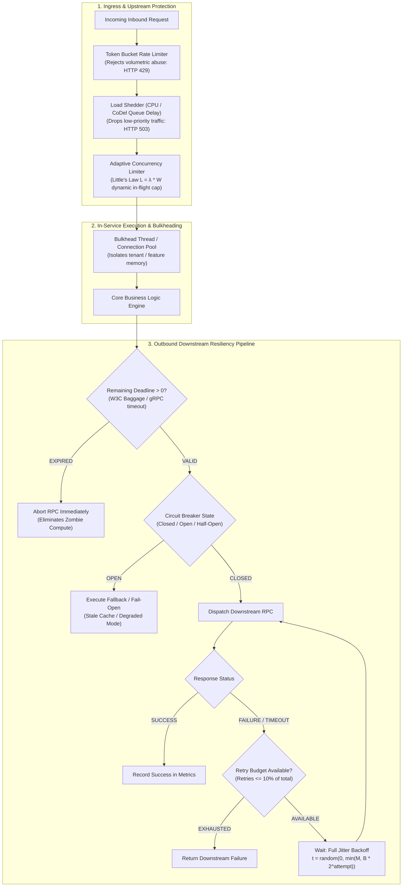
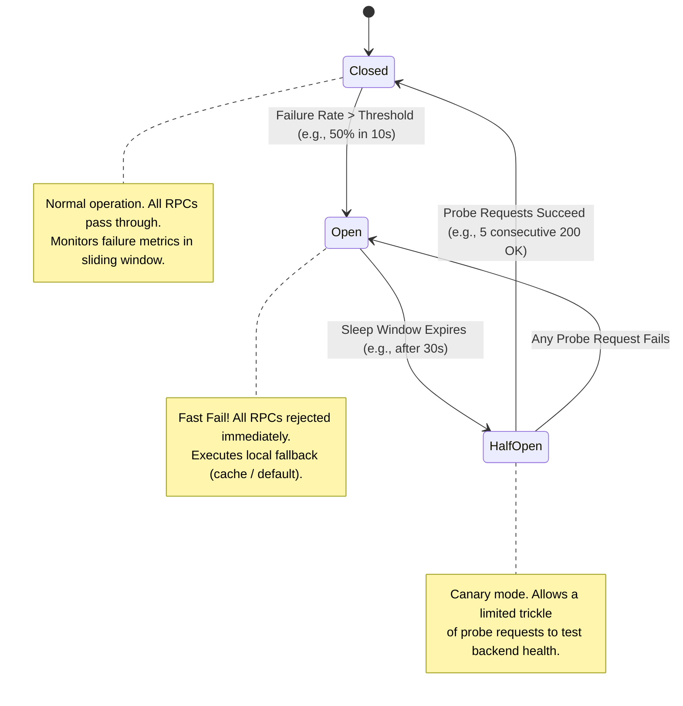
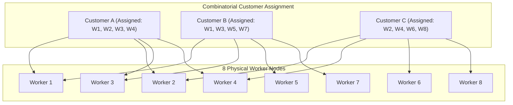

# Layer 12: Distributed Failure Modes, Resiliency & Fault Isolation Playbook

> **The System Design Interview Lens:** In Staff and Principal (L6/L7+) interviews, the system is guaranteed to fail. Mid-level engineers draw architectures assuming happy paths and mention *"I will add retries and circuit breakers."* Staff and Principal engineers treat failure as a **continuous physical reality (Pillar 4: Operational Mindset & Pillar 3: Problem Solving)**: they calculate **retry amplification factors**, design **deadline context propagation** to eliminate zombie compute, enforce **client-side retry budgets and full-jitter backoff**, implement **adaptive concurrency limits (Little's Law)** to prevent server death spirals, and mathematically isolate blast radiuses using **cell-based architecture and combinatorial Shuffle Sharding**.

---

## 1. 60-Second Interview Decision Matrix & Flowchart

### The Master Resiliency & Fault Isolation Decision Matrix

| Failure Mode / Threat | Primary Architectural Defense | Alternative / Secondary Defense | Never Choose in Production | Decisive Mechanical Reason |
| :--- | :--- | :--- | :--- | :--- |
| **Cascading Failure (Load Shift)** | **Upstream Load Shedding & Adaptive Concurrency Limits** | Horizontal Autoscaling with Pre-warming | Naive Autoscaling alone without limits | When nodes crash, shifting $100\%$ load to remaining nodes causes serial crashes. Autoscaling takes 3–5 minutes—too slow to stop sub-second cascading collapses. |
| **Downstream Latency Spike** | **Deadlines / Context Propagation (`grpc-timeout`)** | Client-side Circuit Breaker (Hystrix/Resilience4j) | Indefinite synchronous blocking timeouts | Without propagated deadlines, upstream servers continue holding sockets and burning thread pools for requests whose client has already abandoned/timed out. |
| **Retry Storms & Amplification** | **Exponential Backoff + Full Jitter & Retry Budgets ($\le 10\%$)** | Dead Letter Queues (DLQ) with exponential delay | Blind immediate retries ($N$ attempts) | Retrying immediately multiplies load during an outage by $3\times$ to $27\times$. Full Jitter flattens concurrency spikes, and Retry Budgets hard-cap retry volume. |
| **Cache Stampede / Thundering Herd** | **Mutex Locking (SingleFlight) & Probabilistic Early Expiration (XFetch)** | Pre-computed cache warming cron | Storing raw keys with identical static TTLs | When a hot key expires, thousands of concurrent threads query the database simultaneously, crushing connection pools. |
| **Noisy Neighbor / Poison-Pill Attack** | **Shuffle Sharding (Combinatorial assignment)** | Cell-Based Architecture (Silos) | Shared flat multi-tenant worker pool | A poison-pill request crashes a shared worker fleet completely ($100\%$ blast radius). Shuffle sharding reduces collision probability to $\frac{1}{\binom{N}{k}}$. |
| **Dependency Outage** | **Fail-Open with Stale Cache or Fallback Default** | Fail-Closed (Hard rejection) | Blocking until dependency recovers | For non-critical paths (recommendations, analytics), serving degraded/cached data preserves core checkout/write flows. |

---

### Resiliency Defense Pipeline Flowchart (The Multi-Tier Shield)



---

## 2. Mechanical First Principles of Distributed Failures

Grounded in Roberto Vitillo’s *Understanding Distributed Systems* (Part IV: Resiliency):

### 2.1 The Distributed System Fallacies & Partial Failures
In a single-process application, when an error occurs, the process throws an exception or crashes completely (all-or-nothing). In a distributed system:
* **The Network is Unreliable:** Packets can be dropped, delayed, duplicated, or reordered.
* **Partial Failure is the Default State:** Components fail independently. Service A can run at $100\%$ capacity while Service B is down, and the network between them is functioning at $10\%$ bandwidth.
* **Failure Modes Taxonomy:**
  1. **Crash-Stop:** A node crashes and permanently halts execution.
  2. **Crash-Recovery:** A node crashes, restarts, recovers its state from disk/WAL, and rejoins the cluster.
  3. **Omission Faults:** A node fails to receive an incoming message or fails to send an outbound message (buffer overflows, packet drops).
  4. **Timing Faults:** A node responds, but responds too late (GC pauses, thread contention, disk paging). **In distributed systems, a slow response is far more dangerous than an immediate crash.**

---

## 3. Catastrophic Failure Modes: Anatomy & Mechanics

### 3.1 Cascading Failures (The Positive Feedback Loop)
A cascading failure is an outage that progressively worsens over time due to positive feedback loops:
1. **Initial Trigger:** A sudden traffic spike or network blip causes 2 nodes out of a 10-node cluster to run out of memory (OOM) or miss heartbeats.
2. **Traffic Redistribution:** The load balancer detects 2 dead nodes and removes them. The remaining 8 nodes now absorb **$125\%$ of their normal traffic**.
3. **Queue Buildup:** The 8 surviving nodes queue requests. Latency spikes from $20\text{ms}$ to $2{,}000\text{ms}$. In-flight connections exhaust OS file descriptors and socket buffers.
4. **Complete Collapse:** The surviving nodes fail health checks and crash one by one in rapid succession, resulting in a **$100\%$ cluster outage**.

### 3.2 Retry Storms & Retry Amplification
When downstream latency increases, upstream clients time out and immediately retry.
* **The Amplification Multiplier:** In a multi-tier microservice architecture ($A \to B \to C \to D$):
  If each layer configures $3$ retries upon failure:
  $$\text{Maximum Amplified Requests on D} = 3 \times 3 \times 3 = 27\text{ requests per user action}$$
* **Result:** A transient 100ms database blip turns into an overwhelming $27\times$ load flood that permanently prevents the database from recovering.

```
Client (User)
  │
  ├── Request 1 ────────────────────────► Service A (times out after 500ms)
  │                                         │
  │   ┌── Attempt 1 ────────────────────────┤
  │   │                                     ▼
  │   │                                   Service B (times out after 400ms)
  │   │                                     │
  │   │                                     ├── Attempt 1 ──► Service C (times out)
  │   │                                     ├── Attempt 2 ──► Service C (times out)
  │   │                                     └── Attempt 3 ──► Service C (times out)
  │   ├── Attempt 2 ────────────────────────┤
  │   │                                     ▼
  │   │                                   Service B (Retry wave 2)
  │   │                                     └── 3 more requests to Service C
  │   └── Attempt 3 ────────────────────────┤
  │                                         ▼
  │                                       Service B (Retry wave 3)
  │                                         └── 3 more requests to Service C
  ▼
Total requests hitting backend: 1 * 3 * 3 = 9x to 27x amplification!
```

---

## 4. Downstream Resiliency Patterns (Client-Side Protection)

### 4.1 Timeouts & Context Deadlines (Eliminating Zombie Compute)
* **The Problem:** Setting static timeouts at each layer (e.g., Client=5s, Service A=4s, Service B=3s, Service C=2s) creates **zombie requests**. If Service A times out after 4s, Service C may continue executing an expensive database query for another 2s even though the upstream client has already terminated the connection!
* **The Solution — Deadline Context Propagation:**
  * When an edge request enters the system, an absolute deadline timestamp is attached:
    $$\text{Deadline} = \text{Current Time} + \text{Overall Timeout (e.g., } 1{,}000\text{ms)}$$
  * This deadline is propagated across every HTTP header (`Request-Timeout`) and gRPC metadata (`grpc-timeout`).
  * **The Invariant:** Before invoking any downstream RPC or database query, the service checks:
    $$\text{Remaining Time} = \text{Deadline} - \text{Current Time}$$
    If $\text{Remaining Time} \le 0$ (or $< \text{network round-trip estimate}$), the service **aborts immediately** without issuing the outbound RPC.

### 4.2 Exponential Backoff with Full Jitter
When retrying failed operations, naive fixed intervals (e.g., retry every 100ms) cause **synchronized retry pulses** where thousands of clients slam the server simultaneously.

* **Exponential Backoff Formula:**
  $$\text{Backoff}(i) = \min(M, B \times 2^i)$$
  Where $B$ is the base delay (e.g., $100\text{ms}$), $M$ is the maximum cap (e.g., $5{,}000\text{ms}$), and $i$ is the retry attempt.
* **The Three Jitter Algorithms (AWS Research):**
  1. *No Jitter:* $t = \text{Backoff}(i)$ (Synchronous spikes; terrible).
  2. *Equal Jitter:* $t = \frac{\text{Backoff}(i)}{2} + \text{random}\left(0, \frac{\text{Backoff}(i)}{2}\right)$ (Spreads load but retains a synchronized lower bound).
  3. **Full Jitter (Production Standard):**
     $$t = \text{random}(0, \text{Backoff}(i))$$
* **Mechanical Advantage:** Full Jitter completely flattens the concurrency distribution curve, reducing peak server contention to the lowest possible mathematical minimum.

### 4.3 Retry Budgets (Hard-Capping Retries)
Never permit unlimited retries. A microservice client must maintain an in-memory **Token Bucket for Retries**:
* **Rule:** A client service is only allowed to retry if retries account for **$\le 10\%$ of its total outbound request volume** over a rolling 60-second window.
* **Mechanism:** 
  * Every regular request adds $0.1$ tokens to the bucket.
  * Every retry consumes $1.0$ token from the bucket.
  * If the bucket is empty, **retries are forbidden**, and the client fails fast immediately. This prevents healthy clients from attacking a degrading dependency.

### 4.4 The Circuit Breaker Pattern



---

## 5. Upstream Resiliency Patterns (Server-Side Protection)

### 5.1 Load Shedding (Dropping Work to Stay Alive)
When incoming traffic exceeds maximum server throughput, queuing requests causes response times to skyrocket past client timeouts.
* **First Principle:** **It is better to serve 80% of traffic with low latency and drop 20% immediately (HTTP 503) than to attempt serving 100% and fail all of them due to timeouts.**
* **Load Shedding Signals:**
  1. **CPU / Memory Thresholds:** Reject requests when CPU $>90\%$.
  2. **Queue Delay (CoDel Algorithm):** Measure how long a request sits in the thread pool queue before a worker thread picks it up. If queue wait time $>50\text{ms}$, drop the request immediately without processing.

### 5.2 Adaptive Concurrency Limits & Little's Law
Static hardcoded concurrency limits (e.g., "max 200 threads") fail in production because ideal concurrency depends on downstream latency:

$$\text{Little's Law: } L = \lambda \times W$$
$$\text{In-Flight Concurrency } (L) = \text{Throughput } (\lambda) \times \text{Latency } (W)$$

* **The Problem:** If downstream latency spikes from $10\text{ms}$ to $500\text{ms}$ ($50\times$), keeping throughput constant requires $50\times$ more concurrent in-flight requests, exhausting RAM and socket pools.
* **The Solution — Adaptive Concurrency Limits (TCP Vegas / Netflix Gradient Algorithm):**
  The server dynamically adjusts its allowed in-flight concurrency window ($L$) based on observed round-trip latency (RTT):
  $$\text{Gradient} = \frac{\text{RTT}_{\text{baseline}}}{\text{RTT}_{\text{actual}}}$$
  $$\text{Limit}_{t+1} = \text{Limit}_t \times \text{Gradient} + \text{Headroom}$$
  * When latency is low (healthy), the limit expands.
  * When latency spikes (congestion/degradation), the limit **automatically contracts**, throttling in-flight concurrency before the server runs out of memory.

### 5.3 Fail-Open vs Fail-Closed Strategy

| Architecture Domain | Failure Policy | Fallback Behavior | Decisive Rationale |
| :--- | :--- | :--- | :--- |
| **Authentication & Authorization** | **Fail-Closed** | Reject request (HTTP 401/403) | Security invariant: A failure in auth must never grant unauthorized access. |
| **Financial Ledger / Payments** | **Fail-Closed** | Abort transaction with 500 / Retry later | Correctness invariant: Money must never be double-debited or credited blindly. |
| **Product Recommendations** | **Fail-Open** | Return static popular items or empty array | User experience: Missing recommendations does not prevent the user from buying. |
| **Search Autocomplete** | **Fail-Open** | Return local cached prefixes or empty list | Non-critical path: Better to let user type manually than block keystrokes. |
| **Rate Limiter Outage** | **Fail-Open** | Allow request through (bypass rate limiter) | Availability invariant: A failure in Redis must not take down the entire business. |

---

## 6. Architectural Fault Isolation & Blast Radius Reduction

### 6.1 Bulkheads (Resource Partitioning)
Named after watertight compartments in ships: if one compartment floods, the ship remains afloat.
* **Process-Level Bulkheads:** Running separate worker pools for different customer tiers (e.g., Free Tier vs Enterprise VIPs). A runaway script by a free-tier user cannot starve enterprise CPU.
* **Thread Pool Bulkheads:** In a gateway calling 5 backend services, assign dedicated thread pools (e.g., 20 threads for Service A, 10 for Service B). If Service B hangs, only its 10 threads block; Service A continues processing.

### 6.2 Cell-Based Architecture (Swimlanes)
* Partition the entire software stack (gateways, compute, caches, databases) into independent, isolated units called **Cells**.
* Each cell handles a fraction of the total user base (e.g., Cell 1 = Users 1–1M, Cell 2 = Users 1M–2M).
* **Blast Radius Invariant:** A fatal deployment bug, database corruption, or poison-pill query is completely contained within **a single cell** (affecting only $\frac{1}{\text{Total Cells}}$ of users), leaving the rest of the company fully operational.

### 6.3 Combinatorial Shuffle Sharding (The AWS Route 53 Math)

```
Traditional Sharding (Siloed):
8 Workers. 8 Customers. 1 Customer per Worker.
If Customer A sends a poison-pill request -> Worker 1 crashes. (Impact: 1 customer down).
If 8 Customers are randomly hashed across all 8 workers:
Poison pill crashes ALL 8 Workers! (Impact: 100% of customers down!).

Shuffle Sharding (Combinatorial):
8 Workers. Each Customer assigned an isolated combination of 4 Workers.
Total Unique Virtual Shards = 8! / (4! * 4!) = 70 Shards!
```



#### The Combinatorial Mathematics:
* Given $N$ physical workers, we assign each customer a virtual shard consisting of $k$ distinct workers.
* The number of unique virtual shards is:
  $$\text{Capacity} = \binom{N}{k} = \frac{N!}{k!(N - k)!}$$
* **The Blast Radius Calculation:**
  Assume Customer A sends a poison-pill request that permanently crashes all $k$ workers in its shard (e.g., $W_1, W_2, W_3, W_4$).
  * Any customer assigned a different combination (like Customer B on $W_1, W_3, W_5, W_7$) still has **2 healthy workers** ($W_5, W_7$) available to process requests!
  * The only way another customer suffers a complete outage is if they share the **exact same combination of $k$ workers**.
  * The probability of another tenant experiencing an outage is:
    $$\text{Probability of Complete Failure} = \frac{1}{\binom{N}{k}}$$
  * With $N = 8$ and $k = 4$, $\binom{8}{4} = 70$. The probability of a collision causing downtime is only **$\frac{1}{70} \approx 1.43\%$**!

---

## 7. The 7 Deadly Resiliency Sins in System Design Interviews

| Mistake / Anti-Pattern | Why It Fails in Production | Staff / Principal Remediation |
| :--- | :--- | :--- |
| **1. Unbounded Synchronous Retries** | Retrying immediately upon failure multiplies traffic during an outage, turning minor slowdowns into permanent collapse. | Implement **Exponential Backoff with Full Jitter** and enforce a strict **Retry Budget ($\le 10\%$)**. |
| **2. Static Timeouts Without Deadlines** | Setting independent timeouts at each layer results in zombie processing when upstream clients have already disconnected. | Propagate absolute **Deadlines** across all RPC boundaries; check remaining deadline before issuing child RPCs. |
| **3. Autoscaling as the Only Defense** | Kubernetes pod autoscaling takes 3–7 minutes to spin up new pods; cascading failures take down clusters in seconds. | Implement immediate in-process **Load Shedding** and **Adaptive Concurrency Limits**; never rely solely on reactive autoscaling. |
| **4. Flat Shared Multi-Tenant Workers** | Running all tenants on a single shared worker pool allows one malicious or misconfigured tenant to crash the entire fleet. | Implement **Shuffle Sharding** or **Cell-Based Architecture** to mathematically isolate poison-pill blast radius. |
| **5. Blind Fail-Open on Security Paths** | Falling open on authentication or billing outages allows free unauthorized access or corrupts financial books. | Enforce strict **Fail-Closed** policies for security and ledgers; restrict **Fail-Open** exclusively to non-critical display paths. |
| **6. Hardcoded Concurrency Limits** | Fixed thread limits cause massive queueing when downstream latency increases according to Little's Law ($L = \lambda W$). | Use **Adaptive Concurrency Limits** (Vegas/Gradient algorithms) that shrink allowed concurrency when latency rises. |
| **7. Synchronous Cache Miss Stamps** | Relying on simple cache gets without locking causes thousands of concurrent cache misses to slam the DB at expiration. | Use **SingleFlight / Mutex Locking** to ensure only one thread queries the DB while others wait, or use **XFetch probabilistic refreshing**. |

---

## 8. The Interview Defense Playbook (Formulas & Candidate Scripts)

When the interviewer asks: *"Downstream Service X latency increases from 10ms to 2000ms. What happens to your system, and how do you protect it?"*

### The 4-Step Staff Justification Formula:

1. **Step 1: Diagnose the Mechanical Bottleneck (Little's Law)**
   > *"If Service X's latency spikes from $10\text{ms}$ to $2{,}000\text{ms}$ ($200\times$), Little's Law ($L = \lambda W$) dictates that maintaining our current throughput would require a $200\times$ increase in concurrent in-flight connections. Without protection, our service's thread pool and connection buffers will exhaust in seconds, causing our own service to crash and triggering a cascading failure upstream."*

2. **Step 2: Enforce Downstream Protection (Deadlines & Circuit Breakers)**
   > *"To stop this immediately, we implement two downstream defenses:
   > 1. **Deadline Propagation:** We propagate an absolute deadline header across all RPCs. If the remaining deadline drops below our estimated round-trip time, we abort the call immediately without dispatching it.
   > 2. **Circuit Breaking:** We wrap the client in a Circuit Breaker. If the error or timeout rate exceeds $50\%$ over a 10-second rolling window, the breaker trips to OPEN. All subsequent requests fail fast in $<1\mu\text{s}$ without consuming network sockets, invoking our local cached fallback."*

3. **Step 3: Guard Upstream Ingress (Adaptive Concurrency & Load Shedding)**
   > *"On our own server side, we don't rely on static thread limits. We deploy an **Adaptive Concurrency Limiter** using the Vegas gradient algorithm. As observed latency increases, the algorithm automatically shrinks our allowed in-flight concurrency window, shedding lower-priority requests with HTTP 503 Service Unavailable (with a `Retry-After` header) to preserve our core processing health."*

4. **Step 4: Constrain Blast Radius (Shuffle Sharding)**
   > *"Finally, to prevent a single downstream tenant from exhausting shared resources for everyone, our worker pool is partitioned using **Shuffle Sharding**. Each tenant is assigned a virtual shard of $4$ nodes out of an $8$-node cluster. Even if a tenant's requests completely saturate their $4$ assigned nodes, any other tenant shares at most a fraction of those nodes, reducing the probability of a total tenant outage to $\frac{1}{\binom{8}{4}} = \frac{1}{70} \approx 1.4\%$."*

---

## 9. System Design Mapping: Where to Apply This Playbook

| System Design Chapter | Direct Failure Modes & Resiliency Application |
| :--- | :--- |
| **[Chapter 04: Rate Limiter](file:///Users/abhinnaagarwal/Documents/system-design-notes/04.%20Rate%20Limiter/Readme.md)** | Designing fail-open behavior when Redis becomes unreachable to prevent the rate limiter from causing an outage. |
| **[Chapter 06: Key-Value Store](file:///Users/abhinnaagarwal/Documents/system-design-notes/06.%20Key-Value%20Store/Readme.md)** | Quorum math ($R + W > N$), handling split-brain via Sloppy Quorums and Hinted Handoff during network partitions. |
| **[Chapter 08: URL Shortener](file:///Users/abhinnaagarwal/Documents/system-design-notes/08.%20URL%20Shortener/Readme.md)** | SingleFlight cache mutexes to prevent thundering herd when a celebrity shortened link expires. |
| **[Chapter 10: Notification System](file:///Users/abhinnaagarwal/Documents/system-design-notes/10.%20Notification%20System/Readme.md)** | Exponential backoff with full jitter and Dead Letter Queues (DLQ) when third-party APNs/FCM servers return HTTP 429/503. |
| **[Chapter 12: Chat System](file:///Users/abhinnaagarwal/Documents/system-design-notes/12.%20Chat%20System/Readme.md)** | Managing reconnect storms when a WebSocket gateway crashes; using randomized client reconnection jitter to prevent gateway collapse. |
| **[Chapter 26: Payment System](file:///Users/abhinnaagarwal/Documents/system-design-notes/26.%20Payment%20System/Readme.md)** | Strict fail-closed semantics on PSP failures; idempotency keys and retry budgets to prevent double charges during timeouts. |
| **[Chapter 28: Stock Exchange](file:///Users/abhinnaagarwal/Documents/system-design-notes/28.%20Stock%20Exchange/Readme.md)** | LMAX Disruptor ring buffers as physical bulkheads, isolating matching engines from network I/O jitter. |
