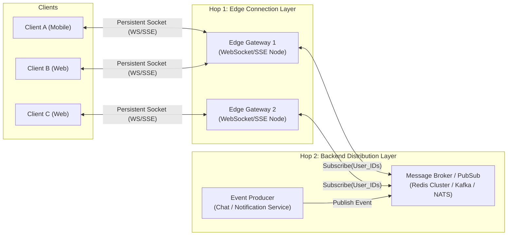

# Pattern 01: Real-Time Updates

> **Delivery contract:** Sequence/event IDs, reconnect cursors, retained replay history and duplicate handling let clients recover after disconnects.

> **The System Design Interview Lens:** In high-concurrency systems, standard HTTP request-response breaks down when the server needs to push live events to clients. A Staff-level answer does not simply jump to WebSockets for everything—it separates client delivery (**Hop 1**) from backend fanout (**Hop 2**), justifies transport protocols based on directionality and state, grounds decisions in network transport physics (TCP/IP vs UDP vs HTTP/2/3), and protects infrastructure against thundering herd reconnects.

---

## 1. 60-Second Interview Decision Matrix

| Dimension | Short Polling | Long Polling | Server-Sent Events (SSE) | WebSockets | WebRTC |
| :--- | :--- | :--- | :--- | :--- | :--- |
| **Directionality** | Unidirectional (`Client -> Server`) | Unidirectional (`Server -> Client`) | Unidirectional (`Server -> Client`) | **Bidirectional** (Full-Duplex) | **Peer-to-Peer** (Mesh/SFU) |
| **Underlying Protocol** | Standard HTTP/1.1 or HTTP/2 | Standard HTTP/1.1 or HTTP/2 | HTTP/1.1 or HTTP/2 (Chunked Transfer) | WS / WSS (TCP Socket Upgrade) | UDP (via RTP/SRTP + SCTP) |
| **Connection State** | Stateless | Ephemeral Stateful | Persistent Stateful | **Persistent Stateful** | Stateful Peer Connection |
| **Infrastructure Overhead** | High (constant TCP/TLS handshakes) | Moderate (reconnect on each message) | Low (single persistent HTTP pipe) | High (stateful connection gateways) | Complex (STUN / TURN / ICE) |
| **Reconnection Support** | Native (Client loop) | Native (Client loop) | **Built-in Browser Auto-Reconnect** | Manual client handling required | Manual signaling re-negotiation |
| **Firewall / Proxy Friendly** | 100% | 100% | 100% (Standard HTTP port 80/443) | Can be blocked by enterprise L7 proxies | Requires UDP hole-punching |
| **Head-of-Line Blocking** | N/A (Independent requests) | Per-request TCP HoL | **None across streams on HTTP/2** | **Full TCP HoL** (1 dropped packet stalls all) | **None** (UDP datagrams) |
| **Best Use Case** | Infrequent updates (>30s), simple MVP | Fallback for legacy clients without SSE/WS | **Live feeds, notifications, sports scores, ChatGPT text stream** | **Chat apps (WhatsApp), collaborative docs (Docs), live games** | **1-on-1 video/audio calls, low-latency live streaming** |

---

## 2. Network Transport Physics (The Donne Martin Foundation)

To evaluate real-time choices with Staff-level depth, ground your trade-offs in the underlying transport layer:

### A. TCP vs. UDP Mechanics
* **TCP (Transmission Control Protocol):** Connection-oriented. Requires a 3-way handshake (`SYN -> SYN-ACK -> ACK`) plus TLS 1.3 negotiation before any byte of payload is transmitted. Guarantees in-order, reliable delivery via sequence numbers and ACK packets.
  * *The Trap (Head-of-Line Blocking):* If packet #3 drops in transit, TCP buffers packets #4, #5, and #6 in the OS kernel until packet #3 is retransmitted. **Both WebSockets and SSE over TCP suffer from TCP Head-of-Line blocking.**
* **UDP (User Datagram Protocol):** Connectionless, lightweight datagrams. Zero handshake overhead, zero guaranteed ordering, zero retransmission delay. Used by WebRTC (RTP/SRTP for voice/video and SCTP for data channels) where real-time timeliness matters more than 100% packet arrival.

### B. HTTP/1.1 vs. HTTP/2 vs. HTTP/3 for Real-Time Streaming
* **HTTP/1.1:** Browsers enforce a hard limit of **6 concurrent TCP connections per domain**. If a client opens an SSE connection in one tab, it consumes 1 of the 6 available connections for the entire website.
* **HTTP/2 (Multiplexing & HPACK):** Solves the connection limit by multiplexing hundreds of logical bidirectional streams over a **single shared TCP connection**. Reduces repetitive HTTP header overhead from ~800 bytes down to ~20 bytes via HPACK compression. SSE running over HTTP/2 eliminates socket bloat.
* **HTTP/3 (QUIC over UDP):** Replaces TCP with QUIC. Solves TCP Head-of-Line blocking entirely: packet loss on one stream does not pause or block parallel streams.

---

## 3. Reverse Proxy & Socket Optimization (Nginx / HAProxy / Envoy)

Holding millions of open concurrent sockets requires tuning the Linux kernel and reverse proxy layer:
1. **File Descriptor Limits:** In Linux, "everything is a file". Each open socket consumes one file descriptor:
   ```bash
   # /etc/security/limits.conf
   * soft nofile 1048576
   * hard nofile 1048576
   ```
2. **I/O Multiplexing (Epoll):** Never use thread-per-connection architectures (classic Apache `prefork`), which consume 2MB–8MB of RAM stack space per thread (100,000 threads $= 200\text{GB–}800\text{GB}$ of RAM!). Use event-driven, non-blocking I/O engines (**Nginx, Envoy, Node.js, Go Netpoll, Rust Tokio**) backed by Linux `epoll` or FreeBSD `kqueue`. A single machine can easily maintain 1,000,000 idle sockets in just 2GB–3GB of memory.
3. **Zombie Socket Pruning (TCP Keep-Alive vs. App Pings):** Mobile devices frequently drop connections without sending a TCP `FIN` packet (e.g., entering an elevator or tunnel).
   * OS TCP Keep-Alive takes up to 2 hours by default to detect a dead socket!
   * Enforce **Application-Level Heartbeats (Ping/Pong frames)** every 30–60 seconds. If a client misses 2 consecutive pings, the gateway forcibly terminates the socket and frees resources.

---

## 4. The "Two Hops" Architecture

Real-time architectures consist of two completely distinct scaling problems:
1. **Hop 1 (Client Delivery):** Maintaining persistent connections to millions of client devices.
2. **Hop 2 (Backend Routing & Fanout):** Ingesting an event on a backend service and efficiently routing it to the exact connection servers holding the target recipients' sockets.



---

## 3. Hop 1: Deep Dive into Client-Server Protocols

### A. Short Polling (The Baseline)
* **Mechanism:** Client sends a standard `GET /events` every $N$ seconds.
* **Why it Fails at Scale:** If 10 million users poll every 2 seconds, the backend must process **5 million QPS**, even if 99.9% of requests return empty responses (`304 Not Modified` or `[]`). Each poll incurs TCP handshake, TLS negotiation, and HTTP header overhead (500–1,000 bytes per request).

### B. Long Polling (The Legacy Compromise)
* **Mechanism:** Client sends `GET /events`. The server holds the request open until an event arrives or a timeout (e.g., 30s) occurs. As soon as the client receives data or hits a timeout, it immediately opens a new long-poll request.
* **When to Mention in Interviews:** Mention strictly as a **backward-compatibility fallback** when connecting across restrictive corporate HTTP proxies that terminate persistent non-standard connections.

### C. Server-Sent Events (SSE) — The Interview Secret Weapon
* **Mechanism:** The client sends a standard HTTP GET with `Accept: text/event-stream`. The server leaves the connection open indefinitely and streams text payloads formatted with `data: ...\n\n`.
* **Mechanical Advantages:**
  1. Runs over standard HTTP/1.1 and multiplexes natively over HTTP/2.
  2. Bypasses restrictive firewalls and corporate proxies without custom port configuration.
  3. Browsers have native `EventSource` API with **automatic reconnection**, backoff, and `Last-Event-ID` tracking for lost messages.
  4. Massively reduced server resource consumption compared to WebSockets (simpler state machine, no bidirectional framing overhead).
* **The Directionality Trade-off:** SSE is strictly **unidirectional** (`Server -> Client`). When the client needs to talk back, it issues a standard HTTP `POST` or `PUT` request. For 90% of "real-time" interview prompts (e.g., Uber driver location to passenger, Stock ticker updates, Twitter notifications, AI LLM streaming), **SSE + HTTP POST is architecturally superior to WebSockets**.

```http
// Client Request
GET /live-feed HTTP/1.1
Host: api.example.com
Accept: text/event-stream

// Server Response
HTTP/1.1 200 OK
Content-Type: text/event-stream
Cache-Control: no-cache
Connection: keep-alive

id: 101
event: price-update
data: {"symbol": "AAPL", "price": 242.50}

id: 102
event: price-update
data: {"symbol": "GOOG", "price": 182.10}
```

### D. WebSockets (The Full-Duplex Champion)
* **Mechanism:** Starts as an HTTP connection with an `Upgrade: websocket` header. Once the HTTP 101 Switching Protocols handshake completes, the underlying TCP connection switches to a lightweight framed, full-duplex binary/text protocol.
* **When WebSockets is Mandatory:**
  1. High-frequency bidirectional data exchanges where HTTP request header overhead is intolerable (e.g., multiplayer gaming inputs, financial high-frequency order books).
  2. Collaborative real-time typing with character-by-character delta synchronization (e.g., Google Docs operational transformation).
  3. High-throughput two-way chat rooms.
* **The Operational Cost:** WebSockets are **stateful TCP connections**. Standard L7 load balancers cannot balance individual messages across backend workers; they can only balance initial connections. If a gateway node holding 100,000 connections crashes, all 100,000 clients disconnect simultaneously.

---

## 4. Hop 2: Backend Distribution & Fanout Strategies

When User A publishes a message intended for User B, how does the system locate which edge server holds User B's active connection?

### Strategy 1: Pub/Sub Broker (Redis Cluster / NATS / Kafka)
* **Architecture:** 
  1. When a user connects to Gateway Node 1, Node 1 subscribes to that user's channel: `SUBSCRIBE user:<user_id>`.
  2. When an event occurs, the Producer publishes to the channel: `PUBLISH user:<user_id> <payload>`.
  3. The Pub/Sub layer routes the message directly to Gateway Node 1, which pushes it down the persistent socket.
* **Pros:** Completely decouples application services from edge gateway nodes.
* **Cons:** Redis Pub/Sub does not guarantee message durability. If Gateway Node 1 drops during delivery, the message is lost unless paired with a durable log (e.g., Redis Streams or Kafka).

### Strategy 2: Session Registry + RPC (Stateful Tracking)
* **Architecture:**
  1. A central distributed key-value store (Redis / DynamoDB) stores the active mapping: `user_id -> gateway_server_ip`.
  2. When the backend service has an event for `user_id`, it looks up `gateway_server_ip` and makes a fast direct gRPC call: `GatewayServer.PushToUser(user_id, payload)`.
* **Pros:** Highly targeted; eliminates pub/sub fanout chatter across unrelated gateway nodes.
* **Cons:** Requires strict heartbeat mechanisms to purge stale session mappings when edge gateways crash abruptly.

### Strategy 3: Consistent Hashing Ring (Collocated State)
* **Architecture:** Route persistent connections to gateway nodes using a consistent hash of the entity ID (e.g., `hash(document_id) -> Node 3` or `hash(chat_room_id) -> Node 5`).
* **Why it's Crucial:** Used in collaborative document editing (Google Docs). By routing all users viewing `doc_123` to the exact same server instance, the server maintains the document AST and Operational Transformation (OT) state locally in RAM without distributed lock overhead.

---

## 5. Critical Edge Traps & Interview Deep Dives

### Deep Dive 1: The Reconnection Storm (Thundering Herd)
* **The Failure Mode:** When an edge gateway node restarts or a network partition heals, tens of thousands of client connections reconnect simultaneously, overwhelming TLS termination proxies and backend databases.
* **The Solution:**
  1. **Exponential Backoff with Full Jitter:**

     $$
     \text{Sleep} = \text{random}(0, \, \min(M, \, B \times 2^{\text{attempt}}))
     $$

     Adding random jitter desynchronizes clients and spreads the reconnect wave across seconds.
  2. **Rate Limiting at Ingress / API Gateway:** Enforce token-bucket limits on connection establishment rates per second.

### Deep Dive 2: The "Celebrity" Broadcast Problem
* **The Failure Mode:** A celebrity with 10 million followers starts a live broadcast or posts a comment. Broadcasting 1 message to 10 million sockets simultaneously from a single server will saturate CPU and network interface cards (NIC egress bandwidth).
* **The Solution (Hierarchical Fanout Trees):**
  * Do not fan out from a single point.
  * Root producer sends to regional message brokers $\to$ regional brokers publish to edge gateway clusters $\to$ gateways push to local sockets.
  * For passive viewers on live streams, drop individual WebSockets and switch to **HTTP Chunked Streaming or SSE with Edge CDN caching**.

### Deep Dive 3: Message Ordering & Delivery Guarantees
* **The Failure Mode:** Messages sent over distributed edge nodes arrive out of order or get dropped during network reconnects.
* **The Solution:**
  1. **Monotonic Sequence Numbers:** The producer assigns a per-conversation or per-channel incrementing `seq_id`.
  2. **Client Buffer & Ack:** The client buffers incoming messages and renders them sorted by `seq_id`.
  3. **Catch-up Sync API:** Upon reconnecting via SSE/WS, the client passes `last_delivered_seq_id`. The server queries the durable message store for all records where `seq_id > last_delivered_seq_id` and streams the delta before resuming live updates.

---

## 6. Interview Checklist: What to Say Under Pressure

```
1. "Before picking a protocol, let's clarify directionality: does the client need to send frequent live data back over this connection, or is this primarily server-to-client push?"
2. "If it's server-to-client (e.g., notifications, live scores), I will use Server-Sent Events (SSE). It gives us persistent push over standard HTTP/2, native browser reconnects, and avoids custom WebSocket connection management."
3. "If it requires bidirectional low-latency interactions (e.g., chat, collaborative docs), I'll use WebSockets."
4. "Now for Hop 2 (backend fanout): I will decouple the edge gateway servers using a distributed Redis Pub/Sub cluster or Kafka topic. Gateway servers subscribe only to the active user channels they host."
5. "To handle edge node crashes and reconnect storms, clients will implement exponential backoff with full jitter, and synchronize missing messages using a sequence ID catch-up API."
```
