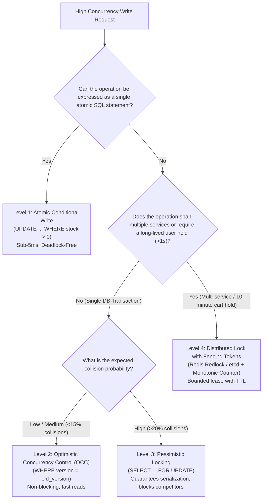
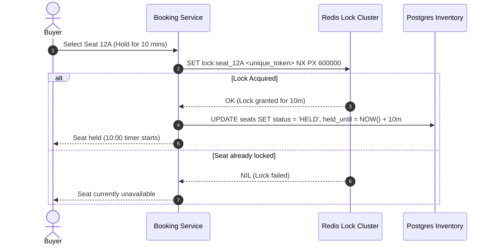
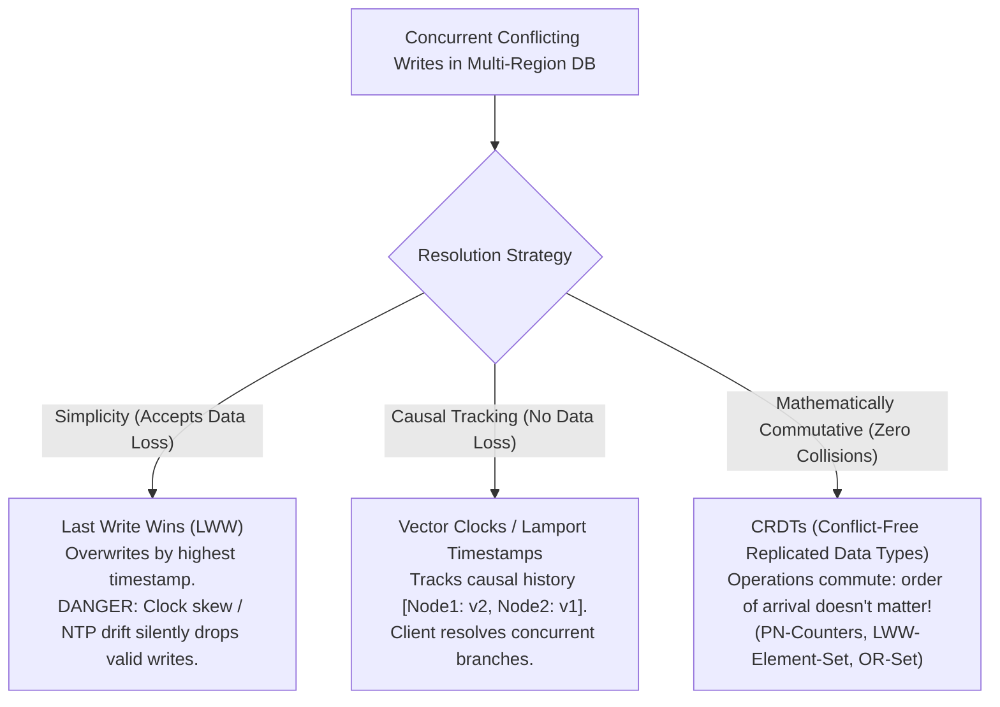

# Pattern 02: Dealing with Contention

> **Concurrency contract:** Conditional mutations serialize updates; affected-row counts identify successful transitions. Row locks last through transaction end, and leased owners use fencing at the protected resource.

> **The System Design Interview Lens:** Contention occurs when multiple concurrent requests attempt to mutate the exact same finite resource at the exact same millisecond (e.g., the last concert ticket on Ticketmaster, inventory in a flash sale, hotel room booking, or bidding in an online auction). A Staff engineer does not jump to heavy distributed locks (Redis Redlock) for a simple database counter; they escalate through an architectural hierarchy of concurrency primitives, evaluate collision probability, and handle hot-spot database lock contention.

---

## 1. 60-Second Interview Decision Matrix

| Mechanism | Concurrency Model | Best Contention Level | Lock Scope | Performance / Latency | Primary Risk / Failure Mode | Best Use Case |
| :--- | :--- | :--- | :--- | :--- | :--- | :--- |
| **Atomic Conditional Writes** | Implicit Database Row Lock | High | Single row in single DB | **Sub-5ms** (Hardware serialized) | None (Deadlock-free if single statement) | Inventory decrement (`stock = stock - 1 WHERE stock > 0`), balance check |
| **Optimistic Concurrency Control (OCC)** | Non-blocking Check & Set (CAS) | **Low to Medium** (<15% collision rate) | Memory version check until commit | Fast on read; retries on conflict | **Retry storm** under high contention (CPU waste) | Collaborative document edits, user profile updates, shopping cart changes |
| **Pessimistic Locking (`SELECT FOR UPDATE`)** | Blocking Exclusive Lock | **High** (>20% collision rate) | Database table row until transaction commit | High latency (threads block and wait) | **Deadlocks**, thread pool starvation, connection pool exhaustion | Seat reservations, flight bookings, financial ledger reconciliation |
| **Distributed Locks (Redis/Redlock, etcd)** | Distributed Lease with TTL | High | Spans multiple databases/microservices | Moderate (10–25ms network RTT) | **Split-brain**, GC pause / clock drift breaking lease, stale writes | 10-minute cart holds across multiple microservices (Ticketmaster) |
| **Partitioned Counters / Key Salting** | Parallelized Sharding | **Extreme** (>10k writes/sec on 1 key) | $N$ sub-counters | Blazing fast (spread across $N$ rows) | Eventual consistency during read aggregation | YouTube video view counts, live stream like buttons, viral post counters |

---

## 2. The Root Cause: The Read-Modify-Write Race Condition

The classic disaster scenario occurs when an application separates the *check* from the *update*:

```
Client Alice                       Database                        Client Bob
    |                                 |                                 |
    |---- 1. Read: available = 1 ---->|                                 |
    |                                 |<---- 2. Read: available = 1 ----|
    |                                 |                                 |
    |  [Local Check: 1 > 0 -> OK]     |     [Local Check: 1 > 0 -> OK]  |
    |                                 |                                 |
    |---- 3. Write: available = 0 --->|                                 |
    |    (Alice gets ticket)          |                                 |
    |                                 |<---- 4. Write: available = 0 ---|
    |                                 |     (Bob gets SAME ticket!)     |
    v                                 v                                 v
```

* **The Result:** Both cards are charged $500, two confirmation emails are sent for Seat 12A, and the company suffers reputational damage and customer support costs.

---

## 3. The 4-Tier Mitigation Hierarchy

Always propose solutions starting from the simplest, most mechanically resilient primitive before adding architectural complexity:



---

### Level 1: Atomic Conditional Writes (The Default Starting Point)
If you can push the condition down into the storage engine's update statement, the database serializes row execution in memory:

```sql
-- Atomic check and decrement in a single statement
UPDATE inventory 
SET available_count = available_count - 1 
WHERE item_id = 'CONCERT_101' AND available_count > 0;
```
* **How it works:** A conditional UPDATE atomically checks and modifies the row under the database's concurrency rules. Short-lived internal latches differ from transactional row locks: conflicting updates are typically serialized until transaction end (statement end in autocommit). Check affected rows; no row updated means the precondition did not hold.
* **Application logic:** Check the rows affected:
  * If `rows_affected == 1`: Success! Proceed to payment.
  * If `rows_affected == 0`: Sold out! Return clean out-of-stock response without rolling back a complex transaction.

---

### Level 2: Optimistic Concurrency Control (OCC)
OCC assumes conflicts are rare. It reads state without taking any locks, executes application logic, and only verifies that the data hasn't mutated when committing the write.

```sql
-- Step 1: Read without locking
SELECT id, price, status, version 
FROM hotel_rooms 
WHERE id = 'ROOM_404';

-- Step 2: Write with atomic version check
UPDATE hotel_rooms 
SET status = 'RESERVED', 
    guest_id = 'USER_ALICE', 
    version = version + 1 
WHERE id = 'ROOM_404' AND version = 3;
```

#### Handling Conflicts:
If Bob updated `ROOM_404` while Alice was computing, the version incremented to `4`. Alice's update affects `0` rows.
* **The Retry Loop with Backoff:** Alice's application layer catches the version mismatch, re-reads the fresh row, verifies if the room is still available, and retries.
* **The High-Contention Danger:** When 1,000 users compete for 1 item, OCC causes **999 transactions to fail and retry repeatedly**. This saturates the database CPU with wasted work. **Rule of thumb: Never use OCC for flash sales or high-contention inventory.**

---

### Level 3: Pessimistic Locking (`SELECT FOR UPDATE`)
When contention is high and retrying is expensive, lock the row upfront so other transactions queue up and wait:

```sql
BEGIN TRANSACTION;

-- Acquires an exclusive row-level lock; other transactions block here
SELECT id, available_seats 
FROM events 
WHERE id = 'EVENT_999' 
FOR UPDATE;

-- Application checks balance and updates
UPDATE events 
SET available_seats = available_seats - 1 
WHERE id = 'EVENT_999';

COMMIT; -- Lock is released here
```

#### Deadlock Prevention: Deterministic Ordering
If Transaction A tries to reserve Seat 1 then Seat 2, while Transaction B tries to reserve Seat 2 then Seat 1, both threads block each other, causing a database deadlock.
* **Staff Rule:** Always sort resource IDs deterministically before acquiring locks:
  ```python
  # Always lock in ascending sorted order
  seat_ids_to_lock = sorted(requested_seat_ids)
  for seat_id in seat_ids_to_lock:
      db.execute("SELECT * FROM seats WHERE id = %s FOR UPDATE", (seat_id,))
  ```

---

### Level 4: Distributed Locks for Long-Lived Holds
When a user selects seats on Ticketmaster, they need a **10-minute hold** to enter payment details. You cannot keep a database transaction open for 10 minutes (it would exhaust database connection pools and hold open table/row locks).



#### The Distributed Lock Split-Brain Hazard (Fencing Tokens)
What happens if a worker holding a lock undergoes a 60-second Garbage Collection (GC) pause?
1. Worker A acquires lock with a 30s TTL.
2. Worker A freezes in a GC pause for 45s.
3. Lock expires in Redis.
4. Worker B acquires the lock and updates the database.
5. Worker A wakes up and blindly executes its delayed write, corrupting Worker B's data!

* **The Fix (Martin Kleppmann's Fencing Tokens):** Every lock acquisition returns a strictly monotonically increasing token (`token = 101, 102, 103...`). The storage engine rejects any write carrying a fencing token lower than the latest committed token:
  ```sql
  UPDATE inventory 
  SET buyer_id = 'A', fencing_token = 101 
  WHERE item_id = 'SEAT_12' AND fencing_token < 101;
  ```

---

## 4. Database Isolation Levels & The "Write Skew" Anomaly

Even within a single relational database, picking the wrong transaction isolation level triggers silent contention corruptions:

| Isolation Level | Dirty Reads | Non-Repeatable Reads | Phantom Reads | Write Skew Anomaly | Primary Concurrency Mechanism |
| :--- | :---: | :---: | :---: | :---: | :--- |
| **Read Uncommitted** | Permitted | Permitted | Permitted | Permitted | No read locks; dangerous |
| **Read Committed** (Postgres default) | **Prevented** | Permitted | Permitted | Permitted | MVCC snapshot per query statement |
| **Repeatable Read** (MySQL default) | **Prevented** | **Prevented** | **Prevented** (InnoDB Next-Key Locks) | **Permitted!** | MVCC snapshot per entire transaction |
| **Serializable** | **Prevented** | **Prevented** | **Prevented** | **Prevented** | Two-Phase Locking (2PL) or Serializable Snapshot Isolation (SSI) |

### The "Write Skew" Interview Classic
* **Scenario:** A hospital requires at least one doctor on call. Doctors Alice and Bob are currently on call. Both simultaneously request leave.
* **Under Repeatable Read:**
  1. Alice checks: `SELECT COUNT(*) FROM on_call WHERE active = TRUE` $\to$ Returns 2. OK!
  2. Bob checks: `SELECT COUNT(*) FROM on_call WHERE active = TRUE` $\to$ Returns 2. OK!
  3. Alice updates her status to `active = FALSE` and commits.
  4. Bob updates his status to `active = FALSE` and commits.
* **The Disaster:** Zero doctors are on call! Neither transaction violated row locks because they modified *different rows* (`doctor_id = Alice` vs `doctor_id = Bob`).
* **The Fix:** Enforce **Serializable Isolation (SSI)** or explicitly lock the predicate with an explicit table-level lock / mutual lock row (`SELECT ... FOR UPDATE`).

---

## 5. CAP/PACELC & Multi-Master Write Conflict Resolution

When contention spans multi-region active-active databases, network partitions force a choice between **Consistency** and **Availability** (CAP):
$$\text{PACELC: If Partition (P) } \to \text{ Availability (A) vs Consistency (C)}; \quad \text{Else (E) } \to \text{ Latency (L) vs Consistency (C)}$$

If you choose Availability (AP / Eventual Consistency), concurrent writes across data centers will conflict. How do you resolve them?



---

## 6. Extreme Hot-Spot Scaling: Partitioned Counters

When scaling writes to an ultra-hot single row (e.g., millions of users clicking "Like" on a viral Super Bowl post simultaneously), even atomic conditional writes bottleneck on database row-lock serialization (typically capped at 3,000–5,000 writes/sec per row).

### Key Salting / Row Splitting
Instead of a single counter row, split the counter across $N$ independent sub-rows (shards):

```
+--------------------+------------+-------+
| entity_id          | shard_idx  | count |
+--------------------+------------+-------+
| post_superbowl_1   | 0          | 43102 |
| post_superbowl_1   | 1          | 42981 |
| post_superbowl_1   | 2          | 43050 |
| ...                | ...        | ...   |
| post_superbowl_1   | 9          | 43110 |
+--------------------+------------+-------+
```

* **Write Path:** The application randomly selects a shard index:
  ```sql
  UPDATE post_likes 
  SET count = count + 1 
  WHERE entity_id = 'post_superbowl_1' 
    AND shard_idx = FLOOR(RAND() * 10);
  ```
  *Write throughput scales linearly by $10\times$ because row locks are distributed across 10 distinct physical rows.*
* **Read Path:** Aggregate the sum across all shards with a fast query:
  ```sql
  SELECT SUM(count) FROM post_likes WHERE entity_id = 'post_superbowl_1';
  ```

---

## 5. Interview Checklist: What to Say Under Pressure

```
1. "First, I'll identify the concurrency window: is this a sub-second atomic decrement, or does it require a human-in-the-loop 10-minute cart reservation?"
2. "For sub-second updates (like inventory during flash sales), I will avoid distributed locks and use an atomic conditional database write (UPDATE ... WHERE stock > 0). This serializes at the storage layer with sub-5ms latency."
3. "If conflicts are infrequent, I'll use Optimistic Concurrency Control (OCC) with a version column to avoid holding locks on read."
4. "If it's a multi-minute hold across services (like Ticketmaster), I will implement a distributed lock with a TTL in Redis, complemented by fencing tokens in the storage layer to prevent stale writes after GC pauses."
5. "If a single key receives extreme write traffic (>10k writes/sec, like a viral live stream like button), I'll apply key salting / partitioned counters to spread lock contention across N sub-keys."
```
