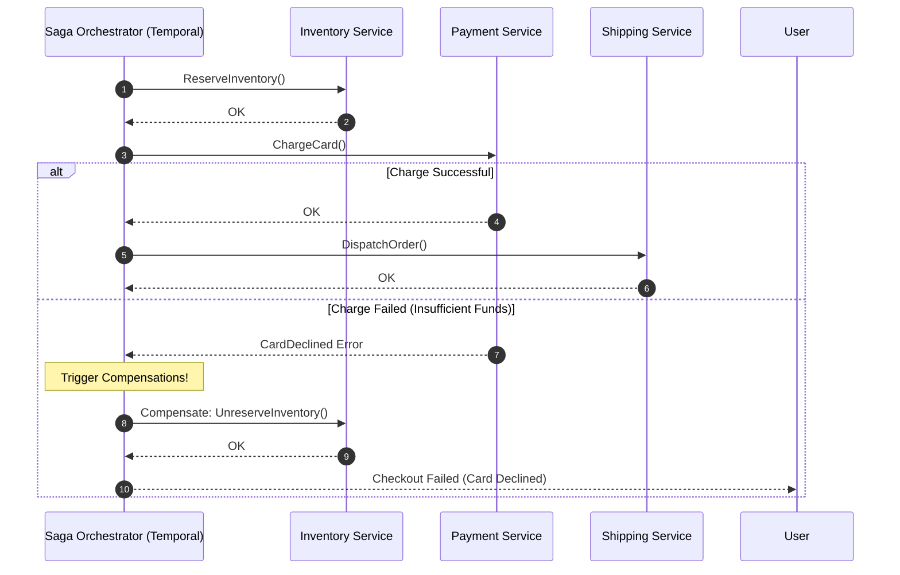
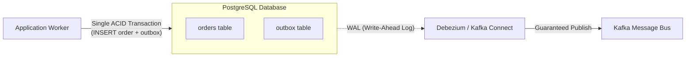

# Pattern 03: Multi-Step Processes

> **The System Design Interview Lens:** First identify whether the participants share a supported ACID transaction boundary. Across independent services, compare participant-supported atomic commit with **Choreography vs. Orchestration Sagas** and durable workflow engines. Workflow history/replay improves recovery; activity idempotency and compensation remain application responsibilities.

> **Recovery contract:** Persist intent and decisions, reuse business-operation IDs on retries, and reconcile unknown outcomes before compensation. Temporal replays deterministic workflow code and retries activities.

---

## 1. 60-Second Interview Decision Matrix

| Dimension | Single-Node ACID | Two-Phase Commit (2PC) | Choreography Saga (Events) | Orchestration Saga (Engine / Temporal) |
| :--- | :--- | :--- | :--- | :--- |
| **Coordination Model** | Local DB Lock Manager | Blocking Central Coordinator | Decentralized Events / PubSub | **Durable State Machine** |
| **System Boundary** | Single Database | Distributed Databases / XA | Multiple Microservices | Multiple Microservices & External APIs |
| **Lock Duration** | Sub-millisecond | Holds locks across network roundtrips | **Zero locks held** (Local ACID only) | **Zero locks held** (Local ACID only) |
| **Rollback Mechanism** | DB Undo Log (`ROLLBACK`) | Durable coordinator decision; abort only before commit decision | Explicit Compensating Events | **Explicitly authored retry-safe compensations** |
| **Observability / Tracing** | Trivial (Single DB) | Moderate | **Complex & Fragile** (Event spaghetti) | **Native UI Visualizer** (Full state tree) |
| **Scale Limit** | Single machine limits | Poor (>5 nodes stalls throughput) | High throughput, asynchronous | High throughput, scalable workers |
| **Best Use Case** | Monolith / Single DB table updates | Legacy banking / mainframe systems | Simple 2–3 step linear fire-and-forget flows | **E-commerce checkout, payment flows, ride matching, food delivery** |

---

## 2. The Theoretical Paradigm Shift: ACID vs. BASE

ACID is not limited to one machine: distributed SQL and supported transaction participants can provide distributed transactions. **BASE** is a useful description of a deliberately asynchronous design, not a requirement imposed by microservices. Use the comparison below as a vocabulary aid and state the actual contract:

| ACID (Single DB World) | BASE (Distributed Microservices World) | Architectural Implication |
| :--- | :--- | :--- |
| **Atomicity:** All-or-nothing execution. | **Basically Available:** System guarantees availability (CAP AP focus). | High availability over instantaneous consistency. |
| **Consistency:** DB state strictly adheres to all constraints. | **Soft State:** Data status may drift or change over time without user input. | State transitions (`PENDING -> CHARGING -> COMPLETED`). |
| **Isolation:** Transactions execute as if serialized. | **Eventual Consistency:** System converges to consistency after all messages process. | Workflows expose intermediate states to clients. |
| **Durability:** Committed transactions persist on disk. | **Event Sourcing / Log Durability:** Changes recorded in durable append-only logs. | Temporal / Kafka stores immutable execution history. |

---

## 3. The Problem: The Naive Sequential Anti-Pattern

Consider an e-commerce checkout flow ("Cartwheel" example):
1. Reserve Inventory (Inventory Service)
2. Charge Credit Card (Payment Service / Stripe)
3. Create Delivery Order (Logistics / Warehouse Service)
4. Send Email Confirmation (Notification Service)

### What Happens in the Naive Sequential Code:
```python
def checkout(order_id, user_id, items, payment_method):
    inventory_service.reserve(items)           # Step 1: OK
    payment_service.charge(payment_method)     # Step 2: OK
    delivery_service.schedule_pickup(order_id) # Step 3: CRASH! (Network timeout / OOM)
    # The client got a 500 error, but the card was charged and inventory was deducted!
```
* **The Failure:** If Step 3 crashes or times out:
  * The user was billed \$150.
  * The warehouse never receives the delivery job.
  * The items are permanently locked in inventory.
* **Why 2PC Fails Here:** You cannot keep an XA distributed lock open across an external payment gateway like Stripe or an asynchronous warehouse API. If the coordinator crashes while holding locks, the entire system stalls.

---

## 3. The Saga Pattern

A **Saga** is a sequence of local transactions. Each transaction updates data within a single service and publishes an event or message. If a step fails, the Saga executes **Compensating Transactions** in reverse order to undo the previous changes.

```
Forward Path:       [Reserve Items] ----> [Charge Card] ----> [Dispatch Delivery (FAILS!)]
                                                                           |
Compensating Path:  [Unreserve Items] <-- [Refund Card] <------------------+
```

---

### Comparison: Choreography vs. Orchestration

#### A. Event-Driven Choreography
* **How it works:** Services publish and subscribe to domain events over a message bus (Kafka / RabbitMQ). 
  * `InventoryService` publishes `InventoryReserved` $\to$ `PaymentService` listens and charges card $\to$ publishes `PaymentCaptured` $\to$ `DeliveryService` listens.
* **The Downside at Scale ("Event Spaghetti"):**
  1. No single place in code defines the workflow logic.
  2. Difficult to trace: when a transaction hangs, debugging requires querying distributed trace IDs across 5 different Kafka topics.
  3. Cyclic dependencies: Handling compensation rollbacks requires every service to subscribe to everyone else's `*Failed` events.

#### B. Workflow Orchestration
* **How it works:** A dedicated orchestrator component directs the participants. It sends commands to services, tracks the step state, and invokes compensating calls on failure.



---

## 4. Modern Standard: Durable Execution Engines (Temporal / Cadence)

In modern engineering organizations (Uber, Stripe, Netflix), custom Saga orchestrators are replaced with **Durable Execution Engines** (e.g., [Temporal](https://temporal.io)).

### How Durable Execution Works Under the Hood:
1. **Deterministic Workflow Code:** You write straightforward sequential code (in Go, Python, Java, or TypeScript).
2. **Event Sourcing & Replay:** Temporal records reported activity completions in workflow history. The effect can occur before its completion reaches history.
3. **Resilience to Crashes:** If the server executing the workflow crashes midway:
   * A new worker picks up the execution.
   * It **replays** the workflow from line 1.
   * When it reaches already-completed steps, it returns the cached result from the event log without re-executing the network call.
   * Recorded completions are reused; an unrecorded activity may execute again. See [Temporal activity idempotency](https://docs.temporal.io/activity-definition).

```text
Workflow pseudocode:
1. Persist checkout identity and reserve inventory with a stable reservation key.
2. Charge using the persisted provider idempotency key.
3. If completion is unknown, record RECONCILING and query/retry the same charge.
   Record exhausted ambiguous retries as UNKNOWN for reconciliation.
4. On definitive failure, execute the explicitly registered inventory compensation.
5. On definitive success, durably advance toward shipping using a stable dispatch key.
6. Retry failed compensations; expose unresolved age and an escalation owner.
```

---

## 5. Critical Production Safeguards

### Safeguard 1: The Idempotency Key (Non-Negotiable)
In distributed systems, network calls fail in three distinct ways: **Success**, **Failure**, or **Unknown (Timeout)**. If an orchestrator times out calling `chargeCard()`, it must retry. But did the first call actually charge the card before the network dropped?
* **Solution:** The client passes an `Idempotency-Key` (e.g., UUID generated on checkout page).
* **Storage-level Deduplication:**
  ```sql
  CREATE TABLE payment_requests (
      idempotency_key UUID PRIMARY KEY,
      order_id VARCHAR(64) NOT NULL,
      status VARCHAR(32) NOT NULL,
      response_payload JSONB,
      created_at TIMESTAMP WITH TIME ZONE DEFAULT NOW()
  );
  ```
* The unique constraint serializes admission for that key. Return its completed result or in-progress/unknown status, and reject reuse with a different payload. Remote charges use the provider key; persist/reconcile their results and retain identities through the replay window.

---

### Safeguard 2: Transactional Outbox + Change Data Capture (CDC)
How do you update a local database and publish an event to Kafka atomically without the "dual-write" failure?



1. The service inserts the order and writes an outbox record into an `outbox` table within the **same local database ACID transaction**.
2. A Change Data Capture (CDC) engine (e.g., Debezium) streams the database Write-Ahead Log (WAL) to Kafka.
3. This eliminates the catastrophic bug where a database write succeeds but the Kafka publish crashes.

---

## 6. Interview Checklist: What to Say Under Pressure

```
1. "Because this transaction spans independent microservices and external payment gateways, Two-Phase Commit (2PC) is a non-starter—it holds distributed locks open and degrades availability."
2. "I will implement the Saga Pattern using Orchestration rather than Choreography. Orchestration avoids event spaghetti, centralizes business rules, and makes state transitions observable."
3. "For implementation, I will leverage a Durable Execution Engine like Temporal. It gives us durable timers, automatic retries with backoff, and state persistence via event sourcing."
4. "Every activity step must be strictly idempotent. We will enforce this by propagating an Idempotency-Key header and using unique database constraints."
5. "To guarantee event publishing without dual-write bugs, internal services will adopt the Transactional Outbox Pattern with Debezium CDC."
```
