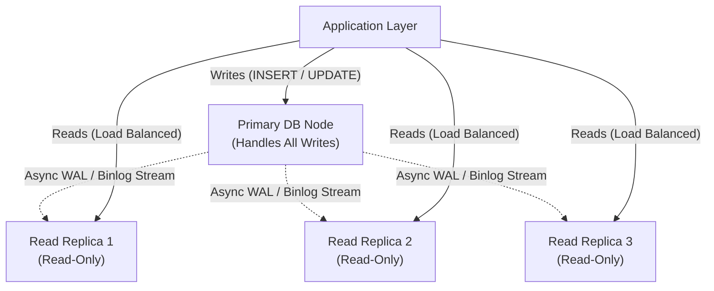

# Pattern 04: Scaling Reads

> **The System Design Interview Lens:** In consumer applications (Twitter/X, Instagram, Yelp, Amazon product catalog), read-to-write ratios often exceed **100:1 or 1,000:1**. A Staff engineer systematically applies a 3-tier escalation strategy: first exhausting database engine optimizations, then scaling storage nodes horizontally, and finally introducing multi-tier caching architectures with rigorous stampede and invalidation defenses.

---

## 1. 60-Second Interview Decision Matrix

| Layer | Strategy | Read Latency | Write Overhead | Consistency Model | Best Used When |
| :--- | :--- | :--- | :--- | :--- | :--- |
| **Tier 1: DB Engine** | **Covering B+ Tree Indexes** | 2–8ms | Minor (Index update on write) | **Strong Consistency** (ACID) | Filtering/sorting on specific column combinations |
| **Tier 1: DB Engine** | **Denormalization / Pre-joins** | 1–5ms | Moderate (Multiple row updates) | Strong (if same DB transaction) | Avoiding complex multi-table `JOIN` operations |
| **Tier 2: Horizontal DB** | **Read Replicas (Primary-Replica)** | 3–10ms | None on primary | **Eventual Consistency** (Replication lag) | Read-heavy queries with acceptable 100ms–1s staleness |
| **Tier 2: Horizontal DB** | **Database Sharding** | 3–10ms | Routing logic overhead | Strong per-shard | Data volume exceeds single storage instance (>3–5TB) |
| **Tier 3: In-Memory** | **Application Cache (Redis/Valkey)** | **Sub-1ms** | Invalidation coordination | Eventual (TTL or event-invalidated) | High-QPS point lookups, user sessions, hot product pages |
| **Tier 3: Edge** | **Edge CDN (Cloudflare / CloudFront)** | **10–30ms** (PoP close to user) | Cache purge delay | Eventual (HTTP Cache-Control) | Static assets, public REST/GraphQL queries, video manifests |

---

## 2. Tier 1: In-Database Optimizations (Before Adding Caching)

Interviewers test whether you jump to Redis immediately before considering relational engine tuning. Always mention internal database optimizations first:

### A. Covering Indexes (Index-Only Scans)
* **The Mechanism:** Normally, a B+ Tree index lookup yields a pointer (or Primary Key) to the heap table, requiring a secondary random I/O read ("table lookup").
* A **Covering Index** includes all columns requested by the `SELECT` clause directly in the index leaf pages via `INCLUDE` (PostgreSQL) or compound ordering:
  ```sql
  -- Without covering index: index scan + heap table fetch
  -- With covering index: index-only scan (zero heap lookups!)
  CREATE INDEX idx_orders_covering 
  ON orders (customer_id, created_at DESC) 
  INCLUDE (total_amount, status);

  -- This query is satisfied 100% within RAM/Index leaf nodes
  SELECT total_amount, status 
  FROM orders 
  WHERE customer_id = 'CUST_123' 
  ORDER BY created_at DESC 
  LIMIT 10;
  ```

### B. Denormalization & Materialized Views
* Instead of running `COUNT(*)` or `SUM(revenue)` across 5 million rows on every dashboard load, maintain pre-aggregated counters or materialized summary tables updated via triggers or application writes.

---

## 3. Tier 2: Horizontal Scaling with Read Replicas

When read QPS exceeds what a single high-memory database server can handle (typically >15k–25k complex reads/sec), add asynchronous **Read Replicas**:



---

### The Replication Lag Trap: "Read-Your-Own-Writes"
* **The Failure Mode:** A user updates their profile name from "Bob" to "Robert". The write goes to the Primary DB. The user's browser immediately redirects to `/profile`. The read request hits Replica 2, which has a 200ms replication lag. The user sees "Bob" and frantically submits the form again!
* **Staff Solutions:**
  1. **Session-Pinning Window:** When a user issues a mutation, store a flag in their session cookie or Redis: `user:<id>:recent_write = timestamp`. For the next 3–5 seconds, route all read queries for this specific user directly to the **Primary DB**.
  2. **Monotonic Read Consistency via Replication Log Offsets:** Replicas track their applied LSN (Log Sequence Number). The client carries the transaction's commit LSN; queries route only to replicas that have caught up to that LSN.

---

## 4. Tier 3: External Caching Strategies (The Donne Martin Master Matrix)

Never just say "I'll add Redis." A Staff engineer evaluates which **Cache Update Strategy** matches the data volatility and consistency requirements:

| Strategy | Read Flow | Write Flow | Cache Hit Latency | Write Latency Overhead | Data Loss Risk | Best Use Case |
| :--- | :--- | :--- | :--- | :--- | :--- | :--- |
| **Cache-Aside (Lazy Loading)** | Cache miss $\to$ fetch DB $\to$ write cache | Writes go directly to DB $\to$ delete cache key | **Sub-1ms** (after warm up) | Low (Write DB + Del cache) | **Zero** (DB is truth) | **Read-heavy point lookups**, user profiles, product catalog |
| **Write-Through** | Reads hit cache directly | App writes to Cache $\to$ Cache writes synchronously to DB | **Sub-1ms** (Always warm) | High (Two sequential writes) | **Zero** (Synchronously committed to DB) | Financial balances, user auth tokens |
| **Write-Around** | Reads hit cache or fallback to DB | App writes directly to DB $\to$ Cache is **not** updated | High on initial read (Cold cache) | **Lowest** (Single DB write) | **Zero** (DB is truth) | **Write-heavy logs**, data written once and rarely read |
| **Write-Back (Write-Behind)** | Reads hit cache directly | App writes to Cache $\to$ returns immediately $\to$ async worker flushes to DB | **Sub-1ms** | **Sub-1ms** (Fastest writes) | **High** (If cache node crashes before flush!) | Real-time gaming leaderboards, video view counters |

---

### Cache Eviction Policies & Sizing (Donne Martin Framework)
When the cache reaches memory capacity (`maxmemory`), the cache must evict keys:
1. **LRU (Least Recently Used):** Evicts the keys that haven't been accessed for the longest time. *Best default choice for 90% of workloads.*
2. **LFU (Least Frequently Used):** Tracks access frequency counters. Evicts rarely requested items, even if accessed recently. *Best for keeping evergreen popular items in memory.*
3. **FIFO (First In First Out):** Evicts the oldest created keys regardless of access.
4. **Random / TTL-based (volatile-lru):** Evicts only among keys that have an explicit expiration time set.

---

### Database Federation (Functional Splitting Before Sharding)
Before partitioning tables horizontally across shards, apply **Database Federation** (Donne Martin's structural scaling step):
* Split a single monolithic database into distinct functional databases by domain:
  * `auth_db`: User accounts, credentials, sessions.
  * `catalog_db`: Products, categories, inventory.
  * `orders_db`: Orders, payments, shipping line items.
* **Benefits:** Independent scaling, localized schema changes, isolated failure domains.
* **Trade-off:** Cross-database `JOIN` operations are eliminated; relationships must be resolved at the application layer or via GraphQL/API Gateway composition.

---

## 5. Critical Edge Traps & Interview Deep Dives

### Deep Dive 1: Cache Stampede (Thundering Herd)
* **The Failure Mode:** An extremely hot key (e.g., product page for a newly launched iPhone) expires or is evicted from Redis. Suddenly, 50,000 concurrent requests miss the cache at the exact same millisecond and hammer the database with the identical query, instantly exhausting database connection pools.
* **Solution A: Mutex / SingleFlight Pattern**
  Only the first worker to experience a cache miss acquires a distributed mutex; all other 49,999 workers wait on a channel or retry after 50ms:
  ```go
  // Go SingleFlight implementation
  v, err, _ := g.Do(key, func() (interface{}, error) {
      // Only ONE goroutine executes this DB call
      return fetchFromDatabase(key)
  })
  ```
* **Solution B: Probabilistic Early Expiration (XFetch Algorithm)**
  Instead of waiting for the key to expire, clients calculate a dynamic probability of recomputing the cache item before its actual TTL:
  $$\Delta \cdot \beta \cdot \ln(\text{random}()) > \text{TTL} - \text{now}$$
  As the expiration time approaches, the likelihood that a client asynchronously re-warms the cache approaches 100%, ensuring zero cache misses on hot keys.

---

### Deep Dive 2: Cache Invalidation (The Hardest Problem)
* **Trap: Cache-Aside Dual-Write Races**
  1. Thread A updates DB row.
  2. Thread B reads DB row before Thread A deletes the cache key.
  3. Thread B repopulates cache with old stale value.
* **The Architectural Fix (Change Data Capture + Kafka Invalidator):**
  Never let application servers delete cache keys directly inside business logic controllers.
  1. Application writes exclusively to PostgreSQL.
  2. PostgreSQL commits to the Write-Ahead Log (WAL).
  3. Debezium streams WAL events to an `invalidation-topic` in Kafka.
  4. A dedicated Invalidator Worker consumes Kafka and executes `DEL key` in Redis. This guarantees that cache invalidation occurs **after** the transaction is durably committed.

---

### Deep Dive 3: Cache Penetration & Avalanche
* **Cache Penetration:** Attackers query random non-existent keys (`id = -999999`), bypassing cache and hitting DB directly.
  * *Defense:* **Bloom Filters** at the API gateway or caching null values with a short TTL (`SET key:null EX 60`).
* **Cache Avalanche:** Thousands of keys are created at midnight with an identical 24-hour TTL, causing them to all expire simultaneously.
  * *Defense:* **Jittered TTLs** (add random variance: $\text{TTL} = 86400 \pm \text{random}(0, 3600)$).

---

## 6. Interview Checklist: What to Say Under Pressure

```
1. "Before jumping straight to Redis, I'll first optimize the database access path using composite covering B+ Tree indexes and denormalized tables to eliminate expensive joins."
2. "To scale read throughput horizontally, I will provision read replicas off an asynchronous WAL stream from the primary."
3. "To solve replication lag and protect the user experience from stale data, we will use session-pinning: any user who submits a write has their reads routed to the primary for the next 3 seconds."
4. "For ultra-hot point lookups, I'll introduce an in-memory Cache-Aside layer with Redis."
5. "To defend against Cache Stampedes on viral keys, I will use the SingleFlight/Mutex pattern and implement the XFetch probabilistic early re-warming algorithm."
```
