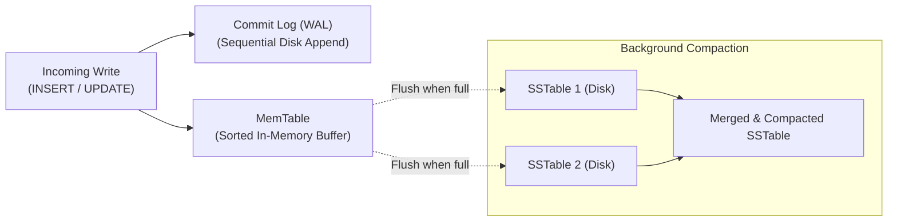
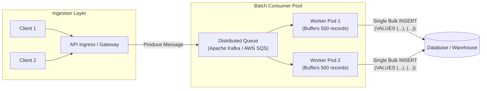

# Pattern 05: Scaling Writes

> **Write contract:** Define success at durable log acceptance or database commit. Preserve operation IDs and ordering through retries, replication and shard migration.

> **The System Design Interview Lens:** Scaling writes is fundamentally more difficult than scaling reads. While reads can be scaled by adding replicas, writes must modify the single source of truth, maintain durability (fsync to disk), enforce constraints, and update indexes. A Staff engineer articulates how to choose write-optimized storage engines (LSM Trees vs. B+ Trees), buffer spikes using message queues, apply micro-batching, and partition hot keys using salting.

---

## 1. 60-Second Interview Decision Matrix

| Strategy | Write Mechanism | Throughput Scaling | Hardware Bottleneck Solved | Latency Trade-off | Best Workload |
| :--- | :--- | :--- | :--- | :--- | :--- |
| **LSM-Tree Engine (Cassandra / RocksDB)** | Append-only sequential disk writes | High ($>50\text{k}$ writes/sec/node) | Eliminates random disk I/O seek overhead | Slightly higher read latency (SSTable compaction) | Time-series metrics, IoT sensor telemetry, chat logs |
| **Write Buffering via Queues (Kafka / SQS)** | Asynchronous ingestion pipeline | Massive (Absorbs peak bursts) | Prevents database connection exhaustion | Introduces 100ms–2s eventual consistency | Order ingestion, clickstream logging, analytics events |
| **Micro-Batching** | In-memory aggregation before bulk write | High ($10\times$ fewer IOPS) | Drastically reduces network and transaction overhead | Small latency buffer (e.g., 50–100ms flush window) | Bulk database inserts, log shipping, financial audits |
| **Horizontal Sharding** | Hash-based partition distribution | Near-linear horizontal scale | Bypasses single-server CPU, memory, and disk capacity | Complex cross-shard queries and transactions | Multi-tenant SaaS, large user tables (>100M rows) |
| **Key Salting / Distributed Sub-Keys** | Append random suffix to hot keys | Extreme on single hot entity | Eliminates single-row lock serialization | Read requires fan-out `SUM()` across $N$ sub-keys | Viral post likes, global event counters, flash sale stock |

---

## 2. Why Scaling Writes Is Harder Than Scaling Reads

1. **Random Disk I/O vs. Sequential Append:** Standard relational databases (PostgreSQL, MySQL InnoDB) organize tables using **B+ Trees**. When inserting or updating a row, the database must dirty and flush 8KB/16KB pages scattered randomly across disk blocks.
2. **Replicas Cannot Absorb Writes:** In standard primary-replica replication, read replicas must replay the primary's write stream. Adding replicas increases write replication overhead, not write throughput.
3. **Locking & Constraints:** Writes must enforce unique constraints, check foreign keys, and take exclusive row/table locks, serializing execution.

---

## 3. The 5-Stage Database Scaling Roadmap (Donne Martin Framework)

In an interview, never jump directly to sharding. Present the progressive scaling roadmap:

```
Stage 1: SQL Tuning & Indexes   -> Eliminate table scans, add covering indexes, increase RAM/buffer pool
Stage 2: Master-Slave Replicas  -> Offload all reads to replicas (Primary only handles writes)
Stage 3: Database Federation    -> Split DB by business domain (users_db, orders_db, catalog_db)
Stage 4: Denormalization        -> Pre-compute joined tables to avoid expensive write-time join locks
Stage 5: Horizontal Sharding   -> Partition a single table across N distinct physical database servers
```

---

## 4. Core Strategy 1: Write-Optimized Storage Engines (LSM-Trees)

When write throughput is the primary system bottleneck, switch from a B+ Tree database to a **Log-Structured Merge-Tree (LSM-Tree)** database (Cassandra, ScyllaDB, ClickHouse, RocksDB):



* **Why LSM-Trees are Blazing Fast on Writes:**
  1. The incoming write is sequentially appended to a Write-Ahead Log (WAL) on disk for durability.
  2. The data is inserted into an in-memory sorted data structure (**MemTable**, e.g., SkipList or Red-Black Tree).
  3. **Zero random disk writes occur during the write transaction!** The client receives a success response immediately.
  4. Later, background threads flush the sorted MemTable to disk as an immutable **SSTable** (Sorted String Table) and merge them asynchronously.

---

## 4. Core Strategy 2: Write Buffering via Queues & Micro-Batching

Never expose your relational database directly to spiky write traffic. Place a distributed message queue in front of the database to act as a shock absorber:



### The Power of Micro-Batching:
* Instead of running 1,000 independent `INSERT` statements (each requiring a separate network roundtrip and transaction commit):
  ```sql
  -- BAD: 1,000 separate transactions = 1,000 fsyncs
  INSERT INTO event_logs (id, payload) VALUES (1, 'data');
  INSERT INTO event_logs (id, payload) VALUES (2, 'data');
  ```
* The consumer worker buffers events for 100ms or until 500 records accumulate, then executes a single bulk statement:
  ```sql
  -- GOOD: 1 transaction = 1 fsync = 10x higher throughput
  INSERT INTO event_logs (id, payload) VALUES 
      (1, 'data'),
      (2, 'data'),
      ...
      (500, 'data');
  ```

---

## 5. Core Strategy 3: Horizontal Sharding

When data volume and write QPS exceed a single machine's physical limits, partition the database across multiple independent database nodes.

### Choosing the Right Shard Key:
* **Good Shard Key:** High cardinality, even distribution of reads and writes (e.g., `user_id`, `tenant_id`, `company_id`).
* **The Temporal Key Anti-Pattern:** Never use `created_at` or timestamp as your sole shard key! If you partition by date, **100% of current writes hit the shard for today**, creating a massive hot spot while historical shards sit idle. Use a compound key: `(tenant_id, created_at)`.

---

## 6. Sharding Architectures: Comparison of 3 Approaches

| Sharding Strategy | Mechanism | Rebalancing Complexity | Hot Spot Risk | Cross-Shard Query Penalty |
| :--- | :--- | :--- | :--- | :--- |
| **Hash-Based Sharding** | `shard = hash(key) % num_shards` (or Consistent Hash Ring) | Low (with virtual nodes) | Low (Evenly uniform distribution) | High (Scatter-gather across all shards) |
| **Range-Based Sharding** | Contiguous ranges (`A-C -> Shard 1`, `D-F -> Shard 2`) | High (Splitting split ranges) | **High** (e.g., date ranges concentrate current writes) | Low for range queries within single shard |
| **Directory-Based Sharding** | Lookup service maintains mapping table: `entity_id -> shard_id` | **Trivial** (Update entry in lookup table) | Low | Lookup service becomes single point of failure & cache bottleneck |

---

## 7. Ingress Backpressure: Leaky Bucket vs. Token Bucket Throttling

When write spikes threaten database availability, use rate limiters to enforce backpressure before reaching message queues:
* **Token Bucket:** Tokens added at constant rate $R$, bucket holds capacity $B$. Allows **bursty write traffic** up to capacity $B$. Best for absorbing sudden traffic spikes.
* **Leaky Bucket:** Requests enter bucket and leak out at a strictly **smooth constant rate**. Smooths out erratic spikes into uniform write flow. Best for protecting downstream databases with strict IOPS thresholds.

---

## 8. Critical Edge Traps & Interview Deep Dives

### Deep Dive 1: Zero-Downtime Resharding
* **The Problem:** Your 4-node sharded cluster is at 85% capacity. You need to expand to 8 nodes without dropping writes or taking the system offline.
* **Versioned Snapshot + Change-Log Runbook:**
  1. **Declare authority:** Keep the old cluster authoritative. Establish a consistent snapshot and its change-log position; retain the log long enough for backfill and recovery.
  2. **Backfill and replay:** Copy the snapshot, then replay ordered changes. Guard destination writes with source versions so stale backfill cannot overwrite a newer update; carry delete tombstones and stable operation IDs. Naive application dual-writes alone leave a partial-failure gap.
  3. **Verify at a barrier:** Catch up to an explicit source position, compare version-aware checksums and sampled queries, and shadow reads.
  4. **Cut over ownership:** Briefly fence or drain old writers as required, apply through the cutover barrier and change routing with an epoch. Reject old-epoch writes and ensure clients cannot keep writing to both authorities.
  5. **Keep a rollback window:** Define whether rollback needs reverse replication; retain the old cluster and logs until compatibility, reconciliation and recovery checks pass. Assign the cutover/rollback owner before starting.

---

### Deep Dive 2: Hot Key Salting
* **The Problem:** A celebrity account or viral tweet (`post_id = 'VIRAL_999'`) receives 50,000 comment writes per second. Even in a sharded cluster, all 50,000 writes hash to the exact same shard node, taking down that instance.
* **The Fix (Key Salting):**
  * When writing, append a random integer suffix between $0$ and $N-1$:
    $$\text{Partition Key} = \text{post\_id} + \text{"\#"} + \text{random}(0, 9)$$
  * The writes are now evenly scattered across 10 distinct physical shards!
  * **Read Path:** When fetching comments or total comment count, the application queries all 10 salted keys in parallel (`VIRAL_999#0` through `VIRAL_999#9`) and sums the result in memory.

---

## 7. Interview Checklist: What to Say Under Pressure

```
1. "Scaling writes is harder than scaling reads because writes must coordinate state, enforce durability, and update index trees. Read replicas do not absorb writes."
2. "If the workload is write-intensive with sequential scans (e.g., chat logs, telemetry), I will choose an LSM-Tree storage engine like Cassandra or ScyllaDB to eliminate random disk I/O."
3. "To protect our database from bursty write traffic, I will place a distributed message queue (Kafka) in front of the database to provide backpressure."
4. "Consumer workers will leverage micro-batching, flushing records in batches of 500 every 100ms to reduce transaction commits and disk fsyncs by 90%."
5. "If a single key becomes viral, I'll apply key salting, appending a random suffix (0..9) to disperse writes across multiple database shards, aggregating results on read."
```
