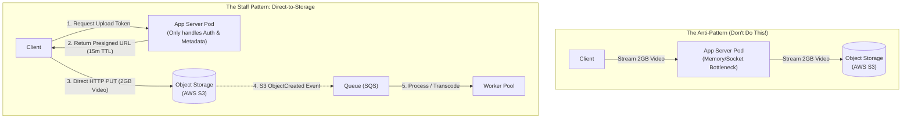
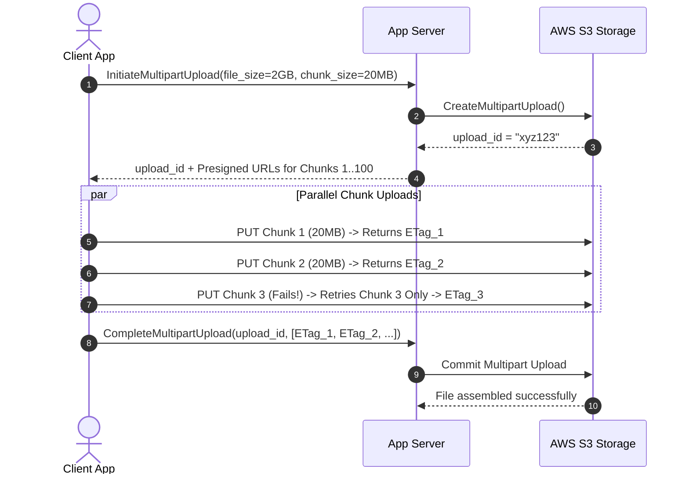

# Pattern 06: Handling Large Blobs

> **The System Design Interview Lens:** Transporting large binary files (videos, high-res photos, machine learning models, system backups) directly through your application servers is an architectural disaster. A Staff engineer enforces the cardinal rule: **application servers handle metadata and authentication, while object storage and CDNs handle raw bytes via Presigned URLs and Multipart Uploads.**

---

## 1. 60-Second Interview Decision Matrix

| Dimension | App Server Proxy (Anti-Pattern) | Presigned URL (Direct Upload) | Multipart Upload (Chunked) | CDN Edge Caching (Download) |
| :--- | :--- | :--- | :--- | :--- |
| **Data Path** | Client $\to$ App Pod $\to$ Storage | **Client $\to$ Object Storage** | **Client $\to$ Object Storage** | **Client $\to$ CDN PoP** |
| **Max File Size** | <10MB | Up to 100MB–5GB | **Up to 5TB** | Unlimited (Chunked / Streamed) |
| **Memory / CPU Load** | High (Exhausts pod heap & sockets) | **Zero on App Server** | **Zero on App Server** | Zero on Origin Storage |
| **Resumability** | Impossible (Whole file restarts on fail) | Poor (Fails on connection drop) | **Native** (Retry only failed 5MB chunks) | N/A |
| **Upload Speed** | Slow (Double hop across network) | Fast (Single direct hop) | **Ultra Fast** (Parallel chunk uploads) | N/A |
| **Access Control** | JWT in HTTP Header | Time-limited signed query string | Time-limited signed query string | Signed Cookies / Signed URLs |
| **Best Use Case** | Never use for files >5MB | Profile avatars, small PDF invoices | **YouTube video uploads, Dropbox files** | **Video streaming (HLS/DASH), image delivery** |

---

## 2. The Cardinal Rule: Bypass the Application Server

Streaming gigabytes through web servers (Node.js, Go, Python, Java) ties up memory buffers, saturates network interface cards (NICs), and holds open thread pools:



---

## 3. Direct Uploads via Presigned URLs

### The 4-Step Handshake:
1. **Client requests upload URL:** The client calls `POST /api/uploads/request-url` with file metadata (`filename`, `file_size`, `content_type: video/mp4`).
2. **Server authenticates & signs:** The application server verifies user permissions, inserts a record into the metadata database (`status = 'PENDING'`), and generates a signed AWS S3 or Google Cloud Storage URL using IAM credentials:
   ```python
   # Backend generates pre-signed URL with 15-minute expiration
   presigned_url = s3_client.generate_presigned_url(
       'put_object',
       Params={
           'Bucket': 'user-video-uploads',
           'Key': f'raw/{user_id}/{video_id}.mp4',
           'ContentType': 'video/mp4'
       },
       ExpiresIn=900 # 15 minutes
   )
   ```
3. **Client uploads directly to S3:** The client issues an `HTTP PUT` directly to `presigned_url` with the file body. The application server is 100% out of the data path!
4. **Completion reconciliation:** See Section 5 below.

---

## 4. Multipart & Resumable Uploads for Large Files (>100MB)

For gigabyte-scale uploads (e.g., YouTube video uploads), a single HTTP connection is fragile. If a 4GB upload drops at 98%, starting from byte 0 is unacceptable.



### Why Multipart Uploads Win:
1. **Parallel Uploads:** Upload 4–8 chunks simultaneously, maximizing the client's available uplink bandwidth.
2. **Resilience:** If chunk 34 fails due to a mobile network switch (Wi-Fi to 5G), **only chunk 34 is retried**.
3. **Pausable / Resumable:** The client tracks which chunk ETags succeeded in local storage (`IndexedDB` or SQLite) and resumes without loss.

---

## 5. State Synchronization: How Does the Backend Know It's Done?

Never trust the client to notify the backend that an upload succeeded! The client could lose battery or disconnect right after the S3 PUT finishes.

### The Event-Driven Reconciliation Pipeline:
1. When the file finishes uploading, S3 triggers an **S3 Event Notification** (`s3:ObjectCreated:*`).
2. S3 pushes the event payload to an **AWS SQS Queue** or **Kafka topic**.
3. A background **Validation Worker** consumes the message:
   * Validates the file magic bytes (verifies it is genuinely an MP4 video, not malware disguised with an `.mp4` extension).
   * Generates a video thumbnail and extracts duration/metadata.
   * Updates the relational database: `UPDATE videos SET status = 'READY', s3_path = ... WHERE id = ...`.
   * Pushes a real-time notification to the user via SSE or WebSockets: *"Your video is ready!"*

### Cleaning Up Abandoned / Dangling Uploads:
If users start an upload and close their browser, incomplete chunks consume terabytes of hidden storage fees.
* **The Fix:** Configure an **S3 Bucket Lifecycle Rule**:
  ```json
  {
    "Rules": [
      {
        "ID": "AbortIncompleteMultipartUploads",
        "Status": "Enabled",
        "AbortIncompleteMultipartUpload": {
          "DaysAfterInitiation": 7
        }
      }
    ]
  }
  ```

---

## 6. Content Delivery: Push CDN vs. Pull CDN (Donne Martin Framework)

Never serve raw media files directly from object storage to viewers! Place a CDN edge layer between viewers and origin storage:

| Dimension | Push CDN | Pull CDN (Default for Blobs) |
| :--- | :--- | :--- |
| **Ingestion Model** | Content is explicitly uploaded directly to CDN edge nodes | Content is pulled lazily from S3 origin upon first client cache miss |
| **Storage Cost** | High (Stores full copy of data across all global PoPs) | **Low** (Only stores frequently requested "hot" content) |
| **Origin Load** | Zero on origin | Spikes during initial cache warm-up |
| **Freshness / Updates** | Requires proactive cache purge API calls | Governed by `Cache-Control: max-age` and `ETag` validation |
| **Best Use Case** | Fixed software installation binaries, game patches | **User-generated YouTube videos, social media photos, news assets** |

---

## 7. Content-Addressable Storage (CAS) & Block Deduplication

In cloud file drives (Dropbox, Google Drive), storing duplicate copies of popular files (e.g., standard OS ISOs, viral videos, textbook PDFs) wastes petabytes of storage.
* **The Mechanism:** Split incoming files into fixed (4MB) or variable-sized (Rabin fingerprinting) blocks.
* Compute the **cryptographic hash (SHA-256)** of each block:
  $$\text{Block ID} = \text{SHA-256}(\text{Block Bytes})$$
* **Storage Check:** Query the metadata database:
  ```sql
  SELECT block_id FROM blocks WHERE block_id = 'e3b0c44298fc1c149afb...';
  ```
  * If the block exists: **Do not upload the bytes!** Simply increment the file's reference pointer.
  * If the block does not exist: Upload the unique block to object storage.
* *Result:* Reduces raw object storage footprint and WAN bandwidth by 40–60%.

---

## 8. Efficient Media Delivery & Streaming

Never serve raw media files directly from object storage to viewers!

### Direct Downloads & Edge CDN
* **Origin Offload:** Point a global CDN (AWS CloudFront / Cloudflare) to your S3 bucket origin. Cached popular media items achieve 95%+ cache hit ratios, offloading requests from S3.
* **Access Control for Paid/Private Media:** Use **CDN Signed URLs or Signed Cookies** (e.g., CloudFront Signed Cookies) so video URLs cannot be hotlinked or pirated.

### Adaptive Bitrate Streaming (HLS / DASH)
* In a system like YouTube or Netflix, videos are never served as raw `.mp4` files.
* Background workers (using `ffmpeg`) transcode the video into multiple resolutions (1080p, 720p, 480p, 360p) and slice them into **2-to-6-second chunks** (`.ts` or `.m4s` files), alongside a `.m3u8` playlist manifest.
* The player dynamically switches resolutions on the fly as the user's network bandwidth fluctuates!

---

## 7. Interview Checklist: What to Say Under Pressure

```
1. "The cardinal rule for large files is that application servers should never touch raw binary bytes. They only handle metadata, authentication, and URL generation."
2. "Clients will upload directly to object storage (S3/GCS) via time-limited Presigned URLs."
3. "For files larger than 100MB (like video uploads), we will implement Multipart Uploads: splitting files into 10–20MB chunks uploaded in parallel, with client-side retry for failed chunks."
4. "To track upload completion reliably, we won't rely on the client. Instead, we'll listen to S3 ObjectCreated events via SQS, triggering asynchronous validation and transcoding workers."
5. "For downloads and streaming, we will front the bucket with an Edge CDN, convert videos to HLS/DASH for adaptive bitrate streaming, and enforce privacy using Signed Cookies."
```
