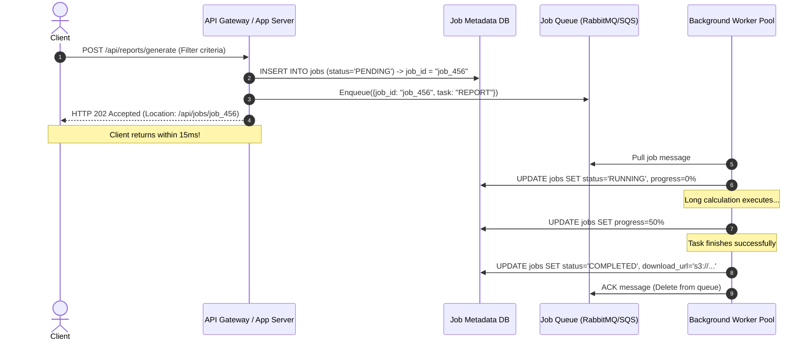

# Pattern 07: Managing Long-Running Tasks

> **The System Design Interview Lens:** Operations taking longer than 2–3 seconds (video transcoding, monthly payroll report generation, ML model batch inference, bulk CSV data exports) must never execute synchronously within an HTTP request. A Staff engineer decouples execution using the **Asynchronous Request-Response Pattern**, chooses appropriate queue and worker topologies, handles poison-pill worker crashes, and guarantees execution progress visibility.

---

## 1. 60-Second Interview Decision Matrix

| Dimension | Synchronous API (Anti-Pattern) | Message Queue + Worker Pool | Workflow Orchestrator (Temporal) | Distributed Stream (Kafka / Flink) |
| :--- | :--- | :--- | :--- | :--- |
| **Execution Duration** | <1–2 seconds | **Seconds to Hours** | **Hours to Weeks** (Human-in-the-loop) | Continuous / Streaming |
| **Client Interaction** | Blocks until response | **Immediate `HTTP 202` + Polling/Webhook** | Immediate `HTTP 202` + Query API | Fire-and-forget or Consumer loop |
| **Worker Failure Recovery** | Request drops (Client gets 504 Gateway Timeout) | **Automatic retry via Queue Visibility Timeout** | **Stateful resume from event history** | Replays partition offset |
| **Job Dependencies / DAGs** | None | Requires custom state coordination | **Native DAG & Dependency Graph** | Directed Acyclic Graph in Flink |
| **Autoscaling Metric** | CPU / Request Latency | **Queue Backlog Depth / Wait Time** | Pending Activity Count | Consumer Group Lag |
| **Best Use Case** | Fast CRUD point lookups | **PDF generation, email sending, video rendering** | **Loan approvals, complex multi-day workflows** | **Real-time click aggregation, fraud scoring** |

---

## 2. The Asynchronous Request-Response Protocol

Instead of holding open an HTTP socket connection while a heavy 60-second task executes, decouple the submission from the processing:



### The Standard HTTP API Contract:
1. **Submission:**
   * Request: `POST /api/reports/generate`
   * Response: `HTTP 202 Accepted`
     ```json
     {
       "job_id": "job_456",
       "status": "PENDING",
       "check_status_url": "/api/jobs/job_456",
       "estimated_duration_seconds": 45
     }
     ```
2. **Status Polling:**
   * Request: `GET /api/jobs/job_456`
   * Response: `HTTP 200 OK`
     ```json
     {
       "job_id": "job_456",
       "status": "RUNNING",
       "progress_percentage": 65,
       "result": null
     }
     ```
3. **Completion:**
   * Response: `HTTP 200 OK`
     ```json
     {
       "job_id": "job_456",
       "status": "COMPLETED",
       "progress_percentage": 100,
       "result": {
         "download_url": "https://cdn.example.com/exports/report_456.pdf",
         "file_size_bytes": 14205000
       }
     }
     ```

---

## 3. Queue & Worker Architecture: Technology Selection

### A. Queue Selection Guide
* **AWS SQS:** Best for cloud-native simplicity. Fully managed, automatic scaling, built-in visibility timeouts and Dead Letter Queues (DLQs).
* **RabbitMQ:** Best for complex routing keys, high-throughput AMQP protocol, and strict priority queues.
* **Redis BullMQ / Celery:** Best for lightweight setups where Redis is already present, sub-millisecond dispatch, and delayed/scheduled jobs.
* **Apache Kafka:** Best when you need **ordered event logs** and high-throughput streaming. *Warning:* Kafka is generally poor for arbitrary discrete task queues with long and variable execution times because slow jobs block the entire partition.

### A. Message Broker vs. Task Queue (Donne Martin Distinction)
* **Message Broker (RabbitMQ, Kafka, SQS):** Responsible strictly for **transporting raw bytes** from producers to consumers. Agnostic to job state, task progress, retries, and scheduled execution.
* **Task Queue (Celery, BullMQ, Sidekiq, Temporal):** An application-level abstraction built on top of a broker (or Redis). Handles **task life-cycle state tracking**, scheduled cron execution, rate-limiting per tenant, worker heartbeats, and result persistence.

---

### B. Back-of-the-Envelope Capacity Estimation Framework
In interviews, calculate exact worker pool sizing using Donne Martin's capacity formula:
* **Assumptions:**
  * System ingests $100{,}000$ video upload tasks per day.
  * Average transcoding execution time $= 60$ seconds per video.
  * Traffic spike factor $= 3\times$ average load.
* **Calculations:**
  $$\text{Average Ingestion Rate} = \frac{100{,}000 \text{ jobs}}{86{,}400 \text{ sec}} \approx 1.16 \text{ jobs/sec}$$
  $$\text{Peak Ingestion Rate} = 1.16 \times 3 \approx 3.5 \text{ jobs/sec}$$
  $$\text{Concurrent Workload at Peak} = \text{Peak Ingestion} \times \text{Execution Duration} = 3.5 \text{ jobs/sec} \times 60 \text{ sec} = 210 \text{ active jobs}$$
* **Worker Sizing:**
  * If 1 worker container (with 4 vCPU, 8GB RAM) processes 2 transcoding jobs concurrently:
    $$\text{Required Worker Pods} = \frac{210 \text{ active jobs}}{2 \text{ jobs/worker}} = 105 \text{ worker pods at peak}$$

---

### C. Worker Autoscaling Strategy
* **Anti-Pattern:** Autoscaling worker pods based on CPU or memory utilization. If workers are waiting on I/O or network calls, CPU may be low even though the queue is backing up!
* **Staff Pattern:** Autoscale based on **Queue Backlog Lag**:
  $$\text{Target Workers} = \frac{\text{Approximate Number of Visible Messages}}{\text{Acceptable Wait Time per Job} \times \text{Worker Processing Rate}}$$

---

## 4. Critical Production Safeguards

### Safeguard 1: Worker Crash Recovery (Visibility Timeout & ACKs)
* **How It Works:** When a worker dequeues a message from SQS, the message is **not deleted**. It enters a **Visibility Timeout** window (e.g., 5 minutes) during which other workers cannot see it.
* **Normal Path:** The worker finishes the task, updates the DB, and explicitly sends an `ACK` (DeleteMessage) to the queue.
* **Crash Path:** If the worker crashes, runs out of memory (OOM), or experiences a hardware fault:
  * The worker dies without sending an `ACK`.
  * The Visibility Timeout expires.
  * The queue automatically makes the message visible again! Another healthy worker pulls the message and resumes processing.

---

### Safeguard 2: Poison Pills & Dead Letter Queues (DLQ)
* **The Failure Mode:** A corrupt PDF file causes the video processing worker to trigger a segmentation fault and crash immediately. The message returns to the queue, another worker pulls it and crashes, causing an infinite loop that crashes all worker pods in the cluster!
* **The Solution:**
  1. Maintain a `ReceiveCount` metadata attribute on every message.
  2. If $\text{ReceiveCount} > \text{MaxAttempts}$ (e.g., 3 failed attempts), the queue ejects the poison message to a **Dead Letter Queue (DLQ)**.
  3. Emit a critical PagerDuty alert to the on-call engineer, while keeping the main processing queue running smoothly.

---

### Safeguard 3: Preventing Duplicate Execution (Distributed Leases)
Because queues guarantee **at-least-once delivery**, network delays might cause a visibility timeout to expire while a slow worker is still working.
* **The Defense:** Workers acquire a distributed lease in Redis or PostgreSQL using the `job_id`:
  ```sql
  -- Atomic worker heartbeat / claim
  UPDATE jobs 
  SET worker_id = 'worker_node_9', 
      heartbeat_at = NOW(), 
      status = 'RUNNING' 
  WHERE id = 'job_456' 
    AND (status = 'PENDING' OR heartbeat_at < NOW() - INTERVAL '2 minutes');
  ```
* If the row count is `0`, another worker is actively processing the job; discard the duplicate message.

---

## 5. Result Notification Strategies

| Notification Method | Implementation | Pros | Cons |
| :--- | :--- | :--- | :--- |
| **Client Polling with Exponential Backoff** | Client polls `GET /api/jobs/{id}` every 1s, 2s, 4s, 8s... | Simple, works behind firewalls | Adds HTTP request traffic |
| **Webhooks (Server-to-Server)** | Worker makes `POST https://client-callback.com/webhook` with HMAC signature | Ideal for B2B APIs (Stripe, GitHub Actions) | Client must host a public endpoint |
| **Real-time Push (SSE / WebSockets)** | Worker publishes to Redis channel $\to$ Gateway pushes to active browser socket | Instant feedback for interactive UI | Client connection must remain alive |

---

## 6. Interview Checklist: What to Say Under Pressure

```
1. "Because this task takes more than 2 seconds, executing it synchronously in the HTTP request cycle is an anti-pattern that leads to 504 timeouts and server thread pool starvation."
2. "I will implement the Asynchronous Request-Response Pattern: the API Gateway validates the request, creates a job record in PostgreSQL, enqueues the task in AWS SQS, and returns HTTP 202 Accepted within 15ms."
3. "Background worker pools will autoscale dynamically based on the queue backlog depth, not CPU utilization."
4. "To guarantee resilience against worker crashes, messages will use a 5-minute Visibility Timeout. If a worker dies, the message automatically re-appears for another worker to process."
5. "To prevent poison pills from taking down the worker cluster, we will route tasks that fail more than 3 times to a Dead Letter Queue (DLQ) with automated alerting."
```
