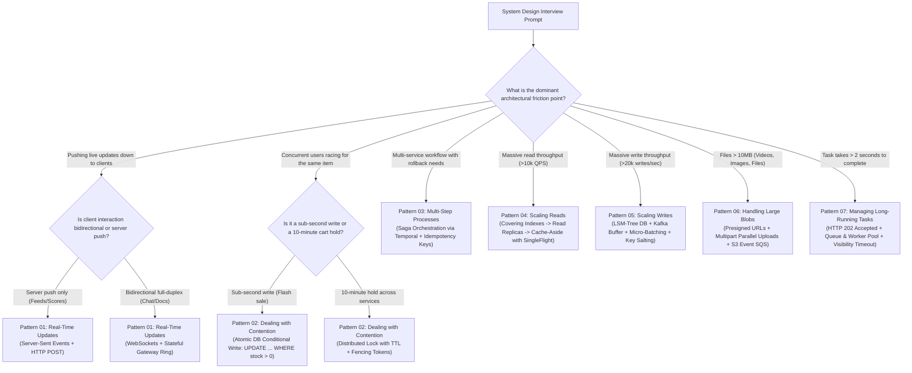

# Architectural Design Patterns Playbook

> **The System Design Interview Lens:** System design interviews are fundamentally about **pattern recognition**, not memorizing 50 disconnected company architectures. Candidates who stand out don't treat every interview question as a blank canvas; they map requirements to a core set of battle-tested architectural patterns, justify trade-offs under constraints, and avoid common production traps.

This directory provides the deep-dive architectural playbooks for the **7 Core System Design Patterns**, synthesizing the practical interview frameworks of **HelloInterview** (Meta Staff Engineer breakdowns) with the foundational distributed systems principles of **Donne Martin's [System Design Primer](https://github.com/donnemartin/system-design-primer)**.

---

## 1. The 7 Core Architectural Patterns

| # | Pattern | Core Challenge | Primary Architectural Primitives | Typical Interview Prompts |
| :-: | :--- | :--- | :--- | :--- |
| **01** | [**Real-Time Updates**](./01-Real-Time-Updates.md) | Pushing sub-second data to clients without overwhelming servers with polling | Server-Sent Events (SSE), WebSockets, Two-Hop Architecture, Pub/Sub Fanout | WhatsApp, Slack, Google Docs, Uber Driver Tracking, Live Sports Feeds |
| **02** | [**Dealing with Contention**](./02-Dealing-with-Contention.md) | High-concurrency race conditions on the same finite resource (Read-Modify-Write) | Atomic DB Conditional Writes, OCC (Version checks), Pessimistic Locking, Distributed Fencing Leases, Key Salting | Ticketmaster (Seat Reservation), Flash Sales, Hotel Booking, Auction Bidding |
| **03** | [**Multi-Step Processes**](./03-Multi-Step-Processes.md) | Workflows across multiple distributed microservices that must stay consistent | Sagas (Choreography vs. Orchestration), Durable Execution (Temporal), Idempotency Keys, Outbox + CDC | E-Commerce Checkout, Payment Systems, Food Delivery, Ride Dispatch |
| **04** | [**Scaling Reads**](./04-Scaling-Reads.md) | Extreme read-heavy workloads (100:1 to 1,000:1 read-to-write ratios) | Covering B+ Tree Indexes, Read Replicas, Session Pinning, Cache-Aside (Redis), SingleFlight / Stampede Defenses | Twitter/X News Feed, Instagram Profiles, Yelp / Nearby Places, Amazon Product Catalog |
| **05** | [**Scaling Writes**](./05-Scaling-Writes.md) | Massive write throughput hitting disk I/O, transaction locks, and IOPS ceilings | LSM-Trees (Cassandra/ScyllaDB), Write Buffering (Kafka), Micro-Batching, Hash Sharding, Hot Key Salting | IoT Sensor Ingestion, Metrics Monitoring, Ad Click Aggregation, High-Volume Audit Logs |
| **06** | [**Handling Large Blobs**](./06-Handling-Large-Blobs.md) | Uploading and streaming gigabytes of binary media without exhausting app server memory | Presigned URLs, S3 Multipart Resumable Chunking, S3 Event Reconciliation, CDN Edge Delivery, HLS/DASH | YouTube Video Upload, Google Drive / Dropbox, Netflix Streaming, Photo Sharing |
| **07** | [**Managing Long-Running Tasks**](./07-Managing-Long-Running-Tasks.md) | Operations taking seconds to hours that break synchronous HTTP request cycles | Asynchronous Request-Response (`HTTP 202 Accepted`), Queue + Worker Pools, Visibility Timeouts, DLQs | Distributed Job Scheduler, Video Transcoding, Monthly PDF Generation, ML Batch Inference |

---

## 2. The Master Pattern Selection Flowchart



---

## 3. How Patterns Fit Into Your Study System

This repository structures system design knowledge across three complementary layers:

```
+-----------------------------------------------------------------------------------------+
|                                1. BUILDING BLOCKS                                       |
|  What technologies exist? (Redis, Kafka, Cassandra, Postgres, SQS, ClickHouse...)       |
|  See: Building_Blocks.md                                                                |
+-----------------------------------------------------------------------------------------+
                                             |
                                             v
+-----------------------------------------------------------------------------------------+
|                             2. LAYER SELECTION PLAYBOOKS                                |
|  Which technology should I pick for a specific layer? (SQL vs NoSQL, Kafka vs RabbitMQ) |
|  See: Layer-Playbooks/                                                                  |
+-----------------------------------------------------------------------------------------+
                                             |
                                             v
+-----------------------------------------------------------------------------------------+
|                         3. ARCHITECTURAL PATTERNS (THIS FOLDER)                         |
|  How do I assemble these technologies to solve recurring distributed problems?          |
|  (Contention, Real-Time Updates, Sagas, Large Blobs, Scaling Reads/Writes, Long Tasks)  |
|  See: Patterns/                                                                         |
+-----------------------------------------------------------------------------------------+
                                             |
                                             v
+-----------------------------------------------------------------------------------------+
|                            4. END-TO-END SYSTEM DESIGNS                                 |
|  Putting patterns together into complete 45-minute interview designs:                   |
|  - Designing YouTube (Patterns 04, 06, 07)                                              |
|  - Designing WhatsApp / Chat (Patterns 01, 04, 05)                                      |
|  - Designing Ticketmaster / Flash Sale (Patterns 02, 03, 04)                            |
|  - Designing Payment System (Patterns 02, 03)                                           |
|  - Designing Metrics Monitoring (Patterns 05, 07)                                       |
|  See: Chapters 01 through 31                                                            |
+-----------------------------------------------------------------------------------------+
```

---

## 4. Cross-Reference Index: Mapping Patterns to System Designs

| Design Chapter | Primary Pattern(s) Applied | Chapter Deep Dive Link |
| :--- | :--- | :--- |
| **04. Rate Limiter** | Pattern 02 (Contention on token bucket keys) | [Chapter 04: Rate Limiter](../04.%20Rate%20Limiter/) |
| **08. URL Shortener (Bitly)** | Pattern 04 (Read-heavy caching & replicas) | [Chapter 08: URL Shortener](../08.%20URL%20Shortener/) |
| **10. Notification System** | Pattern 01 (Real-Time Push) & Pattern 07 (Async Queues) | [Chapter 10: Notification System](../10.%20Notification%20System/) |
| **11. News Feed System** | Pattern 04 (Scaling Reads, Fan-out-on-write cache) | [Chapter 11: News Feed System](../11.%20News%20Feed%20System/) |
| **12. Chat System (WhatsApp)** | Pattern 01 (WebSockets, Two-Hop Fanout) | [Chapter 12: Chat System](../12.%20Chat%20System/) |
| **14. YouTube** | Pattern 06 (Large Blobs, Multipart, CDN) & Pattern 07 (Video Transcoding) | [Chapter 14: YouTube](../14.%20Youtube/) |
| **15. Google Drive** | Pattern 06 (Chunking, Sync) & Pattern 01 (Delta Notifications) | [Chapter 15: Google Drive](../15.%20Google%20Drive/) |
| **20. Metrics Monitoring System**| Pattern 05 (LSM-Tree Writes, Time-series buffering) | [Chapter 20: Metrics Monitoring](../20.%20Metrics%20Monitoring%20and%20Alerting%20System/) |
| **22. Hotel Reservation** | Pattern 02 (Room Contention, OCC) & Pattern 03 (Multi-step Sagas) | [Chapter 22: Hotel Reservation](../22.%20Hotel%20Reservation%20System/) |
| **24. S3-like Object Storage** | Pattern 06 (Handling Large Blobs, Chunk Deduplication) | [Chapter 24: S3-like Object Storage](../24.%20S3-like%20Object%20Storage/) |
| **26. Payment System** | Pattern 02 (Contention on balances) & Pattern 03 (Sagas, Idempotency) | [Chapter 26: Payment System](../26.%20Payment%20System/) |
| **31. Distributed Job Scheduler**| Pattern 07 (Managing Long-Running Tasks, Worker Pools) | [Chapter 31: Distributed Job Scheduler](../31.%20Distributed%20Job%20Scheduler/) |

---

## 5. Quantitative Grounding: Latency Numbers Every Programmer Should Know

A Staff-level pattern proposal is grounded in the physics of hardware and networking (Donne Martin / Jeff Dean / Peter Norvig latency hierarchy):

| Hardware / Network Operation | Exact Latency | Scaled Comparison (If 1 CPU Cycle = 1 Sec) | Architectural Implication for Patterns |
| :--- | :--- | :--- | :--- |
| **L1 CPU Cache Reference** | 0.5 ns | 1.5 seconds | In-memory CPU calculation is practically instantaneous. |
| **Mutex Lock / Unlock** | 25 ns | 1.25 minutes | Local row latches serialize in nanoseconds. |
| **Main Memory Reference (DRAM)** | 100 ns | 5 minutes | In-memory caches (**Redis / Memcached**) serve lookups in microseconds. |
| **Read 1 MB Sequentially from RAM** | 250 µs | 9.5 days | Sequential memory scans (MemTables in LSM-trees) are blazing fast. |
| **Read 4 KB Randomly from SSD** | 150 µs | 5.7 days | Random B+ Tree index reads require storage controller I/O. |
| **Read 1 MB Sequentially from NVMe SSD**| 1 ms | 38.5 days | Sequential disk appends (**WAL / SSTables**) are $10\times$ faster than random seeks. |
| **Same Datacenter Network Roundtrip (RTT)**| 500 µs (0.5 ms) | 19 days | Internal gRPC / Redis network calls cost 0.5ms minimum per hop. |
| **Rotational Hard Disk Seek** | 10 ms | 12 months | Random disk I/O in legacy RDBMS is a catastrophic bottleneck. |
| **Cross-Continent WAN Roundtrip (CA to EU)**| 150 ms | 15 years | **Cross-region distributed locks** add huge 150ms latency penalties to transactions! |

> **Key Rule of Thumb:** Memory is $\approx 100{,}000\times$ faster than disk, and local network RTT is $\approx 300\times$ faster than inter-datacenter WAN. When justifying why you choose **Cache-Aside (Pattern 04)**, **LSM-Trees (Pattern 05)**, or **Local Atomic Writes over Distributed Locks (Pattern 02)**, cite these latency numbers to stand out immediately.
